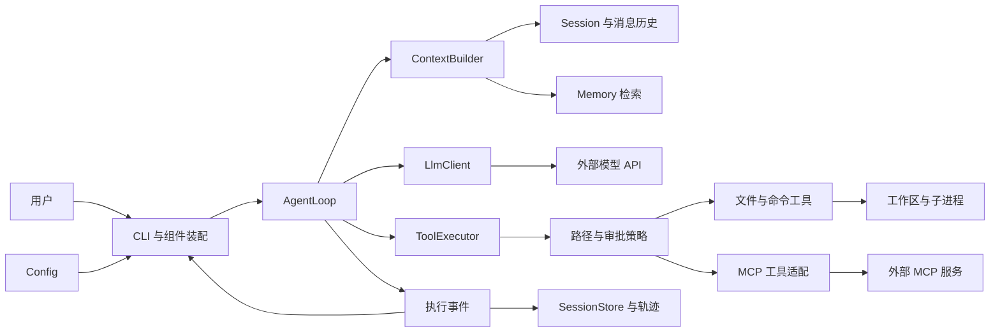

# CodeY

使用 Java 从零构建 CLI 编程 Agent，通过实际实现理解 Claude Code、Codex 等编程 Agent 的工作原理。

目标闭环：**接收任务 → 探索代码 → 修改文件 → 执行测试 → 根据结果继续修复 → 输出结果与验证证据**。

## 当前进度

当前已完成多模型 Profile 配置、消息模型、基础提示词、非流式模型调用、本地会话保存/恢复，以及基础 Agent 工具循环。无参数或 `--chat` 展示所有工作区最近 10 条会话，支持分页、新建、标题/ID 恢复、改名、可选工作区和自动标题。`--prompt` 执行无工作区的单条任务。SSE、内容搜索/写入/命令工具、长期记忆和 MCP 尚待实现；已使用本地模拟模型验证，真实厂商兼容性需另行验证。

工作区会话已注册 `list_files`、`search_file` 与 `read_file`：模型可浏览目录，或按文件名/路径模式直接定位文件，再读取内容。工具描述通过结构化 `tools` 字段发送，由 AgentLoop 执行并回填结果，继续请求最终回答。默认每个任务最多请求模型 20 次，最后一次禁用工具用于收尾；完成的工具消息组随会话保存，恢复时不自动重放。说明见 [文件定位](docs/architecture.md#search-file)、[目录工具](docs/architecture.md#list-files)、[读文件工具](docs/architecture.md#read-file) 和 [Agent 循环](docs/architecture.md#agent-loop)。

控制台显示简洁执行进度：调用轮次、工具名称和涉及的文件，最后展示模型回答；工具失败时补充错误码。聊天中输入 `exit` 返回会话列表，列表中 `exit` 退出；`/exit` 随时退出程序。

`/help` 查看全部交互命令，`/list model` 查看供应商与各模型 ID，`/model 供应商 模型ID` 切换当前模型并保留历史；`/model 供应商` 选择该供应商配置的第一个模型。交互终端支持 Tab 补全命令、供应商与模型，多个候选可用上下键选择。默认采用最后一次成功选择的供应商与模型，重启后继续使用；首次无记录时使用 `.env` 默认值，`--profile` 可覆盖启动选择。

## 模块导航

各模块按“功能 → 涉及文件 → 调用流程 → 实现方式与边界”维护。表中的状态描述当前代码，待实现模块的流程仅为规划。

| 模块 | 状态 |
|---|---|
| [配置模块](#module-config) | 已实现：dotenv、多 Profile、模型与会话设置 |
| [工作区模块](#module-workspace) | 已实现：可选目录绑定与路径解析 |
| [提示词模块](#module-prompt) | 已实现：基础提示词资源加载 |
| [消息模型模块](#module-message) | 已实现：四种消息角色与工具调用数据 |
| [模型对话模块](#module-llm) | 已实现：非流式 Chat Completions |
| [CLI 交互模块](#module-cli) | 已实现：启动选择、输入、分页与会话命令 |
| [会话管理模块](#module-session) | 已实现：内存历史、本地保存/恢复与标题 |
| [工具模块](#module-tool) | 已实现基础结构、list_files/search_file/read_file，已接入模型和 CLI |
| [Agent 执行模块](#module-agent) | 已实现：工具循环、轮次预算、中断与完成状态 |
| [上下文模块](#module-context) | 待实现：请求组织、预算与压缩 |
| [记忆模块](#module-memory) | 待实现：长期事实保存与召回 |
| [MCP 模块](#module-mcp) | 待实现：外部工具协议与适配 |
| [权限模块](#module-policy) | 待实现：路径策略、审批与执行控制 |
| [模式切换模块](#module-mode) | 已实现会话内模型切换；PLAN/AGENT 运行模式待实现 |
| [可观测性模块](#module-observability) | 已实现简洁控制台进度；事件、指标与持久化轨迹待实现 |

## 技术基线

- Java 17、Maven 单模块。
- 基础包：`io.github.jackfeicoder.codey`。
- 使用 JDK HttpClient 调用兼容 Chat Completions 的接口，Jackson 2.18.2 处理 JSON。
- 使用 JLine 3.30.17 编辑终端输入，补全命令和模型参数，支持候选菜单选择。
- Maven Shade 将运行依赖打入可执行 JAR。
- 第一版聚焦单 Agent；上下文、持久化、MCP 按阶段加入。

## 架构概览

以下为目标架构。当前实现了配置、消息、内存 Session、本地 JSON 快照、会话恢复和 CLI 非流式对话；图中的 Agent、工具执行事件及长期记忆按路线逐步实现。



| 模块 | 职责 |
|---|---|
| CLI / Config | 接收输入、加载配置、装配组件与展示结果 |
| Agent | 维护执行循环、预算、取消与任务完成状态 |
| LLM | 编码请求、调用模型、解析 SSE 并返回完整响应 |
| Tool / Policy | 注册工具、校验参数与权限、执行文件和命令操作 |
| Context | 每轮选择、组织和压缩模型需要的信息 |
| Session | 保存消息历史、工具结果与执行状态 |
| Memory | 保存和召回带项目范围的长期事实与约定 |
| MCP | 接入外部工具服务，复用统一工具执行流程 |
| Observability | 记录执行轨迹、Token、耗时与验证证据 |

这些组件共同构成 CodeY 的 Agent Harness：模型决定下一步行动，Java 程序维护状态、执行工具并检查结果。

## 当前调用流程与目标闭环

当前会话的实际流程：

```text
Main → 注册工具 / 加载会话设置 → SessionLauncher 展示历史
  → 新建/恢复：选择工作区与模型配置，创建或恢复 SessionService
  → 用户问题 → ChatCli.answer → AgentLoop.run
  → Session.messagesFor + Registry.definitions → LlmRequest(messages, tools)
  → ChatCompletionsClient.generate → 工具请求：Executor 执行 / 回填 → 再请求
  → 最终回答：Session.completeAgentTurn → SessionService.captureTurn/save
  → 首轮无手动标题：独立生成标题或保留首问摘要，再保存
```

以上是当前已接通的只读工具闭环。下面是后续加入修改、验证、流式与上下文预算后的目标流程：

1. 用户输入任务，创建独立的运行上下文并追加用户消息。
2. 构建本轮上下文，加入规则、历史、相关记忆和工具定义。
3. 调用模型，展示文本增量，并组装完整文本与工具调用。
4. 如果存在工具调用，校验参数和权限，执行后将结果回填消息，再进入下一轮。
5. 如果模型返回最终回答，按任务类型检查验收证据；代码修改任务需要约定的编译或测试结果。
6. 返回完整结果、验证摘要与明确状态：完成、未完成、失败、取消或预算耗尽。

当前工具按顺序执行，会话保存完整文本/工具轮次；流式展示、完整执行事件、上下文筛选和长期记忆后续补充。

完整流程图、时序图和恢复策略见 [架构设计](docs/architecture.md)。

## 模块说明

以下介绍主要业务文件；各包的 `package-info.java` 用于职责声明。测试按相同包结构放在 `src/test/java`，完整设计与验收条件在架构文档中维护。

<a id="module-config"></a>

### 1. 配置模块：config

**功能**：读取启动目录 `.env` 和进程环境，解析多模型 Profile，选择默认或指定配置并校验；读取会话存储位置、建议工作区与自动标题开关。

**涉及文件**：

| 文件 | 职责 |
|---|---|
| [ConfigLoader.java](src/main/java/io/github/jackfeicoder/codey/config/ConfigLoader.java) | 配置加载入口，合并来源、解析别名、转换模型字段 |
| [DotEnvReader.java](src/main/java/io/github/jackfeicoder/codey/config/DotEnvReader.java) | 按 UTF-8 解析单行键值、引号、注释和 `export`；定位格式错误 |
| [ModelProfiles.java](src/main/java/io/github/jackfeicoder/codey/config/ModelProfiles.java) | 不可变配置快照，列出别名、按需构建配置、先校验再选择 |
| [ProfileSelection.java](src/main/java/io/github/jackfeicoder/codey/config/ProfileSelection.java) | 解析 `供应商 [模型ID]`，别名忽略大小写、模型 ID 保持原样，兼容旧选择记录 |
| [ModelPreferenceStore.java](src/main/java/io/github/jackfeicoder/codey/config/ModelPreferenceStore.java) | 用户级 model-preference.json，保存最后选择的别名和模型 ID；有界读取与原子替换 |
| [LlmConfig.java](src/main/java/io/github/jackfeicoder/codey/config/LlmConfig.java) | 强类型模型地址、认证、模型 ID 与超时；打印时隐藏密钥 |
| [AuthMode.java](src/main/java/io/github/jackfeicoder/codey/config/AuthMode.java) | 表达 Bearer 认证或无需认证的 NONE 模式 |
| [SessionSettings.java](src/main/java/io/github/jackfeicoder/codey/config/SessionSettings.java) | 加载数据目录、建议工作区、自动标题设置，不保存模型凭证 |
| [AgentSettings.java](src/main/java/io/github/jackfeicoder/codey/config/AgentSettings.java) | 启动时加载任务模型请求预算与目录工具默认深度，校验范围后由 Main 注入 |
| [ConfigException.java](src/main/java/io/github/jackfeicoder/codey/config/ConfigException.java) | 表达读取/字段校验错误，供 CLI 展示 |
| [.env.example](.env.example) | 可填写字段模板；实际运行加载 `.env`，模板不作为有效配置 |

**调用流程**：

```text
Main / SessionLauncher 的模型工厂
  → ConfigLoader.loadProfiles(启动目录, 环境, 指定别名)
  → DotEnvReader.read(.env) → 合并环境变量 → ModelProfiles
  → activeConfig()/configFor(alias) → 字段转换与校验 → LlmConfig
会话设置：Main → SessionSettings.load → 数据目录/建议工作区/标题开关
运行设置：Main → AgentSettings.load → AgentLoop(maxIterations) / ListFilesTool(defaultDepth)
```

Agent 运行参数也读取同一配置目录，优先级为进程环境 > `.env` > 默认值：

```dotenv
CODEY_MAX_ITERATIONS=20
CODEY_LIST_FILES_DEFAULT_DEPTH=10
```

轮次范围为 1–100，每条用户任务重新计算，包含最后一次只回答的请求；默认最多 19 轮工具探索加 1 轮收尾。目录深度范围为 1–20，表示模型省略 `maxDepth` 时的默认值；模型仍可显式指定其他合法深度。当前项目最深 Java 文件在第 10 层，提示词在第 5 层。修改这两个字段后重启 CodeY，`/model` 只重载模型配置。`--check-config` 会一并显示已解析的运行设置。

**实现方式与边界**：字段优先级为进程环境 > `.env` > 默认值，空环境值也覆盖文件值。`.env` 默认来自启动目录，显式 `CODEY_CONFIG_DIR` 可指定共享配置目录；相对数据目录以配置目录为基准，工作区仍以启动目录定位。首次选择为 `--profile` > 最后选择 > 会话保存别名（恢复时）> `CODEY_ACTIVE_PROFILE`；后续 `/new` 使用最后选择。别名来自 `CODEY_PROFILE_NAMES`，字段按 `CODEY_PROFILE_别名_*` 解析；无多 Profile 时兼容 `CODEY_LLM_*`。目录只展示本地配置状态，不探测远端。

`CODEY_PROFILE_*_MODEL` 支持英文逗号分隔的多个模型 ID，模型共用该 Profile 的地址、密钥、认证和超时；省略模型 ID 时选择第一个。`ModelProfiles` 拆分列表、校验目标 ID 属于该供应商，再生成仅含一个模型的 `LlmConfig`，HTTP 层与 AgentLoop 保持原调用方式。空项、重复模型 ID 和含空白的 ID 报错，模型 ID 区分大小写。配置模型不代表平台权限、协议和工具能力已通过远端验证。

`ModelProfiles.select()` 返回新快照；`/model` 在用户输入边界重新加载配置并替换客户端，不修改 `.env`。最后选择保存到 `CODEY_DATA_DIR/model-preference.json`，只含版本与 `供应商 模型ID`，保存失败会单独提示；旧单别名记录仍可读取。当前未加载 `application.yml`，dotenv 不做变量插值、多行值或转义展开，没有自动热更新。

<a id="module-workspace"></a>

### 2. 工作区模块：workspace

**功能**：为每个会话绑定一个目录，或明确选择无工作区的普通聊天；验证路径，恢复时检查原目录是否仍有效。

**涉及文件**：

| 文件 | 职责 |
|---|---|
| [WorkspaceBinding.java](src/main/java/io/github/jackfeicoder/codey/workspace/WorkspaceBinding.java) | `DIRECTORY` 保存绝对路径，`NONE` 表示普通聊天，提供展示文本 |
| [WorkspaceResolver.java](src/main/java/io/github/jackfeicoder/codey/workspace/WorkspaceResolver.java) | 相对启动目录解析路径，校验真实目录与可读性；检查恢复时的可用性 |

**调用流程**：

```text
/new 或 --workspace → SessionLauncher → WorkspaceResolver.resolve
  → WorkspaceBinding → SessionSnapshot 保存绑定
恢复：SessionLauncher → WorkspaceResolver.available → 沿用原目录或提示失效
工具可用性：ToolContext.hasWorkspace → Registry 筛选 / Executor 检查
```

**实现方式与边界**：使用 `Path.toRealPath()` 处理相对段与现有链接，支持带空格的目录；不要求 Git 仓库或目录可写。`NONE` 没有目录字段，不用当前目录冒充普通聊天。选工作区不修改进程目录，也不改变 `.env` 的查找位置。绑定目录本身不扫描项目；列目录与读取由具体工具执行，统一路径策略和进程隔离属于后续权限模块。

<a id="module-prompt"></a>

### 3. 提示词模块：prompt

**功能**：将基础提示词从代码中提取为资源，按 UTF-8 加载，并作为 system 消息提供给模型。

**涉及文件**：

| 文件 | 职责 |
|---|---|
| [PromptLoader.java](src/main/java/io/github/jackfeicoder/codey/prompt/PromptLoader.java) | 从 classpath 读取基础提示词，支持开发目录与打包 JAR |
| [PromptException.java](src/main/java/io/github/jackfeicoder/codey/prompt/PromptException.java) | 表达缺失、空白或读取失败 |
| [base.md](src/main/resources/prompts/base.md) | 编程助手身份、回复习惯、依据与操作结果要求 |

**调用流程**：

```text
Main / SessionLauncher → PromptLoader.loadBase
  → classpath /prompts/base.md → Message.system → LlmRequest
新会话 → SessionSnapshot 保存提示词快照和 hash → 恢复时只注入一次
```

**实现方式与边界**：直接发送 Markdown 原文，不转换 HTML。加载用资源流，不依赖运行时的源码目录；基础资源缺失或为空时在发请求前报错。所有 Profile 共用基础提示词，修改后重新打包即可。历史会话沿用创建时的快照，发现 hash 变化会提示。

工具名称、描述与参数 schema 放在 `ToolDefinition`，已通过请求 `tools` 字段发送；基础提示词仅写使用指导、不维护另一份工具清单。工具输出按待分析的数据处理。标题生成的专用指令目前在 `SessionTitleGenerator` 内。项目 `AGENTS.md`、提示词组合和模式模板尚待接入，详见 [提示词设计](docs/architecture.md#prompt-design)。

<a id="module-message"></a>

### 4. 消息模型模块：session / tool 的共享数据

**功能**：用统一数据结构表达系统指令、用户输入、模型回答、工具调用及结果，为 LLM、会话与后续 Agent 提供共同消息契约。

**涉及文件**：

| 文件 | 职责 |
|---|---|
| [Message.java](src/main/java/io/github/jackfeicoder/codey/session/Message.java) | 不可变消息，提供 system/user/assistant/tool 工厂方法并检查单条角色约束 |
| [MessageRole.java](src/main/java/io/github/jackfeicoder/codey/session/MessageRole.java) | 四种角色及对应协议字符串 |
| [ToolCall.java](src/main/java/io/github/jackfeicoder/codey/tool/ToolCall.java) | 保存调用 ID、工具名与原始 JSON 参数字符串，不代表已执行 |

**调用流程**：

```text
基础提示词/用户输入 → Message → LlmRequest → 协议 JSON
模型响应 → assistant Message（可含 ToolCall）→ LlmResponse
后续执行结果 → ToolResult.toMessage → Message.tool(原调用 ID, 结果正文)
```

**实现方式与边界**：使用 Java record，复制传入列表。只有 assistant 可带工具调用，只有 tool 可带 `toolCallId`；同一 assistant 的调用 ID 不重复。纯工具请求允许没有文本，空工具输出允许为空字符串。`MessageHistory` 进一步校验轮次顺序、同一任务 ID 唯一、所有结果配对以及最终回答；会话与磁盘快照已支持完整工具消息组。

<a id="module-llm"></a>

### 5. 模型对话模块：llm

**功能**：通过统一接口调用兼容 Chat Completions 的模型服务，编码消息、发送 HTTP、解析完整回答、工具请求、结束原因和可选 Token 用量。

**涉及文件**：

| 文件 | 职责 |
|---|---|
| [LlmClient.java](src/main/java/io/github/jackfeicoder/codey/llm/LlmClient.java) | 声明 `generate(LlmRequest)`，上层通过接口使用客户端 |
| [ChatCompletionsClient.java](src/main/java/io/github/jackfeicoder/codey/llm/ChatCompletionsClient.java) | 当前 HTTP/JSON 实现，每个实例绑定一套模型配置 |
| [LlmRequest.java](src/main/java/io/github/jackfeicoder/codey/llm/LlmRequest.java) | 保存不可修改的消息与工具定义列表，拒绝重复名称；单参数构造兼容无工具请求 |
| [LlmResponse.java](src/main/java/io/github/jackfeicoder/codey/llm/LlmResponse.java) | 保存 assistant 消息、结束原因、TokenUsage，提供文本/工具/截断判断 |
| [LlmException.java](src/main/java/io/github/jackfeicoder/codey/llm/LlmException.java) | 区分 HTTP、网络、超时、中断、请求/响应格式和模型拒绝等错误 |

**调用流程**：

```text
AgentLoop / SessionTitleGenerator
  → LlmRequest → LlmClient.generate
  → encode：model/messages/stream=false/可选 tools → POST BASE_URL/chat/completions
  → 检查 HTTP 状态 → decode：首个 assistant/finish_reason/usage → LlmResponse
```

**实现方式与边界**：共享 JDK HttpClient，按认证模式添加 Bearer 头或不添加认证头；默认不跟随重定向。Jackson 显式映射消息与工具调用字段，拒绝重复 JSON 键、尾随内容和不完整工具参数。`sendAsync` 后限时等待完整响应，因此对调用者仍是同步非流式；超时取消 future，中断恢复线程标志。异常不附带原始服务商正文或可能泄露凭证的底层异常。

兼容同一协议的服务使用配置选择，无需按厂商名称新建实现；协议差异出现时通过新 `LlmClient` 适配。工具定义显式编码为 `tools[].type/function.name/description/parameters`，无工具时省略字段；普通轮次使用协议默认工具选择，最后一次请求设置 `tool_choice="none"` 用于收尾。生成参数、SSE 和自动重试尚未接入；`isRetryable()` 只是分类提示。Token 用量解析后可通过响应读取，CLI 尚未统一展示或统计。

<a id="module-cli"></a>

### 6. CLI 交互模块：cli

**功能**：解析启动参数，展示全局历史列表，处理输入、新建/恢复/改名/分页等命令，装配组件并显示模型回答和错误。

**涉及文件**：

| 文件 | 职责 |
|---|---|
| [Main.java](src/main/java/io/github/jackfeicoder/codey/cli/Main.java) | 参数解析与组件装配，提供帮助、配置操作、单次请求和会话入口 |
| [bin/codey.cmd](bin/codey.cmd) | Windows 全局命令入口，定位 JAR、转发参数、保留调用目录并设置默认配置目录 |
| [SessionLauncher.java](src/main/java/io/github/jackfeicoder/codey/cli/SessionLauncher.java) | 管理列表/聊天状态，选择工作区、延迟校验模型，协调会话切换和标题任务 |
| [ChatCli.java](src/main/java/io/github/jackfeicoder/codey/cli/ChatCli.java) | `answer()` 调用 AgentLoop、展示状态并提交完整成功轮次；`run()` 保留给内存调用者，生产入口使用 Launcher |
| [ConsoleInput.java](src/main/java/io/github/jackfeicoder/codey/cli/ConsoleInput.java) | 原生终端使用 JLine 编辑与补全，管道/测试使用 BufferedReader，关闭时恢复终端状态 |
| [CommandCatalog.java](src/main/java/io/github/jackfeicoder/codey/cli/CommandCatalog.java) | `/help` 与补全共享命令名称、用法和说明 |
| [CommandCompleter.java](src/main/java/io/github/jackfeicoder/codey/cli/CommandCompleter.java) | 按输入词位置补全命令、供应商及该供应商下的模型，仅读取本地目录 |

**调用流程**：

```text
Main 解析参数
  ├─ --help/--version：直接展示
  ├─ --list-models/--check-config：只做本地配置操作
  ├─ --prompt：临时 Session + 无工作区 → AgentLoop → 展示回答
  └─ 无参数/--chat：注册 list_files/search_file/read_file → SessionLauncher → ChatCli.answer → AgentLoop
```

**实现方式与边界**：列表模式的普通文本匹配序号、完整标题或唯一 ID 前缀；聊天模式的普通文本就是问题，切换用 `/resume`。最近每批 10 条，分页持有稳定列表快照，`/sessions` 才刷新；重名与前缀冲突展示候选项。查看列表和历史预览不要求模型凭证，准备继续时才校验。交互终端使用 JLine 3.30.17 与 JNI provider，Tab 唯一匹配直接补全，多个匹配进入菜单，方向键或 Tab 选择、Enter 确认，再 Enter 执行。Ctrl+C 取消当前编辑，EOF 保存退出。路径/标题等辅助输入不提示命令，不启用 shell 转义或 `!` 历史展开。管道/IDE 无原生控制台时使用 UTF-8 逐行输入，不启用补全。未知斜杠命令不发模型请求。命令表和启动例子见 [构建与启动](#build-run)。

<a id="module-session"></a>

### 7. 会话管理模块：session

**功能**：保存本次内存历史，给每个会话分配 ID、标题、工作区与模型别名；每轮成功后落盘，重启恢复，支持改名与一次自动标题生成。

**涉及文件**：

| 文件 | 职责 |
|---|---|
| [Session.java](src/main/java/io/github/jackfeicoder/codey/session/Session.java) | 初始化 system、构建请求副本、提交成功轮次、清空内存和从快照恢复 |
| [MessageHistory.java](src/main/java/io/github/jackfeicoder/codey/session/MessageHistory.java) | 校验完整 user/assistant/tool 顺序与调用结果配对；阻止残缺历史提交或恢复 |
| [SessionSnapshot.java](src/main/java/io/github/jackfeicoder/codey/session/SessionSnapshot.java) | 版本化磁盘 DTO，保存元数据/基础提示词/消息，校验 UUID、标题、时间及轮次 |
| [SessionService.java](src/main/java/io/github/jackfeicoder/codey/session/SessionService.java) | 协调 Session、快照、dirty 状态与持锁读写，保存失败保留待重试内容 |
| [SessionStore.java](src/main/java/io/github/jackfeicoder/codey/session/SessionStore.java) | 存储接口，提供列表、加载和持锁 Lease；上层不绑定 JSON 文件实现 |
| [JsonSessionStore.java](src/main/java/io/github/jackfeicoder/codey/session/JsonSessionStore.java) | 单文件快照、版本检查、全局列表、独占文件锁与原子替换 |
| [SessionTitleGenerator.java](src/main/java/io/github/jackfeicoder/codey/session/SessionTitleGenerator.java) | 独立首问标题请求，限制输入与标题长度，失败返回本地摘要 |
| [SessionException.java](src/main/java/io/github/jackfeicoder/codey/session/SessionException.java) | 表达存储、格式、锁和版本冲突，不回显 JSON 正文 |

**调用流程**：

```text
新建：Launcher → SessionService.create → Snapshot + 写锁 + 初始保存
对话：Session.messagesFor(input) → AgentLoop → completeAgentTurn → captureTurn → save
恢复：标题/ID → 预览 → 检查工作区/配置 → lock/load → Session.restore → 等待新输入
标题：首轮保存摘要 → 保存已尝试标记 → 独立标题请求 → 校验/回退 → 保存
```

**实现方式与边界**：当前任务只放请求副本，收到最终回答后提交 user、工具调用/结果及最终 assistant；模型失败、中断或预算结束后仍未得到文本时不提交残缺本轮；有效收尾回答可正常保存。v2 快照支持工具轮次，旧 v1 文本记录可加载并在恢复保存时升级。UUID 是身份，标题可重复且可修改；system 单独保存在快照，恢复只注入一次。标题请求最多使用 2000 个首问码点，超时取模型配置与 5 秒中的较小值；手动标题优先，生成一次，重启不重复生成。

默认使用用户目录 `.codey/sessions/<UUID>/session.json`。同一会话持独占文件锁，每次保存检查 revision，写同目录临时文件并 force，再原子替换；文件系统不支持时明确报错。单快照上限 16 MiB，损坏记录不会覆盖为空，也不阻断其他列表项。保存失败保持 dirty，下一轮或切换前先重试。快照只记录模型别名，不序列化配置对象或密钥。

CLI 的 `/clear` 保存旧会话并创建新 ID，沿用工作区/模型，旧记录仍可恢复；不是调用 `Session.clear()` 删除持久化记录。恢复完整文本/工具对话，但不重放历史工具调用、不恢复执行中的任务或还原文件；长期记忆、工具事件与上下文压缩后续加入。更多边界见 [会话实现](docs/architecture.md#workspace-sessions)。

<a id="module-tool"></a>

### 8. 工具模块：tool（目录浏览、文件定位与读取已实现）

**功能**：将模型可见定义与 Java 执行分开，统一注册、查找、参数校验入口、工作区检查、错误结果和输出上限。`list_files` 浏览目录结构，`search_file` 按名称/路径模式定位文件，`read_file` 阅读已知文件内容。三个工具各自实现 Tool，互不调用，由模型按任务选择，均已接入工作区会话的工具循环。

**涉及文件**：

| 文件 | 职责 |
|---|---|
| [Tool.java](src/main/java/io/github/jackfeicoder/codey/tool/Tool.java) | 声明定义、是否需要工作区、具体参数校验和执行方法 |
| [ToolDefinition.java](src/main/java/io/github/jackfeicoder/codey/tool/ToolDefinition.java) | 不可变 name/description/parameters；复制 schema 防止外部修改 |
| [ToolCall.java](src/main/java/io/github/jackfeicoder/codey/tool/ToolCall.java) | 原始调用 ID、名称与 JSON 参数字符串 |
| [ToolContext.java](src/main/java/io/github/jackfeicoder/codey/tool/ToolContext.java) | 宿主工作区与输出上限，不由模型参数决定 |
| [ToolRegistry.java](src/main/java/io/github/jackfeicoder/codey/tool/ToolRegistry.java) | 按名称固定定义和实现，拒绝重复注册，按工作区筛选可用定义 |
| [ToolExecutor.java](src/main/java/io/github/jackfeicoder/codey/tool/ToolExecutor.java) | 严格解析参数对象、执行校验与工具、归一化错误、测量耗时及截断 |
| [ToolResult.java](src/main/java/io/github/jackfeicoder/codey/tool/ToolResult.java) | 成功/错误状态、输出、错误码、耗时与截断，转换为原调用 ID 的 tool 消息 |
| [ToolException.java](src/main/java/io/github/jackfeicoder/codey/tool/ToolException.java) | 工具可预期的业务失败；未知 RuntimeException 使用通用说明 |
| [builtin/ReadFileTool.java](src/main/java/io/github/jackfeicoder/codey/tool/builtin/ReadFileTool.java) | read_file 定义、参数/路径检查、UTF-8 有界分页读取及完整 JSON 输出 |
| [builtin/ListFilesTool.java](src/main/java/io/github/jackfeicoder/codey/tool/builtin/ListFilesTool.java) | list_files 参数与目录条目输出，调用共享遍历器浏览目录结构 |
| [builtin/SearchFileTool.java](src/main/java/io/github/jackfeicoder/codey/tool/builtin/SearchFileTool.java) | search_file 参数、名称/路径匹配和有界路径结果，不读取正文 |
| [filesystem/WorkspaceFiles.java](src/main/java/io/github/jackfeicoder/codey/tool/filesystem/WorkspaceFiles.java) | 目录工具共用的工作区路径校验、有界排序/遍历、忽略和链接规则 |
| [filesystem/FileGlob.java](src/main/java/io/github/jackfeicoder/codey/tool/filesystem/FileGlob.java) | 跨平台名称/路径模式匹配，支持 *、? 和独立的 ** 目录段 |
| [builtin/package-info.java](src/main/java/io/github/jackfeicoder/codey/tool/builtin/package-info.java) | 内置工具包说明；内容搜索、修改和命令工具后续加入 |

**调用流程**：

```text
宿主 register(Tool) → 固定 ToolDefinition 与 Java 实现
ToolCall → Registry.find → Executor 解析 JSON / 检查工作区
  → Tool.validateArguments → Tool.execute → ToolResult → toMessage()
模型接入：Registry.definitions(context) → LLM 请求 tools → AgentLoop 调度与回填
```

**实现方式与边界**：工具用途用自然语言 description，参数用 JSON Schema，由协议适配器编码为结构化 `tools`；MD 只适合额外行为指导。当前只验证 schema 顶层为 object，没有通用 schema 校验器，具体字段/类型/业务限制由工具的 `validateArguments()` 明确实现。

执行器拒绝重复键、尾随 JSON、非对象与超过 64 Ki 字符的参数；需要工作区的工具会检查 NONE/失效目录。默认输出最多 16000 个 Unicode 码点，截断状态单独记录。保留中断标志，不吞 JVM Error，不自动重试。当前同步执行，耗时统计不代表超时控制；统一权限策略、审批、超时与并行调度仍待接入。详见 [工具模块设计与示例](docs/architecture.md#tool-foundation)。

**读文件的参数与流程**：`path` 必填，使用工作区相对路径；`startLine` 从 1 开始，默认 1；`maxLines` 默认 200，最大 500。

```text
ToolCall("read_file", {path, startLine?, maxLines?})
  → Executor 严格解析 / 检查工作区 → ReadFileTool 参数校验
  → 工作区拼接相对路径 → 归一化和真实路径范围检查
  → 检查普通文件、大小和可读性 → 严格 UTF-8 解码 / 跳过前文 / 读取完整行
  → JSON {path, startLine, returnedLines, endLine, lines, hasMore, nextStartLine}
  → ToolResult → 对应调用 ID 的 tool 消息（后续由 Agent 回填）
```

文件及实际字节读取最多 4 MiB，单行最多 16384 个 UTF-16 单元。兼容 LF/CRLF/CR，保留文本空白，移除开头 BOM；非法编码和 NUL 报错。输出预算包含 JSON 转义和元数据，超出时提前分页，完整行放不下则明确报错。`hasMore` 表示还有后续内容，`nextStartLine` 用于继续读取；成功 JSON 不经截断。绝对路径、越界路径和指向工作区外的符号链接被拒绝，路径检查不是完整操作系统沙箱。独立调用示例和错误码见 [读文件实现](docs/architecture.md#read-file)。

**目录探索的参数与流程**：`path` 默认 `.`；`maxDepth` 默认 10、范围 1–20（默认值可由 `CODEY_LIST_FILES_DEFAULT_DEPTH` 配置），所选目录的直接子项算第 1 层；`maxEntries` 默认 200、范围 1–1000，文件和目录都占条数。

```text
ToolCall("list_files", {path?, maxDepth?, maxEntries?})
  → Executor 检查工作区与参数 → ListFilesTool 检查归一化/真实路径范围
  → 每层收集有限子项并关闭目录流 → 按名称排序 → 深度优先遍历
  → JSON {path, maxDepth, maxEntries, returnedEntries, entries, truncated, limitReason, scannedEntries, ignoredDirectoryNames}
  → 原调用 ID 的 tool 消息 → 模型选取具体文件 → read_file
```

条目包含工作区相对 `path`、`type`（file/directory/symlink/other）与相对所选目录的 `depth`，可把文件路径直接交给 read_file。默认跳过遍历中遇到的 `.git`、`target`、`node_modules`、`.gradle`、`build`、`dist` 目录；显式指定这些目录为 path 时允许查看其内容。发现的符号链接、junction 等重解析目录只列出、不递归；显式指向工作区外的路径拒绝。

最多扫描 10000 个目录项，包含被忽略项；返回结果还受条数与宿主输出预算约束。`truncated` 和 `limitReason`（maxEntries/outputLimit/scanLimit）表示请求深度内是否因预算提前停止，不表示目录总数；指定深度之外的内容未扫描。截断时应缩小 path，当前没有分页游标或 `.gitignore` 解析。扫描上限内的每层按名称排序，达到扫描上限时只处理已收集子项，不保证整个目录的完整排序。成功结果保持完整 JSON，容不下元数据或一个完整条目时明确报错；权限/目录读取失败也报错，不把失败伪装为空目录。实现与边界见 [目录工具设计](docs/architecture.md#list-files)。

**文件定位的参数与流程**：`pattern` 必填；`path` 默认 `.`；不设置人为目录深度限制，也不接受 `maxDepth`；`maxResults` 默认 100、最大 1000；`caseSensitive` 默认 false，跨平台行为一致。这个工具采用前面讨论的 glob 文件定位语义，统一命名为 `search_file`，不再增加同义的 `glob_files` 或 `search_files`。

```text
ToolCall("search_file", {pattern, path?, maxResults?, caseSensitive?})
  → Executor 检查工作区与参数 → SearchFileTool 校验并构造 FileGlob
  → WorkspaceFiles 校验目录 / 有界遍历 → 只筛选普通文件的名称或相对路径
  → JSON {pattern, path, files, returnedFiles, truncated, limitReason, scannedEntries, ...}
  → 原调用 ID 的 tool 消息 → 模型按需调用 read_file
```

`AgentLoop.java` 精确匹配任意层同名文件；`*Config*.java` 按名称模式定位；`**/prompts/*.md` 定位提示词。模式不含 `/` 时只匹配文件名，包含 `/` 时相对搜索起点匹配；`*` 不跨目录，`?` 匹配一个 Unicode 字符，独立的 `**` 目录段可匹配零层或多层。Windows 的反斜杠模式也会统一为 `/`。不做模糊词义、正文或正则搜索，`[]` 和 `{}` 按字面字符处理。需要名称包含 Config 时显式写 `*Config*`，不会把 `Config` 自动改成包含匹配。

结果 `files` 始终是工作区相对路径，可直接交给 read_file；目录、发现的符号链接和 junction 不作为命中，也不进入其目标。扫描上限/忽略规则与 list_files 共用；从搜索起点遍历到目录末端，底层使用显式栈避免受 Java 递归调用层数影响；条数、输出或扫描上限触发时标记 `truncated`，`limitReason` 为 maxResults/outputLimit/scanLimit。空结果仅说明已检查范围内没有匹配。成功输出保持完整 JSON。共享底层能力而不共享工具职责，不强制“先列目录才能查名称”。详见 [文件定位工具](docs/architecture.md#search-file)。后续 `grep_code` 单独负责文件内容搜索。

<a id="module-agent"></a>

### 9. Agent 执行模块：agent（基础循环已实现）

**功能**：维护“模型决策 → 工具执行 → 结果回填 → 再决策”的 ReAct 风格循环，管理模型请求次数、单步工具数量、中断与完成状态；不要求模型输出内部思考过程。

**涉及文件**：

| 文件 | 职责 |
|---|---|
| [AgentLoop.java](src/main/java/io/github/jackfeicoder/codey/agent/AgentLoop.java) | `run(Session, input, context)` 在历史副本上请求模型、发送定义、校验工具组、顺序执行和回填 |
| [AgentResult.java](src/main/java/io/github/jackfeicoder/codey/agent/AgentResult.java) | 保存状态、本轮消息、最终响应及模型/工具调用次数；结果列表不可修改 |
| [agent/package-info.java](src/main/java/io/github/jackfeicoder/codey/agent/package-info.java) | 循环包的职责及提交边界 |

**调用流程**：

```text
Main 注册工具 → Launcher/ChatCli 装配 AgentLoop 与当前工作区
  → run：Session.messagesFor(input) 获取请求副本
  → for 每个允许步骤：Registry.definitions(context) → LlmRequest → generate
      ├─ 最终文本：COMPLETED → CLI 展示 / Session 提交 / Store 保存
      └─ tool_calls：校验整组 → 追加 assistant → 执行各工具 / 追加各 tool → 下一步
  → 剩余 3/2 次时临时提醒预算；最后一次发送 tool_choice=none，只允许回答
      ├─ 有效总结：COMPLETED + budgetLimited → 提示预算受限，保存完整消息组
      └─ 服务商仍返回工具：BUDGET_EXHAUSTED → 不执行、不追加该调用、不提交残缺历史
```

**实现方式与边界**：默认最多请求模型 20 次，由 `CODEY_MAX_ITERATIONS` 配置，包含最终回答请求；临近上限通过临时 system 副本提醒，最后一次通过协议与执行器双重禁用工具。有效收尾回答与完整工具消息一并保存，CLI 提示预算受限；预算提示本身不进入历史。每个响应最多执行 16 个工具。整组执行前检查结束原因与跨步骤 ID 重复，截断的工具请求不执行。未知工具、业务参数错误与读取失败均回填关联错误，允许模型修正；网络/协议错误和线程中断沿 `LlmException` 退出，原历史保持完整。非空文本长度截断可保存并显示提示。空正文或纯空白且无工具调用时按 INVALID_RESPONSE 报错，不打印空 CodeY 回答、不提交本轮；不自动重试。COMPLETED 表示模型返回非空最终文本，并不证明代码修改或测试验收已完成。暂无线程外工具超时、任务总时间/Token 预算、重复无进展检测、流式或执行中恢复。详见 [循环实现与验收](docs/architecture.md#agent-loop)。

<a id="module-context"></a>

### 10. 上下文模块：context（待实现）

**功能（目标）**：组织基础规则、项目指令、历史、工具结果和记忆，控制 Token 预算，筛选与压缩长历史。

**涉及文件**：目前只有 [context/package-info.java](src/main/java/io/github/jackfeicoder/codey/context/package-info.java)，ContextBuilder、预算和压缩类尚未实现。

**调用流程（计划）**：Session/规则/工具定义/记忆 → ContextBuilder → 筛选与预算 → LlmRequest。

**实现方式（计划）**：构建请求副本，保留完整历史，压缩时保留目标、约束和完整工具消息组。目前由 `Session.messagesFor()` 发送全部成功历史，没有 Token 裁剪或摘要；这只是基础上下文组织。

<a id="module-memory"></a>

### 11. 记忆模块：memory（待实现）

**功能（目标）**：保存可跨会话复用的用户偏好、项目约定与事实，并按项目范围召回；不直接把所有聊天记录当作长期记忆。

**涉及文件**：目前只有 [memory/package-info.java](src/main/java/io/github/jackfeicoder/codey/memory/package-info.java)，记忆条目、存储和检索类后续补充。

**调用流程（计划）**：明确保存的信息 → 记忆条目与来源/范围 → 存储；当前问题/项目 → 召回 → ContextBuilder。

**实现方式（计划）**：先简单本地事实存储，提供范围、来源、时间及删除机制，有检索需求后再考虑其他存储。现有会话 JSON 是对话历史，不是已经实现的长期记忆。

<a id="module-mcp"></a>

### 12. MCP 模块：mcp（待实现）

**功能（目标）**：连接外部 MCP 服务，发现工具并把外部调用适配到统一工具接口。

**涉及文件**：目前只有 [mcp/package-info.java](src/main/java/io/github/jackfeicoder/codey/mcp/package-info.java)，客户端、传输与工具适配器尚未实现。

**调用流程（计划）**：配置服务 → 连接/初始化 → 发现工具 → 注册适配工具 → ToolExecutor → 外部服务 → ToolResult。

**实现方式（计划）**：先 stdio 与 JSON-RPC，处理请求 ID、响应匹配、超时和关闭，再扩展其他传输；具体协议版本与支持能力在接入时验证。已有 ToolRegistry 不代表已经接入 MCP。

<a id="module-policy"></a>

### 13. 权限模块：policy（待实现）

**功能（目标）**：在工具执行前落实文件路径范围、读写/命令策略和需要的审批，不靠提示词文字授予权限。

**涉及文件**：目前只有 [policy/package-info.java](src/main/java/io/github/jackfeicoder/codey/policy/package-info.java)，路径策略、执行策略及审批组件尚未实现。

**调用流程（计划）**：ToolCall + 工作区/模式 → 执行策略/路径校验 → 必要审批 → 执行或明确拒绝结果。

**实现方式（计划）**：先处理文件路径与读写分类，再加入命令审批和进程隔离。已有真实目录检查、工具是否需要工作区的判断只是基础前置条件，不是完整路径权限或沙箱。

<a id="module-mode"></a>

### 14. 模型与模式切换（模型切换已实现，尚未独立建包）

**功能**：会话内切换模型、保留完整消息历史，默认采用最后选择。PLAN/AGENT 运行行为与工具能力切换后续实现。

**涉及文件**：ModelProfiles 提供目录和配置校验；Main 装配客户端工厂；SessionLauncher 管理 `/model`、`/list model` 和 `/help`；SessionService 保存会话别名；ModelPreferenceStore 保存默认选择。真实文件见对应模块，目前没有独立模式管理类。

**调用流程**：`/model 供应商 [模型ID]` → 查找该供应商的模型列表/校验配置/创建客户端 → switchProfile 持锁保存完整选择 → 替换聊天/标题客户端 → 保存默认偏好。下一条输入继续携带同一 Session 的文本和工具历史。

**实现方式与边界**：配置或会话保存失败时保留旧模型；默认偏好保存失败不撤销已完成的会话切换，会报告重启默认可能未保存。切换不调用模型、不重放旧工具、不清空历史、不重生成标题。新模型通过请求获得历史，不依赖内部记忆；上下文容量及提供商兼容性仍需实际验证。PLAN 策略后续实现。详见 [模型命令](docs/architecture.md#model-commands)。

<a id="module-observability"></a>

### 15. 可观测性模块：observability（简洁进度已实现）

**功能**：查看每轮模型调用、实际调用的工具与涉及文件，等待执行时可看到进度；最终回答和必要错误由 CLI 展示。

**涉及文件**：

| 文件 | 职责 |
|---|---|
| [DebugPrinter.java](src/main/java/io/github/jackfeicoder/codey/observability/DebugPrinter.java) | 一行显示轮次/工具/文件，失败显示错误码；摘要立即刷新、长名称有界 |
| [observability/package-info.java](src/main/java/io/github/jackfeicoder/codey/observability/package-info.java) | 当前打印能力与后续事件/指标的职责说明 |

**调用流程**：Main 创建 DebugPrinter → AgentLoop 请求前打印轮次 → 执行工具前打印名称与 path → 失败打印错误码 → CLI 展示最终回答。

**实现方式与边界**：直接在执行位置加打印，不建立事件观察接口。Main 默认启用，旧核心构造方式默认静默；LLM 适配器不打印 HTTP 正文。工具摘要只提取 path，成功不展示工具正文，失败只展示类别；完整结果仍回填模型并随成功轮次保存。提示词、历史、原始响应和认证头不作为日志输出。自动标题请求不计入 ReAct 次数。进度不进入会话消息、不生成额外日志文件；统一指标与事件存储后续加入。详见 [简洁控制台输出](docs/architecture.md#console-debug)。

## 项目目录

```text
codeY/
├── bin/codey.cmd
├── README.md
├── pom.xml
├── .env.example
├── docs/
│   ├── architecture.md           # 完整设计、配置、路线与学习笔记
│   └── diagrams/                 # 可编辑 Mermaid 图
└── src/
    ├── main/
    │   ├── java/io/github/jackfeicoder/codey/
    │   │   ├── cli/
    │   │   ├── config/
    │   │   ├── prompt/
    │   │   ├── agent/
    │   │   ├── llm/
    │   │   ├── tool/builtin/
    │   │   ├── context/
    │   │   ├── session/
    │   │   ├── workspace/
    │   │   ├── memory/
    │   │   ├── mcp/
    │   │   ├── policy/
    │   │   └── observability/
    │   └── resources/prompts/
    │       └── base.md
    └── test/
        ├── java/io/github/jackfeicoder/codey/
        └── resources/fixtures/
```

详细目录与运行时数据布局见 [架构设计](docs/architecture.md)。

## 开发路线

| 阶段 | 目标 | 状态 |
|---|---|---|
| M0 | 工程、入口与设计文档 | 已完成 |
| M1 | LLM 调用与 SSE 流式输出 | 进行中：配置、消息、非流式调用与连续对话已完成 |
| M2 | Agent 循环与只读工具 | list_files、search_file、read_file、tools 请求、基础循环与工具历史已完成；grep_code 内容搜索待实现 |
| M3 | 修改代码、执行命令与验证闭环 | 待实现 |
| M4 | 上下文预算与历史压缩 | 待实现 |
| M5 | 会话恢复与项目记忆 | 文本/工具对话保存恢复已实现；执行中恢复与长期记忆待实现 |
| M6 | MCP 工具接入 | 待实现 |
| M7 | 固定任务评估与项目展示 | 待实现 |

每阶段的验收标准见 [开发路线](docs/architecture.md#roadmap)，配套学习问题见 [面试学习笔记](docs/architecture.md#interview)。

<a id="build-run"></a>

## 构建与启动

<a id="global-cmd"></a>

### Windows CMD 全局命令

[bin/codey.cmd](bin/codey.cmd) 可从任意目录定位本仓库的 JAR。先在项目目录执行 `mvn package`，然后将 `E:\Desktop\github\codeY\bin` 加入当前用户 Path，重新打开 CMD：

```cmd
codey
codey --help
codey --chat --workspace .
codey --chat --no-workspace
```

`codey` 打开全局会话列表，可 `/new` 开始新对话。`--workspace .` 使用调用时的当前目录，脚本不切换目录。脚本默认临时设置 `CODEY_CONFIG_DIR` 为仓库根目录，因此共用项目 `.env`；用户已设置该变量时保留指定配置。相对 `CODEY_DATA_DIR` 以配置目录为基准，跨工作区仍共用历史与默认模型。

当前 CMD 窗口尚未刷新 PATH 时，可以临时启用：

```cmd
set "PATH=E:\Desktop\github\codeY\bin;%PATH%"
codey
```

脚本只负责启动与参数转发，不自动编译；代码修改后重新 `mvn package` 更新 JAR。Java 17+ 需要在 PATH 中。`exit` 和 `/exit` 的语义与原入口一致；配置错误等进程退出码原样传递。仓库移动或版本号改变后需更新对应路径/脚本。

需要 JDK 17+ 和 Maven 3.9+。首次构建需要下载 Maven 插件。

```shell
mvn clean verify
java -jar target/codey-0.1.0-SNAPSHOT.jar
java -jar target/codey-0.1.0-SNAPSHOT.jar --help
java -jar target/codey-0.1.0-SNAPSHOT.jar --version
java -jar target/codey-0.1.0-SNAPSHOT.jar --check-config
java -jar target/codey-0.1.0-SNAPSHOT.jar --list-models
java -jar target/codey-0.1.0-SNAPSHOT.jar --check-config --profile qwen
java -jar target/codey-0.1.0-SNAPSHOT.jar --prompt "你好，介绍一下你自己"
java -jar target/codey-0.1.0-SNAPSHOT.jar --prompt "解释 Java record" --profile qwen
java -jar target/codey-0.1.0-SNAPSHOT.jar --chat
java -jar target/codey-0.1.0-SNAPSHOT.jar --chat --profile qwen
java -jar target/codey-0.1.0-SNAPSHOT.jar --chat --workspace "E:\projects\demo" --title "项目开发"
java -jar target/codey-0.1.0-SNAPSHOT.jar --chat --no-workspace
java -jar target/codey-0.1.0-SNAPSHOT.jar --chat --resume "项目开发"
```

构建生成的 JAR 已包含 Jackson 与 JLine 运行依赖，直接使用 `java -jar` 即可。`--prompt` 执行无工作区任务；`--chat` 每轮发送基础提示词、成功历史和当前问题，工作区会话提供 list_files/search_file/read_file。两种入口展示简洁调用进度，都会向选中平台发送真实请求；输出被截断时提示 `finish_reason=length`。

启动列表接受已显示序号、完整标题或唯一 ID 前缀（至少 8 位）。进入会话后普通文本就是问题；重名/前缀冲突会显示候选项。每行一个问题，终端使用 Console 编码，重定向输入输出使用 UTF-8。

| 命令 | 功能 |
|---|---|
| `/help` | 查看全部交互命令，不调用模型 |
| `/list model` | 显示配置别名、模型 ID、本地配置状态和当前/默认选择 |
| `/model`、`/model 供应商 [模型ID]` | 查看当前模型，或切换当前会话并保留完整历史；省略 ID 选择该供应商第一个模型 |
| `/new` | 保留当前记录，选择工作区或普通聊天，输入标题（留空自动生成） |
| `/more_session` | 在列表追加下一批 10 条；会话中使用则打开列表第一页 |
| `/sessions`、`/resume` | 刷新全局最近列表，保持当前会话可返回 |
| `/resume 标题或ID` | 切换到明确选择的历史会话 |
| `/rename 新标题` | 修改标题，ID 与消息不变 |
| `/back` | 从历史列表返回当前会话，或取消新建输入 |
| `/clear` | 保存旧会话，新建 ID，沿用工作区和模型；旧历史仍可恢复 |
| `exit` | 聊天中先保存并返回列表，可 `/back` 继续；列表中退出程序 |
| `/exit` 或 EOF | 保存待写快照并退出 |

每条任务得到最终回答后保存完整文本/工具消息组；模型失败、中断或预算结束后仍未得到文本的任务不入历史；有效收尾回答与完整工具消息会保存，并显示预算提示。默认存储为 Java `user.home` 下的 `.codey/sessions/<UUID>/session.json`；可以在启动目录 `.env` 中设置 `CODEY_DATA_DIR=E:/codey-data`。标题可手动填写或 `/rename`；留空时首轮成功后额外调用模型生成一次，最多等待 5 秒，失败保留本地摘要。`CODEY_AUTO_TITLE=false` 可关闭额外调用。标题请求不加入对话历史。

恢复沿用原工作区，模型默认采用最后选择，无用户偏好时才参考保存别名；`--profile` 可覆盖首次选择。目录失效仍可查看历史，配置无效时要求另选别名。工作区选择不改变 `.env` 查找目录。会话文件不保存凭证；同一会话只允许一个进程写入，保存失败会先提示重试。

当前恢复完整文本/工具会话，不重放旧工具调用；尚无执行中任务恢复、长期记忆、Token 预算或历史压缩。切换模型后全部历史仍随请求发送；较长时可 `/clear` 开始新会话。旧会话沿用保存的基础提示词，可 `/clear` 或 `/new` 采用新版。

读取工作区文件示例：

```shell
java -jar target/codey-0.1.0-SNAPSHOT.jar --chat --workspace E:/Desktop/github/codeY --title 了解项目
```

进入后输入“请看看配置功能是怎么实现的”。模型可先用 `list_files` 了解结构，或用 `search_file` 按名称定位，再用 `read_file` 阅读；目录探索有深度、扫描量与输出限制，需要时继续查看具体子目录。当前没有按内容搜索、修改文件或执行命令的工具。旧会话保留旧系统提示词，`/new` 或 `/clear` 可加载最新工具使用指导。

基础提示词位于 [src/main/resources/prompts/base.md](src/main/resources/prompts/base.md)。PromptLoader 从 classpath 按 UTF-8 读取全文，Main 将其作为 system 消息注入请求；所有模型 Profile 共用。修改提示词后执行 `mvn package` 更新 JAR。资源缺失或空白时会在发送请求前报告提示词错误。设计与后续扩展见 [Prompt 模块](docs/architecture.md#prompt-design)。

`--check-config` 需要有效配置，但不调用模型。首次配置时复制 `.env.example` 为启动目录 `.env`，已有文件时手工补充字段。字段来源为 **系统环境变量 > .env > 默认值**；模型选择为 **--profile > 最后选择 > 会话保存别名（恢复时）> CODEY_ACTIVE_PROFILE**。旧版 `CODEY_LLM_*` 仍兼容，`--prompt` 成功也更新默认，列表和检查不改默认。完整语法见 [配置说明](docs/architecture.md#configuration)。

## 设计文档

[完整设计文档](docs/architecture.md) 集中包含架构与目录、模块接口、执行流程、配置与多模型选择、开发验收、设计决策和面试学习笔记。

[工作区与历史会话实现](docs/architecture.md#workspace-sessions) 记录全局列表、分页、标题/ID 恢复、工作区、本地快照与自动标题的实现方式和后续边界。

学习代码可从 [阅读顺序与当前调用流程](docs/architecture.md#code-guide) 开始。主代码和测试已补充中文类、方法、字段及关键变量注释；构建配置和环境模板也有用途说明。

## 验证与文档维护

最近一次完整构建 `mvn verify` 共 415 项测试通过，无失败、错误或跳过。文件定位模块现有 42 项真实目录测试与 1 项 Agent 组合测试，覆盖名称/路径匹配、大小写/Unicode、无正文读取、工作区/链接边界、旧深度参数拒绝、超过 20 层的定位，以及条数/扫描/输出限制；既有目录工具 30 项测试全部通过共享遍历回归。另通过 7 组本地 HTTP JAR 场景：生产注册与搜索→读取→回答/保存、跨进程恢复不重放、无工作区单次/会话隐藏工具、越界错误回填、结果条数限制、真实仓库十层 Java 路径和提示词目录发现、超过 20 层定位且 list_files 仍保留深度控制。测试配置与会话全部隔离，没有调用真实厂商。此前运行参数、工具、模型切换、终端补全与 CMD 启动验证记录保留在设计文档。 空最终回答处理新增 7 项测试，覆盖工具后空正文/纯空白、预算末轮和 length 空正文、CLI 错误提示及后续输入；打包 HTTP 场景另验证空回答不保存、429 不自动重试与成功历史保留。

后续每完成或调整模块，同步维护模块导航和对应章节的四项内容：

1. 功能与当前状态：说明实际可用能力，明确规划边界。
2. 涉及文件：链接真实文件，解释各类的职责；计划类不当作现有文件列出。
3. 调用流程：写清调用入口、关键方法、输入输出及与其他模块的关系。
4. 实现方式与边界：记录实现机制、重要取舍、失败处理与适用验证。

README 是按模块阅读与上手的入口；[架构设计](docs/architecture.md) 保留完整方案、接口细节、验收条件和面试笔记。说明性文档继续维护这两份，提示词资源独立用于运行。

## 学习方式

每完成一个阶段，都补充运行方法、执行证据和设计取舍。参考 PaiCLI 的工程场景与 Hello-Agents 的教学思路，用自己的实现验证理解。

参考项目和维护约定统一记录在设计文档中。
