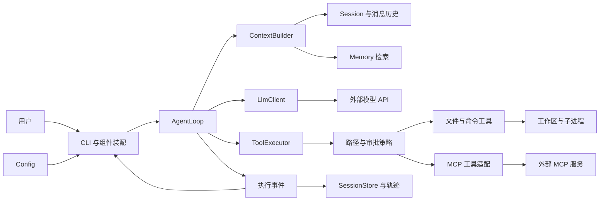

# CodeY

使用 Java 从零构建 CLI 编程 Agent，通过实际实现理解 Claude Code、Codex 等编程 Agent 的工作原理。

目标闭环：**接收任务 → 探索代码 → 修改文件 → 执行测试 → 根据结果继续修复 → 输出结果与验证证据**。

## 当前进度

当前已完成多模型 Profile 配置、消息模型、基础提示词、非流式模型调用和本地会话保存/恢复。无参数或 `--chat` 展示所有工作区最近 10 条会话，支持分页、新建、标题/ID 恢复、改名、可选工作区和自动标题。`--prompt` 保留单次调用。SSE、Agent 循环、工具执行、长期记忆和 MCP 尚待实现；已使用本地模拟模型验证，真实厂商兼容性需另行验证。

工具模块骨架已加入：Tool、ToolDefinition、ToolContext、ToolRegistry、ToolExecutor、ToolResult、ToolException，复用现有 ToolCall。支持注册、JSON 对象解析、工具参数校验契约、工作区检查和有界结果；CLI 尚未注册内置工具，也未发送 tools 定义或进入工具循环。说明见 [工具模块与描述](docs/architecture.md#tool-foundation)。

## 模块导航

各模块按“功能 → 涉及文件 → 调用流程 → 实现方式与边界”维护。表中的状态描述当前代码，待实现模块的流程仅为规划。

| 模块 | 状态 |
|---|---|
| [配置模块](#module-config) | 已实现：dotenv、多 Profile、模型与会话设置 |
| [工作区模块](#module-workspace) | 已实现：可选目录绑定与路径解析 |
| [提示词模块](#module-prompt) | 已实现：基础提示词资源加载 |
| [消息模型模块](#module-message) | 已实现：四种消息角色与工具调用数据 |
| [模型对话模块](#module-llm) | 已实现：非流式 Chat Completions |
| [CLI 交互模块](#module-cli) | 已实现：启动选择、输入、分页与会话命令 |
| [会话管理模块](#module-session) | 已实现：内存历史、本地保存/恢复与标题 |
| [工具模块](#module-tool) | 骨架已实现：定义、注册、同步执行与结果；内置工具待接入 |
| [Agent 执行模块](#module-agent) | 待实现：模型与工具的执行循环 |
| [上下文模块](#module-context) | 待实现：请求组织、预算与压缩 |
| [记忆模块](#module-memory) | 待实现：长期事实保存与召回 |
| [MCP 模块](#module-mcp) | 待实现：外部工具协议与适配 |
| [权限模块](#module-policy) | 待实现：路径策略、审批与执行控制 |
| [模式切换模块](#module-mode) | 待实现：会话内模型切换与运行模式 |
| [可观测性模块](#module-observability) | 待实现：统一事件、指标与轨迹 |

## 技术基线

- Java 17、Maven 单模块。
- 基础包：`io.github.jackfeicoder.codey`。
- 使用 JDK HttpClient 调用兼容 Chat Completions 的接口，Jackson 2.18.2 处理 JSON。
- Maven Shade 将运行依赖打入可执行 JAR。
- 第一版聚焦单 Agent；上下文、持久化、MCP 按阶段加入。

## 架构概览

以下为目标架构。当前实现了配置、消息、内存 Session、本地 JSON 快照、会话恢复和 CLI 非流式对话；图中的 Agent、工具执行事件及长期记忆按路线逐步实现。



| 模块 | 职责 |
|---|---|
| CLI / Config | 接收输入、加载配置、装配组件与展示结果 |
| Agent | 维护执行循环、预算、取消与任务完成状态 |
| LLM | 编码请求、调用模型、解析 SSE 并返回完整响应 |
| Tool / Policy | 注册工具、校验参数与权限、执行文件和命令操作 |
| Context | 每轮选择、组织和压缩模型需要的信息 |
| Session | 保存消息历史、工具结果与执行状态 |
| Memory | 保存和召回带项目范围的长期事实与约定 |
| MCP | 接入外部工具服务，复用统一工具执行流程 |
| Observability | 记录执行轨迹、Token、耗时与验证证据 |

这些组件共同构成 CodeY 的 Agent Harness：模型决定下一步行动，Java 程序维护状态、执行工具并检查结果。

## 当前调用流程与目标闭环

当前文本会话的实际流程：

```text
Main → 加载会话设置 → SessionLauncher 展示历史
  → 新建/恢复：选择工作区与模型配置，创建或恢复 SessionService
  → 用户问题 → ChatCli.answer → Session.messagesFor → LlmRequest
  → ChatCompletionsClient.generate → LlmResponse
  → 普通回答：Session.completeTurn → SessionService.captureTurn/save
  → 首轮无手动标题：独立生成标题或保留首问摘要，再保存
```

工具模块目前可通过 Java 注册并执行测试工具；现有 CLI 未连接它。下面是后续 Agent 闭环的目标流程：

1. 用户输入任务，创建独立的运行上下文并追加用户消息。
2. 构建本轮上下文，加入规则、历史、相关记忆和工具定义。
3. 调用模型，展示文本增量，并组装完整文本与工具调用。
4. 如果存在工具调用，校验参数和权限，执行后将结果回填消息，再进入下一轮。
5. 如果模型返回最终回答，按任务类型检查验收证据；代码修改任务需要约定的编译或测试结果。
6. 返回完整结果、验证摘要与明确状态：完成、未完成、失败、取消或预算耗尽。

目标实现中工具按顺序执行，流式展示保留完整返回值；当前会话只保存成功文本轮次，完整执行事件、上下文筛选和长期记忆后续补充。

完整流程图、时序图和恢复策略见 [架构设计](docs/architecture.md)。

## 模块说明

以下介绍主要业务文件；各包的 `package-info.java` 用于职责声明。测试按相同包结构放在 `src/test/java`，完整设计与验收条件在架构文档中维护。

<a id="module-config"></a>

### 1. 配置模块：config

**功能**：读取启动目录 `.env` 和进程环境，解析多模型 Profile，选择默认或指定配置并校验；读取会话存储位置、建议工作区与自动标题开关。

**涉及文件**：

| 文件 | 职责 |
|---|---|
| [ConfigLoader.java](src/main/java/io/github/jackfeicoder/codey/config/ConfigLoader.java) | 配置加载入口，合并来源、解析别名、转换模型字段 |
| [DotEnvReader.java](src/main/java/io/github/jackfeicoder/codey/config/DotEnvReader.java) | 按 UTF-8 解析单行键值、引号、注释和 `export`；定位格式错误 |
| [ModelProfiles.java](src/main/java/io/github/jackfeicoder/codey/config/ModelProfiles.java) | 不可变配置快照，列出别名、按需构建配置、先校验再选择 |
| [LlmConfig.java](src/main/java/io/github/jackfeicoder/codey/config/LlmConfig.java) | 强类型模型地址、认证、模型 ID 与超时；打印时隐藏密钥 |
| [AuthMode.java](src/main/java/io/github/jackfeicoder/codey/config/AuthMode.java) | 表达 Bearer 认证或无需认证的 NONE 模式 |
| [SessionSettings.java](src/main/java/io/github/jackfeicoder/codey/config/SessionSettings.java) | 加载数据目录、建议工作区、自动标题设置，不保存模型凭证 |
| [ConfigException.java](src/main/java/io/github/jackfeicoder/codey/config/ConfigException.java) | 表达读取/字段校验错误，供 CLI 展示 |
| [.env.example](.env.example) | 可填写字段模板；实际运行加载 `.env`，模板不作为有效配置 |

**调用流程**：

```text
Main / SessionLauncher 的模型工厂
  → ConfigLoader.loadProfiles(启动目录, 环境, 指定别名)
  → DotEnvReader.read(.env) → 合并环境变量 → ModelProfiles
  → activeConfig()/configFor(alias) → 字段转换与校验 → LlmConfig
会话设置：Main → SessionSettings.load → 数据目录/建议工作区/标题开关
```

**实现方式与边界**：字段优先级为进程环境 > `.env` > 默认值，空环境值也覆盖文件值。新会话的模型选择为 `--profile` > `CODEY_ACTIVE_PROFILE`，恢复时为 `--profile` > 保存的别名；别名缺失或配置无效时要求明确选择，不静默更换。别名来自 `CODEY_PROFILE_NAMES`，字段按 `CODEY_PROFILE_别名_*` 解析；未声明多 Profile 时兼容 `CODEY_LLM_*`。选中时才校验完整模型配置，备用配置未填齐不阻塞其他模型。

`ModelProfiles.select()` 返回新快照，不修改文件或正在进行的请求。当前未加载 `application.yml`，dotenv 不做变量插值、多行值或转义展开；会话内 `/model` 与自动热更新尚未实现。

<a id="module-workspace"></a>

### 2. 工作区模块：workspace

**功能**：为每个会话绑定一个目录，或明确选择无工作区的普通聊天；验证路径，恢复时检查原目录是否仍有效。

**涉及文件**：

| 文件 | 职责 |
|---|---|
| [WorkspaceBinding.java](src/main/java/io/github/jackfeicoder/codey/workspace/WorkspaceBinding.java) | `DIRECTORY` 保存绝对路径，`NONE` 表示普通聊天，提供展示文本 |
| [WorkspaceResolver.java](src/main/java/io/github/jackfeicoder/codey/workspace/WorkspaceResolver.java) | 相对启动目录解析路径，校验真实目录与可读性；检查恢复时的可用性 |

**调用流程**：

```text
/new 或 --workspace → SessionLauncher → WorkspaceResolver.resolve
  → WorkspaceBinding → SessionSnapshot 保存绑定
恢复：SessionLauncher → WorkspaceResolver.available → 沿用原目录或提示失效
工具可用性：ToolContext.hasWorkspace → Registry 筛选 / Executor 检查
```

**实现方式与边界**：使用 `Path.toRealPath()` 处理相对段与现有链接，支持带空格的目录；不要求 Git 仓库或目录可写。`NONE` 没有目录字段，不用当前目录冒充普通聊天。选工作区不修改进程目录，也不改变 `.env` 的查找位置。当前只绑定目录，不扫描或操作项目；工具路径限制和进程隔离属于后续权限模块。

<a id="module-prompt"></a>

### 3. 提示词模块：prompt

**功能**：将基础提示词从代码中提取为资源，按 UTF-8 加载，并作为 system 消息提供给模型。

**涉及文件**：

| 文件 | 职责 |
|---|---|
| [PromptLoader.java](src/main/java/io/github/jackfeicoder/codey/prompt/PromptLoader.java) | 从 classpath 读取基础提示词，支持开发目录与打包 JAR |
| [PromptException.java](src/main/java/io/github/jackfeicoder/codey/prompt/PromptException.java) | 表达缺失、空白或读取失败 |
| [base.md](src/main/resources/prompts/base.md) | 编程助手身份、回复习惯、依据与操作结果要求 |

**调用流程**：

```text
Main / SessionLauncher → PromptLoader.loadBase
  → classpath /prompts/base.md → Message.system → LlmRequest
新会话 → SessionSnapshot 保存提示词快照和 hash → 恢复时只注入一次
```

**实现方式与边界**：直接发送 Markdown 原文，不转换 HTML。加载用资源流，不依赖运行时的源码目录；基础资源缺失或为空时在发请求前报错。所有 Profile 共用基础提示词，修改后重新打包即可。历史会话沿用创建时的快照，发现 hash 变化会提示。

工具名称、描述与参数 schema 放在 `ToolDefinition`，后续经请求 `tools` 字段发送；基础提示词不维护另一份工具清单。标题生成的专用指令目前在 `SessionTitleGenerator` 内。项目 `AGENTS.md`、提示词组合和模式模板尚待接入，详见 [提示词设计](docs/architecture.md#prompt-design)。

<a id="module-message"></a>

### 4. 消息模型模块：session / tool 的共享数据

**功能**：用统一数据结构表达系统指令、用户输入、模型回答、工具调用及结果，为 LLM、会话与后续 Agent 提供共同消息契约。

**涉及文件**：

| 文件 | 职责 |
|---|---|
| [Message.java](src/main/java/io/github/jackfeicoder/codey/session/Message.java) | 不可变消息，提供 system/user/assistant/tool 工厂方法并检查单条角色约束 |
| [MessageRole.java](src/main/java/io/github/jackfeicoder/codey/session/MessageRole.java) | 四种角色及对应协议字符串 |
| [ToolCall.java](src/main/java/io/github/jackfeicoder/codey/tool/ToolCall.java) | 保存调用 ID、工具名与原始 JSON 参数字符串，不代表已执行 |

**调用流程**：

```text
基础提示词/用户输入 → Message → LlmRequest → 协议 JSON
模型响应 → assistant Message（可含 ToolCall）→ LlmResponse
后续执行结果 → ToolResult.toMessage → Message.tool(原调用 ID, 结果正文)
```

**实现方式与边界**：使用 Java record，复制传入列表。只有 assistant 可带工具调用，只有 tool 可带 `toolCallId`；同一 assistant 的调用 ID 不重复。纯工具请求允许没有文本，空工具输出允许为空字符串。消息类型已支持工具，但当前文本会话与磁盘快照只提交普通 user/assistant 轮次；完整工具消息组的历史校验与保存还需接 Agent 时扩展。

<a id="module-llm"></a>

### 5. 模型对话模块：llm

**功能**：通过统一接口调用兼容 Chat Completions 的模型服务，编码消息、发送 HTTP、解析完整回答、工具请求、结束原因和可选 Token 用量。

**涉及文件**：

| 文件 | 职责 |
|---|---|
| [LlmClient.java](src/main/java/io/github/jackfeicoder/codey/llm/LlmClient.java) | 声明 `generate(LlmRequest)`，上层通过接口使用客户端 |
| [ChatCompletionsClient.java](src/main/java/io/github/jackfeicoder/codey/llm/ChatCompletionsClient.java) | 当前 HTTP/JSON 实现，每个实例绑定一套模型配置 |
| [LlmRequest.java](src/main/java/io/github/jackfeicoder/codey/llm/LlmRequest.java) | 保存不可修改的本轮消息列表 |
| [LlmResponse.java](src/main/java/io/github/jackfeicoder/codey/llm/LlmResponse.java) | 保存 assistant 消息、结束原因、TokenUsage，提供文本/工具/截断判断 |
| [LlmException.java](src/main/java/io/github/jackfeicoder/codey/llm/LlmException.java) | 区分 HTTP、网络、超时、中断、请求/响应格式和模型拒绝等错误 |

**调用流程**：

```text
Main 单次入口 / ChatCli.answer / SessionTitleGenerator
  → LlmRequest → LlmClient.generate
  → encode：model/messages/stream=false → POST BASE_URL/chat/completions
  → 检查 HTTP 状态 → decode：首个 assistant/finish_reason/usage → LlmResponse
```

**实现方式与边界**：共享 JDK HttpClient，按认证模式添加 Bearer 头或不添加认证头；默认不跟随重定向。Jackson 显式映射消息与工具调用字段，拒绝重复 JSON 键、尾随内容和不完整工具参数。`sendAsync` 后限时等待完整响应，因此对调用者仍是同步非流式；超时取消 future，中断恢复线程标志。异常不附带原始服务商正文或可能泄露凭证的底层异常。

兼容同一协议的服务使用配置选择，无需按厂商名称新建实现；协议差异出现时通过新 `LlmClient` 适配。当前请求只有 messages，`tools` schema、生成参数、SSE 和自动重试尚未接入；`isRetryable()` 只是分类提示。Token 用量解析后可通过响应读取，CLI 尚未统一展示或统计。

<a id="module-cli"></a>

### 6. CLI 交互模块：cli

**功能**：解析启动参数，展示全局历史列表，处理输入、新建/恢复/改名/分页等命令，装配组件并显示模型回答和错误。

**涉及文件**：

| 文件 | 职责 |
|---|---|
| [Main.java](src/main/java/io/github/jackfeicoder/codey/cli/Main.java) | 参数解析与组件装配，提供帮助、配置操作、单次请求和会话入口 |
| [SessionLauncher.java](src/main/java/io/github/jackfeicoder/codey/cli/SessionLauncher.java) | 管理列表/聊天状态，选择工作区、延迟校验模型，协调会话切换和标题任务 |
| [ChatCli.java](src/main/java/io/github/jackfeicoder/codey/cli/ChatCli.java) | `answer()` 处理一次文本轮次并展示结果；`run()` 保留给内存调用者，生产入口使用 Launcher |

**调用流程**：

```text
Main 解析参数
  ├─ --help/--version：直接展示
  ├─ --list-models/--check-config：只做本地配置操作
  ├─ --prompt：构建 system/user，独立请求一次
  └─ 无参数/--chat：SessionLauncher → 列表选择或新建 → ChatCli.answer
```

**实现方式与边界**：列表模式的普通文本匹配序号、完整标题或唯一 ID 前缀；聊天模式的普通文本就是问题，切换用 `/resume`。最近每批 10 条，分页持有稳定列表快照，`/sessions` 才刷新；重名与前缀冲突展示候选项。查看列表和历史预览不要求模型凭证，准备继续时才校验。终端通过 Console 处理编码，重定向输入输出使用 UTF-8；未知斜杠命令不发模型请求。命令表和启动例子见 [构建与启动](#build-run)。

<a id="module-session"></a>

### 7. 会话管理模块：session

**功能**：保存本次内存历史，给每个会话分配 ID、标题、工作区与模型别名；每轮成功后落盘，重启恢复，支持改名与一次自动标题生成。

**涉及文件**：

| 文件 | 职责 |
|---|---|
| [Session.java](src/main/java/io/github/jackfeicoder/codey/session/Session.java) | 初始化 system、构建请求副本、提交成功轮次、清空内存和从快照恢复 |
| [SessionSnapshot.java](src/main/java/io/github/jackfeicoder/codey/session/SessionSnapshot.java) | 版本化磁盘 DTO，保存元数据/基础提示词/消息，校验 UUID、标题、时间及轮次 |
| [SessionService.java](src/main/java/io/github/jackfeicoder/codey/session/SessionService.java) | 协调 Session、快照、dirty 状态与持锁读写，保存失败保留待重试内容 |
| [SessionStore.java](src/main/java/io/github/jackfeicoder/codey/session/SessionStore.java) | 存储接口，提供列表、加载和持锁 Lease；上层不绑定 JSON 文件实现 |
| [JsonSessionStore.java](src/main/java/io/github/jackfeicoder/codey/session/JsonSessionStore.java) | 单文件快照、版本检查、全局列表、独占文件锁与原子替换 |
| [SessionTitleGenerator.java](src/main/java/io/github/jackfeicoder/codey/session/SessionTitleGenerator.java) | 独立首问标题请求，限制输入与标题长度，失败返回本地摘要 |
| [SessionException.java](src/main/java/io/github/jackfeicoder/codey/session/SessionException.java) | 表达存储、格式、锁和版本冲突，不回显 JSON 正文 |

**调用流程**：

```text
新建：Launcher → SessionService.create → Snapshot + 写锁 + 初始保存
对话：Session.messagesFor(input) → LLM → completeTurn → captureTurn → save
恢复：标题/ID → 预览 → 检查工作区/配置 → lock/load → Session.restore → 等待新输入
标题：首轮保存摘要 → 保存已尝试标记 → 独立标题请求 → 校验/回退 → 保存
```

**实现方式与边界**：当前问题只放请求副本，收到普通回答后才提交 user/assistant；调用失败和未执行工具请求不污染历史。UUID 是身份，标题可重复且可修改；system 单独保存在快照，恢复只注入一次。标题请求最多使用 2000 个首问码点，超时取模型配置与 5 秒中的较小值；手动标题优先，生成一次，重启不重复生成。

默认使用用户目录 `.codey/sessions/<UUID>/session.json`。同一会话持独占文件锁，每次保存检查 revision，写同目录临时文件并 force，再原子替换；文件系统不支持时明确报错。单快照上限 16 MiB，损坏记录不会覆盖为空，也不阻断其他列表项。保存失败保持 dirty，下一轮或切换前先重试。快照只记录模型别名，不序列化配置对象或密钥。

CLI 的 `/clear` 保存旧会话并创建新 ID，沿用工作区/模型，旧记录仍可恢复；不是调用 `Session.clear()` 删除持久化记录。当前恢复文本，不还原文件、重启旧进程或重放命令；长期记忆、工具事件与上下文压缩后续加入。更多边界见 [会话实现](docs/architecture.md#workspace-sessions)。

<a id="module-tool"></a>

### 8. 工具模块：tool（骨架已实现）

**功能**：将模型可见定义与 Java 执行分开，统一注册、查找、参数校验入口、工作区检查、错误结果和输出上限。目前使用测试工具验证，CLI 未注册内置工具。

**涉及文件**：

| 文件 | 职责 |
|---|---|
| [Tool.java](src/main/java/io/github/jackfeicoder/codey/tool/Tool.java) | 声明定义、是否需要工作区、具体参数校验和执行方法 |
| [ToolDefinition.java](src/main/java/io/github/jackfeicoder/codey/tool/ToolDefinition.java) | 不可变 name/description/parameters；复制 schema 防止外部修改 |
| [ToolCall.java](src/main/java/io/github/jackfeicoder/codey/tool/ToolCall.java) | 原始调用 ID、名称与 JSON 参数字符串 |
| [ToolContext.java](src/main/java/io/github/jackfeicoder/codey/tool/ToolContext.java) | 宿主工作区与输出上限，不由模型参数决定 |
| [ToolRegistry.java](src/main/java/io/github/jackfeicoder/codey/tool/ToolRegistry.java) | 按名称固定定义和实现，拒绝重复注册，按工作区筛选可用定义 |
| [ToolExecutor.java](src/main/java/io/github/jackfeicoder/codey/tool/ToolExecutor.java) | 严格解析参数对象、执行校验与工具、归一化错误、测量耗时及截断 |
| [ToolResult.java](src/main/java/io/github/jackfeicoder/codey/tool/ToolResult.java) | 成功/错误状态、输出、错误码、耗时与截断，转换为原调用 ID 的 tool 消息 |
| [ToolException.java](src/main/java/io/github/jackfeicoder/codey/tool/ToolException.java) | 工具可预期的业务失败；未知 RuntimeException 使用通用说明 |
| [builtin/package-info.java](src/main/java/io/github/jackfeicoder/codey/tool/builtin/package-info.java) | 内置工具包占位，read_file/list_files/search_text 等尚待实现 |

**调用流程**：

```text
宿主 register(Tool) → 固定 ToolDefinition 与 Java 实现
ToolCall → Registry.find → Executor 解析 JSON / 检查工作区
  → Tool.validateArguments → Tool.execute → ToolResult → toMessage()
后续模型接入：Registry.definitions(context) → LLM 请求 tools → AgentLoop 调度
```

**实现方式与边界**：工具用途用自然语言 description，参数用 JSON Schema，后续由协议适配器编码为结构化 `tools`；MD 只适合额外行为指导。当前只验证 schema 顶层为 object，没有通用 schema 校验器，具体字段/类型/业务限制由工具的 `validateArguments()` 明确实现。

执行器拒绝重复键、尾随 JSON、非对象与超过 64 Ki 字符的参数；需要工作区的工具会检查 NONE/失效目录。默认输出最多 16000 个 Unicode 码点，截断状态单独记录；具体工具仍需限制实际读取量。保留中断标志，不吞 JVM Error，不自动重试。当前同步执行，耗时统计不代表超时控制；路径范围、审批、超时、并行调度、真实内置工具与 Agent 回填仍待接入。详见 [工具模块设计与示例](docs/architecture.md#tool-foundation)。

<a id="module-agent"></a>

### 9. Agent 执行模块：agent（待实现）

**功能（目标）**：维护“模型决策 → 工具执行 → 结果回填 → 再决策”的循环，管理轮次、时间预算、取消与任务完成状态。

**涉及文件**：目前只有 [agent/package-info.java](src/main/java/io/github/jackfeicoder/codey/agent/package-info.java) 的职责声明，没有 AgentLoop 等业务类；实现后逐个补充真实文件说明。

**调用流程（计划）**：CLI → AgentLoop → 上下文/LLM → ToolExecutor → assistant/tool 消息组 → 下一轮或完成。

**实现方式（计划）**：先单 Agent、串行工具、明确轮次上限；工具结果与调用 ID 配对，正常回答和执行证据分开判断。当前连续聊天循环不等同于已经实现工具 Agent 循环。

<a id="module-context"></a>

### 10. 上下文模块：context（待实现）

**功能（目标）**：组织基础规则、项目指令、历史、工具结果和记忆，控制 Token 预算，筛选与压缩长历史。

**涉及文件**：目前只有 [context/package-info.java](src/main/java/io/github/jackfeicoder/codey/context/package-info.java)，ContextBuilder、预算和压缩类尚未实现。

**调用流程（计划）**：Session/规则/工具定义/记忆 → ContextBuilder → 筛选与预算 → LlmRequest。

**实现方式（计划）**：构建请求副本，保留完整历史，压缩时保留目标、约束和完整工具消息组。目前由 `Session.messagesFor()` 发送全部成功历史，没有 Token 裁剪或摘要；这只是基础上下文组织。

<a id="module-memory"></a>

### 11. 记忆模块：memory（待实现）

**功能（目标）**：保存可跨会话复用的用户偏好、项目约定与事实，并按项目范围召回；不直接把所有聊天记录当作长期记忆。

**涉及文件**：目前只有 [memory/package-info.java](src/main/java/io/github/jackfeicoder/codey/memory/package-info.java)，记忆条目、存储和检索类后续补充。

**调用流程（计划）**：明确保存的信息 → 记忆条目与来源/范围 → 存储；当前问题/项目 → 召回 → ContextBuilder。

**实现方式（计划）**：先简单本地事实存储，提供范围、来源、时间及删除机制，有检索需求后再考虑其他存储。现有会话 JSON 是对话历史，不是已经实现的长期记忆。

<a id="module-mcp"></a>

### 12. MCP 模块：mcp（待实现）

**功能（目标）**：连接外部 MCP 服务，发现工具并把外部调用适配到统一工具接口。

**涉及文件**：目前只有 [mcp/package-info.java](src/main/java/io/github/jackfeicoder/codey/mcp/package-info.java)，客户端、传输与工具适配器尚未实现。

**调用流程（计划）**：配置服务 → 连接/初始化 → 发现工具 → 注册适配工具 → ToolExecutor → 外部服务 → ToolResult。

**实现方式（计划）**：先 stdio 与 JSON-RPC，处理请求 ID、响应匹配、超时和关闭，再扩展其他传输；具体协议版本与支持能力在接入时验证。已有 ToolRegistry 不代表已经接入 MCP。

<a id="module-policy"></a>

### 13. 权限模块：policy（待实现）

**功能（目标）**：在工具执行前落实文件路径范围、读写/命令策略和需要的审批，不靠提示词文字授予权限。

**涉及文件**：目前只有 [policy/package-info.java](src/main/java/io/github/jackfeicoder/codey/policy/package-info.java)，路径策略、执行策略及审批组件尚未实现。

**调用流程（计划）**：ToolCall + 工作区/模式 → 执行策略/路径校验 → 必要审批 → 执行或明确拒绝结果。

**实现方式（计划）**：先处理文件路径与读写分类，再加入命令审批和进程隔离。已有真实目录检查、工具是否需要工作区的判断只是基础前置条件，不是完整路径权限或沙箱。

<a id="module-mode"></a>

### 14. 模式切换模块（待实现，尚未独立建包）

**功能（目标）**：支持会话内模型切换，以及后续 PLAN/AGENT 等运行行为与工具能力切换。模型选择、运行模式与审批策略分别定义。

**涉及文件**：目前 [ModelProfiles.java](src/main/java/io/github/jackfeicoder/codey/config/ModelProfiles.java) 提供不可变选择接口，[Main.java](src/main/java/io/github/jackfeicoder/codey/cli/Main.java) 和 [SessionLauncher.java](src/main/java/io/github/jackfeicoder/codey/cli/SessionLauncher.java) 支持启动/恢复时选择。没有独立模式管理类，也没有 `/model` 命令。

**调用流程（计划）**：切换命令 → 校验目标配置/模式 → 轮次边界更新客户端或工具策略 → 重建相应上下文。

**实现方式（计划）**：失败保留原状态，不修改正在进行的请求。PLAN 的可用工具范围由代码定义，模式提示词只描述行为；`WorkspaceBinding.Mode` 的 DIRECTORY/NONE 只是目录绑定状态，不代表已经实现 PLAN/AGENT。

<a id="module-observability"></a>

### 15. 可观测性模块：observability（待实现）

**功能（目标）**：统一记录请求与工具事件、Token、耗时和任务验证证据，支持排查与评估。

**涉及文件**：目前只有 [observability/package-info.java](src/main/java/io/github/jackfeicoder/codey/observability/package-info.java)，事件发布、轨迹存储和指标聚合类尚未实现。

**调用流程（计划）**：LLM/工具/Agent 事件 → 脱敏与聚合 → CLI 展示/本地轨迹 → 评估结果。

**实现方式（计划）**：区分用户输出、调试事件和持久化轨迹。当前 LlmResponse 已有可选 Token 用量，ToolResult 已有耗时，但没有统一统计、日志系统或完整执行事件存储。

## 项目目录

```text
codeY/
├── README.md
├── pom.xml
├── .env.example
├── docs/
│   ├── architecture.md           # 完整设计、配置、路线与学习笔记
│   └── diagrams/                 # 可编辑 Mermaid 图
└── src/
    ├── main/
    │   ├── java/io/github/jackfeicoder/codey/
    │   │   ├── cli/
    │   │   ├── config/
    │   │   ├── prompt/
    │   │   ├── agent/
    │   │   ├── llm/
    │   │   ├── tool/builtin/
    │   │   ├── context/
    │   │   ├── session/
    │   │   ├── workspace/
    │   │   ├── memory/
    │   │   ├── mcp/
    │   │   ├── policy/
    │   │   └── observability/
    │   └── resources/prompts/
    │       └── base.md
    └── test/
        ├── java/io/github/jackfeicoder/codey/
        └── resources/fixtures/
```

详细目录与运行时数据布局见 [架构设计](docs/architecture.md)。

## 开发路线

| 阶段 | 目标 | 状态 |
|---|---|---|
| M0 | 工程、入口与设计文档 | 已完成 |
| M1 | LLM 调用与 SSE 流式输出 | 进行中：配置、消息、非流式调用与连续对话已完成 |
| M2 | Agent 循环与只读工具 | 工具基础结构已完成，内置工具与循环待实现 |
| M3 | 修改代码、执行命令与验证闭环 | 待实现 |
| M4 | 上下文预算与历史压缩 | 待实现 |
| M5 | 会话恢复与项目记忆 | 文本会话保存/恢复已提前实现；工具状态与记忆待实现 |
| M6 | MCP 工具接入 | 待实现 |
| M7 | 固定任务评估与项目展示 | 待实现 |

每阶段的验收标准见 [开发路线](docs/architecture.md#roadmap)，配套学习问题见 [面试学习笔记](docs/architecture.md#interview)。

<a id="build-run"></a>

## 构建与启动

需要 JDK 17+ 和 Maven 3.9+。首次构建需要下载 Maven 插件。

```shell
mvn clean verify
java -jar target/codey-0.1.0-SNAPSHOT.jar
java -jar target/codey-0.1.0-SNAPSHOT.jar --help
java -jar target/codey-0.1.0-SNAPSHOT.jar --version
java -jar target/codey-0.1.0-SNAPSHOT.jar --check-config
java -jar target/codey-0.1.0-SNAPSHOT.jar --list-models
java -jar target/codey-0.1.0-SNAPSHOT.jar --check-config --profile qwen
java -jar target/codey-0.1.0-SNAPSHOT.jar --prompt "你好，介绍一下你自己"
java -jar target/codey-0.1.0-SNAPSHOT.jar --prompt "解释 Java record" --profile qwen
java -jar target/codey-0.1.0-SNAPSHOT.jar --chat
java -jar target/codey-0.1.0-SNAPSHOT.jar --chat --profile qwen
java -jar target/codey-0.1.0-SNAPSHOT.jar --chat --workspace "E:\projects\demo" --title "项目开发"
java -jar target/codey-0.1.0-SNAPSHOT.jar --chat --no-workspace
java -jar target/codey-0.1.0-SNAPSHOT.jar --chat --resume "项目开发"
```

构建生成的 JAR 已包含 Jackson 运行依赖，直接使用 `java -jar` 即可。`--prompt` 发送独立的 system/user 请求；`--chat` 每轮发送基础提示词、成功历史和当前问题，两种入口都会向选中平台发送真实请求。工具调用暂不执行，输出被截断时提示 `finish_reason=length`。

启动列表接受已显示序号、完整标题或唯一 ID 前缀（至少 8 位）。进入会话后普通文本就是问题；重名/前缀冲突会显示候选项。每行一个问题，终端使用 Console 编码，重定向输入输出使用 UTF-8。

| 命令 | 功能 |
|---|---|
| `/new` | 保留当前记录，选择工作区或普通聊天，输入标题（留空自动生成） |
| `/more_session` | 在列表追加下一批 10 条；会话中使用则打开列表第一页 |
| `/sessions`、`/resume` | 刷新全局最近列表，保持当前会话可返回 |
| `/resume 标题或ID` | 切换到明确选择的历史会话 |
| `/rename 新标题` | 修改标题，ID 与消息不变 |
| `/back` | 从历史列表返回当前会话，或取消新建输入 |
| `/clear` | 保存旧会话，新建 ID，沿用工作区和模型；旧历史仍可恢复 |
| `/exit` 或 EOF | 保存待写快照并退出 |

每轮成功回答立即保存，失败调用和未执行工具请求不入历史。默认存储为 Java `user.home` 下的 `.codey/sessions/<UUID>/session.json`；可以在启动目录 `.env` 中设置 `CODEY_DATA_DIR=E:/codey-data`。标题可手动填写或 `/rename`；留空时首轮成功后额外调用模型生成一次，最多等待 5 秒，失败保留本地摘要。`CODEY_AUTO_TITLE=false` 可关闭额外调用。标题请求不加入对话历史。

恢复使用原工作区和保存的 Profile 别名，`--profile` 可显式覆盖；目录失效仍可查看历史，模型配置缺失时提示另选别名。工作区选择不改变 `.env` 查找目录，不自动扫描项目或增加文件操作能力。会话文件不保存模型凭证；同一会话只允许一个进程写入。保存失败会明确提示并阻止下一轮模型调用，避免覆盖未保存结果。

当前恢复的是成功文本会话，尚无工具执行状态恢复、长期记忆、Token 预算或历史压缩。全部历史仍随请求发送，较长时可用 `/clear` 开始新会话。`/model` 会话内切换后续实现。职责与流程见 [Session 与连续对话](docs/architecture.md#session-chat)。

基础提示词位于 [src/main/resources/prompts/base.md](src/main/resources/prompts/base.md)。PromptLoader 从 classpath 按 UTF-8 读取全文，Main 将其作为 system 消息注入请求；所有模型 Profile 共用。修改提示词后执行 `mvn package` 更新 JAR。资源缺失或空白时会在发送请求前报告提示词错误。设计与后续扩展见 [Prompt 模块](docs/architecture.md#prompt-design)。

`--check-config` 需要选中 Profile 的有效配置，但不会调用模型。首次配置时复制 `.env.example` 为启动目录下的 `.env`，已有 `.env` 时手工补充字段；填写地址、密钥和模型。来源优先级为 **系统环境变量 > .env > 默认值**，选择优先级为 **--profile > CODEY_ACTIVE_PROFILE**。旧版 `CODEY_LLM_*` 仍兼容。完整语法、CMD/PowerShell 用法及与 `application.yml` 的关系见 [配置说明](docs/architecture.md#configuration)。

## 设计文档

[完整设计文档](docs/architecture.md) 集中包含架构与目录、模块接口、执行流程、配置与多模型选择、开发验收、设计决策和面试学习笔记。

[工作区与历史会话实现](docs/architecture.md#workspace-sessions) 记录全局列表、分页、标题/ID 恢复、工作区、本地快照与自动标题的实现方式和后续边界。

学习代码可从 [阅读顺序与当前调用流程](docs/architecture.md#code-guide) 开始。主代码和测试已补充中文类、方法、字段及关键变量注释；构建配置和环境模板也有用途说明。

## 验证与文档维护

最近一次完整构建 `mvn verify` 共 201 项测试通过，工具骨架新增 23 项。会话阶段另验证过 12 项 JAR 场景，包括重启恢复、分页、标题回退与跨进程写锁；这些验证使用临时目录和本地替身，不代表已完成真实厂商或生产内置工具验证。本次 README 更新只核对代码、文件链接与文档结构，不重新调用模型。

后续每完成或调整模块，同步维护模块导航和对应章节的四项内容：

1. 功能与当前状态：说明实际可用能力，明确规划边界。
2. 涉及文件：链接真实文件，解释各类的职责；计划类不当作现有文件列出。
3. 调用流程：写清调用入口、关键方法、输入输出及与其他模块的关系。
4. 实现方式与边界：记录实现机制、重要取舍、失败处理与适用验证。

README 是按模块阅读与上手的入口；[架构设计](docs/architecture.md) 保留完整方案、接口细节、验收条件和面试笔记。说明性文档继续维护这两份，提示词资源独立用于运行。

## 学习方式

每完成一个阶段，都补充运行方法、执行证据和设计取舍。参考 PaiCLI 的工程场景与 Hello-Agents 的教学思路，用自己的实现验证理解。

参考项目和维护约定统一记录在设计文档中。
