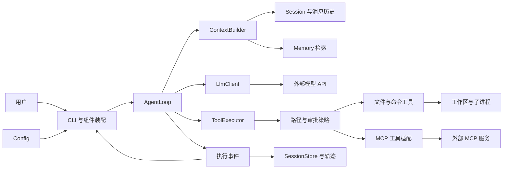

# CodeY

使用 Java 从零构建 CLI 编程 Agent，通过实际实现理解 Claude Code、Codex 等编程 Agent 的工作原理。

目标闭环：**接收任务 → 探索代码 → 修改文件 → 执行测试 → 根据结果继续修复 → 输出结果与验证证据**。

## 当前进度

当前已建立 Maven 工程、CLI 入口、模块目录和设计文档，完成多模型 Profile 配置加载、选择与校验，以及不可变消息模型（M1）。消息支持 system、user、assistant、tool 四种角色和工具调用关联。支持启动目录 `.env`、系统环境变量、`--profile` 覆盖和本地服务无认证配置；LLM 调用、Agent 循环、工具执行、记忆和 MCP 尚待实现。

## 技术基线

- Java 17、Maven 单模块。
- 基础包：`io.github.jackfeicoder.codey`。
- 首版计划采用 JDK HttpClient 接入兼容 Chat Completions 的接口，使用 Jackson 处理 JSON。
- 第一版聚焦单 Agent；上下文、持久化、MCP 按阶段加入。

## 架构概览

以下为目标架构。当前实现了工程骨架、CLI 入口和配置加载，图中的 Agent、LLM、工具及存储能力按开发路线逐步实现。



| 模块 | 职责 |
|---|---|
| CLI / Config | 接收输入、加载配置、装配组件与展示执行事件 |
| Agent | 维护执行循环、预算、取消与任务完成状态 |
| LLM | 编码请求、调用模型、解析 SSE 并返回完整响应 |
| Tool / Policy | 注册工具、校验参数与权限、执行文件和命令操作 |
| Context | 每轮选择、组织和压缩模型需要的信息 |
| Session | 保存消息历史、工具结果与执行状态 |
| Memory | 保存和召回带项目范围的长期事实与约定 |
| MCP | 接入外部工具服务，复用统一工具执行流程 |
| Observability | 记录执行轨迹、Token、耗时与验证证据 |

这些组件共同构成 CodeY 的 Agent Harness：模型决定下一步行动，Java 程序维护状态、执行工具并检查结果。

## 核心工作流程

1. 用户输入任务，创建独立的运行上下文并追加用户消息。
2. 构建本轮上下文，加入规则、历史、相关记忆和工具定义。
3. 调用模型，展示文本增量，并组装完整文本与工具调用。
4. 如果存在工具调用，校验参数和权限，执行后将结果回填消息，再进入下一轮。
5. 如果模型返回最终回答，按任务类型检查验收证据；代码修改任务需要约定的编译或测试结果。
6. 返回完整结果、验证摘要与明确状态：完成、未完成、失败、取消或预算耗尽。

首版工具按顺序执行；流式展示始终保留完整返回值。会话保存完整执行记录，上下文负责选择本轮输入，长期记忆保存跨会话事实。

完整流程图、时序图和恢复策略见 [架构设计](docs/architecture.md)。

## 项目目录

```text
codeY/
├── README.md
├── pom.xml
├── .env.example
├── docs/
│   ├── architecture.md           # 完整设计、配置、路线与学习笔记
│   └── diagrams/                 # 可编辑 Mermaid 图
└── src/
    ├── main/
    │   ├── java/io/github/jackfeicoder/codey/
    │   │   ├── cli/
    │   │   ├── config/
    │   │   ├── agent/
    │   │   ├── llm/
    │   │   ├── tool/builtin/
    │   │   ├── context/
    │   │   ├── session/
    │   │   ├── memory/
    │   │   ├── mcp/
    │   │   ├── policy/
    │   │   └── observability/
    │   └── resources/prompts/
    └── test/
        ├── java/io/github/jackfeicoder/codey/
        └── resources/fixtures/
```

详细目录与运行时数据布局见 [架构设计](docs/architecture.md)。

## 开发路线

| 阶段 | 目标 | 状态 |
|---|---|---|
| M0 | 工程、入口与设计文档 | 已完成 |
| M1 | LLM 调用与 SSE 流式输出 | 进行中：配置与消息模型已完成 |
| M2 | Agent 循环与只读工具 | 待实现 |
| M3 | 修改代码、执行命令与验证闭环 | 待实现 |
| M4 | 上下文预算与历史压缩 | 待实现 |
| M5 | 会话恢复与项目记忆 | 待实现 |
| M6 | MCP 工具接入 | 待实现 |
| M7 | 固定任务评估与项目展示 | 待实现 |

每阶段的验收标准见 [开发路线](docs/architecture.md#roadmap)，配套学习问题见 [面试学习笔记](docs/architecture.md#interview)。

## 构建与启动

需要 JDK 17+ 和 Maven 3.9+。首次构建需要下载 Maven 插件。

```shell
mvn clean verify
java -jar target/codey-0.1.0-SNAPSHOT.jar
java -jar target/codey-0.1.0-SNAPSHOT.jar --help
java -jar target/codey-0.1.0-SNAPSHOT.jar --version
java -jar target/codey-0.1.0-SNAPSHOT.jar --check-config
java -jar target/codey-0.1.0-SNAPSHOT.jar --list-models
java -jar target/codey-0.1.0-SNAPSHOT.jar --check-config --profile qwen
```

当前版本没有运行时第三方依赖，因此普通 JAR 即可运行。加入依赖后，在 LLM 接入阶段同步配置可执行 JAR 的依赖打包。

`--check-config` 需要选中 Profile 的有效配置，但不会调用模型。首次配置时复制 `.env.example` 为启动目录下的 `.env`，已有 `.env` 时手工补充字段；填写地址、密钥和模型。来源优先级为 **系统环境变量 > .env > 默认值**，选择优先级为 **--profile > CODEY_ACTIVE_PROFILE**。旧版 `CODEY_LLM_*` 仍兼容。完整语法、CMD/PowerShell 用法及与 `application.yml` 的关系见 [配置说明](docs/architecture.md#configuration)。

## 设计文档

[完整设计文档](docs/architecture.md) 集中包含架构与目录、模块接口、执行流程、配置与多模型选择、开发验收、设计决策和面试学习笔记。

## 学习方式

每完成一个阶段，都补充运行方法、执行证据和设计取舍。参考 PaiCLI 的工程场景与 Hello-Agents 的教学思路，用自己的实现验证理解。

参考项目和维护约定统一记录在设计文档中。
