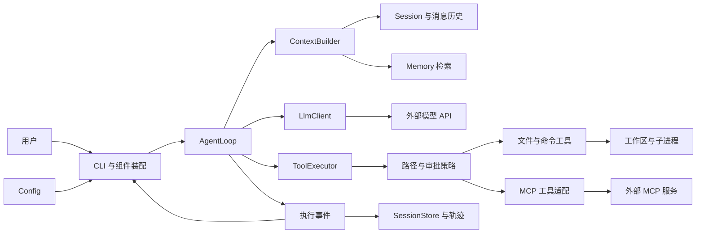

# CodeY

使用 Java 从零构建 CLI 编程 Agent，通过实际实现理解 Claude Code、Codex 等编程 Agent 的工作原理。

目标闭环：**接收任务 → 探索代码 → 修改文件 → 执行测试 → 根据结果继续修复 → 输出结果与验证证据**。

## 当前进度

当前已完成多模型 Profile 配置、消息模型、基础提示词、非流式模型调用和本地会话保存/恢复。无参数或 `--chat` 展示所有工作区最近 10 条会话，支持分页、新建、标题/ID 恢复、改名、可选工作区和自动标题。`--prompt` 保留单次调用。SSE、Agent 循环、工具执行、长期记忆和 MCP 尚待实现；已使用本地模拟模型验证，真实厂商兼容性需另行验证。

## 技术基线

- Java 17、Maven 单模块。
- 基础包：`io.github.jackfeicoder.codey`。
- 使用 JDK HttpClient 调用兼容 Chat Completions 的接口，Jackson 2.18.2 处理 JSON。
- Maven Shade 将运行依赖打入可执行 JAR。
- 第一版聚焦单 Agent；上下文、持久化、MCP 按阶段加入。

## 架构概览

以下为目标架构。当前实现了配置、消息、内存 Session、本地 JSON 快照、会话恢复和 CLI 非流式对话；图中的 Agent、工具执行事件及长期记忆按路线逐步实现。



| 模块 | 职责 |
|---|---|
| CLI / Config | 接收输入、加载配置、装配组件与展示执行事件 |
| Agent | 维护执行循环、预算、取消与任务完成状态 |
| LLM | 编码请求、调用模型、解析 SSE 并返回完整响应 |
| Tool / Policy | 注册工具、校验参数与权限、执行文件和命令操作 |
| Context | 每轮选择、组织和压缩模型需要的信息 |
| Session | 保存消息历史、工具结果与执行状态 |
| Memory | 保存和召回带项目范围的长期事实与约定 |
| MCP | 接入外部工具服务，复用统一工具执行流程 |
| Observability | 记录执行轨迹、Token、耗时与验证证据 |

这些组件共同构成 CodeY 的 Agent Harness：模型决定下一步行动，Java 程序维护状态、执行工具并检查结果。

## 核心工作流程

1. 用户输入任务，创建独立的运行上下文并追加用户消息。
2. 构建本轮上下文，加入规则、历史、相关记忆和工具定义。
3. 调用模型，展示文本增量，并组装完整文本与工具调用。
4. 如果存在工具调用，校验参数和权限，执行后将结果回填消息，再进入下一轮。
5. 如果模型返回最终回答，按任务类型检查验收证据；代码修改任务需要约定的编译或测试结果。
6. 返回完整结果、验证摘要与明确状态：完成、未完成、失败、取消或预算耗尽。

首版工具按顺序执行；流式展示始终保留完整返回值。会话保存完整执行记录，上下文负责选择本轮输入，长期记忆保存跨会话事实。

完整流程图、时序图和恢复策略见 [架构设计](docs/architecture.md)。

## 项目目录

```text
codeY/
├── README.md
├── pom.xml
├── .env.example
├── docs/
│   ├── architecture.md           # 完整设计、配置、路线与学习笔记
│   └── diagrams/                 # 可编辑 Mermaid 图
└── src/
    ├── main/
    │   ├── java/io/github/jackfeicoder/codey/
    │   │   ├── cli/
    │   │   ├── config/
    │   │   ├── prompt/
    │   │   ├── agent/
    │   │   ├── llm/
    │   │   ├── tool/builtin/
    │   │   ├── context/
    │   │   ├── session/
    │   │   ├── workspace/
    │   │   ├── memory/
    │   │   ├── mcp/
    │   │   ├── policy/
    │   │   └── observability/
    │   └── resources/prompts/
    │       └── base.md
    └── test/
        ├── java/io/github/jackfeicoder/codey/
        └── resources/fixtures/
```

详细目录与运行时数据布局见 [架构设计](docs/architecture.md)。

## 开发路线

| 阶段 | 目标 | 状态 |
|---|---|---|
| M0 | 工程、入口与设计文档 | 已完成 |
| M1 | LLM 调用与 SSE 流式输出 | 进行中：配置、消息、非流式调用与连续对话已完成 |
| M2 | Agent 循环与只读工具 | 待实现 |
| M3 | 修改代码、执行命令与验证闭环 | 待实现 |
| M4 | 上下文预算与历史压缩 | 待实现 |
| M5 | 会话恢复与项目记忆 | 文本会话保存/恢复已提前实现；工具状态与记忆待实现 |
| M6 | MCP 工具接入 | 待实现 |
| M7 | 固定任务评估与项目展示 | 待实现 |

每阶段的验收标准见 [开发路线](docs/architecture.md#roadmap)，配套学习问题见 [面试学习笔记](docs/architecture.md#interview)。

## 构建与启动

需要 JDK 17+ 和 Maven 3.9+。首次构建需要下载 Maven 插件。

```shell
mvn clean verify
java -jar target/codey-0.1.0-SNAPSHOT.jar
java -jar target/codey-0.1.0-SNAPSHOT.jar --help
java -jar target/codey-0.1.0-SNAPSHOT.jar --version
java -jar target/codey-0.1.0-SNAPSHOT.jar --check-config
java -jar target/codey-0.1.0-SNAPSHOT.jar --list-models
java -jar target/codey-0.1.0-SNAPSHOT.jar --check-config --profile qwen
java -jar target/codey-0.1.0-SNAPSHOT.jar --prompt "你好，介绍一下你自己"
java -jar target/codey-0.1.0-SNAPSHOT.jar --prompt "解释 Java record" --profile qwen
java -jar target/codey-0.1.0-SNAPSHOT.jar --chat
java -jar target/codey-0.1.0-SNAPSHOT.jar --chat --profile qwen
java -jar target/codey-0.1.0-SNAPSHOT.jar --chat --workspace "E:\projects\demo" --title "项目开发"
java -jar target/codey-0.1.0-SNAPSHOT.jar --chat --no-workspace
java -jar target/codey-0.1.0-SNAPSHOT.jar --chat --resume "项目开发"
```

构建生成的 JAR 已包含 Jackson 运行依赖，直接使用 `java -jar` 即可。`--prompt` 发送独立的 system/user 请求；`--chat` 每轮发送基础提示词、成功历史和当前问题，两种入口都会向选中平台发送真实请求。工具调用暂不执行，输出被截断时提示 `finish_reason=length`。

启动列表接受已显示序号、完整标题或唯一 ID 前缀（至少 8 位）。进入会话后普通文本就是问题；重名/前缀冲突会显示候选项。每行一个问题，终端使用 Console 编码，重定向输入输出使用 UTF-8。

| 命令 | 功能 |
|---|---|
| `/new` | 保留当前记录，选择工作区或普通聊天，输入标题（留空自动生成） |
| `/more_session` | 在列表追加下一批 10 条；会话中使用则打开列表第一页 |
| `/sessions`、`/resume` | 刷新全局最近列表，保持当前会话可返回 |
| `/resume 标题或ID` | 切换到明确选择的历史会话 |
| `/rename 新标题` | 修改标题，ID 与消息不变 |
| `/back` | 从历史列表返回当前会话，或取消新建输入 |
| `/clear` | 保存旧会话，新建 ID，沿用工作区和模型；旧历史仍可恢复 |
| `/exit` 或 EOF | 保存待写快照并退出 |

每轮成功回答立即保存，失败调用和未执行工具请求不入历史。默认存储为 Java `user.home` 下的 `.codey/sessions/<UUID>/session.json`；可以在启动目录 `.env` 中设置 `CODEY_DATA_DIR=E:/codey-data`。标题可手动填写或 `/rename`；留空时首轮成功后额外调用模型生成一次，最多等待 5 秒，失败保留本地摘要。`CODEY_AUTO_TITLE=false` 可关闭额外调用。标题请求不加入对话历史。

恢复使用原工作区和保存的 Profile 别名，`--profile` 可显式覆盖；目录失效仍可查看历史，模型配置缺失时提示另选别名。工作区选择不改变 `.env` 查找目录，不自动扫描项目或增加文件操作能力。会话文件不保存模型凭证；同一会话只允许一个进程写入。保存失败会明确提示并阻止下一轮模型调用，避免覆盖未保存结果。

当前恢复的是成功文本会话，尚无工具执行状态恢复、长期记忆、Token 预算或历史压缩。全部历史仍随请求发送，较长时可用 `/clear` 开始新会话。`/model` 会话内切换后续实现。职责与流程见 [Session 与连续对话](docs/architecture.md#session-chat)。

基础提示词位于 [src/main/resources/prompts/base.md](src/main/resources/prompts/base.md)。PromptLoader 从 classpath 按 UTF-8 读取全文，Main 将其作为 system 消息注入请求；所有模型 Profile 共用。修改提示词后执行 `mvn package` 更新 JAR。资源缺失或空白时会在发送请求前报告提示词错误。设计与后续扩展见 [Prompt 模块](docs/architecture.md#prompt-design)。

`--check-config` 需要选中 Profile 的有效配置，但不会调用模型。首次配置时复制 `.env.example` 为启动目录下的 `.env`，已有 `.env` 时手工补充字段；填写地址、密钥和模型。来源优先级为 **系统环境变量 > .env > 默认值**，选择优先级为 **--profile > CODEY_ACTIVE_PROFILE**。旧版 `CODEY_LLM_*` 仍兼容。完整语法、CMD/PowerShell 用法及与 `application.yml` 的关系见 [配置说明](docs/architecture.md#configuration)。

## 设计文档

[完整设计文档](docs/architecture.md) 集中包含架构与目录、模块接口、执行流程、配置与多模型选择、开发验收、设计决策和面试学习笔记。

[工作区与历史会话实现](docs/architecture.md#workspace-sessions) 记录全局列表、分页、标题/ID 恢复、工作区、本地快照与自动标题的实现方式和后续边界。

学习代码可从 [阅读顺序与当前调用流程](docs/architecture.md#code-guide) 开始。主代码和测试已补充中文类、方法、字段及关键变量注释；构建配置和环境模板也有用途说明。

## 学习方式

每完成一个阶段，都补充运行方法、执行证据和设计取舍。参考 PaiCLI 的工程场景与 Hello-Agents 的教学思路，用自己的实现验证理解。

参考项目和维护约定统一记录在设计文档中。
