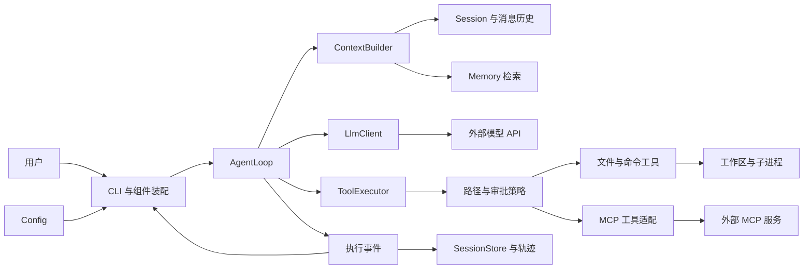

# CodeY

使用 Java 从零构建 CLI 编程 Agent，通过实际实现理解 Claude Code、Codex 等编程 Agent 的工作原理。

目标闭环：**接收任务 → 探索代码 → 修改文件 → 执行测试 → 根据结果继续修复 → 输出结果与验证证据**。

## 当前进度

当前已完成多模型配置、消息与基础提示词、普通与 SSE 流式调用、本地会话保存/恢复、六个文件工具、execute_command 本地命令、Agent 循环、权限审批及 ReAct/Plan 切换。无参数或 `--chat` 展示所有工作区最近 10 条会话，支持分页、新建、标题/ID 恢复、改名、可选工作区和自动标题。`--prompt` 执行无工作区的单条任务。专用网络/删除工具、进程沙箱、多 Agent 尚待实现；MCP 默认休眠、按需召唤已实现；长期记忆的管理、条件自动提取、模型整理与关键词召回已实现；验证使用本地模拟模型，真实厂商兼容性需另行验证。

工作区会话已注册 `list_files`、`search_file`、`grep_code` 与 `read_file`：模型可浏览目录、按名称定位或按正文关键词搜索，再读取内容。工具描述通过结构化 `tools` 字段发送，由 AgentLoop 执行并回填结果，继续请求最终回答。默认每个任务最多请求模型 20 次，最后一次禁用工具用于收尾；完成的工具消息组随会话保存，恢复时不自动重放。说明见 [正文搜索](docs/architecture.md#grep-code)、[文件定位](docs/architecture.md#search-file)、[目录工具](docs/architecture.md#list-files)、[读文件工具](docs/architecture.md#read-file) 和 [Agent 循环](docs/architecture.md#agent-loop)。

另已注册 `write_file`（新建/完整覆盖）和 `edit_file`（精确局部替换）。默认 `react + ask`，只读自动执行，每个文件首次实际修改前确认，成功后本会话复用该文件授权。`/permissions ask|auto|full` 切换权限，`/permissions revoke` 撤销授权；`/mode react|plan` 切换工作模式，PLAN 在 full 下仍保持只读。原生终端底栏显示模式/权限、模型以及“已用 ≈用量 / 容量（百分比）”，`/context` 查看估算拆分，`/status` 查看来源和最近实际用量。数值用 K/M 缩写，上限可按模型配置，未配置显示 ?；进入会话及每次 ReAct 请求前均估算上下文，已知容量的请求前预算检查已启用，已接入发送前自动摘要压缩与 /compact。一次工具写入成功后，后续模型失败或消息未保存不会自动回滚文件。实现见 [写入和编辑](#file-writes)、[权限模块](#module-policy)、[上下文模块](#module-context)。

控制台显示简洁执行进度：调用轮次、工具名称和涉及的文件，模型正文随 SSE 分片到达即时显示；工具失败时补充错误码。流结束并校验完整响应后才执行工具，完整任务成功后保存历史，最终回答不会重复打印。聊天中输入 `exit` 返回会话列表，列表中 `exit` 退出；`/exit` 随时退出程序。

`/help` 查看全部交互命令，`/list model` 查看供应商与各模型 ID，`/model 供应商 模型ID` 切换当前模型并保留历史；`/model 供应商` 选择该供应商配置的第一个模型。交互终端支持 Tab 补全命令、供应商与模型，多个候选可用上下键选择。默认采用最后一次成功选择的供应商与模型，重启后继续使用；首次无记录时使用 `.env` 默认值，`--profile` 可覆盖启动选择。

## 模块导航

各模块按“功能 → 涉及文件 → 调用流程 → 实现方式与边界”维护。表中的状态描述当前代码，待实现模块的流程仅为规划。

| 模块 | 状态 |
|---|---|
| [配置模块](#module-config) | 已实现：dotenv、多 Profile、模型与会话设置 |
| [工作区模块](#module-workspace) | 已实现：可选目录绑定与路径解析 |
| [提示词模块](#module-prompt) | 已实现：基础提示词资源加载 |
| [消息模型模块](#module-message) | 已实现：四种消息角色与工具调用数据 |
| [模型对话模块](#module-llm) | 已实现：Chat Completions 普通请求与 SSE 正文/工具分片聚合 |
| [CLI 交互模块](#module-cli) | 已实现：启动选择、输入、分页与会话命令 |
| [会话管理模块](#module-session) | 已实现：内存历史、本地保存/恢复与标题 |
| [工具模块](#module-tool) | 已实现六个文件工具及 execute_command，已接入模型、审批和 CLI |
| [Agent 执行模块](#module-agent) | 已实现：工具循环、轮次预算、中断与完成状态 |
| [上下文模块](#module-context) | 已实现模型容量、统一组装、Token 估算、输入预算与有界历史摘要 |
| [项目规则模块](#module-instruction) | 已实现根目录 AGENTS.md、/init、大小校验、动态加载与上下文计数 |
| [记忆模块](#module-memory) | 已实现用户/项目记忆、条件自动提取、可恢复整理及 BM25 召回 |
| [MCP 模块](#module-mcp) | 已实现：休眠目录、按需召唤、stdio/HTTP、统一审批与任务释放 |
| [权限模块](#module-policy) | 已实现 ask/规则 auto/full、逐文件审批、撤销和拒绝拦截；审计及进程沙箱待实现 |
| [模式切换模块](#module-mode) | 已实现模型切换和 react/plan；multi 明确未开放 |
| [可观测性模块](#module-observability) | 已实现简洁控制台进度；事件、指标与持久化轨迹待实现 |

## 技术基线

- Java 17、Maven 单模块。
- 基础包：`io.github.jackfeicoder.codey`。
- 使用 JDK HttpClient 调用兼容 Chat Completions 的接口，Jackson 2.19.2 处理 JSON。
- 使用 JLine 3.30.17 编辑终端输入，补全命令和模型参数，支持候选菜单选择。
- Maven Shade 将运行依赖打入可执行 JAR。
- 第一版聚焦单 Agent；上下文、持久化、MCP 按阶段加入。

## 架构概览

以下为目标架构。当前实现了配置、消息、Session 本地保存/恢复、Agent 工具循环、权限审批与 CLI 流式对话；ContextBuilder 与长期记忆已实现，MCP 按需工具接入已实现，完整执行事件按路线逐步实现。



| 模块 | 职责 |
|---|---|
| CLI / Config | 接收输入、加载配置、装配组件与展示结果 |
| Agent | 维护执行循环、预算、取消与任务完成状态 |
| LLM | 编码请求、调用模型、解析 SSE 并返回完整响应 |
| Tool / Policy | 注册工具、校验参数与权限、执行文件和命令操作 |
| Context | 每轮选择、组织和压缩模型需要的信息 |
| Session | 保存消息历史、工具结果与执行状态 |
| Memory | 保存和召回带项目范围的长期事实与约定 |
| MCP | 接入外部工具服务，复用统一工具执行流程 |
| Observability | 记录执行轨迹、Token、耗时与验证证据 |

这些组件共同构成 CodeY 的 Agent Harness：模型决定下一步行动，Java 程序维护状态、执行工具并检查结果。

## 当前调用流程与目标闭环

当前会话的实际流程：

```text
Main → 注册工具 / 加载会话设置 → SessionLauncher 展示历史
  → 新建/恢复：选择工作区与模型配置，创建或恢复 SessionService
  → 用户问题 → ChatCli.answer → AgentLoop.run
  → Session.messages + 当前任务 + Registry.definitions → ContextBuilder → LlmRequest(messages, tools)
  → ChatCompletionsClient.generateStream → 正文增量展示 / 完整工具请求聚合
  → 整体响应校验 → 工具请求：Executor 审批 / 执行 / 回填 → 再请求
  → 最终回答：Session.completeAgentTurn → SessionService.captureTurn/save
  → 首轮无手动标题：独立生成标题或保留首问摘要，再保存
```

以上已接通文件读写、命令执行和流式展示。加入上下文预算与验收证据后，目标流程为：

1. 用户输入任务，创建独立的运行上下文并追加用户消息。
2. 构建本轮上下文，加入规则、历史、相关记忆和工具定义。
3. 调用模型，展示文本增量，并组装完整文本与工具调用。
4. 如果存在工具调用，校验参数和权限，执行后将结果回填消息，再进入下一轮。
5. 如果模型返回最终回答，按任务类型检查验收证据；代码修改任务需要约定的编译或测试结果。
6. 返回完整结果、验证摘要与明确状态：完成、未完成、失败、取消或预算耗尽。

当前正文流式展示，工具按顺序执行，会话保存完整文本/工具轮次；长期记忆已按任务检索注入；完整执行事件与更细的上下文筛选后续补充。

完整流程图、时序图和恢复策略见 [架构设计](docs/architecture.md)。

## 模块说明

以下介绍主要业务文件；各包的 `package-info.java` 用于职责声明。测试按相同包结构放在 `src/test/java`，完整设计与验收条件在架构文档中维护。

<a id="module-config"></a>

### 1. 配置模块：config

**功能**：读取启动目录 `.env` 和进程环境，解析多模型 Profile，选择默认或指定配置并校验；读取会话存储位置、建议工作区与自动标题开关。

**涉及文件**：

| 文件 | 职责 |
|---|---|
| [ConfigLoader.java](src/main/java/io/github/jackfeicoder/codey/config/ConfigLoader.java) | 配置加载入口，合并来源、解析别名、转换模型字段 |
| [DotEnvReader.java](src/main/java/io/github/jackfeicoder/codey/config/DotEnvReader.java) | 按 UTF-8 解析单行键值、引号、注释和 `export`；定位格式错误 |
| [ModelProfiles.java](src/main/java/io/github/jackfeicoder/codey/config/ModelProfiles.java) | 不可变配置快照，列出别名、按需构建配置、先校验再选择 |
| [ProfileSelection.java](src/main/java/io/github/jackfeicoder/codey/config/ProfileSelection.java) | 解析 `供应商 [模型ID]`，别名忽略大小写、模型 ID 保持原样，兼容旧选择记录 |
| [ModelPreferenceStore.java](src/main/java/io/github/jackfeicoder/codey/config/ModelPreferenceStore.java) | 用户级 model-preference.json，保存最后选择的别名和模型 ID；有界读取与原子替换 |
| [LlmConfig.java](src/main/java/io/github/jackfeicoder/codey/config/LlmConfig.java) | 强类型模型地址、认证、模型 ID 与超时；打印时隐藏密钥 |
| [AuthMode.java](src/main/java/io/github/jackfeicoder/codey/config/AuthMode.java) | 表达 Bearer 认证或无需认证的 NONE 模式 |
| [SessionSettings.java](src/main/java/io/github/jackfeicoder/codey/config/SessionSettings.java) | 加载数据目录、建议工作区、自动标题设置，不保存模型凭证 |
| [AgentSettings.java](src/main/java/io/github/jackfeicoder/codey/config/AgentSettings.java) | 启动时加载任务模型请求预算与目录工具默认深度，校验范围后由 Main 注入 |
| [CommandSettings.java](src/main/java/io/github/jackfeicoder/codey/config/CommandSettings.java) | 命令默认/最大超时、输出保留预算及解码字符集，环境覆盖 .env |
| [StreamingSettings.java](src/main/java/io/github/jackfeicoder/codey/config/StreamingSettings.java) | 加载流式与 usage 兼容开关，默认均为 true，环境覆盖 .env |
| [ModelCapabilities.java](src/main/java/io/github/jackfeicoder/codey/config/ModelCapabilities.java) | 保存可空的最大上下文 token 数，缺配置表示未知；与密钥和请求分开 |
| [ModelCapabilitiesLoader.java](src/main/java/io/github/jackfeicoder/codey/config/ModelCapabilitiesLoader.java) | 读取同配置目录 models.json，严格校验后按供应商别名和模型 ID 选择容量 |
| [models.example.json](models.example.json) | 容量配置模板，别名、ID 和数值均为示例；运行时读取 models.json |
| [ConfigException.java](src/main/java/io/github/jackfeicoder/codey/config/ConfigException.java) | 表达读取/字段校验错误，供 CLI 展示 |
| [.env.example](.env.example) | 可填写字段模板；实际运行加载 `.env`，模板不作为有效配置 |

**调用流程**：

```text
Main / SessionLauncher 的模型工厂
  → ConfigLoader.loadProfiles(启动目录, 环境, 指定别名)
  → DotEnvReader.read(.env) → 合并环境变量 → ModelProfiles
  → activeConfig()/configFor(alias) → 字段转换与校验 → LlmConfig
会话设置：Main → SessionSettings.load → 数据目录/建议工作区/标题开关
运行设置：Main → AgentSettings.load → AgentLoop(maxIterations) / ListFilesTool(defaultDepth)
```

Agent 运行参数也读取同一配置目录，优先级为进程环境 > `.env` > 默认值：

```dotenv
CODEY_MAX_ITERATIONS=20
CODEY_LIST_FILES_DEFAULT_DEPTH=10
```

轮次范围为 1–100，每条用户任务重新计算，包含最后一次只回答的请求；默认最多 19 轮工具探索加 1 轮收尾。目录深度范围为 1–20，表示模型省略 `maxDepth` 时的默认值；模型仍可显式指定其他合法深度。当前项目最深 Java 文件在第 10 层，提示词在第 5 层。修改这两个字段后重启 CodeY，`/model` 只重载模型配置。`--check-config` 会一并显示已解析的运行设置。

**实现方式与边界**：字段优先级为进程环境 > `.env` > 默认值，空环境值也覆盖文件值。`.env` 默认来自启动目录，显式 `CODEY_CONFIG_DIR` 可指定共享配置目录；相对数据目录以配置目录为基准，工作区仍以启动目录定位。首次选择为 `--profile` > 最后选择 > 会话保存别名（恢复时）> `CODEY_ACTIVE_PROFILE`；后续 `/new` 使用最后选择。别名来自 `CODEY_PROFILE_NAMES`，字段按 `CODEY_PROFILE_别名_*` 解析；无多 Profile 时兼容 `CODEY_LLM_*`。目录只展示本地配置状态，不探测远端。

`CODEY_PROFILE_*_MODEL` 支持英文逗号分隔的多个模型 ID，模型共用该 Profile 的地址、密钥、认证和超时；省略模型 ID 时选择第一个。`ModelProfiles` 拆分列表、校验目标 ID 属于该供应商，再生成仅含一个模型的 `LlmConfig`，HTTP 层与 AgentLoop 保持原调用方式。空项、重复模型 ID 和含空白的 ID 报错，模型 ID 区分大小写。配置模型不代表平台权限、协议和工具能力已通过远端验证。

`ModelProfiles.select()` 返回新快照；`/model` 在用户输入边界重新加载配置并替换客户端，不修改 `.env`。最后选择保存到 `CODEY_DATA_DIR/model-preference.json`，只含版本与 `供应商 模型ID`，保存失败会单独提示；旧单别名记录仍可读取。当前未加载 `application.yml`，dotenv 不做变量插值、多行值或转义展开，没有自动热更新。

<a id="module-workspace"></a>

### 2. 工作区模块：workspace

**功能**：为每个会话绑定一个目录，或明确选择无工作区的普通聊天；验证路径，恢复时检查原目录是否仍有效。

**涉及文件**：

| 文件 | 职责 |
|---|---|
| [WorkspaceBinding.java](src/main/java/io/github/jackfeicoder/codey/workspace/WorkspaceBinding.java) | `DIRECTORY` 保存绝对路径，`NONE` 表示普通聊天，提供展示文本 |
| [WorkspaceResolver.java](src/main/java/io/github/jackfeicoder/codey/workspace/WorkspaceResolver.java) | 相对启动目录解析路径，校验真实目录与可读性；检查恢复时的可用性 |

**调用流程**：

```text
/new 或 --workspace → SessionLauncher → WorkspaceResolver.resolve
  → WorkspaceBinding → SessionSnapshot 保存绑定
恢复：SessionLauncher → WorkspaceResolver.available → 沿用原目录或提示失效
工具可用性：ToolContext.hasWorkspace → Registry 筛选 / Executor 检查
```

**实现方式与边界**：使用 `Path.toRealPath()` 处理相对段与现有链接，支持带空格的目录；不要求 Git 仓库或目录可写。`NONE` 没有目录字段，不用当前目录冒充普通聊天。选工作区不修改进程目录，也不改变 `.env` 的查找位置。绑定目录本身不扫描项目；列目录与读取由具体工具执行，统一路径策略和进程隔离属于后续权限模块。

<a id="module-prompt"></a>

### 3. 提示词模块：prompt

**功能**：将基础提示词从代码中提取为资源，按 UTF-8 加载，并作为 system 消息提供给模型。

**涉及文件**：

| 文件 | 职责 |
|---|---|
| [PromptLoader.java](src/main/java/io/github/jackfeicoder/codey/prompt/PromptLoader.java) | 从 classpath 读取基础提示词，支持开发目录与打包 JAR |
| [PromptException.java](src/main/java/io/github/jackfeicoder/codey/prompt/PromptException.java) | 表达缺失、空白或读取失败 |
| [base.md](src/main/resources/prompts/base.md) | 编程助手身份、回复习惯、依据与操作结果要求 |

**调用流程**：

```text
Main / SessionLauncher → PromptLoader.loadBase
  → classpath /prompts/base.md → Message.system → LlmRequest
新会话 → SessionSnapshot 保存提示词快照和 hash → 恢复时只注入一次
```

**实现方式与边界**：直接发送 Markdown 原文，不转换 HTML。加载用资源流，不依赖运行时的源码目录；基础资源缺失或为空时在发请求前报错。所有 Profile 共用基础提示词，修改后重新打包即可。历史会话沿用创建时的快照，发现 hash 变化会提示。

工具名称、描述与参数 schema 放在 `ToolDefinition`，已通过请求 `tools` 字段发送；基础提示词仅写使用指导、不维护另一份工具清单。工具输出按待分析的数据处理。标题生成的专用指令目前在 `SessionTitleGenerator` 内。项目 `AGENTS.md` 与 `/init` 已接入独立 instruction 模块；更多提示词组合和模式模板仍待扩展，详见 [提示词设计](docs/architecture.md#prompt-design)。

<a id="module-message"></a>

### 4. 消息模型模块：session / tool 的共享数据

**功能**：用统一数据结构表达系统指令、用户输入、模型回答、工具调用及结果，为 LLM、会话与后续 Agent 提供共同消息契约。

**涉及文件**：

| 文件 | 职责 |
|---|---|
| [Message.java](src/main/java/io/github/jackfeicoder/codey/session/Message.java) | 不可变消息，提供 system/user/assistant/tool 工厂方法并检查单条角色约束 |
| [MessageRole.java](src/main/java/io/github/jackfeicoder/codey/session/MessageRole.java) | 四种角色及对应协议字符串 |
| [ToolCall.java](src/main/java/io/github/jackfeicoder/codey/tool/ToolCall.java) | 保存调用 ID、工具名与原始 JSON 参数字符串，不代表已执行 |

**调用流程**：

```text
基础提示词/用户输入 → Message → LlmRequest → 协议 JSON
模型响应 → assistant Message（可含 ToolCall）→ LlmResponse
后续执行结果 → ToolResult.toMessage → Message.tool(原调用 ID, 结果正文)
```

**实现方式与边界**：使用 Java record，复制传入列表。只有 assistant 可带工具调用，只有 tool 可带 `toolCallId`；同一 assistant 的调用 ID 不重复。纯工具请求允许没有文本，空工具输出允许为空字符串。`MessageHistory` 进一步校验轮次顺序、同一任务 ID 唯一、所有结果配对以及最终回答；会话与磁盘快照已支持完整工具消息组。

<a id="module-llm"></a>

### 5. 模型对话模块：llm

**功能**：通过统一接口调用兼容 Chat Completions 的模型服务，编码消息、发送 HTTP、解析完整回答、工具请求、结束原因和可选 Token 用量。

**涉及文件**：

| 文件 | 职责 |
|---|---|
| [LlmClient.java](src/main/java/io/github/jackfeicoder/codey/llm/LlmClient.java) | 声明完整响应 `generate` 与增量展示 `generateStream(request, onText)`，两者均返回完整响应 |
| [ChatCompletionsClient.java](src/main/java/io/github/jackfeicoder/codey/llm/ChatCompletionsClient.java) | HTTP/JSON/SSE 实现，管理总超时、取消、完整响应校验，每实例绑定一套模型配置 |
| [ChatStreamDecoder.java](src/main/java/io/github/jackfeicoder/codey/llm/ChatStreamDecoder.java) | 有界读取 SSE 帧，回调正文并按 index 聚合工具参数，验证流结束 |
| [LlmRequest.java](src/main/java/io/github/jackfeicoder/codey/llm/LlmRequest.java) | 保存不可修改的消息与工具定义列表，拒绝重复名称；单参数构造兼容无工具请求 |
| [LlmResponse.java](src/main/java/io/github/jackfeicoder/codey/llm/LlmResponse.java) | 保存 assistant 消息、结束原因、TokenUsage，提供文本/工具/截断判断 |
| [LlmException.java](src/main/java/io/github/jackfeicoder/codey/llm/LlmException.java) | 区分 HTTP、网络、超时、中断、请求/响应格式和模型拒绝等错误 |

**调用流程**：

```text
聊天 / --prompt → AgentLoop → LlmClient.generateStream(request, onText)
  → encode：stream=true + 可选 stream_options.include_usage → HTTP InputStream
  → ChatStreamDecoder：正文 delta → ConsoleStreamOutput 即时刷新
  → finish_reason + [DONE] → 聚合结果 → decode 校验 → 完整 LlmResponse
  → AgentLoop 再决定执行工具或结束任务 → CLI 保存完整历史
标题 / 显式 generate → stream=false → 完整 JSON → LlmResponse
```

**实现方式与边界**：共享 JDK HttpClient，按认证模式添加 Bearer 头或不添加认证头，默认不跟随重定向。Jackson 显式映射消息与工具调用字段，拒绝重复 JSON 键、尾随内容和不完整工具参数。流式方法调用期间逐片回调，返回时仍提供完整文本、工具调用、结束原因与可选用量；线程负责读取响应体，总超时覆盖响应头和完整流。超时/中断关闭流、取消读取并阻止晚到片段继续显示，中断恢复标志。异常不附带原始服务商正文或凭证。

工具参数按 index 拼接，允许多个调用交错；完整流和整组调用校验通过后才交给原有执行器，不执行半截参数。无工具时省略 tools；最后一次请求保留 `tool_choice="none"`。正文提前显示不等于任务成功，异常时标注本轮未保存；之前已成功执行的工具副作用仍不回滚。不展示 reasoning_content、工具参数或 SSE 原始数据。

兼容同一协议的服务共用客户端，无需按厂商新建实现；协议差异通过配置或 `LlmClient` 适配。服务忽略 stream 而返回完整 JSON 时解析同一响应，不额外重发。自动标题继续调用非流式 generate，不插入聊天正文。生成参数、自动重试与完整执行事件仍待实现；上下文输入预算由 context 模块检查。

**配置与使用**：两项均为全局设置，缺省 true，修改后重启 CodeY；现有多模型配置、历史会话和模型切换照常使用。

```dotenv
CODEY_LLM_STREAM=true
CODEY_LLM_STREAM_INCLUDE_USAGE=true
```

平台拒绝 stream_options 时将第二项设为 false；平台不支持 SSE 时将第一项设为 false。只接受 true/false，未返回用量显示 `?`；底栏在完整响应后更新“已用”，来源为最近请求的输入 token，尚无实时上下文估算。首版流式正文使用终端默认前景色，不做逐片 Markdown 语法着色。协议边界、超时和验收见 [流式实现](docs/architecture.md#streaming)。

流式工具 ID 兼容：id 缺省、null 或空字符串视为该分片没有提供身份，不覆盖已保存 ID；首片为空也允许后续非空 ID 补齐；同一非空 ID 重复发送不会报错。每个响应独立聚合，下一轮 index 可重新从 0 开始。若同一响应的同一 index 出现不同非空 ID，继续拒绝整个工具组，不猜测拼接或重编号；错误显示 index、JSON 分片序号和 ID 长度，不打印 ID/参数原文。超长、纯空白和始终缺少有效 ID 分别报错，流完整通过校验后才执行工具。

2026-10-27 验证：完整 `mvn verify` 共 783 项通过，无失败、错误或跳过；新增 8 项覆盖空占位、重复/延后 ID、真实冲突、超长/空白/始终缺失身份及跨响应 index 复用。生产 JAR 本地 SSE 验证空占位后正常 read_file、结果回填及完整历史保存，非空冲突时阻止后续请求且不保存残缺轮次；未请求真实厂商。

<a id="module-cli"></a>

### 6. CLI 交互模块：cli

**功能**：解析启动参数，展示全局历史列表，处理输入、新建/恢复/改名/分页等命令，装配组件并显示模型回答和错误。

**涉及文件**：

| 文件 | 职责 |
|---|---|
| [Main.java](src/main/java/io/github/jackfeicoder/codey/cli/Main.java) | 参数解析与组件装配，提供帮助、配置操作、单次请求和会话入口 |
| [bin/codey.cmd](bin/codey.cmd) | Windows 全局命令入口，定位 JAR、转发参数、保留调用目录并设置默认配置目录 |
| [SessionLauncher.java](src/main/java/io/github/jackfeicoder/codey/cli/SessionLauncher.java) | 管理列表/聊天状态，选择工作区、延迟校验模型，协调会话切换和标题任务 |
| [ChatCli.java](src/main/java/io/github/jackfeicoder/codey/cli/ChatCli.java) | `answer()` 调用 AgentLoop、展示状态并提交完整成功轮次；`run()` 保留给内存调用者，生产入口使用 Launcher |
| [ConsoleInput.java](src/main/java/io/github/jackfeicoder/codey/cli/ConsoleInput.java) | 原生终端使用 JLine 编辑与补全，管道/测试使用 BufferedReader，关闭时恢复终端状态 |
| [ConsoleTheme.java](src/main/java/io/github/jackfeicoder/codey/cli/ConsoleTheme.java) | 按消息类型统一颜色、回答与命令排版；仅展示时转义控制字符，支持 NO_COLOR 与纯文本管道 |
| [ConsoleStreamOutput.java](src/main/java/io/github/jackfeicoder/codey/cli/ConsoleStreamOutput.java) | 接收正文增量、即时刷新、跨片段处理 Unicode/换行与控制字符，关闭段落后刷新底栏 |
| [CommandCatalog.java](src/main/java/io/github/jackfeicoder/codey/cli/CommandCatalog.java) | `/help` 与补全共享命令名称、用法和说明 |
| [CommandCompleter.java](src/main/java/io/github/jackfeicoder/codey/cli/CommandCompleter.java) | 按输入词位置补全命令、供应商及该供应商下的模型，仅读取本地目录 |

**调用流程**：

```text
Main 解析参数
  ├─ --help/--version：直接展示
  ├─ --list-models/--check-config：只做本地配置操作
  ├─ --prompt：临时 Session + 无工作区 → AgentLoop → 展示回答
  └─ 无参数/--chat：注册 list_files/search_file/grep_code/read_file → SessionLauncher → ChatCli.answer → AgentLoop
```

**实现方式与边界**：列表模式的普通文本匹配序号、完整标题或唯一 ID 前缀；聊天模式的普通文本就是问题，切换用 `/resume`。最近每批 10 条，分页持有稳定列表快照，`/sessions` 才刷新；重名与前缀冲突展示候选项。查看列表和历史预览不要求模型凭证，准备继续时才校验。交互终端使用 JLine 3.30.17 与 JNI provider，Tab 唯一匹配直接补全，多个匹配进入菜单，方向键或 Tab 选择、Enter 确认，再 Enter 执行。Ctrl+C 取消当前编辑，EOF 保存退出。路径/标题等辅助输入不提示命令，不启用 shell 转义或 `!` 历史展开。管道/IDE 无原生控制台时使用 UTF-8 逐行输入，不启用补全。未知斜杠命令不发模型请求。命令表和启动例子见 [构建与启动](#build-run)。

**终端 UI**：主输入使用分隔线与 `❯` 提示，输入文字青色加粗，斜杠命令紫色；宽窗口右侧提示 Tab/方向键和 `/help`。命令菜单选中项使用青色背景，说明文字灰色，`/permissions`、`/mode` 候选带具体用途；`/help` 按窗口宽度分列或换行。模型等待提示黄色，工具摘要青色并缩进，错误红色；回答标签绿色，正文采用终端默认前景色，流式正文即时显示，完整回答备用渲染器保留 Markdown 标题与代码块轻量着色。等待提示仅表示正在请求模型，不展示模型内部推理或等待动画。

<a id="module-session"></a>

### 7. 会话管理模块：session

**功能**：保存本次内存历史，给每个会话分配 ID、标题、工作区与模型别名；每轮成功后落盘，重启恢复，支持改名与一次自动标题生成。

**涉及文件**：

| 文件 | 职责 |
|---|---|
| [Session.java](src/main/java/io/github/jackfeicoder/codey/session/Session.java) | 初始化 system、构建请求副本、提交成功轮次、清空内存和从快照恢复 |
| [MessageHistory.java](src/main/java/io/github/jackfeicoder/codey/session/MessageHistory.java) | 校验完整 user/assistant/tool 顺序与调用结果配对；阻止残缺历史提交或恢复 |
| [SessionSnapshot.java](src/main/java/io/github/jackfeicoder/codey/session/SessionSnapshot.java) | 版本化磁盘 DTO，保存元数据/基础提示词/消息，校验 UUID、标题、时间及轮次 |
| [SessionService.java](src/main/java/io/github/jackfeicoder/codey/session/SessionService.java) | 协调 Session、快照、dirty 状态与持锁读写，保存失败保留待重试内容 |
| [SessionStore.java](src/main/java/io/github/jackfeicoder/codey/session/SessionStore.java) | 存储接口，提供列表、加载和持锁 Lease；上层不绑定 JSON 文件实现 |
| [JsonSessionStore.java](src/main/java/io/github/jackfeicoder/codey/session/JsonSessionStore.java) | 单文件快照、版本检查、全局列表、独占文件锁与原子替换 |
| [SessionTitleGenerator.java](src/main/java/io/github/jackfeicoder/codey/session/SessionTitleGenerator.java) | 独立首问标题请求，限制输入与标题长度，失败返回本地摘要 |
| [SessionException.java](src/main/java/io/github/jackfeicoder/codey/session/SessionException.java) | 表达存储、格式、锁和版本冲突，不回显 JSON 正文 |

**调用流程**：

```text
新建：Launcher → SessionService.create → Snapshot + 写锁 + 初始保存
对话：Session.messages() + 当前输入 → AgentLoop / ContextBuilder → completeAgentTurn → captureTurn → save
恢复：标题/ID → 预览 → 检查工作区/配置 → lock/load → Session.restore → 等待新输入
标题：首轮保存摘要 → 保存已尝试标记 → 独立标题请求 → 校验/回退 → 保存
```

**实现方式与边界**：当前任务只放请求副本，收到最终回答后提交 user、工具调用/结果及最终 assistant；模型失败、中断或预算结束后仍未得到文本时不提交残缺本轮；有效收尾回答可正常保存。v2 快照支持工具轮次，旧 v1 文本记录可加载并在恢复保存时升级。UUID 是身份，标题可重复且可修改；system 单独保存在快照，恢复只注入一次。标题请求最多使用 2000 个首问码点，超时取模型配置与 5 秒中的较小值；手动标题优先，生成一次，重启不重复生成。

默认使用用户目录 `.codey/sessions/<UUID>/session.json`。同一会话持独占文件锁，每次保存检查 revision，写同目录临时文件并 force，再原子替换；文件系统不支持时明确报错。单快照上限 16 MiB，损坏记录不会覆盖为空，也不阻断其他列表项。保存失败保持 dirty，下一轮或切换前先重试。快照只记录模型别名，不序列化配置对象或密钥。

CLI 的 `/clear` 保存旧会话并创建新 ID，沿用工作区/模型，旧记录仍可恢复；不是调用 `Session.clear()` 删除持久化记录。恢复完整文本/工具对话，但不重放历史工具调用、不恢复执行中的任务或还原文件；原始历史与摘要一并恢复，长期记忆从独立存储按当前任务加载，执行事件后续加入。更多边界见 [会话实现](docs/architecture.md#workspace-sessions)。

<a id="module-tool"></a>

### 8. 工具模块：tool（文件操作与本地命令已实现）

**功能**：将模型可见定义与 Java 执行分开，统一注册、查找、参数校验入口、工作区检查、错误结果和输出上限。`list_files` 浏览目录，`search_file` 定位路径，`grep_code` 搜正文，`read_file` 阅读，`write_file` 完整写入，`edit_file` 局部编辑。增加 execute_command 后，七个工具各自实现 Tool，互不调用，由模型按任务选择，均已接入工作区会话的工具循环。

**涉及文件**：

| 文件 | 职责 |
|---|---|
| [Tool.java](src/main/java/io/github/jackfeicoder/codey/tool/Tool.java) | 声明定义、是否需要工作区、具体参数校验和执行方法 |
| [ToolDefinition.java](src/main/java/io/github/jackfeicoder/codey/tool/ToolDefinition.java) | 不可变 name/description/parameters；复制 schema 防止外部修改 |
| [ToolCall.java](src/main/java/io/github/jackfeicoder/codey/tool/ToolCall.java) | 原始调用 ID、名称与 JSON 参数字符串 |
| [ToolContext.java](src/main/java/io/github/jackfeicoder/codey/tool/ToolContext.java) | 宿主工作区与输出上限，不由模型参数决定 |
| [ToolRegistry.java](src/main/java/io/github/jackfeicoder/codey/tool/ToolRegistry.java) | 按名称固定定义和实现，拒绝重复注册，按工作区筛选可用定义 |
| [ToolExecutor.java](src/main/java/io/github/jackfeicoder/codey/tool/ToolExecutor.java) | 严格解析参数对象、执行校验与工具、归一化错误、测量耗时及截断 |
| [ToolResult.java](src/main/java/io/github/jackfeicoder/codey/tool/ToolResult.java) | 成功/错误状态、输出、错误码、耗时与截断，转换为原调用 ID 的 tool 消息 |
| [ToolException.java](src/main/java/io/github/jackfeicoder/codey/tool/ToolException.java) | 工具可预期的业务失败；未知 RuntimeException 使用通用说明 |
| [builtin/ReadFileTool.java](src/main/java/io/github/jackfeicoder/codey/tool/builtin/ReadFileTool.java) | read_file 定义、参数/路径检查、UTF-8 有界分页读取及完整 JSON 输出 |
| [builtin/ListFilesTool.java](src/main/java/io/github/jackfeicoder/codey/tool/builtin/ListFilesTool.java) | list_files 参数与目录条目输出，调用共享遍历器浏览目录结构 |
| [builtin/SearchFileTool.java](src/main/java/io/github/jackfeicoder/codey/tool/builtin/SearchFileTool.java) | search_file 参数、名称/路径匹配和有界路径结果，不读取正文 |
| [builtin/GrepCodeTool.java](src/main/java/io/github/jackfeicoder/codey/tool/builtin/GrepCodeTool.java) | grep_code 参数、逐行字面匹配、文件跳过/预算统计和完整匹配结果 |
| [builtin/WriteFileTool.java](src/main/java/io/github/jackfeicoder/codey/tool/builtin/WriteFileTool.java) | 完整内容写入、默认覆盖保护、创建/覆盖/未变化结果 |
| [builtin/EditFileTool.java](src/main/java/io/github/jackfeicoder/codey/tool/builtin/EditFileTool.java) | 精确匹配计数、唯一匹配校验、替换/插入/删除与替换全部 |
| [builtin/ExecuteCommandTool.java](src/main/java/io/github/jackfeicoder/codey/tool/builtin/ExecuteCommandTool.java) | 命令 schema/校验、固定 argv 和审批预览、完整进程结果 JSON |
| [process/CommandResolver.java](src/main/java/io/github/jackfeicoder/codey/tool/process/CommandResolver.java) | PATH/实际程序定位、Windows 参数及批处理适配、程序身份复检 |
| [process/CommandRunner.java](src/main/java/io/github/jackfeicoder/codey/tool/process/CommandRunner.java) | 启动进程、关闭 stdin、并行排空日志、超时/取消和已观察后代清理 |
| [filesystem/WorkspaceTextFiles.java](src/main/java/io/github/jackfeicoder/codey/tool/filesystem/WorkspaceTextFiles.java) | 两个写工具共用的路径/链接检查、严格 UTF-8、快照冲突检查和临时文件提交 |
| [filesystem/WorkspaceFiles.java](src/main/java/io/github/jackfeicoder/codey/tool/filesystem/WorkspaceFiles.java) | 目录工具共用的工作区路径校验、有界排序/遍历、忽略和链接规则 |
| [filesystem/FileGlob.java](src/main/java/io/github/jackfeicoder/codey/tool/filesystem/FileGlob.java) | 跨平台名称/路径模式匹配，支持 *、? 和独立的 ** 目录段 |
| [filesystem/Utf8TextReader.java](src/main/java/io/github/jackfeicoder/codey/tool/filesystem/Utf8TextReader.java) | read_file 与 grep_code 共用严格 UTF-8/BOM/换行、有界行读取和实际字节预算 |
| [builtin/package-info.java](src/main/java/io/github/jackfeicoder/codey/tool/builtin/package-info.java) | 六个文件工具与本地命令的职责说明 |

**调用流程**：

```text
宿主 register(Tool) → 固定 ToolDefinition 与 Java 实现
ToolCall → Registry.find → Executor 解析 JSON / 检查工作区
  → Tool.validateArguments → 工作模式检查 → Tool.prepare
  → PreparedToolOperation 审批/执行 → ToolResult → toMessage()
模型接入：Registry.definitions(context) → LLM 请求 tools → AgentLoop 调度与回填
```

**实现方式与边界**：工具用途用自然语言 description，参数用 JSON Schema，由协议适配器编码为结构化 `tools`；MD 只适合额外行为指导。当前只验证 schema 顶层为 object，没有通用 schema 校验器，具体字段/类型/业务限制由工具的 `validateArguments()` 明确实现。

执行器拒绝重复键、尾随 JSON、非对象与超过 64 Ki 字符的参数；需要工作区的工具会检查 NONE/失效目录。默认输出最多 16000 个 Unicode 码点，截断状态单独记录。保留中断标志，不吞 JVM Error，不自动重试。当前按模型调用组顺序同步执行，已接入工作模式检查和审批；execute_command 单独实现进程超时，其他工具未统一增加执行超时，并行工具调度仍待实现。详见 [工具模块设计与示例](docs/architecture.md#tool-foundation)。

<a id="execute-command"></a>

**本地命令工具 execute_command**：启动单个程序，用于编译、测试和诊断；返回退出码及 stdout/stderr，不在工具内部自动修复或重试。

**使用策略**：仅在已确认的项目任务中按需调用，先参考项目配置、结构或已有验证脚本；绑定一个目录不等于项目。独立 HTML/CSS/JS 等单文件任务只用文件工具修改和静态检查，用户说“测试一下”也不因此启动命令、安装运行时或创建构建项目。明确区分静态检查与运行/浏览器验证；项目内修改一个文件仍属于项目任务。程序未找到时按已有证据处理，不连续猜测多种运行时。这些指导同时放在工具 description 和 base.md；本次未增加 Java 项目类型识别/硬拦截，现有工作区/PLAN/审批检查继续执行。

```json
{"command":"mvn","args":["test"],"workingDirectory":".","timeoutSeconds":60}
```

| 参数 | 用途及边界 |
|---|---|
| command | 必填，单个程序名或路径；裸名称搜索 PATH，程序路径可为绝对路径或相对工作目录 |
| args | 默认空数组，最多 32 个字符串，每项最多 1024 个 UTF-16 单元；可见参数预览合计最多 8192 字符 |
| workingDirectory | 默认 `.`，现有的工作区相对目录；拒绝越界或指向工作区外的链接 |
| timeoutSeconds | 默认 60 秒，可选 1 至宿主最大值；宿主最大值默认 300 秒、硬上限 600 秒 |

调用流程：模型选择命令 → ToolExecutor 校验 → 解析真实目录与程序 → 固定 argv/目录身份并生成预览 → 权限批准 → 复检目录与程序 → ProcessBuilder 启动 → 同时排空两个输出流 → 等待结束/超时/取消 → 完整 JSON 回填 AgentLoop → 模型决定总结、修复或继续验证。

结果包含 `status`（completed/timed_out）、可空 `exitCode`、`stdout`、`stderr`、`durationMs`、`timedOut`、`stdoutTruncated`、`stderrTruncated`、`outputIncomplete`、`cleanupIncomplete`。外层 ToolResult.success 表示获得有效执行结果；completed + 非零 exitCode 表示程序报错。超时退出码为 null；找不到程序/启动失败分别返回 COMMAND_NOT_FOUND/COMMAND_START_FAILED。中断沿既有 INTERRUPTED 通道结束本轮；Agent 仍受单任务模型请求预算约束。

`ask`、`auto` 每次命令都人工批准，不复用文件授权，不建立长期命令授权。拒绝按真实程序、argv 和 cwd 摘要缓存，修改超时不会解除同一命令的拒绝；其他不同命令仍可独立确认，语义等价命令的识别不是完备的。`full` 跳过审批；`plan`、NONE 会话隐藏并强制拒绝命令工具。

配置：`CODEY_COMMAND_TIMEOUT_SECONDS=60`、`CODEY_COMMAND_MAX_TIMEOUT_SECONDS=300`、`CODEY_COMMAND_MAX_OUTPUT_CHARS=8000`；`CODEY_COMMAND_CHARSET` 默认 Java 平台编码，可按实际程序设置 UTF-8/GBK，修改后重启。stdout/stderr 各保留一半码点预算，超出仍排空；JSON 转义后超出工具总预算会继续缩短日志并标记，保留合法 JSON。

普通程序独立传递 argv，不自动解释 Shell 语法；Windows 适配 `.cmd/.bat`（例如 mvn.cmd），首版批处理参数不接受引号、百分号、感叹号、插入号、`&|<>()` 和控制字符。审批展示真实程序、完整参数和 cwd，控制字符可见，不截掉待审批参数；进度仅显示程序/cwd 和退出或超时摘要，不打印日志全文。历史会话沿用旧 base.md 快照，新会话使用命令指导。

工作目录不是文件/网络沙箱，进程可使用当前用户权限，可能修改或删除工作区外文件、联网，已有副作用不会回滚。后台/交互进程首版不支持，stdin 关闭；尽力清理已观察后代，快速脱离的后代可能未被观察。尚无 OS Job Object/容器隔离，清理可能额外耗时，不完整状态返回模型；程序/目录复检也不是原子启动保证。详见 [命令执行设计](docs/architecture.md#execute-command)。

**读文件的参数与流程**：`path` 必填，使用工作区相对路径；`startLine` 从 1 开始，默认 1；`maxLines` 默认 200，最大 500。

```text
ToolCall("read_file", {path, startLine?, maxLines?})
  → Executor 严格解析 / 检查工作区 → ReadFileTool 参数校验
  → 工作区拼接相对路径 → 归一化和真实路径范围检查
  → 检查普通文件、大小和可读性 → 严格 UTF-8 解码 / 跳过前文 / 读取完整行
  → JSON {path, startLine, returnedLines, endLine, lines, hasMore, nextStartLine}
  → ToolResult → 对应调用 ID 的 tool 消息（后续由 Agent 回填）
```

文件及实际字节读取最多 4 MiB，单行最多 16384 个 UTF-16 单元。兼容 LF/CRLF/CR，保留文本空白，移除开头 BOM；非法编码和 NUL 报错。输出预算包含 JSON 转义和元数据，超出时提前分页，完整行放不下则明确报错。`hasMore` 表示还有后续内容，`nextStartLine` 用于继续读取；成功 JSON 不经截断。绝对路径、越界路径和指向工作区外的符号链接被拒绝，路径检查不是完整操作系统沙箱。独立调用示例和错误码见 [读文件实现](docs/architecture.md#read-file)。

**目录探索的参数与流程**：`path` 默认 `.`；`maxDepth` 默认 10、范围 1–20（默认值可由 `CODEY_LIST_FILES_DEFAULT_DEPTH` 配置），所选目录的直接子项算第 1 层；`maxEntries` 默认 200、范围 1–1000，文件和目录都占条数。

```text
ToolCall("list_files", {path?, maxDepth?, maxEntries?})
  → Executor 检查工作区与参数 → ListFilesTool 检查归一化/真实路径范围
  → 每层收集有限子项并关闭目录流 → 按名称排序 → 深度优先遍历
  → JSON {path, maxDepth, maxEntries, returnedEntries, entries, truncated, limitReason, scannedEntries, ignoredDirectoryNames}
  → 原调用 ID 的 tool 消息 → 模型选取具体文件 → read_file
```

条目包含工作区相对 `path`、`type`（file/directory/symlink/other）与相对所选目录的 `depth`，可把文件路径直接交给 read_file。默认跳过遍历中遇到的 `.git`、`target`、`node_modules`、`.gradle`、`build`、`dist` 目录；显式指定这些目录为 path 时允许查看其内容。发现的符号链接、junction 等重解析目录只列出、不递归；显式指向工作区外的路径拒绝。

最多扫描 10000 个目录项，包含被忽略项；返回结果还受条数与宿主输出预算约束。`truncated` 和 `limitReason`（maxEntries/outputLimit/scanLimit）表示请求深度内是否因预算提前停止，不表示目录总数；指定深度之外的内容未扫描。截断时应缩小 path，当前没有分页游标或 `.gitignore` 解析。扫描上限内的每层按名称排序，达到扫描上限时只处理已收集子项，不保证整个目录的完整排序。成功结果保持完整 JSON，容不下元数据或一个完整条目时明确报错；权限/目录读取失败也报错，不把失败伪装为空目录。实现与边界见 [目录工具设计](docs/architecture.md#list-files)。

**文件定位的参数与流程**：`pattern` 必填；`path` 默认 `.`；不设置人为目录深度限制，也不接受 `maxDepth`；`maxResults` 默认 100、最大 1000；`caseSensitive` 默认 false，跨平台行为一致。这个工具采用前面讨论的 glob 文件定位语义，统一命名为 `search_file`，不再增加同义的 `glob_files` 或 `search_files`。

```text
ToolCall("search_file", {pattern, path?, maxResults?, caseSensitive?})
  → Executor 检查工作区与参数 → SearchFileTool 校验并构造 FileGlob
  → WorkspaceFiles 校验目录 / 有界遍历 → 只筛选普通文件的名称或相对路径
  → JSON {pattern, path, files, returnedFiles, truncated, limitReason, scannedEntries, ...}
  → 原调用 ID 的 tool 消息 → 模型按需调用 read_file
```

`AgentLoop.java` 精确匹配任意层同名文件；`*Config*.java` 按名称模式定位；`**/prompts/*.md` 定位提示词。模式不含 `/` 时只匹配文件名，包含 `/` 时相对搜索起点匹配；`*` 不跨目录，`?` 匹配一个 Unicode 字符，独立的 `**` 目录段可匹配零层或多层。Windows 的反斜杠模式也会统一为 `/`。不做模糊词义、正文或正则搜索，`[]` 和 `{}` 按字面字符处理。需要名称包含 Config 时显式写 `*Config*`，不会把 `Config` 自动改成包含匹配。

结果 `files` 始终是工作区相对路径，可直接交给 read_file；目录、发现的符号链接和 junction 不作为命中，也不进入其目标。扫描上限/忽略规则与 list_files 共用；从搜索起点遍历到目录末端，底层使用显式栈避免受 Java 递归调用层数影响；条数、输出或扫描上限触发时标记 `truncated`，`limitReason` 为 maxResults/outputLimit/scanLimit。空结果仅说明已检查范围内没有匹配。成功输出保持完整 JSON。共享底层能力而不共享工具职责，不强制“先列目录才能查名称”。详见 [文件定位工具](docs/architecture.md#search-file)。`grep_code` 独立负责文件内容搜索。

**正文搜索的参数与流程**：`query` 必填，最多 256 个字符的单行字面文本；`path` 默认 `.`，支持目录或单个文件；`filePattern` 默认 `*`，只用于文件范围筛选；`caseSensitive` 默认 false，同时控制正文和文件模式大小写；`maxResults` 默认 50、最大 500。不设置人为递归深度、不执行 Shell，也不做正则、语义相似度或函数/变量识别。模型负责从问题中选择 login、auth 等关键词。

```text
ToolCall("grep_code", {query, path?, filePattern?, caseSensitive?, maxResults?})
  → ToolExecutor → GrepCodeTool 校验参数 → WorkspaceFiles.scope 确认目录或文件范围
  → 目录：共享遍历器 + FileGlob 筛选；单文件：直接进入读取
  → Utf8TextReader 有界逐行读取 → 字符串包含匹配，每行最多返回一次
  → JSON {matches:[{path,line,text}], returnedMatches, searchedFiles, skippedFiles, ...}
  → 原调用 ID 的 tool 消息 → 模型判断相关性，再按需 read_file 阅读连续上下文
```

工具互不调用：grep_code 可直接从目录搜索，不要求先 search_file；名称定位只返回路径，正文搜索返回路径/行号/匹配行，read_file 返回连续文本。文件筛选模式相对搜索目录，单文件请求则匹配其文件名。结果保留原文和工作区相对路径，行号从 1 开始。

每次最多扫描 10000 个目录项、检查 1000 个候选文件、实际读取 32 MiB；单文件最多 4 MiB、单行最多 16384 个 UTF-16 单元，输出预算默认 16000 个 Unicode 码点。`scannedFiles` 是开始检查的候选文件数，`searchedFiles` 是完整成功扫描的文本文件数，`partialFiles` 是预算提前停止的文件数；被文件模式排除或忽略目录内的文件不计入候选统计。`readBytes` 包含 UTF-8 解码器预读，精确耗尽总预算时停止，不额外探测 EOF。

非法 UTF-8、NUL、超大/超长行及读取问题按文件跳过，计入 `skippedFiles/skippedReasons`；发生文件错误时撤回该文件此前暂存的匹配。`truncated` 仅表示预算导致提前停止，`limitReason` 为 maxResults/outputLimit/fileLimit/byteLimit/scanLimit；`complete=false` 表示有截断或候选文件跳过。空匹配只说明已检查区域未命中。成功输出始终保持完整 JSON，第一条完整匹配行放不下时明确报错。匹配与预算边界见 [正文搜索工具](docs/architecture.md#grep-code)。

<a id="file-writes"></a>

**文件写入与局部编辑的参数及流程**：工具定义和 JSON Schema 在各自 Java 类中维护，由 ToolRegistry → LlmRequest → ChatCompletionsClient 注入 `tools`；`base.md` 只指导何时使用。

```json
{"path":"notes/demo.txt","content":"第一行\n第二行\n"}
```

`write_file` 必填 `path/content`，可选 `overwrite` 默认为 false。目标不存在时创建文件及缺失父目录；存在时返回 `FILE_ALREADY_EXISTS`，显式 true 才请求完整覆盖。`content` 可为空，表示创建空文件或清空；没有追加模式。内容相同且允许覆盖时返回 `changed=false`，不重写。

```json
{"path":"notes/demo.txt","oldText":"第二行","newText":"修改后的第二行"}
```

`edit_file` 必填 `path/oldText/newText`，可选 `replaceAll` 默认 false。大小写、空白、换行精确匹配；旧片段非空且必须与新片段不同。零处匹配报 `TEXT_NOT_FOUND`，多处匹配报 `AMBIGUOUS_MATCH`；显式 true 才替换所有非重叠匹配。插入时把原锚点保留在新片段，删除时 `newText` 为空。只操作已有文件，不自动新建。

```text
模型 tools 调用 → AgentLoop → ToolExecutor 严格解析/工作区检查
  → WriteFileTool / EditFileTool 校验参数并构造目标内容
  → WorkspaceTextFiles 路径/编码/大小检查 → 提交前检查原文件快照
  → 同目录临时文件提交 → JSON 元数据 → 原调用 ID 的 tool 消息 → 模型继续
```

共用边界：仅工作区相对路径，拒绝路径中的符号链接/junction（包括内部链接）及 Windows ADS。每段模型输入最多 64 KiB UTF-8，完整参数仍受执行器 64 Ki UTF-16 单元上限约束；已有及编辑后文件最多 4 MiB。拒绝 NUL、非法 UTF-8 和无效 Unicode；局部编辑保留未改动的 BOM、空白、换行。底层 Java NIO，无 Shell、正则或模糊编辑。

写前检查输出预算，成功 JSON 不截断、不回传完整正文，字段包括 `path/operation/changed/bytesWritten/fileBytes/sha256`，编辑另有 `replacements`。新文件以同目录临时文件硬链接发布，文件系统需支持硬链接；已有文件原子替换，不支持时失败并保留原文件，失败后清理临时文件。父目录已创建时可能留下空目录；当前不保证保留所有原 ACL/扩展属性。提交前对比文件身份、mtime 和完整字节，捕获本次读取后的常规修改；检查至提交仍有竞态窗口，也未验证跨工具 `read_file` 后文件是否变化。这不是文件系统事务或完整沙箱。已接入准备后审批；持久化操作日志和失败自动回滚后续实现。详见 [写入模块设计](docs/architecture.md#file-writes)。

<a id="module-agent"></a>

### 9. Agent 执行模块：agent（基础循环已实现）

**功能**：维护“模型决策 → 工具执行 → 结果回填 → 再决策”的 ReAct 风格循环，管理模型请求次数、单步工具数量、中断与完成状态；不要求模型输出内部思考过程。

**涉及文件**：

| 文件 | 职责 |
|---|---|
| [AgentLoop.java](src/main/java/io/github/jackfeicoder/codey/agent/AgentLoop.java) | `run(Session, input, context)` 在历史副本上请求模型、发送定义、校验工具组、顺序执行和回填 |
| [AgentResult.java](src/main/java/io/github/jackfeicoder/codey/agent/AgentResult.java) | 保存状态、本轮消息、最终响应及模型/工具调用次数；结果列表不可修改 |
| [AgentStreamListener.java](src/main/java/io/github/jackfeicoder/codey/agent/AgentStreamListener.java) | 定义每轮响应开始/正文增量/结束的展示回调，Agent 无需依赖终端库 |
| [agent/package-info.java](src/main/java/io/github/jackfeicoder/codey/agent/package-info.java) | 循环包的职责及提交边界 |

**调用流程**：

```text
Main 注册工具 → Launcher/ChatCli 装配 AgentLoop 与当前工作区
  → run：Session.messages() 取历史快照，单独创建当前任务消息列表
  → for 每个允许步骤：Registry.definitions(context) → ContextBuilder 组装/估算 → LlmRequest → generateStream（CLI）/ generate（原接口）
      ├─ 最终文本：COMPLETED → CLI 展示 / Session 提交 / Store 保存
      └─ tool_calls：校验整组 → 追加 assistant → 执行各工具 / 追加各 tool → 下一步
  → 剩余 3/2 次时临时提醒预算；最后一次发送 tool_choice=none，只允许回答
      ├─ 有效总结：COMPLETED + budgetLimited → 提示预算受限，保存完整消息组
      └─ 服务商仍返回工具：BUDGET_EXHAUSTED → 不执行、不追加该调用、不提交残缺历史
```

**实现方式与边界**：默认最多请求模型 20 次，由 `CODEY_MAX_ITERATIONS` 配置，包含最终回答请求；临近上限通过临时 system 副本提醒，最后一次通过协议与执行器双重禁用工具。有效收尾回答与完整工具消息一并保存，CLI 提示预算受限；预算提示本身不进入历史。每个响应最多执行 16 个工具。整组执行前检查结束原因与跨步骤 ID 重复，截断的工具请求不执行。未知工具、业务参数错误与读取失败均回填关联错误，允许模型修正；网络/协议错误和线程中断沿 `LlmException` 退出，原历史保持完整。非空文本长度截断可保存并显示提示。空正文或纯空白且无工具调用时按 INVALID_RESPONSE 报错，不打印空 CodeY 回答、不提交本轮；不自动重试。COMPLETED 表示模型返回非空最终文本，并不证明代码修改或测试验收已完成。暂无线程外工具超时、任务总时间/累计 Token 消耗预算、重复无进展检测或执行中恢复。详见 [循环实现与验收](docs/architecture.md#agent-loop)。

<a id="module-context"></a>

### 10. 上下文模块：context（容量、组装、预算与摘要压缩已实现）

**功能**：统一组装模型输入，保留完整成功历史和本次任务的工具消息；提供各部分 Token 估算、模型容量与百分比展示。新建/恢复会话后即可估算，每次 ReAct 请求前重新组装。发送前达到水位时摘要旧历史，保留近期完整任务并重新估算；仍超过输入预算时阻止请求。原始成功历史始终保留；项目规则与长期记忆已接入；MCP 动态工具已接入；Skill 尚未接入。

**涉及文件**：

| 文件 | 职责 |
|---|---|
| [ContextBuilder.java](src/main/java/io/github/jackfeicoder/codey/context/ContextBuilder.java) | 合并基础 system、运行时指令、成功历史、本次任务消息和工具定义；校验调用/结果配对 |
| [ContextSnapshot.java](src/main/java/io/github/jackfeicoder/codey/context/ContextSnapshot.java) | 不可变请求视图与 TokenBreakdown 分项统计，不写入会话或 HTTP |
| [HistoryCompactor.java](src/main/java/io/github/jackfeicoder/codey/context/HistoryCompactor.java) | 发送前选取完整旧任务、协调 Single/MapReduce、超时/调用数限制、候选验收；不删除源消息 |
| [CompactionPlanner.java](src/main/java/io/github/jackfeicoder/codey/context/CompactionPlanner.java)、[CompactionPlan.java](src/main/java/io/github/jackfeicoder/codey/context/CompactionPlan.java) | 按来源 Token 选策略，规划完整任务/工具组边界、资料分片及 Map/Reduce 输入输出预算 |
| [SingleSummaryStrategy.java](src/main/java/io/github/jackfeicoder/codey/context/SingleSummaryStrategy.java)、[MapReduceSummaryStrategy.java](src/main/java/io/github/jackfeicoder/codey/context/MapReduceSummaryStrategy.java) | 单次摘要或有限并行 Map 后调用模型 Reduce，乱序完成按来源重排 |
| [SummaryExecution.java](src/main/java/io/github/jackfeicoder/codey/context/SummaryExecution.java) | 共用截止时间、线程池、实际调用计数、响应验收和取消；不修改会话 |
| [CompactionSettings.java](src/main/java/io/github/jackfeicoder/codey/config/CompactionSettings.java) | 加载压缩水位、近期保留轮次、摘要输出/调用数/总超时 |
| [SummaryDocument.java](src/main/java/io/github/jackfeicoder/codey/context/SummaryDocument.java)、[CompactionState.java](src/main/java/io/github/jackfeicoder/codey/context/CompactionState.java) | 八类结构化摘要、原始覆盖范围、SHA-256 指纹和时间；恢复时校验 |
| [compact.md](src/main/resources/prompts/compact.md) | 独立摘要指令，旧消息作为资料处理，保留约束/事实/验证/下一步 |
| [TokenEstimator.java](src/main/java/io/github/jackfeicoder/codey/context/TokenEstimator.java) | 本地 heuristic-v1 估算，覆盖文本、调用参数、工具结果、描述、完整 schema 和协议开销 |
| [ContextBudgetSettings.java](src/main/java/io/github/jackfeicoder/codey/config/ContextBudgetSettings.java) | 加载全局输出预留、安全余量及预警比例，环境覆盖 .env |
| [ContextBudgetPolicy.java](src/main/java/io/github/jackfeicoder/codey/context/ContextBudgetPolicy.java) | 解析当前模型覆盖值，计算输入预算、水位和剩余空间，返回正常/预警/超限/未知 |
| [ContextLimitException.java](src/main/java/io/github/jackfeicoder/codey/context/ContextLimitException.java) | 记录本地超限判断及已实际发生的模型/工具次数，不伪装为 HTTP 错误 |
| [ModelCapabilities.java](src/main/java/io/github/jackfeicoder/codey/config/ModelCapabilities.java)、[ModelCapabilitiesLoader.java](src/main/java/io/github/jackfeicoder/codey/config/ModelCapabilitiesLoader.java) | 读取可选 models.json，按供应商/模型 ID 精确匹配容量 |
| [AgentLoop.java](src/main/java/io/github/jackfeicoder/codey/agent/AgentLoop.java) | 每次模型请求前调用 ContextBuilder，工具结果回填后重新估算 |
| [SessionLauncher.java](src/main/java/io/github/jackfeicoder/codey/cli/SessionLauncher.java)、[RuntimeStatus.java](src/main/java/io/github/jackfeicoder/codey/cli/RuntimeStatus.java)、[StatusRenderer.java](src/main/java/io/github/jackfeicoder/codey/cli/StatusRenderer.java) | 输入前预览、/context 拆分、底栏估算/占比、/status 实际 usage |

**已实现的容量配置流程**：

```text
选择模型 → .env 解析实际 Profile + modelId
  → ModelCapabilitiesLoader 读取 CODEY_CONFIG_DIR/models.json（未设置时用启动目录）
  → 严格校验全部条目 → 精确匹配 → ModelCapabilities
  → ModelChoice → RuntimeStatus → /status 与终端底栏
```

`models.json` 是可选的本地配置，已加入 Git 忽略；仓库提供 models.example.json。配置示例（数字不代表真实模型规格）：

```json
{
  "models": [
    {"profile": "example_provider", "modelId": "EXAMPLE_MODEL_SMALL", "contextWindow": 128000},
    {"profile": "example_provider", "modelId": "EXAMPLE_MODEL_LARGE", "contextWindow": 1000000}
  ]
}
```

填写时将 profile 对应到 CODEY_PROFILE_NAMES 的别名，modelId 与该供应商 MODEL 列表中的 ID 一致；按网关实际限制填写正整数 token 数。别名忽略大小写，模型 ID 区分大小写，支持斜杠等已有合法格式；同一供应商可多模型，同名模型在不同供应商下互不影响。旧 CODEY_LLM_* 格式使用 profile=default。容量条目不负责注册模型或验证远端能力。

首次配置可以在 CMD 执行 `copy models.example.json models.json`，再修改占位数据；使用共享配置目录时，把文件放在该目录。文件缺失、models 为空或没有匹配条目时显示未知。模型 ID 拼写不匹配也会显示未知，不按名称推测容量。存在文件时严格拒绝错误格式、未知/重复字段、重复模型键和非正整数容量；必填字段为 profile/modelId/contextWindow，可选 outputReserveTokens/safetyMarginTokens 覆盖全局预算默认值；可选 maxOutputTokens 声明模型单次输出能力，独立于普通回答的输出预留。读取最多 1 MiB、1024 个条目，错误不回显原始内容。

`--check-config` 显示容量与来源；--prompt 同样加载并执行输入预算检查；进入/恢复会话以及每次 /model（含重选同一模型）重新读取。已打开会话不自动热更新，可重选模型或重启。重新加载失败保留原模型、容量和历史。修改容量不会覆盖服务商限制，也不会加入模型请求或会话快照。

底栏示例为“已用 ≈118.5K / 1.05M (11.3%)”，已用优先显示当前上下文本地估算，≈ 表示非精确分词。输入等待时包含已有历史、基础指令和可用工具，不含尚未提交的下一条问题；请求时加入当前问题及本次工具消息。上限取本地配置，已知青色、未知灰色。K=1000、M=1000000；K 最多一位、M 最多两位小数。百分比用原始估算总量 / 原始容量计算，保留一位小数，容量未知为 ?%，超过 100% 如实显示。最近一次服务商 usage.promptTokens 在 /status 中单独展示，不与估算相加，不是累计费用。输入预算、输出预留、安全余量、预警水位和剩余空间可在 /context 查看；压缩触发比例独立配置，默认同为 80% 输入预算。详见 [容量实现](docs/architecture.md#model-capacity)与[组装实现](docs/architecture.md#context-assembly)。

2026-10-26 本地配置已按当前 .env 的非敏感供应商/模型清单填充 16 个聊天条目，出处和保留未知的条目见设计文档的[本地规格配置记录](docs/architecture.md#configured-model-capacities)。采用精确整数区分 1,000,000 与 1,048,576；部分转发模型参考原厂规格，尚未验证网关实际上限。qwen3.8-omni-flash 官方详情与概述口径冲突，暂采用 65,536 的保守值。models.json 是本地忽略文件，其他机器仍需自行复制模板或按记录配置。

**调用流程**：

```text
输入前：SessionLauncher → ContextBuilder（成功历史 + 当前可用工具，空 currentTurn）→ 底栏预览
发送时：AgentLoop → ContextBuilder（history + currentTurn + tools + mode/step）
  → 校验完整历史及工具配对 → 组装 system/messages/tools → TokenEstimator → ContextSnapshot
  → HistoryCompactor 检查水位，必要时生成/验收/保存摘要，重新组装
  → 观察器更新底栏 → ContextBudgetPolicy 判断：超限报错，允许后 LlmRequest → LlmClient → 模型
  → 有工具：本次任务追加 assistant + tool，下一轮重新组装
  → 最终回答：原始本次完整消息提交 Session → 持久化；返回输入前预览
/context：显示当前预览分项，不调用模型、不展示消息正文、不保存为用户消息
```

**组装内容**：基础 system（新会话来自 prompts/base.md，恢复用该会话快照）只注入一次；PLAN 和临近轮次上限的指令只叠加到本次 system 副本；历史包含 user、assistant 正文/调用及 tool 结果；本次任务包含当前 user 和已完成的工具消息组。可用工具以独立 tools 数组发送，内容为名称、描述和 parameters JSON Schema，不另拼一份提示词。模型 ID、URL、认证和流式字段仍由 LLM 客户端处理，不把 API Key 加进 messages。工作区影响工具筛选及执行根目录，不自动注入目录树；根目录 AGENTS.md 由 instruction 模块校验后注入。

**估算与边界**：heuristic-v1 对 ASCII 约按 3 字符/token、非 ASCII 按 UTF-8 字节数的 2/3 估算，并计入调用 ID/参数、消息边界和工具 schema；这是统一启发式算法，不是各模型 tokenizer，也不代表精确 HTTP 字节数或硬性上界。统计分为基础指令、运行时指令、成功历史、本次输入、本次 assistant、当前工具结果、可用工具定义、协议开销、历史摘要；旧工具消息归历史，不重复计入本次。已加入输出预留与安全余量，后续仍需用实际 usage 校准估算准确度。摘要生效后发送摘要 + 未覆盖近期原文 + 当前任务；失败不保存残缺任务，完整成功历史仍保存在本地，长期记忆另由 memory 管理。

**预算配置与检查**：现有 .env 和三字段 models.json 仍可使用。全局默认值如下，修改后重启；单个模型的两个可选预留字段可在 models.json 覆盖全局值，重选模型或重启后生效。

```dotenv
CODEY_CONTEXT_OUTPUT_RESERVE_TOKENS=8192
CODEY_CONTEXT_SAFETY_MARGIN_TOKENS=4096
CODEY_CONTEXT_WARNING_RATIO=0.8
```

```json
{"models":[{"profile":"example_provider","modelId":"EXAMPLE_MODEL_SMALL","contextWindow":128000,"outputReserveTokens":8192,"safetyMarginTokens":4096}]}
```

输入预算 = contextWindow - outputReserveTokens - safetyMarginTokens。上例输入预算为 115712，80% 预警水位向上取整为 92570 Token；预警继续请求，一条用户任务最多提醒一次；估算等于输入预算仍允许，严格超过才阻止。比例针对输入预算，底栏原百分比仍针对总窗口，/context 和 /status 分开显示两者。已知容量要求预留合计小于窗口；小窗口模型应配置更小的预留。容量未知时显示未知并跳过容量检查，不按名称猜测。

实际流程：ContextBuilder 组装/估算 → HistoryCompactor 按水位压缩 → ContextBudgetPolicy.evaluate → 超限抛 ContextLimitException，否则请求 LLM。交互和 --prompt 使用同一检查点，工具结果回填后也重新判断。超限消息显示已实际发生的模型/工具次数；被阻止的请求不计数、不重发、不保存残缺本轮。CLI 可继续用 /model 切换更大窗口或 /new、/clear 新建；旧成功历史保留，已执行文件修改不回滚。切模型的预算配置错误在替换/保存前报错，保留旧模型、usage 和默认偏好。

输出预留是本地输入预算参数，不是厂商最大输出声明；普通业务请求不自动加入 API max_tokens，摘要请求单独设置输出上限；服务端分词/窗口与本地资料仍可能不同，因此当前检查不是精确容量保证。内部预算统计不作为业务 HTTP 字段；摘要请求提示输出限制，摘要与覆盖范围保存到快照，原始历史不删除。普通业务请求没有自动重试，Map 摘要块支持有限重试。详见[预算管理设计](docs/architecture.md#context-budget)。

**自动压缩配置**：可省略，以下是默认值。与其他全局 `.env` 设置一样，修改后重启。

```dotenv
CODEY_CONTEXT_COMPACTION_ENABLED=true
CODEY_CONTEXT_COMPACTION_TRIGGER_RATIO=0.8
CODEY_CONTEXT_COMPACTION_TARGET_RATIO=0.2
CODEY_CONTEXT_KEEP_RECENT_TURNS=3
CODEY_CONTEXT_SUMMARY_MAX_TOKENS=0
CODEY_CONTEXT_COMPACTION_MAX_CALLS=24
CODEY_CONTEXT_COMPACTION_TIMEOUT_SECONDS=60
CODEY_CONTEXT_COMPACTION_SINGLE_MAX_SOURCE_TOKENS=64000
CODEY_CONTEXT_COMPACTION_CHUNK_TOKENS=64000
CODEY_CONTEXT_COMPACTION_CONCURRENCY=3
```

每次业务模型请求前，估算达到输入预算的 80% 时尝试压缩。优先保留最近 3 个完整用户任务；在额外容许空间内仍没有最小摘要空间时降至 2 个，assistant 工具调用和对应结果始终成组。更早历史通过独立 `prompts/compact.md` 生成结构化摘要；来源不超过 64K 且单次可容纳时 Single，其余走有限并行 MapReduce。旧摘要仅在 Single 或 Reduce 中提供一次，不重复发送给每个 Map。摘要请求使用当前模型、非流式、无工具并显式设置 `max_tokens`，默认最多 24 次、合计 60 秒（本地可配置至 300 秒）。摘要调用不占 ReAct 轮次，也不算入底栏最近业务 usage。

自动/手动只决定何时触发，Single/MapReduce 按实际摘要来源的 Token 数和模型容量选择，不按总占用百分比或固定轮数。Map 块目标 64K、默认并发 3，两个 Token 参数范围 512..1000000，并发 1..8，可在 `.env` 调整，重启生效。块上限随当前模型窗口与最终输出预留缩小；默认调用预算 24 包含全部 Map 尝试、重试和一次 Reduce，超出时在请求前停止。Reduce 由模型合并，不能仅拼接；全部子摘要的最大总量会预先限制到 Reduce 输入预算内，并在真实合并发送前再次估算。总时限包括规划、排队、退避、Map 重试和 Reduce。失败 Map 最多重试 3 次（首次加重试最多 4 次尝试），成功块保留在本次压缩内，不重复请求。全部 Map 成功后才执行 Reduce。最终失败才取消其他未完成任务，旧摘要和原文保留；无跨次子摘要缓存。64K/并发 3 是初始策略值，不是供应商能力保证，可能受限流影响，真实速度和摘要质量需实测。

Map 重试采用 250/500/1000ms 退避，重试仍受原总调用数、总截止时间及并发上限约束，为 Reduce 保留一个调用名额。HTTP 408/429/5xx、网络/请求超时、无效响应及摘要验收失败可重试；认证/参数错误、用户中断和全局预算不足直接停止。Single 与 Reduce 暂不自动重试。重新执行 /compact 或重启不会复用上一次已放弃的子摘要。

20% 是**整个新请求**的期望上限，包括 system、tools、摘要、近期原文和当前任务，必要时额外容许 5 个百分点（默认最多 25%）。先扣除完整保留内容与 256 Token 包装余量，再将剩余空间全部作为摘要最大额度，不要求生成到这个长度。默认不再固定 4K，也不受普通回答 8K 预留限制；可选的模型 maxOutputTokens 和正数 CODEY_CONTEXT_SUMMARY_MAX_TOKENS 可进一步限制。候选必须结构有效、未截断、比原请求小且符合容许总量与硬预算才生效。失败保留旧摘要与原请求，再走硬预算检查，不反复重试。`/compact` 可提前手动压缩，不新增用户消息或标题请求；关闭压缩或容量未知时跳过。

压缩失败会区分无响应、输出截断、工具调用、异常结束原因、空正文、JSON 校验失败与正文超限，并显示 finish_reason、工具调用数量、正文字符数、实际 max_tokens 和厂商 completion_tokens（缺失为 unknown），不输出摘要正文或工具参数。若为 length，先检查摘要剩余空间、额外输出上限和模型 maxOutputTokens；推理用量可能占用同一输出额度，日志本身不证明具体厂商的计数方式。

已有 `.env` 若显式设置 TARGET_RATIO=0.4 或 SUMMARY_MAX_TOKENS=4096，会继续尊重这些配置；要采用新策略，请分别改为 0.2 和 0 后重启。models.json 可为单个模型添加 `"maxOutputTokens": 32768`（仅为格式示例，按供应商实际限制填写），重选模型或重启加载。未配置时日志显示单次输出能力未知，不按名称猜测；网关可能拒绝过大的 max_tokens。摘要请求还会按实际输出上限缩小输入分块，给输入与输出共用窗口留空间。

摘要放在首条保留 user 消息的资料区，避免将历史提升为 system 指令。会话 JSON 在首次成功压缩后升级 v3，保存全量原始消息、摘要、覆盖条数、源指纹与时间；v1/v2 继续兼容。恢复和切模型复用摘要，重新计算当前预算。当前执行中的任务不压缩，过大的近期/当前任务仍可能超限；工具文件修改不回滚。摘要由模型生成，结构校验不保证事实完全准确。详见[压缩实现与边界](docs/architecture.md#context-compaction)。

<a id="module-instruction"></a>
### 项目规则模块：instruction（已实现）

**功能**：进入项目会话后读取工作区根目录 `AGENTS.md`，每次业务请求只注入一份；`/init` 让 Agent 分析项目并创建或针对性更新规则。用户可手动编辑，后续请求重新读取最新内容。规则按工作区区分，同一工作区多个会话共用。

**涉及文件**：

| 文件 | 职责 |
|---|---|
| `instruction/ProjectInstructions.java` | 路径、内容、token、加载状态及来源标记 |
| `instruction/ProjectInstructionLoader.java` | 有界 UTF-8 读取、字节/token 校验、拒绝目录和符号链接 |
| `instruction/ProjectInitializer.java` | 检查工作区并组织初始化任务，加载专用指令 |
| `resources/prompts/init.md` | 约束探索范围、生成内容、已有文件保留及验证方式 |
| `cli/SessionLauncher.java`、`CommandCatalog.java` | `/init` 分发、帮助和 Tab 补全、加载结果展示 |
| `context/ContextBuilder.java`、`ContextSnapshot.java` | 请求注入、规则 token 分类、固定预算与临时任务指令隔离 |

**调用流程**：`/init → ProjectInitializer → init.md → 现有 AgentLoop → list/read/write/edit 工具 → 当前权限审批 → 重新读取校验`。普通对话为 `工作区 → Loader → ContextBuilder → 预算检查 → LLM`。初始化完整成功轮次照常保存，专用 init.md 只存在于本次请求 system 副本，不改会话基础提示词；工具参数/结果仍作为原始历史保存。

**实现方式与边界**：

- 首次进入不自动扫描或写文件；缺失提示 `/init`，无工作区拒绝初始化。PLAN 只读，ask/auto/full 行为沿用原审批模块。
- 提示词指导模型先读已有规则、README、构建配置与关键入口，只写有证据支持的信息；详细文档提供路径索引，链接不自动展开。已有规则更新优先 `edit_file`，实际内容质量仍需用户检查。
- 默认加载上限 **32768 字节、估算 2000 token**；生成目标约 1000 token、200 行。行数是建议而非硬限制。可用 JVM 参数 `-Dcodey.instructions.maxBytes=32768`（1..1048576）、`-Dcodey.instructions.maxTokens=2000`（1..1000000）覆盖；这是 Java 系统属性，不是 `.env` 字段。
- 文件缺失、空白、超限、UTF-8 错误或读取失败会显示状态；无效文件不注入、不截断，也不继续使用旧版本。普通对话可继续，修正文件后自动恢复加载；`/context` 查看状态与规则及标记的估算占用。
- 每次组装有界重读小文件，避免缓存导致手动修改不生效；不读取父目录、子目录规则或 CLAUDE.md。规则不加入持久化历史，压缩时仍作为固定成本保留，恢复会话重新读取磁盘。
- `AGENTS.md` 是项目指导，权限由 Java policy 强制执行；单文件工具读取它产生的正常工具历史不去重，保证执行记录完整。

使用：进入绑定工作区的会话，执行 `/init`，ask 下确认 `AGENTS.md` 写入，再用 `/context` 查看加载状态。生成后可手动修改，下一次请求生效。

<a id="module-memory"></a>

### 11. 记忆模块：memory（管理、提取、整理与本地召回已实现）

**功能**：用户常驻偏好每次携带，用户按需和项目按需记忆根据当前任务召回；项目常驻规则继续由 `AGENTS.md` 管理。用户可显式管理记忆；完整任务保存后，也可按本轮用户原话意图触发一次独立提取。自动流程只新增按需条目，不自动修改/删除/置顶旧记忆。会话历史、摘要和详细项目文档不复制进记忆库。

**涉及文件**：

| 文件 | 作用 |
|---|---|
| `memory/MemoryEntry.java`、`MemoryScope.java`、`MemoryLoading.java` | ID、作用域、加载方式、标题、正文、标签、来源会话和创建/更新时间 |
| `memory/MemoryStore.java`、`JsonMemoryStore.java` | 存储接口；严格版本 JSON、有界读取、文件锁、持锁重读和原子替换 |
| `memory/MemoryService.java` | 项目标识、增删改查、归一化完全重复检测、作用域隔离、常驻校验与召回预算 |
| `memory/MemoryRetriever.java`、`Bm25MemoryRetriever.java` | 本地 BM25 排序，标题/标签加权，查询和候选共用注入的分词器 |
| `memory/MemoryTokenizer.java`、`HanlpMemoryTokenizer.java` | HanLP Portable 中文词典分词、领域词、英文标识符拆分、归一化与停用词过滤 |
| `resources/memory/domain-words.txt` | 随 JAR 打包的编程/Agent领域词；每行一个词，修改后重新构建 |
| `memory/MemorySelection.java`、`MemoryException.java` | 不可变选择结果、来源包装/Token统计及脱敏错误 |
| `memory/MemoryIntentDetector.java` | 排除引用/代码/否定/能力问句，判断本轮是否值得发起提取 |
| `memory/MemoryExtractor.java`、`MemoryCandidate.java` | 一次有界、非流式、无工具请求；严格JSON、原文依据与作用域校验 |
| `memory/AutoMemoryService.java`、`MemoryExtractionJournal.java` | 保存后的副流程；新增按需/去重/复核提示与每轮幂等尝试记录 |
| `config/MemoryExtractionSettings.java`、`resources/prompts/memory-extract.md` | 自动提取开关、调用限额和独立提示词 |
| `memory/MemoryConsolidator.java`、`MemoryTidyPlan.java` | 水位/冷却/增量门控、单次模型方案、版本校验与程序验收 |
| `memory/MemoryArchive.java`、`MemoryVersion.java`、`MemoryTidyCheckpoint.java` | 完整原文归档、整理/恢复前快照和跨会话水位占位 |
| `config/MemoryConsolidationSettings.java`、`resources/prompts/memory-tidy.md` | 独立整理配置与模型操作协议 |
| `cli/MemoryMaintenanceCommands.java` | 手动整理、归档/版本查看、单组恢复和范围回滚 |
| `config/MemorySettings.java` | `.env`/环境变量的常驻额度、召回额度、条目数 |
| `cli/MemoryCommands.java` | 用户显式命令解析、展示与操作；命令目录和Tab共用注册 |

**调用流程**：`/remember → MemoryCommands → MemoryService → JsonMemoryStore.update → 文件锁 → 重读 → 校验 → 原子替换`。请求路径为 `当前用户任务 → 用户+当前项目候选 → BM25 → 去重/数量/Token选择 → ContextBuilder → 总预算检查 → LLM`。每轮ReAct使用该任务最初的用户目标，不把历史、工具输出或已召回记忆作为查询。

**命令示例**：

```text
/remember --user --always 默认用中文回答
/remember --user --tags Java,面试 讲Java概念时附带面试回答示例
/remember --project --title 缓存决策 --tags Redis,兼容 暂缓替换缓存，因为要兼容旧客户端
/memory
/memory Redis
/remember --user --update 完整ID --tags Java,面试 更新后的记忆内容
/forget 完整ID
```

- 默认加载方式 `--on-demand`；`--always` 只允许用户级，项目常驻规则请编辑 `AGENTS.md`。有工作区时省略作用域默认项目，无工作区必须显式 `--user`。
- 选项放在内容之前，`--title`、`--tags`、`--update` 的参数支持引号；`--` 后全部视为内容。`--update` 整条替换同作用域记忆，保留ID/创建时间；省略加载方式会使用默认按需，省略标签会清空标签，不是字段补丁。
- `/memory [关键词]` 只查看用户和当前项目，最多显示100条；输出控制字符会转义。删除需完整UUID，其他项目的ID也不能越界操作。命令不发给模型，不成为聊天轮次。

**实现方式与边界**：

```text
CODEY_DATA_DIR/memory/
├── user.json
├── user.json.lock
└── projects/
    ├── <工作区真实路径SHA256>.json
    └── <工作区真实路径SHA256>.json.lock
```

项目标识使用规范化真实路径，Windows忽略大小写；不同工作区隔离，同目录多个会话共享。移动项目或不同Git worktree不会自动合并记忆。

有效条目最多1MiB/1000条；v2完整文件（含归档与最近5个整理/恢复前版本）上限16MiB，归档最多2000组。v1兼容只读，首次变更原子升级v2，严格校验版本、字段、重复ID、作用域、时间和条目大小。锁忙时明确要求重试；存储失败保留原文件，不降级为非原子覆盖。未保存过记忆时只读不创建目录。损坏文件不覆盖：交互请求明确提示后跳过该次记忆加载，`--prompt` 入口报错；修复后可恢复。多文件不是跨作用域事务。

默认 `CODEY_MEMORY_ALWAYS_TOKENS=1000`、`CODEY_MEMORY_RECALL_TOKENS=2000`、`CODEY_MEMORY_MAX_RESULTS=5`。环境变量覆盖配置目录 `.env`。常驻额度128..16000，召回0..32000，条数1..20。常驻超过配置上限拒绝保存/加载，不静默截断；召回在模型剩余输入空间内进一步缩减，允许零结果。超大单条按需记忆可保存，但放不进召回额度时跳过。

常驻偏好加入请求system副本，召回结果作为带来源/时间/ID的参考资料前缀放到本次user消息。当前用户纠正优先，记忆不授予权限。原始会话不保存注入副本；压缩只替代旧历史，常驻及本次召回继续参与预算。`/context` 独立显示两类占用；输入前预览没有新任务，只展示常驻，不凭历史猜测召回。

中文现使用 **HanLP Java Portable 1.8.6**，内置基础词典与模型，运行时离线分词。Dijkstra最短路径+索引模式（最小子词长度2）保留词语和词典认可的子词，不机械枚举所有单字/双字；英文继续拆camelCase、缩写边界、下划线等，统一NFKC和小写。`MemoryTokenizer` 与 BM25 解耦，后续可替换。分词器与LLM计费tokenizer不同，不改变TokenEstimator或预算算法。

领域词如“线程池、进程池、上下文、工具调用”由classpath资源补充，用独立DynamicCustomDictionary构建，只在初始化时配置，后续只读；不向HanLP全局词典插入用户数据，也不读取工作区词典。默认中文词典延迟初始化，首个中文请求有初始化开销。每段最多8192 Unicode码点，查询最多4096码点；HanLP依赖约8MB，随可执行JAR打包。新增领域词在 `src/main/resources/memory/domain-words.txt` 一行一个2..32汉字词，最多1024条/64KiB，重新打包后生效。

实际示例：`解释一下线程池 → [解释, 线程池]`；`XMLHttpRequest read_file → [xml, http, request, read, file]`。索引模式也会给出有效子词，例如“身份认证”可同时得到“身份、认证”，相关性仍需BM25排序。BM25仍是词面匹配，分词改善词语边界，不自动理解“登录”和“身份认证”的同义关系；标题/标签可改善命中。已支持条件触发的自动提取；已支持模型辅助合并与明确被替代条目的归档；尚无向量数据库、向量语义去重或按时间自动删除策略；不要把本地检索当成语义理解。完全重复只在同存储作用域内拦截，召回时再跨用户/当前项目去重；与AGENTS.md/文档的语义重复暂需用户维护。

**自动触发与提取**：

```text
普通用户任务 → ReAct结束 → 会话保存成功
                         ↓
              检查本轮用户自然语言意图
          无信号跳过 / 有信号写独占尝试标记
                         ↓
           单次非流式提取（无工具、独立提示词）
                         ↓
           整组校验 → 去重新增按需 / 展示待检查
```

可测试：输入 `以后解释Java时附带面试示例`，主任务保存后会出现 `[长期记忆]` 提示，再用 `/memory` 查看。不保证一定新增：模型可返回空数组，重复内容会跳过，纠正/冲突或不明确范围只展示复核建议。`/remember` 仍直接保存，不另调用提取模型。

- 检测只看当前用户输入；代码块、行引用、行内代码不作为提取依据，引号中的词不单独触发。普通问句、明确拒绝记录和“我记住了”等表述跳过。外部已有请求时保留引号中的值，如“以后都用‘中文’回答”。这是保守的中文规则门控，不是完备的自然语言意图识别，可能漏记，模型二次判断可再过滤误触发。
- 提取请求只带清理后的本轮用户原话、意图/范围提示、最多8条相关已有记忆；不把assistant回复、工具结果或全部历史当成用户偏好依据。当前选中模型负责提取，不调用普通工具，不加入聊天历史，也不占用ReAct轮次数。增加一次调用费用和等待时间，当前同步在最终回答展示/保存后执行。
- 用户明确的个人/全局表达使用USER；明确项目或未明确全局且有工作区时使用PROJECT，后端拒绝范围提升；无工作区且范围不明确时仅复核。候选须有本轮连续原文依据，最多3条、正文1000字符，整组结构/依据/范围先校验后保存。疑似凭证候选拒绝自动记录；不承诺规则能识别所有隐私，也不保证模型释义绝对准确。
- 自动新增固定ON_DEMAND。即使输入“以后都用中文回答”，也不自动提升为常驻；需要每次携带时，用 `/remember --user --always ...` 显式管理。模型的REVIEW和所有纠正型输入均只显示待检查；不自动覆盖旧记忆，不修改AGENTS.md，不提供持久候选审批队列。
- 新增时在原文件锁内去重，已有常驻或按需内容保留。多条候选不是跨文件事务，部分保存失败会报告已经新增的数量和ID。触发源用会话UUID＋成功消息位置/输入摘要标识，先CREATE_NEW占位；结果只记状态/时间/新增ID，不记原文。失败、超时、崩溃残留CLAIMED均不自动重试，恢复历史也不重新提取；这些标记目前不自动清理。
- 会话未成功持久化、任务失败、/init、/compact、管理命令、--prompt单次无持久会话入口均不自动提取。用户中断只取消提取并停止后续输入，已保存主任务保留。提取模型失败不显示为“本轮未保存”。

配置默认：`CODEY_MEMORY_AUTO_ENABLED=true`，`CODEY_MEMORY_AUTO_TIMEOUT_SECONDS=10`（1..60），`CODEY_MEMORY_AUTO_MAX_INPUT_TOKENS=4096`（512..16000），`CODEY_MEMORY_AUTO_MAX_OUTPUT_TOKENS=1024`（128..4096）。环境覆盖配置目录.env，修改后重启。输入还受当前模型预算约束，输出取配置和已知模型单次输出上限较小值。超限跳过，不截断用户原话；模型等待超时取消且无重试。关闭开关不影响显式管理和已有记忆召回。

**达到水位后的模型整理（已实现）**：

每个范围分别检查，默认按需记忆达到 **50条或正文合计约8K token** 时可触发。普通任务成功保存后（自动提取之后）检查用户及当前项目；显式 `/remember` 保存后也检查，因此它本身不调用提取模型，但达到整理水位可能额外调用整理模型。/init、恢复历史、只读管理命令与--prompt不自动整理。每范围一次无工具、非流式请求，失败不影响主任务。

模型只返回 `KEEP / MERGE / SHORTEN / ARCHIVE / REVIEW` 操作列表；未列出的条目原样保留。MERGE保留第一个来源ID，SHORTEN保持原ID，二者需减少估算占用；原条目完整进入归档，来源会话/原时间可以追溯。ALWAYS只保留或转复核，不自动改写/降级。ARCHIVE必须有本范围仍保留的较新替代条目和逐字原文证据；只因时间久或未用不予归档。是否语义重复、合并是否完整仍由模型判断，程序验收和恢复版本不等于事实正确性证明。

提交前持久占位并释放文件锁，模型请求期间其他会话仍可正常写入；结果提交时检查revision与原文指纹，期间任何变更使旧方案失效。整个操作列表先验收，最终有效记忆、归档、快照和检查点在同一JSON中原子保存，失败不部分应用。常驻复核建议仅显示，不自动进入审批队列。

自动整理还需：同指纹不重复、距离上次尝试默认3600秒、按需条目至少新增10条或正文新增约1024 token。成功后以整理结果作为新基线；无改动和失败也保存尝试基线，避免每轮付费。配置水位不是最优值声明。模型输入过大时整次跳过，不截断、不MapReduce；手动命令可显示原因。占位默认租期为模型超时+60秒，活动占位不允许重入；异常残留后可过期。

```text
/memory tidy --user
/memory tidy --project
/memory archives --user
/memory versions --user
/memory restore --user 完整归档ID
/memory rollback --user 完整版本ID
```

省略范围时默认当前项目，无工作区默认用户。tidy忽略水位/冷却，但仍遵守开关、活动占位和调用预算。restore恢复一组完整原文，替代条目若已被手动修改或删除则拒绝覆盖；rollback显式恢复整个范围的有效/归档状态，会撤销该版本之后的修改（含手动新增、更新和删除），其他项目不受影响。恢复/回滚前也保存版本，最多保留最近5份；归档不正常召回。`/forget`移除有效条目，不抹除归档/恢复快照，原始会话也保留，显式回滚可能恢复旧内容。

整理配置见 `.env.example` 的 `CODEY_MEMORY_TIDY_*`：开关true、ENTRIES=50、TOKENS=8000、COOLDOWN_SECONDS=3600、MIN_GROWTH=10、TIMEOUT_SECONDS=20、MAX_INPUT_TOKENS=16000、MAX_OUTPUT_TOKENS=4096。环境覆盖共享.env，重启生效；当前模型的输入/输出能力也限制请求。用户和项目分别维护水位，关闭整理不影响已有记忆、显式管理和恢复功能。

当前仍是JSON条目＋BM25临时索引，没有新增MEMORY.md式持久索引。本阶段完成整理及可恢复存储，简短索引和Agent按需读取是后续独立扩展。

**分词选型**：本项目选[HanLP 1.x Portable](https://github.com/hankcs/HanLP/tree/1.x)，因为Java本地、内置基础数据、支持索引模式与独立自定义词典。[Jieba Java](https://github.com/huaban/jieba-analysis)支持搜索/索引模式和用户词典，但上游README明确原团队停止维护；[Ansj](https://github.com/NLPchina/ansj_seg)也支持Java中文分词和用户词典。此处依据工程适配选型，未做三者同语料准确率/吞吐基准，不宣称HanLP普遍最好。

<a id="module-mcp"></a>

### 12. MCP 模块：mcp（已实现）

**功能**：启动时只加载用户配置中的服务目录，服务器默认休眠；模型调用 `mcp_summon` 后连接并发现该服务器允许的工具，在下一轮模型请求中提供完整定义。任务内复用连接，`mcp_release`、任务正常结束、异常、预算耗尽或退出时释放连接并卸载工具。没有配置时不增加管理工具。

**涉及文件**：

| 文件 | 职责 |
|---|---|
| `mcp/McpServerConfig.java` | 服务别名、简介、传输、凭证引用解析结果、超时和工具筛选 |
| `mcp/McpConfigLoader.java` | 有界读取 `mcp.json`，严格校验，合并 `.env` 与环境变量 |
| `mcp/McpConnection.java` | 连接接口，隔离 SDK 与工具注册，便于本地替身测试 |
| `mcp/SdkMcpConnection.java` | 官方 Java SDK：stdio/Streamable HTTP、初始化、分页发现、调用和关闭 |
| `mcp/McpConnectionManager.java` | 休眠目录、超时激活、整批注册、成本估算、释放与运行时开关 |
| `mcp/McpControlTool.java` | `mcp_summon(server)`、`mcp_release(server)` 的说明、参数和审批 |
| `mcp/McpToolAdapter.java` | 保留公开名与原始名、输入 Schema 校验、逐次审批、远端执行 |
| `mcp/McpResultMapper.java` | 正文/结构化内容转换，显式错误和富媒体诊断 |
| `tool/ToolRegistry.java`、`agent/AgentLoop.java` | 动态整批注册/卸载、每轮注册快照、任务 finally 清理 |
| `cli/Main.java`、`SessionLauncher.java`、`CommandCatalog.java`、`CommandCompleter.java` | 配置装配、`/mcp`、帮助及子命令补全 |

**配置**：在 `CODEY_CONFIG_DIR` 指定的目录（未设置时为启动目录）创建 `mcp.json`。不随会话工作区读取项目自己的 MCP 配置。仓库提供 [mcp.example.json](mcp.example.json)，示例默认禁用，先修改地址/程序和简介、填写变量，再设置 `enabled: true` 并重启。CMD 可执行 `copy mcp.example.json mcp.json`。本地 `mcp.json` 已加入 `.gitignore`。

```json
{
  "mcpServers": {
    "github": {
      "description": "搜索仓库、查询 Issue 和 PR",
      "transport": "streamable-http",
      "url": "https://example.com/mcp",
      "headers": { "Authorization": "Bearer ${CODEY_MCP_REMOTE_TOKEN}" },
      "activation": "lazy",
      "enabled": true,
      "startupTimeoutSeconds": 15,
      "toolTimeoutSeconds": 60,
      "enabledTools": [],
      "disabledTools": []
    }
  }
}
```

URL 必须是供应商给出的真实 MCP 端点，普通 REST API 地址不能直接接入。`stdio` 使用 `command`、`args`、可选 `env`/`cwd`，不通过 shell 拼接命令；Windows 的 `.cmd` 包装器如需 shell，应由用户显式配置 `cmd.exe` 及对应参数，优先使用真实可执行文件。`cwd` 相对配置目录解析，缺省继承 CodeY 启动目录。`${VAR}` 从进程环境或同目录 `.env` 解析，环境优先；启用服务缺失变量时配置报错且隐藏值；禁用模板允许暂不填变量。`--check-config` 校验配置但不连接服务。文件更新需重启。

**调用流程**：

```text
mcp.json → 简短服务目录（名称、能力、估算定义 token）
  → 模型 mcp_summon → 权限审批 → 连接/初始化 → tools/list 分页
  → 校验全部定义/允许禁用列表 → 整批注册 McpToolAdapter
  → 下一轮请求加入 MCP tools → 模型 tool_calls
  → ToolExecutor → Schema 校验 → 逐次审批 → tools/call（原始工具名）
  → ToolResult → 工具消息 → 继续 ReAct
  → mcp_release 或任务 finally → 卸载工具、关闭连接
```

- 工具名使用 `mcp__服务别名__原始名`，清洗/截短后附带身份哈希，最多 64 字符；路由保存原始名，不反向拆字符串。不同服务的同名工具可共存。
- 启动不连接、不扫描工具。简介来自配置，初次定义成本未知，可选 `estimatedTokens`；发现后计算本进程缓存估算值。目录和管理工具常驻，激活工具定义也进入现有上下文预算。估算不是服务价格，也不是完整任务 token。
- 新工具只能在下一轮请求使用；同一响应中“先召唤再调用新工具”得到关联错误，下一轮再调用。未完整发现、重复名称、注册冲突或超限时不留下半批工具。
- ask/auto 对激活服务与每次外部调用分别审批，不复用文件授权；full 跳过常规审批。未知外部工具不信任 `readOnlyHint`，首版 PLAN 不开放召唤或外部调用，释放仍可用。用户管道审批沿用 `CODEY_ALLOW_PIPED_APPROVALS`，无交互且未启用时不执行。
- `/mcp` 或 `/mcp list` 查看状态；`/mcp tools 名称` 查看已激活工具；`/mcp summon 名称` 手动激活；`/mcp release 名称` 释放；`/mcp reconnect 名称` 释放后重新审批激活；`/mcp disable 名称` 立即释放并禁用；`/mcp enable 名称` 恢复本进程禁用的服务到休眠。文件中原本禁用的模板需先填配置并启用、重启以解析凭证。手动激活必须在活动会话中，保留到下一任务结束或释放/会话切换/退出。
- 状态有 DORMANT / CONNECTING / ACTIVE / FAILED / DISABLED；连接失败不自动重试，工具失败/超时不会自动重放，写操作超时可能已在服务端生效。用户明确重连不等于重放上次操作。
- 释放仅减少后续请求的工具定义，原有工具参数/结果及调用费用保留；目录本身也有 token 成本，工具列表变化可能影响缓存。服务商收费独立于 CodeY。

**首版范围**：官方 SDK 固定 `0.17.2`、Java 17，最新协议常量为 `2025-06-18`，使用 legacy `initialize → initialized → tools/list → tools/call`，不是 2026-07-28 的现代无握手协议。以服务端与 SDK 实际协商结果为准，不承诺 modern-only 服务器兼容。支持 stdio、Streamable HTTP 与静态 headers；OAuth、旧 HTTP+SSE transport、Resources、Prompts、Sampling、多模态附件、动态通知刷新和自动重连暂不接入。服务器 instructions 不额外注入 system。

**限制**：配置文件 256KiB/32 服务；每服务最多发现 256 工具、16 个非空分页游标；单 Schema 64Ki 字符、描述 8192 字符、所选工具定义总估算 32000 token。远程 Schema 引用及 `$id` 拒绝，防止本地校验隐式联网；本地 `#` 引用允许。stdio 清理父环境中 KEY/TOKEN/PASSWORD/SECRET 及 CODEY_ 变量，显式 `env` 可覆盖；关闭直接子进程由 SDK 管理，未提供 OS 沙箱或完整后代进程隔离。SDK stderr/日志不直接输出，工具错误给出脱敏说明。文本及 structuredContent 转文本，富媒体给出类型诊断，不把 base64 存入历史；结果受执行器输出上限约束。任务期间工具清单固定到这次发现结果，刷新需重新召唤。

**验证**：`mvn verify` 共 932 项测试通过；新增 21 项覆盖休眠、召唤/释放、同轮提前调用拒绝、审批、Schema、超时晚到清理、整批注册、多服务、配置及真实本地 HTTP/stdio/CLI。生产 JAR 隔离冒烟以 4 次模拟 LLM 请求、1 次 MCP 业务调用验证动态工具与任务释放，未访问真实供应商或用户数据。

<a id="module-policy"></a>

### 13. 权限模块：policy（已实现）

**功能（目标）**：在工具执行前落实文件路径范围、读写/命令策略和需要的审批，不靠提示词文字授予权限。

**涉及文件**：

| 文件 | 职责 |
|---|---|
| [PermissionMode.java](src/main/java/io/github/jackfeicoder/codey/policy/PermissionMode.java) | ask/auto/full 预设、名称与解析 |
| [PermissionPolicy.java](src/main/java/io/github/jackfeicoder/codey/policy/PermissionPolicy.java) | 执行前检查 PLAN 只读与未实现的 MULTI 模式 |
| [ApprovalRequest.java](src/main/java/io/github/jackfeicoder/codey/policy/ApprovalRequest.java) | 真实目标、操作、前后指纹/字节数、风险标记和有界预览 |
| [ApprovalHandler.java](src/main/java/io/github/jackfeicoder/codey/policy/ApprovalHandler.java) | 人工批准/拒绝/不可用接口 |
| [ApprovalReviewer.java](src/main/java/io/github/jackfeicoder/codey/policy/ApprovalReviewer.java) | 独立审查接口与首版普通文件规则；不是额外 LLM 调用 |
| [PermissionService.java](src/main/java/io/github/jackfeicoder/codey/policy/PermissionService.java) | 会话文件授权/拒绝记录、自动审查回退与授权撤销 |
| [ConsoleApprovalHandler.java](src/main/java/io/github/jackfeicoder/codey/cli/ConsoleApprovalHandler.java) | 复用终端输入展示预览、按 y/yes 批准；full 需显式确认 |
| [PermissionSettings.java](src/main/java/io/github/jackfeicoder/codey/config/PermissionSettings.java) | 加载默认模式和显式管道审批开关 |
| [ToolAccess.java](src/main/java/io/github/jackfeicoder/codey/tool/ToolAccess.java) | 宿主可信只读/文件修改/进程/未知分类，不读取模型自报权限 |
| [PreparedToolOperation.java](src/main/java/io/github/jackfeicoder/codey/tool/PreparedToolOperation.java) | 封装确定操作，审批后执行，成功后保存文件授权 |

**调用流程**：ToolExecutor 解析/校验 → PermissionPolicy 检查工作模式 → Tool.prepare 捕获快照、新内容及输出 → PreparedToolOperation 调用 PermissionService → 自动规则/人工批准 → 原快照复检并提交 → 成功后保存文件级授权 → ToolResult 回填。写工具直接 Java execute 也经过 prepare/审批；审批不是模型可自行调用的工具。无实际变化的整体写入不触发审批或建立授权。

**三种预设**：默认普通 ReAct + ask。ask 每个文件首次实际修改需确认，成功后同会话的同文件写入/编辑复用授权；auto 规则自动批准普通文件，敏感/执行配置路径、清空和明显大幅删减转人工；未知工具也需人工。execute_command 在 ask/auto 下每次都需人工批准，不复用文件授权。full 跳过审批，路径/参数/冲突检查继续生效。审批范围提示包含写入/编辑/删除，但删除工具尚未接入。auto 只做当前规则能识别的情况，不是语义完备的风险检测，也未复刻模型审查器或 OS 沙箱。

**配置与边界**：`CODEY_PERMISSION_MODE=ask|auto|full`，默认 ask；配置 full 或命令切换 full 仍需本次用户确认。`CODEY_ALLOW_PIPED_APPROVALS=false` 默认不消费管道中的普通聊天作批准；确实需要脚本回答审批时显式设 true，使用 y/yes，其他输入拒绝，EOF/中断不批准。拒绝目标保留到当前会话，跨写工具重试同文件也被拦截；`/permissions revoke` 清除批准/拒绝记录，`/permissions` 列出已批准相对路径。切换会话/权限模式、重启和关闭清除状态，切换模型保留；full 不自动扩散到下一个会话。没有持久审计、完整敏感读取策略或进程/网络隔离，后续扩展工具仍需接入策略。文件工具保留工作区范围检查；execute_command 的工作目录不是 OS 沙箱，批准的进程可使用当前用户的文件与网络权限。

文件授权复用只适用于 ask。auto 对每次新操作重新执行规则，先前普通写入获批不会顺带允许之后清空文件；auto 转人工时只批准当前一次操作，界面会显示不同的批准范围。

<a id="module-mode"></a>

### 14. 模型与工作模式切换（已实现 ReAct/Plan）

**功能**：会话内切换模型并保留历史，默认采用最后选择；工作模式默认 react，`/mode plan` 只读探索并输出计划，`/mode react` 回到执行模式。`/mode multi` 明确提示尚未实现，不更改状态。

**涉及文件**：ModelProfiles 提供目录和配置校验；Main 装配客户端工厂；SessionLauncher 管理 `/model`、`/list model` 和 `/help`；SessionService 保存会话别名；ModelPreferenceStore 保存默认选择。真实文件见对应模块，目前没有独立模式管理类。

**调用流程**：`/model 供应商 [模型ID]` → 查找该供应商的模型列表/校验配置/创建客户端 → switchProfile 持锁保存完整选择 → 替换聊天/标题客户端 → 保存默认偏好。下一条输入继续携带同一 Session 的文本和工具历史。

**实现方式与边界**：模型切换不请求远端、不重放工具、不清空历史；新模型通过请求获得历史。WorkMode 和 PermissionMode 独立，每次 answer 创建固定 ToolContext；PLAN 同时通过 Registry 隐藏修改/未知工具、Executor 执行前拦截，运行时只读指导放在 system 请求副本，不保存进历史。full 也不解除 PLAN 约束。命令只在空闲输入时处理，多 Agent 还没有执行调度器。模型容量与提供商兼容性仍需实际验证。详见 [模型命令](docs/architecture.md#model-commands)。

<a id="module-observability"></a>

### 15. 可观测性模块：observability（简洁进度已实现）

**功能**：查看每轮模型调用、实际调用的工具与涉及文件，等待执行时可看到进度；最终回答和必要错误由 CLI 展示。

**涉及文件**：

| 文件 | 职责 |
|---|---|
| [DebugPrinter.java](src/main/java/io/github/jackfeicoder/codey/observability/DebugPrinter.java) | 一行显示轮次/工具/文件，失败显示错误码；摘要立即刷新、长名称有界 |
| [RuntimeStatus.java](src/main/java/io/github/jackfeicoder/codey/cli/RuntimeStatus.java) | 模式、权限、模型和上次模型输入 token，不保存凭证 |
| [StatusRenderer.java](src/main/java/io/github/jackfeicoder/codey/cli/StatusRenderer.java) | 按终端显示列宽左右对齐，转义控制字符，窄屏优先保留模式 |
| [observability/package-info.java](src/main/java/io/github/jackfeicoder/codey/observability/package-info.java) | 当前打印能力与后续事件/指标的职责说明 |

**调用流程**：Main 创建 DebugPrinter → AgentLoop 请求前打印轮次 → 执行工具前打印名称与 path → 失败打印错误码 → CLI 展示最终回答。

原生终端由 ConsoleInput 使用 JLine Status 保留底栏，左侧工作模式/权限，右侧模型/估算已用量、容量和百分比；管道退化为普通单行，不发送 ANSI 控制码。SessionLauncher 输入前预览并观察每次 Agent 请求更新状态；切换模型清除旧实际 usage，按新模型容量重新计算比例。`/context` 查看估算拆分，`/status` 单独查看最近实际输入和授权数量。模型窗口由 models.json 配置，未配置为 ?；本地估算用 ≈ 标注。鼠标点击菜单尚未实现。

底栏为 `react`（青色加粗）/`plan`（紫色加粗）、`ask`（黄色）/`auto`（绿色）/`full`（红色）；模型青色，已知输入 token 紫色，未知量灰色。左侧保留边距，按实际显示列宽对齐，长模型名先缩短以保留用量，极窄窗口优先模式，避免前缀挤出和右侧换行。设置 `NO_COLOR` 时关闭主题配色；管道保持原有文本格式。样式只属于展示，不写进模型请求、历史或工具参数。

**实现方式与边界**：直接在执行位置加打印，不建立事件观察接口。Main 默认启用，旧核心构造方式默认静默；LLM 适配器不打印 HTTP 正文。工具摘要只提取 path，成功不展示工具正文，失败只展示类别；完整结果仍回填模型并随成功轮次保存。提示词、历史、原始响应和认证头不作为日志输出。自动标题请求不计入 ReAct 次数。进度不进入会话消息、不生成额外日志文件；统一指标与事件存储后续加入。详见 [简洁控制台输出](docs/architecture.md#console-debug)。

## 项目目录

```text
codeY/
├── bin/codey.cmd
├── README.md
├── pom.xml
├── .env.example
├── docs/
│   ├── architecture.md           # 完整设计、配置、路线与学习笔记
│   └── diagrams/                 # 可编辑 Mermaid 图
└── src/
    ├── main/
    │   ├── java/io/github/jackfeicoder/codey/
    │   │   ├── cli/
    │   │   ├── config/
    │   │   ├── prompt/
    │   │   ├── instruction/          # 项目规则加载与初始化
    │   │   ├── agent/
    │   │   ├── llm/
    │   │   ├── tool/builtin/
    │   │   ├── context/
    │   │   ├── session/
    │   │   ├── workspace/
    │   │   ├── memory/
    │   │   ├── mcp/
    │   │   ├── policy/
    │   │   └── observability/
    │   └── resources/prompts/
    │       ├── base.md
    │       ├── compact.md
    │       ├── compact-reduce.md
    │       └── init.md
    └── test/
        ├── java/io/github/jackfeicoder/codey/
        └── resources/fixtures/
```

详细目录与运行时数据布局见 [架构设计](docs/architecture.md)。

## 开发路线

| 阶段 | 目标 | 状态 |
|---|---|---|
| M0 | 工程、入口与设计文档 | 已完成 |
| M1 | LLM 调用与 SSE 流式输出 | 普通/流式调用与连续对话已完成，本地 HTTP/SSE 验证通过；真实平台兼容性待验证 |
| M2 | Agent 循环与只读工具 | list_files、search_file、grep_code、read_file、tools 请求、基础循环与工具历史已完成；正则与语义检索后续扩展 |
| M3 | 修改代码、执行命令与验证闭环 | write_file/edit_file、execute_command、审批与 ReAct/Plan 已完成；持久审计、验证证据与失败恢复待实现 |
| M4 | 上下文预算与历史压缩 | 模型容量、组装、估算、输入预算、自动摘要和 /compact 已实现 |
| M5 | 会话恢复与项目记忆 | 文本/工具对话恢复与显式长期记忆已实现；执行中恢复待实现 |
| M6 | MCP 工具接入 | 已实现：stdio / Streamable HTTP、按需召唤与释放 |
| M7 | 固定任务评估与项目展示 | 待实现 |

每阶段的验收标准见 [开发路线](docs/architecture.md#roadmap)，配套学习问题见 [面试学习笔记](docs/architecture.md#interview)。

<a id="build-run"></a>

## 构建与启动

<a id="global-cmd"></a>

### Windows CMD 全局命令

[bin/codey.cmd](bin/codey.cmd) 可从任意目录定位本仓库的 JAR。先在项目目录执行 `mvn package`，然后将 `E:\Desktop\github\codeY\bin` 加入当前用户 Path，重新打开 CMD：

```cmd
codey
codey --help
codey --chat --workspace .
codey --chat --no-workspace
```

`codey` 打开全局会话列表，可 `/new` 开始新对话。`--workspace .` 使用调用时的当前目录，脚本不切换目录。脚本默认临时设置 `CODEY_CONFIG_DIR` 为仓库根目录，因此共用项目 `.env`；用户已设置该变量时保留指定配置。相对 `CODEY_DATA_DIR` 以配置目录为基准，跨工作区仍共用历史与默认模型。

当前 CMD 窗口尚未刷新 PATH 时，可以临时启用：

```cmd
set "PATH=E:\Desktop\github\codeY\bin;%PATH%"
codey
```

脚本只负责启动与参数转发，不自动编译；代码修改后重新 `mvn package` 更新 JAR。Java 17+ 需要在 PATH 中。`exit` 和 `/exit` 的语义与原入口一致；配置错误等进程退出码原样传递。仓库移动或版本号改变后需更新对应路径/脚本。

需要 JDK 17+ 和 Maven 3.9+。首次构建需要下载 Maven 插件。

```shell
mvn clean verify
java -jar target/codey-0.1.0-SNAPSHOT.jar
java -jar target/codey-0.1.0-SNAPSHOT.jar --help
java -jar target/codey-0.1.0-SNAPSHOT.jar --version
java -jar target/codey-0.1.0-SNAPSHOT.jar --check-config
java -jar target/codey-0.1.0-SNAPSHOT.jar --list-models
java -jar target/codey-0.1.0-SNAPSHOT.jar --check-config --profile qwen
java -jar target/codey-0.1.0-SNAPSHOT.jar --prompt "你好，介绍一下你自己"
java -jar target/codey-0.1.0-SNAPSHOT.jar --prompt "解释 Java record" --profile qwen
java -jar target/codey-0.1.0-SNAPSHOT.jar --chat
java -jar target/codey-0.1.0-SNAPSHOT.jar --chat --profile qwen
java -jar target/codey-0.1.0-SNAPSHOT.jar --chat --workspace "E:\projects\demo" --title "项目开发"
java -jar target/codey-0.1.0-SNAPSHOT.jar --chat --no-workspace
java -jar target/codey-0.1.0-SNAPSHOT.jar --chat --resume "项目开发"
```

构建生成的 JAR 已包含 Jackson 与 JLine 运行依赖，直接使用 `java -jar` 即可。`--prompt` 执行无工作区任务；`--chat` 每轮发送基础提示词、成功历史和当前问题，工作区会话提供六个文件工具与 execute_command。两种入口默认流式输出正文，展示简洁调用进度，都会向选中平台发送真实请求；输出被截断时提示 `finish_reason=length`。

启动列表接受已显示序号、完整标题或唯一 ID 前缀（至少 8 位）。进入会话后普通文本就是问题；重名/前缀冲突会显示候选项。每行一个问题，终端使用 Console 编码，重定向输入输出使用 UTF-8。

| 命令 | 功能 |
|---|---|
| `/help` | 查看全部交互命令，不调用模型 |
| `/context`、`/status` | 查看上下文分类估算、预算、摘要覆盖范围与最近业务实际用量 |
| `/compact` | 手动生成旧历史摘要，保留近期完整任务和全部磁盘原始消息 |
| `/list model` | 显示配置别名、模型 ID、本地配置状态和当前/默认选择 |
| `/model`、`/model 供应商 [模型ID]` | 查看当前模型，或切换当前会话并保留完整历史；省略 ID 选择该供应商第一个模型 |
| `/new` | 保留当前记录，选择工作区或普通聊天，输入标题（留空自动生成） |
| `/more_session` | 在列表追加下一批 10 条；会话中使用则打开列表第一页 |
| `/sessions`、`/resume` | 刷新全局最近列表，保持当前会话可返回 |
| `/resume 标题或ID` | 切换到明确选择的历史会话 |
| `/rename 新标题` | 修改标题，ID 与消息不变 |
| `/back` | 从历史列表返回当前会话，或取消新建输入 |
| `/clear` | 保存旧会话，新建 ID，沿用工作区和模型；旧历史仍可恢复 |
| `exit` | 聊天中先保存并返回列表，可 `/back` 继续；列表中退出程序 |
| `/exit` 或 EOF | 保存待写快照并退出 |

每条任务得到最终回答后保存完整文本/工具消息组；模型失败、中断或预算结束后仍未得到文本的任务不入历史；有效收尾回答与完整工具消息会保存，并显示预算提示。默认存储为 Java `user.home` 下的 `.codey/sessions/<UUID>/session.json`；可以在启动目录 `.env` 中设置 `CODEY_DATA_DIR=E:/codey-data`。标题可手动填写或 `/rename`；留空时首轮成功后额外调用模型生成一次，最多等待 5 秒，失败保留本地摘要。`CODEY_AUTO_TITLE=false` 可关闭额外调用。标题请求不加入对话历史。

恢复沿用原工作区，模型默认采用最后选择，无用户偏好时才参考保存别名；`--profile` 可覆盖首次选择。目录失效仍可查看历史，配置无效时要求另选别名。工作区选择不改变 `.env` 查找目录。会话文件不保存凭证；同一会话只允许一个进程写入，保存失败会先提示重试。

当前恢复完整文本/工具会话及摘要，不重放旧工具调用；已有 Token 预算和历史压缩，长期记忆已接入，执行中任务恢复待实现。切换模型保留原始历史及摘要，按新容量重新检查；也可 `/compact` 手动压缩或 `/clear` 开始新会话。旧会话沿用保存的基础提示词，可 `/clear` 或 `/new` 采用新版。

读取工作区文件示例：

```shell
java -jar target/codey-0.1.0-SNAPSHOT.jar --chat --workspace E:/Desktop/github/codeY --title 了解项目
```

进入后输入“请看看配置功能是怎么实现的”。模型可用 `list_files` 了解结构，或用 `search_file` 按名称、`grep_code` 按正文定位，再用 `read_file` 阅读；目录探索有深度、扫描量与输出限制，需要时继续查看具体子目录。可在临时工作区继续输入“创建 notes/demo.txt，内容为 hello”，再输入“读取后仅把 hello 改成你好，保留其他内容”，验证 write_file/read_file/edit_file；实际工具选择由模型决定，控制台显示真实调用。项目可进一步使用 execute_command 运行已有编译/测试命令，遵循当前审批模式。旧会话保留旧系统提示词，`/new` 或 `/clear` 可加载最新工具使用指导。

基础提示词位于 [src/main/resources/prompts/base.md](src/main/resources/prompts/base.md)。PromptLoader 从 classpath 按 UTF-8 读取全文，Main 将其作为 system 消息注入请求；所有模型 Profile 共用。修改提示词后执行 `mvn package` 更新 JAR。资源缺失或空白时会在发送请求前报告提示词错误。设计与后续扩展见 [Prompt 模块](docs/architecture.md#prompt-design)。

`--check-config` 需要有效配置，但不调用模型。首次配置时复制 `.env.example` 为启动目录 `.env`，已有文件时手工补充字段。字段来源为 **系统环境变量 > .env > 默认值**；模型选择为 **--profile > 最后选择 > 会话保存别名（恢复时）> CODEY_ACTIVE_PROFILE**。旧版 `CODEY_LLM_*` 仍兼容，`--prompt` 成功也更新默认，列表和检查不改默认。完整语法见 [配置说明](docs/architecture.md#configuration)。

## 设计文档

[完整设计文档](docs/architecture.md) 集中包含架构与目录、模块接口、执行流程、配置与多模型选择、开发验收、设计决策和面试学习笔记。

[工作区与历史会话实现](docs/architecture.md#workspace-sessions) 记录全局列表、分页、标题/ID 恢复、工作区、本地快照与自动标题的实现方式和后续边界。

学习代码可从 [阅读顺序与当前调用流程](docs/architecture.md#code-guide) 开始。主代码和测试已补充中文类、方法、字段及关键变量注释；构建配置和环境模板也有用途说明。

## 验证与文档维护

记忆整理与恢复阶段：完整 `mvn verify` **911项通过**，失败/错误/跳过均为0。新增24项覆盖操作方案、遗漏保留、常驻保护、归档替代依据、旧方案并发拒绝、持久水位/冷却/增量、输入预算、失败/超时、完整原文恢复、范围回滚、手动冲突保护、最近版本上界、v1迁移、CLI分发/范围/补全/配置。生产JAR另通过7次隔离本地HTTP请求验证旧格式升级、自动水位、常驻修改转复核、原子归档/快照、无网络恢复与回滚、恢复后不立即重整，以及503后主任务保留和相同内容不重复调用。未调用真实供应商或真实用户数据；这些检查不证明模型语义合并质量。


条件自动记忆阶段：完整 `mvn verify` **887项通过**，失败/错误/跳过均为0。新增53项覆盖意图门控正反例、引用/代码/否定/问句、范围限制、原文依据、整组JSON验收、纠正复核、锁内去重、标记并发/恢复/删除后不复活、输入输出预算、超时/中断、配置与真实CLI保存顺序。生产JAR另通过9次隔离本地HTTP请求验证普通聊天不提取、有效意图单次无工具提取、显式命令不多调模型、下轮召回、恢复不重放、503失败保留主任务、关闭开关及尝试状态记录。未读取真实用户数据或调用真实供应商，规则识别与模型提取质量仍需实际样例评估。


中文分词阶段：完整 `mvn verify` **834项通过**，失败/错误/跳过为0。新增9项真实HanLP测试覆盖完整领域词、线程池/进程池共享字符误召回、基础词典、英文缩写/驼峰/全角、停用词和Unicode、独立自定义词典、频次/长度限制、并发和接口注入。生产JAR另通过6次中文标签/查询的隔离本地HTTP请求，验证打包资源、记忆重启恢复、用户/项目作用域与删除。依赖JAR约7.99MB，可执行JAR约11.49MB；未做多分词器准确率或吞吐基准。


长期记忆阶段：完整 `mvn verify` **825项通过**，失败/错误/跳过均为0。新增30项覆盖严格本地存储、损坏保护/大小/锁/持锁重读、作用域隔离、去重/更新/删除、常驻与召回预算、中文/英文BM25、请求角色与原始历史隔离、ReAct查询目标、摘要与初始化兼容、CLI命令/补全和配置。生产JAR另通过6次隔离本地HTTP请求验证保存/重启、用户常驻与按需、--prompt用户作用域、项目隔离/恢复、删除和原历史未混入注入副本。没有读取真实密钥或调用真实供应商；语义召回效果和记忆事实质量仍需实际样例评估。


2026-10-28 项目规则阶段：新增12项测试通过，完整构建 `mvn verify` 通过；补充已有规则局部更新用例后汇总795项，无失败、错误或跳过。覆盖根目录文件加载/缺失/修改/删除/跨工作区隔离、UTF-8/BOM、空白/目录/字节及token限制、规则单份注入和压缩后保留、初始化指令不进入后续任务，以及真实CLI/文件工具/审批/持久化下的创建、拒绝、PLAN拦截、已有文件保护和批准后的局部编辑。使用临时工作区和本地模型替身，未调用真实供应商；生成内容的事实与质量仍需实际检查。


2026-10-26 模型容量阶段：完整 `mvn verify` 共 640 项通过，失败/错误/跳过均为 0。新增 32 项覆盖精确模型身份、共享目录、未知容量、严格配置校验/脱敏、有界读取、动态重选/恢复、切换失败保留状态和底栏容量。生产 JAR 另通过 6 组隔离本地 HTTP/SSE 验证：配置检查不联网、不同模型容量匹配、聊天切换与历史、恢复时重载、错误配置在请求前拦截、容量元数据不改变业务请求且缺文件兼容。没有调用真实厂商或读取真实 .env。

2026-10-27 Map 失败块重试：完整 `mvn verify` 共 **775 项通过**，失败/错误/跳过均为 0。新增 5 项验证只补发失败块、成功结果复用、全部 Map 成功后才 Reduce、第四次失败取消、认证错误立即停止、重试共享调用预算/截止时间及退避不虚报次数。生产 JAR 本地 HTTP/SSE 联测验证一个块首次 HTTP 429 后仅该块重试，其他块只请求一次，随后仅执行一次 Reduce；原文、持久化和失败回退回归通过。

自适应压缩阶段：完整 `mvn verify` 共 **770 项通过**，失败/错误/跳过均为 0。新增 11 项覆盖 Token 分流、模型容量适配、任务/工具组边界、Unicode 大消息分片、Reduce 总预算与调用数预检、实际并发上限、乱序完成后的来源顺序、旧摘要只进入一次合并、失败取消、排队超时、调用方中断及旧状态保护。生产 JAR 本地 HTTP/SSE 联测验证 Single、实际并行 Map、一次 Reduce、自动/手动入口、预算、完整原文保存与恢复、业务失败/摘要失败回退；未调用真实厂商，真实延迟与摘要质量仍需实测。

动态摘要额度阶段：完整 `mvn verify` 共 **759 项通过**，失败/错误/跳过均为 0。新增 7 项专项验证剩余空间分配、独立模型输出上限、三轮保护/两轮回退、20%～25% 容许范围、超大摘要、输入加输出共同占用窗口及大整数边界；原有失败诊断、完整原文与持久化回归保留。生产 JAR 本地 HTTP/SSE 联测验证自动/手动动态额度大于普通回答预留且符合模型输出上限、原文与摘要保存/恢复、工具组配对和失败回退；未使用真实厂商或用户密钥。

历史压缩第一版：完整 `mvn verify` 共 **744 项通过**，失败/错误/跳过均为 0；新增 46 项覆盖配置、严格摘要结构、完整任务边界、分块与 Unicode、超时/次数限制、候选失败回退、原文留存、v3 恢复/指纹/写盘重试、ReAct 计数与 /compact。生产 JAR 使用隔离本地 HTTP/SSE 服务验证自动/手动摘要、输出上限、工具组配对、完整原文保存、离线恢复/切模型、业务失败仍保留已保存摘要，以及摘要失败后预算内继续/超限阻止。未使用真实厂商或用户密钥。

上下文组装阶段：完整 `mvn verify` 共 658 项通过，失败/错误/跳过均为 0；新增 18 项覆盖完整消息组/调用配对、分类估算、Unicode、逐次工具回填、失败历史隔离、输入前预览、恢复、模式筛选、/context 和估算/实际来源区分。生产 JAR 通过隔离本地 SSE 两次请求联测：7 个工具 schema、read_file 结果关联、最终完整消息保存、恢复后离线重新估算。未使用真实厂商或用户密钥。

2026-10-26 上下文预算阶段：完整 `mvn verify` 共 698 项通过，失败/错误/跳过均为 0；新增 40 项覆盖配置来源/覆盖/脱敏、可选模型字段、整数与水位边界、未知容量、首次/工具回填后超限、预警继续且单任务一次、文件副作用保留、失败不提交、模型切换与回退。生产 JAR 通过隔离本地 HTTP/SSE 验证：--check-config 默认/覆盖/错误、--prompt 在 HTTP 前拦截、工具结果阻止下一请求、切大模型恢复、预警继续、未知窗口跳过；没有使用真实厂商、用户配置或密钥。

流式阶段完整构建 `mvn verify` 共 608 项测试通过，无失败、错误或跳过。命令阶段新增 32 项测试，覆盖真实隔离进程的正常/非零退出、双流输出与截断、超时/中断清理、stdin EOF、Windows 参数及批处理优先、审批/拒绝/PLAN/NONE、参数冻结、目录/程序变更、输出预算与配置；另通过 6 组本地 HTTP 生产 JAR 验证，包括 ask/auto 每次实际执行 Maven 版本命令、非零结果回填、管道审批不可用、PLAN 和无工作区。本次 UI 新增 4 项测试，覆盖真实 JLine 输入框与回答展示、ANSI 不进入模型消息/历史、纯文本管道和 NO_COLOR、长模型名下的模式/token 保留及颜色属性；另在开启配色的虚拟终端下验证 Tab/方向键。权限阶段新增 35 项测试，覆盖默认 ask、按文件授权/撤销/拒绝、直接工具调用、未知工具、自动规则/人工回退、审批期间冲突、准备后参数变化、PLAN+full、会话恢复、管道不误读、配置和 token 状态。终端测试使用真实 JLine 编辑器配合虚拟终端，验证底栏与窗口缩窄；厂商请求使用替身。权限阶段另通过 7 组本地 HTTP JAR 验证：生产六工具与首次批准/授权复用、恢复不恢复批准或重放写入、管道默认不误读下一条聊天、full 显式确认和 PLAN 拦截、auto 普通写入/敏感目标拒绝及跨工具重试拦截、撤销后重新批准、无工作区两个入口隐藏工具。全部配置、会话与工作区隔离，未读取真实 .env 或调用真实厂商。原有写入、搜索、会话、配置及协议回归全部保留。

流式阶段新增 31 项测试，覆盖首片即时显示、中文/emoji 与 CRLF 分片、多行 SSE、交错工具参数、usage、缺少结束标记、无效参数、HTTP 错误、超时和中断；CLI 验证无重复正文、完整历史提交及标题非流式。另用生产 JAR 通过 8 组隔离本地 HTTP 场景，验证 --prompt 首片时序、工具循环与会话继续、异常不保存、关闭流式/usage、静默标题、超时后继续提问，以及 full 下未完整流不执行写文件。真实厂商接口另行验证。

后续每完成或调整模块，同步维护模块导航和对应章节的四项内容：

1. 功能与当前状态：说明实际可用能力，明确规划边界。
2. 涉及文件：链接真实文件，解释各类的职责；计划类不当作现有文件列出。
3. 调用流程：写清调用入口、关键方法、输入输出及与其他模块的关系。
4. 实现方式与边界：记录实现机制、重要取舍、失败处理与适用验证。

README 是按模块阅读与上手的入口；[架构设计](docs/architecture.md) 保留完整方案、接口细节、验收条件和面试笔记。说明性文档继续维护这两份，提示词资源独立用于运行。

## 学习方式

每完成一个阶段，都补充运行方法、执行证据和设计取舍。参考 PaiCLI 的工程场景与 Hello-Agents 的教学思路，用自己的实现验证理解。

参考项目和维护约定统一记录在设计文档中。
