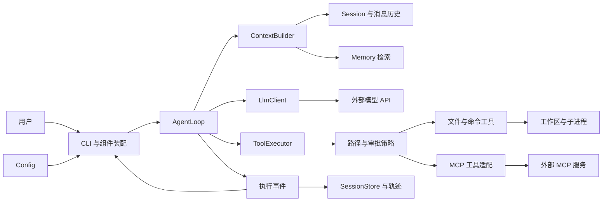
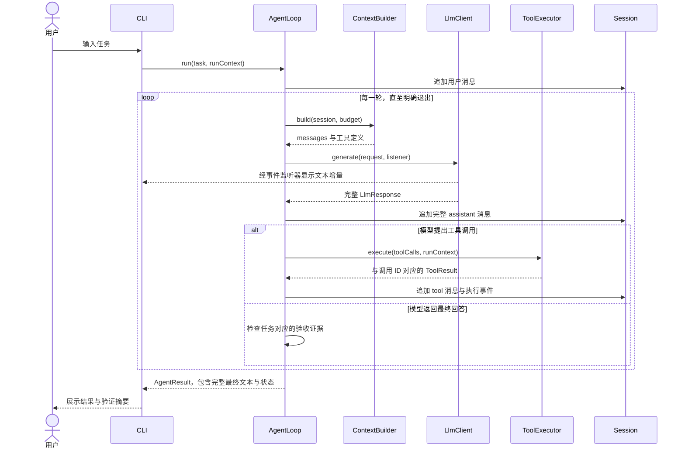

# CodeY 架构设计

> 版本：0.1，日期：2026-10-11。本文描述目标架构；当前已实现 Maven 骨架、CLI 入口及多 Profile 配置加载、选择与校验，其他模块为占位。开发进度见 [开发路线](#roadmap)。

## 阅读导航

- 第 1—9 节：定位、技术栈、目录、架构图、执行流程与核心策略。
- [模块职责与接口契约](#modules)
- [配置加载与多模型选择](#configuration)
- [开发路线与验收标准](#roadmap)
- [设计决策](#decisions)
- [面试学习与项目证据](#interview)

## 1. 项目定位与范围

CodeY 是使用 Java 从零实现的 CLI 编程 Agent。通过手写模型调用、Agent 循环、工具执行与上下文管理，理解 Claude Code、Codex 等产品的运行原理，并形成可演示、可验证的学习项目。

首版场景：在用户指定的 Java 工作区中读取代码、定位问题、修改文件、执行编译与测试，根据实际结果继续修复。最终输出改动说明、验证证据和剩余问题。

Harness 在本项目中指运行核心及其策略：Agent 循环、上下文构建、工具调度、预算、权限、状态和结果验证。LLM 是提出行动的组件；Java 程序负责执行和维护真实状态。

首版采用单 Agent。多 Agent、复杂 Plan、向量 RAG、Web UI、远程 API、微信与后台任务属于后续扩展，暂不建立对应模块。

## 2. 技术基线

| 组件 | 选择 | 实现阶段与原因 |
|---|---|---|
| 语言 | Java 17 | M0；本机可用，records 等能力足够支持首版 |
| 工程 | Maven 单模块 | M0；按包组织，降低初期装配成本 |
| CLI | JDK 标准输入输出 | M0/M1；后续有输入编辑需求再接 JLine |
| HTTP | JDK HttpClient | M1 计划；明确读写协议、超时与流关闭 |
| JSON | Jackson | M1 计划；接入时锁定具体版本并记录 |
| 日志 | 初期标准输出；后续 SLF4J | M1/M3；模型内容与日志分流，避免输出密钥 |
| 测试 | JUnit 5 + 本地 HTTP 替身 | M1 计划；默认测试不调用真实模型 |
| 状态存储 | 项目内 JSON/JSONL 文件 | M5；先实现可解释的事件与状态恢复 |
| MCP | JSON-RPC + stdio | M6；先支持一条传输链，HTTP 后续增加 |

当前 pom 声明构建插件和测试范围的 JUnit 5.10.2，没有第三方运行时依赖。加入 Jackson 等依赖时同步配置依赖打包。依赖版本在实际接入阶段选择、锁定和验证，不直接继承原项目的完整依赖列表。

## 3. 目录结构

```text
codeY/
├── README.md
├── pom.xml
├── .gitignore
├── .gitattributes
├── .env.example
├── docs/
│   ├── architecture.md     # 完整设计、配置、路线与学习笔记
│   └── diagrams/           # 可编辑 Mermaid 源文件
│       ├── architecture.mmd
│       ├── agent-flow.mmd
│       └── request-sequence.mmd
└── src/
    ├── main/
    │   ├── java/io/github/jackfeicoder/codey/
    │   │   ├── cli/          # Main、装配、输入与展示
    │   │   ├── config/       # 环境配置、模型配置、工作区
    │   │   ├── agent/        # AgentLoop、预算、取消、结果
    │   │   ├── llm/          # LlmClient、请求响应、SSE
    │   │   ├── tool/
    │   │   │   └── builtin/  # 文件、搜索、命令工具
    │   │   ├── context/      # 上下文收集、选择、预算与压缩
    │   │   ├── session/      # 消息、执行事件、会话存储
    │   │   ├── memory/       # 长期记忆的检索与保存
    │   │   ├── mcp/          # MCP 客户端及工具适配
    │   │   ├── policy/       # 路径范围、审批与执行策略
    │   │   └── observability/ # 执行轨迹、Token 与耗时
    │   └── resources/prompts/
    └── test/
        ├── java/io/github/jackfeicoder/codey/
        └── resources/fixtures/
```

模块包当前使用 package-info.java 声明用途，避免空目录在 Git 中丢失。资源空目录使用 .gitkeep 占位，不提前加入复杂抽象。prompts 后续保存系统提示词，fixtures 保存脱敏协议响应和小型测试项目；测试按主代码的包结构组织，默认不依赖真实 API Key。

运行时数据目录 `.codey/` 按需创建并忽略提交，目标布局如下，当前未生成：

```text
工作区/.codey/
├── sessions/<session-id>/events.jsonl
├── sessions/<session-id>/state.json
├── memory/project.json
└── runs/<run-id>/summary.json
```

执行轨迹可能含源码与命令输出，日志内容应可截断、脱敏并由用户控制留存。

## 4. 模块架构



CLI 是装配入口，负责创建组件和展示事件。AgentLoop 面向接口工作，避免直接操作终端。上下文、会话与记忆职责明确：会话保存发生过什么，上下文决定当前发什么，记忆保存跨会话事实。

接口和数据契约详见 [模块与接口](#modules)。图中的持久化、记忆、MCP 是后续阶段能力。

## 5. 启动流程

1. 解析参数：help/version，后续加入 workspace/model/session。
2. 加载配置并校验模型名、地址、密钥、超时、工作区。
3. 解析工作区真实路径；按策略注册当前可用工具。
4. 创建 LlmClient、Session、ContextBuilder、ToolExecutor 和 AgentLoop。
5. M5 开始按需恢复会话；M6 开始初始化 MCP，并负责关闭资源。
6. 接收输入，启动 run，展示流式事件和最终 AgentResult。
7. 退出时关闭响应流、执行器、MCP 进程和会话存储。

已实现配置来源优先级：系统环境变量 > 启动目录 `.env` > 默认值。多 Profile 默认选择由 CODEY_ACTIVE_PROFILE 指定，--profile 可临时覆盖。`.env.example` 是字段模板，不作为有效配置加载。--list-models 列出别名，--check-config 只校验选中配置；旧版 CODEY_LLM_* 兼容为 default。其他启动装配步骤按阶段实现。解析范围与 YAML 的关系见 [配置说明](#configuration)。

## 6. 一次任务的执行流程

```mermaid
flowchart TD
    start["接收任务并创建 Run"] --> append["追加用户消息"]
    append --> guard{"取消或预算耗尽？"}
    guard -- "是" --> stopped["返回 CANCELLED 或 BUDGET_EXHAUSTED"]
    guard -- "否" --> build["构建上下文并预留输出预算"]
    build --> call["调用 LLM 并展示事件"]
    call --> valid{"响应完整且合法？"}
    valid -- "否" --> failed["分类失败与有限重试"]
    failed --> exhausted{"重试耗尽？"}
    exhausted -- "是" --> error["返回 FAILED"]
    exhausted -- "否" --> guard
    valid -- "是" --> tools{"存在工具调用？"}
    tools -- "是" --> policy["校验参数与权限"]
    policy --> execute["执行工具并回填全部结果"]
    execute --> guard
    tools -- "否" --> verify{"任务验收证据满足？"}
    verify -- "是" --> done["返回 COMPLETED 与证据"]
    verify -- "否" --> continueRun{"仍可继续？"}
    continueRun -- "是" --> feedback["追加缺失证据或失败反馈"]
    feedback --> guard
    continueRun -- "否" --> incomplete["返回 INCOMPLETE"]
```



流式回调只负责展示，完整响应始终返回调用方。模型的 assistant tool_calls 与每个 tool_call_id 对应的结果作为完整组保留，压缩时避免孤立结果。

## 7. 核心策略

### Agent 与退出

- 每个 run 创建独立 RunContext，携带 runId、workspace、budget、cancelToken。
- 限制轮次、墙钟时间、单次工具时间；Token 预算接入后单独累计。
- 区分 COMPLETED、INCOMPLETE、FAILED、CANCELLED、BUDGET_EXHAUSTED。
- 模型结束回答并不自动证明代码任务完成。代码修改任务检查约定验证命令的退出码、验证发生在最新修改之后等证据。
- 验证通过仅表示约定检查通过，未覆盖的行为在结果中说明；解释代码类任务采用不同完成条件。

### 工具

首版 read_file、list_files、search_text、write_file、execute_command。read_file 默认分页，返回路径、行号、截断信息。工具输出保留执行元数据，与发给模型的截断文本分开。

工具定义、注册与执行分开。ToolResult 结构化保存 status、errorCode、output、exitCode、duration 和 artifacts。参数验证与路径策略在执行前运行。

初期工具顺序执行。具备依赖与资源冲突判断后才并行只读操作；文件写入和改变工作区的命令按顺序执行。命令通过平台适配运行，明确工作目录、退出码和超时，不固定使用 bash。

### 上下文

每次调用模型前统一构建：项目规则、当前目标、历史摘要、近期完整消息组、相关记忆和工具定义。采用收集 → 筛选 → 组织 → 压缩的流程。

预算同时考虑工具 schema、系统规则、近期历史和预留输出。估算值与 API 返回实际 usage 分开记录。大工具输出通过限制、分页和按需读取控制。

压缩使用副本构建请求，完整会话事件保留。摘要记录目标、约束、已完成步骤、关键文件、失败与下一步；需要重新检查文件时读取最新内容。

### 记忆与 MCP

长期记忆初期只保存用户明确确认的偏好、项目约定与重要事实，携带范围、来源与时间；不自动保存每条模型推断。保存操作统一经过存储层，并采用临时文件替换等方式避免半写文件。

MCP 工具经适配器进入同一 ToolRegistry/ToolExecutor，复用权限、超时、事件与结果处理。先实现 stdio 的 initialize、initialized、tools/list、tools/call；未知能力不注册为可用功能。协议版本、能力协商和分页以接入阶段文档与测试为准。

## 8. 会话恢复与操作边界

会话恢复必须绑定工作区与模型配置引用，不持久化 API Key。持久化步骤事件和状态快照。进程意外退出后，先检查最后一条工具是否已完成；不直接重放写文件、命令或其他有副作用的调用。

文件路径校验基于规范化路径和真实路径处理已有文件、符号链接及目标父目录；路径前缀的字符串判断不足以覆盖边界。命令工具能操作更大范围，因此路径限制与进程隔离是不同能力。初期使用命令审批，后续根据需要引入进程隔离。

## 9. 实现验证与已知边界

- 当前验收 Maven 构建、可执行 JAR、help/version 以及配置加载测试和 --check-config；没有模型调用。
- LLM 接入用本地 HTTP/SSE 替身验证，不使用真实密钥作为默认测试前提。
- 工具使用临时工作区验证路径、分页、错误和超时；命令用无网络的测试程序。
- 上下文验证工具调用组完整性、预算和规则保留；恢复验证副作用不会被盲目重放。
- 最终用固定小型 Java 项目评估，记录模型配置和任务集版本，避免把模型变化误认为架构提升。

图表提供 Mermaid 源文件，并人工检查流程与顺序；已核对独立源文件与本文内嵌图一致。初始化时尝试本地渲染，因环境缺少 Mermaid CLI（mmdc）未生成 SVG/PNG；尚未经过渲染器语法验证。可在支持 Mermaid 的 Markdown 查看器中预览，构建 Java 工程不依赖图表渲染工具。

<a id="modules"></a>

## 10. 模块职责与接口契约

> 以下为目标设计。当前已实现 cli.Main、LlmConfig、AuthMode、ModelProfiles、ConfigLoader、DotEnvReader 和 ConfigException；其余模块仅有包说明。接口名可随实际实现调整。

### 模块边界

| 包 | 职责 | 计划核心类型 | 约束 |
|---|---|---|---|
| cli | 装配、输入、渲染、退出 | Main、CliApplication、ConsoleRenderer | 不持有 Agent 算法；核心代码不直接输出终端 |
| config | 加载、选择并验证配置 | LlmConfig、ModelProfiles、AuthMode；后续 AppConfig/WorkspaceConfig | 密钥不进入日志、会话或仓库 |
| agent | 执行循环、预算、取消、完成判定 | AgentLoop、RunContext、AgentResult、RunBudget | 一次 run 的状态独立，明确退出原因 |
| llm | 请求编码、HTTP、SSE、响应组装 | LlmClient、LlmRequest、LlmResponse、StreamListener | 总返回完整结果；展示回调不影响返回值 |
| tool | 定义、注册、调度、参数验证 | Tool、ToolDefinition、ToolCall、ToolResult、ToolRegistry、ToolExecutor | Agent 依赖执行器，工具不反向调用 Agent |
| tool.builtin | 文件搜索、读取、修改、命令 | ReadFileTool、SearchTextTool、WriteFileTool、ExecuteCommandTool | 输出有边界，所有路径基于工作区解析 |
| context | 选择和组织本轮输入 | ContextBuilder、ContextSnapshot、TokenEstimator、HistoryCompactor | 不把长记忆与会话副本重复堆入请求 |
| session | 完整会话状态、消息、事件和存储 | Message、Session、SessionEvent、SessionStore | assistant 调用与 tool 结果具备关联关系 |
| memory | 保存和召回长期事实 | MemoryEntry、MemoryStore、MemoryRetriever | 支持项目范围、来源、时间与删除 |
| mcp | 外部协议与工具适配 | McpClient、StdioTransport、McpToolAdapter | 处理 pending request、分页与资源关闭 |
| policy | 路径范围、审批、操作策略 | ExecutionPolicy、PathPolicy、ApprovalHandler | 程序执行策略；提示词不能替代限制 |
| observability | 轨迹与指标 | AgentEvent、RunMetrics、TraceWriter | 展示信息与持久化信息可分别脱敏 |

### 最小数据模型

| 类型 | 关键字段 | 作用 |
|---|---|---|
| Message | role、content、toolCalls、toolCallId | 保持模型协议中的消息结构 |
| ToolCall | id、name、arguments | arguments 从 JSON 校验后执行；流式碎片按 index/id 拼接 |
| ToolResult | callId、status、output、errorCode、exitCode、duration | 一条调用无论成功失败都产生对应结果 |
| LlmResponse | text、toolCalls、finishReason、usage | 最终结果与展示事件分开；不完整响应显式失败 |
| RunContext | runId、workspace、budget、cancelToken | 每次任务的明确执行环境 |
| AgentResult | status、finalText、verification、metrics、artifacts | CLI 和后续 API 共用；文本不能为空只是因为已流式展示 |
| Session | sessionId、workspace、messages、events | 上下文选择的数据来源，完整历史留存 |
| MemoryEntry | id、scope、projectId、content、source、createdAt | 避免不同项目的相同事实被错误合并 |

只有实际需要的字段进入首版。usage 缺失表示未知，不视为零。模型 capabilities（工具支持、上下文窗口等）通过显式配置提供。

### 核心接口示意

以下是职责说明，不是当前可复制编译的完整接口：

```java
interface LlmClient {
    LlmResponse generate(LlmRequest request, StreamListener listener,
                         CancellationToken cancellation);
}

interface Tool {
    ToolDefinition definition();
    ToolResult execute(ToolCall call, RunContext context);
}

interface ContextBuilder {
    ContextSnapshot build(Session session, RunContext context);
}

interface SessionStore {
    void append(String sessionId, SessionEvent event);
    Session load(String sessionId);
}
```

选择 record 表达不可变数据，接口表达可替换边界。首轮实现中只为 LLM、工具、上下文、存储等真实边界建立接口；不机械地给所有类增加接口。

### 流式协议处理

1. 检查 HTTP 状态和响应类型，读取流时支持取消。
2. 按 SSE 事件边界收集 data 行，支持事件分片和多行 data。
3. 解析文本 delta；tool_calls 按索引组装 name 和 arguments。
4. 只有完整响应通过检查后，才执行工具。部分 JSON 参数不会直接执行。
5. 明确 finish_reason、正常终止和提前 EOF 的处理策略。服务商差异通过适配或配置显式处理。
6. 回调输出文本增量，返回值保留完整文本与工具调用；请求结束关闭流。

初期只支持一种兼容 Chat Completions 的请求格式。兼容不代表所有提供商行为相同，新增提供商时补充协议样例。

### 工具执行契约

- 工具定义包含名称、描述、JSON Schema、操作类别、超时与输出上限。
- ToolRegistry 只负责注册与查找；ToolExecutor 负责验证、审批、调度、取消、事件和归一化结果。
- 未知工具和非法参数作为工具失败回填，让模型收到可处理的原因。
- 读取默认带 offset/limit；列表和搜索分页；输出包含是否截断和继续读取方式。
- 写文件先展示或记录差异，执行后记录改动版本；初期完整写入，随后加入期望旧内容匹配的 patch。
- 同一轮有多个工具调用时，初期按模型给出的顺序执行；全部结果回填后才调用下一轮模型。
- stdout/stderr 有容量上限；保留退出码。超时后终止进程及相关子进程，并确认资源关闭。

### 错误与取消

| 场景 | 处理 |
|---|---|
| 配置缺失 | 启动前报错，说明字段名，不显示密钥 |
| HTTP 认证失败 | FAILED，不重复发送同一错误配置 |
| 限流或临时服务异常 | 有次数与总时间限制的退避；记录尝试 |
| 响应截断或解析失败 | 本轮不执行残缺工具调用，分类报错或有限重试 |
| 工具参数/路径错误 | ToolResult 失败回填，可供模型修正 |
| 写入或命令完成后结果丢失 | 先核对副作用，不自动重放 |
| 用户取消 | 每轮与工具前检查，传播到 HTTP 和进程 |
| 预算耗尽 | 返回 BUDGET_EXHAUSTED，保留已完成步骤 |

错误通过类型与状态传递，不仅返回一条包含“失败”的字符串。重试策略区分模型请求与有副作用的工具调用。

### 事件与完成验证

事件建议包括 RunStarted、LlmStarted、TextDelta、ToolStarted、ToolFinished、ContextCompacted、RunFinished。持久化关键状态事件；高频文本增量可另行汇总，避免每个字符都写状态快照。

代码修改任务的 verification 至少记录命令、工作区、执行时间、对应改动版本、退出码和输出摘要。AgentResult 中说明检查范围与未覆盖项。普通问答与代码修改采用不同的完成条件。

### 扩展边界

- 新模型：实现 LlmClient 或协议适配器。
- 新工具：实现 Tool，经统一执行器执行。
- MCP：将外部 schema 和调用结果适配成 ToolDefinition/ToolResult。
- CLI 改善或 API 接入：复用 AgentResult 与事件，不复制执行循环。
- 代码 RAG：作为检索来源进入 ContextBuilder，按实际任务需求加入。
- 多 Agent：各自拥有 Session/RunContext，资源共享必须显式协调，后续另写设计决策。

<a id="configuration"></a>

## 11. 配置加载与多模型选择

> 当前已实现：LlmConfig、AuthMode、ModelProfiles、ConfigLoader、DotEnvReader，以及 CLI 的 --list-models、--check-config 和 --profile。支持命名 Profile 与旧版单模型配置。当前校验不会调用模型，也不会验证密钥在服务商是否有效。

### .env、环境变量、YAML 和配置类

| 概念 | 是什么 | CodeY 当前行为 |
|---|---|---|
| 系统环境变量 | 进程从操作系统/父进程继承的键值 | 使用 System.getenv() 读取 |
| .env | 保存 KEY=VALUE 的普通文本文件 | DotEnvReader 显式读取启动目录的文件 |
| application.yml | YAML 格式的配置文件，常见于 Spring Boot | 当前不加载；普通 Java 需要解析与映射 |
| LlmConfig | 应用内部使用的强类型配置对象 | 将解析结果转换为 URI、Duration 等并验证 |

System.getenv() 不会因为目录里有 .env 就自动读取它。读 .env 后得到的键值只在 CodeY 配置加载器中合并，没有修改系统环境变量。

Spring Boot 有自动寻找 application.properties/application.yaml、合并多种配置来源和绑定对象的机制。普通 Java 的文件名没有这种自动行为。Spring Boot 默认也不会把 .env 当作 dotenv 文件解析，需要额外加载方式或在启动前注入环境变量。

两种文件可以协作。例如在 Spring Boot 中：

```yaml
llm:
  base-url: ${CODEY_LLM_BASE_URL}
  api-key: ${CODEY_LLM_API_KEY}
  model: ${CODEY_LLM_MODEL}
  timeout-seconds: ${CODEY_LLM_TIMEOUT_SECONDS:120}
```

这里占位符从 Spring 的配置环境解析；只创建 .env 并不会自动让这些占位符获得值。上述 YAML 是原理示例，不是 CodeY 的有效配置文件。

### 当前优先级与查找规则

```text
进程环境变量 > 启动目录的 .env > 代码默认值
            ↓
       ConfigLoader 合并
            ↓
       ModelProfiles 选择配置
            ↓
       选中的 LlmConfig 校验
            ↓
       后续提供给 LlmClient
```

- .env 只在当前工作目录查找，不搜索父目录、用户目录或 resources。
- .env 可缺失，只要环境变量提供全部必填值。
- 环境变量中存在空值时同样覆盖文件；必填配置校验失败，不偷偷回退。
- bearer 认证需要 API Key，none 认证不需要；模型和 URL 无默认值。
- 单 Profile 超时 > 公共 CODEY_LLM_TIMEOUT_SECONDS > 120 秒。字段优先级在文件与环境变量合并后应用。
- .env.example 是可提交的字段模板，不会作为运行配置读取。
- .env 无法读取、内容不符合约定或有重复字段时报错，只输出字段/行号，不回显内容。

启动目录和 Agent 操作的工作区是不同概念，当前按启动目录定位配置；CODEY_WORKSPACE 的加载留到后续 Agent 配置实现。

### 多 Profile 配置与选择

Profile 是一套地址、认证、模型和超时的配置别名，不要求与服务商名字一致。同一平台的两个模型可以命名为 gateway_fast 与 gateway_code。

```dotenv
CODEY_PROFILE_NAMES=deepseek,qwen,local
CODEY_ACTIVE_PROFILE=deepseek

CODEY_PROFILE_DEEPSEEK_BASE_URL=https://api.example.com/v1
CODEY_PROFILE_DEEPSEEK_API_KEY=YOUR_API_KEY
CODEY_PROFILE_DEEPSEEK_MODEL=YOUR_MODEL

CODEY_PROFILE_QWEN_BASE_URL=https://qwen.example.com/v1
CODEY_PROFILE_QWEN_API_KEY=YOUR_API_KEY
CODEY_PROFILE_QWEN_MODEL=YOUR_MODEL

CODEY_PROFILE_LOCAL_BASE_URL=http://localhost:8000/v1
CODEY_PROFILE_LOCAL_MODEL=YOUR_MODEL
CODEY_PROFILE_LOCAL_AUTH=none

CODEY_LLM_TIMEOUT_SECONDS=120
CODEY_PROFILE_LOCAL_TIMEOUT_SECONDS=60
```

上述地址是格式示例，需填写实际基础地址和模型标识。仅检查选中的配置，因此其他配置的占位符不会阻止已填写的 Profile 使用。

规则：

- CODEY_PROFILE_NAMES 声明别名，英文逗号分隔。别名以字母开头，只包含字母、数字和下划线，忽略大小写，重复报错。
- CODEY_ACTIVE_PROFILE 指定默认别名；多 Profile 模式中必填，除非 --profile 已指定。
- 字段前缀是 CODEY_PROFILE_ 加大写别名及下划线，例如 qwen 对应 CODEY_PROFILE_QWEN_。
- 支持 BASE_URL、MODEL、API_KEY、AUTH、TIMEOUT_SECONDS 五个后缀。
- AUTH 默认 bearer，必须有密钥；none 忽略密钥，LlmConfig 中不保留它，后续 HTTP 客户端应不发送认证头。
- 配置选择优先级：--profile > 环境变量 CODEY_ACTIVE_PROFILE > .env CODEY_ACTIVE_PROFILE。
- 有 CODEY_PROFILE_NAMES 就进入命名模式，缺失字段不会回退到旧版 CODEY_LLM_*，避免串用凭证；只有公共超时可共享。
- --list-models 只显示已声明的别名和当前选择，不读取校验所有模型凭证；它不表示服务商模型目录或可达性检查。

ConfigLoader.loadProfiles() 返回不可变配置快照。profileNames() 列出别名，activeConfig() 校验并返回当前配置，configFor(name) 读取指定配置。select(name) 校验目标后返回新快照，失败时原快照保持不变。

文件修改后需要重新加载配置；快照不会自动热更新。交互式 /model 命令将在对话循环实现后使用这些接口。任务执行时持有自己的 LlmConfig，避免修改正在进行的请求。

### 旧版单模型兼容

没有 CODEY_PROFILE_NAMES 时，旧配置仍可使用，并自动命名为 default：

| 配置项 | 必填 | 规则 |
|---|---|---|
| CODEY_LLM_BASE_URL | 是 | HTTP(S) 基础 URL，含服务商路径前缀；不含 userInfo、query、fragment |
| CODEY_LLM_API_KEY | bearer 时必填 | 非空；示例 YOUR_API_KEY 必须替换 |
| CODEY_LLM_MODEL | 是 | 服务商的模型标识，非空；YOUR_MODEL 必须替换 |
| CODEY_LLM_TIMEOUT_SECONDS | 否 | 正整数，默认 120 |
| CODEY_LLM_AUTH | 否 | bearer 或 none，默认 bearer |

BASE_URL 填服务商基础路径，例如 https://api.example.com/v1，不包含 /chat/completions。当前仅验证 URL 格式，不测试网络可达性。

模型名原样用于后续请求，不代表 CodeY 已确认该模型存在。例子中的 example.com 和占位 Key 仅说明格式。

### .env 支持范围

为了学习配置过程，当前用一个小型读取器，采用明确的单行格式：

```dotenv
# 注释行
CODEY_LLM_BASE_URL=https://api.example.com/v1
CODEY_LLM_API_KEY="replace-with-your-key"
CODEY_LLM_MODEL='replace-with-your-model'
CODEY_LLM_TIMEOUT_SECONDS=120 # 行末注释
```

支持 UTF-8（含 BOM）、空行、注释、可选 export 前缀、KEY=VALUE、单/双引号包围的单行值。首个等号后是值，值中的等号保留；引号中的 # 保留。无引号的 # 在行首或前面为空白时开始注释。

当前不做变量插值、命令替换、多行值和引号转义；反斜杠按字面保留。重复字段视为错误。它是 CodeY 的简化语法，不声称兼容所有 dotenv 实现。

### 使用方法

新建配置时，在项目目录运行。已有 .env 时手工补充字段，避免覆盖已填写的配置。

CMD：

```cmd
copy .env.example .env
```

PowerShell：

```powershell
Copy-Item .env.example .env
```

编辑 .env，替换当前需要使用的 Profile 地址、API Key 和模型名，保存为 UTF-8，然后执行（CMD/PowerShell 均可）：

```powershell
mvn clean verify
java -jar target/codey-0.1.0-SNAPSHOT.jar --check-config
java -jar target/codey-0.1.0-SNAPSHOT.jar --list-models
java -jar target/codey-0.1.0-SNAPSHOT.jar --check-config --profile qwen
java -jar target/codey-0.1.0-SNAPSHOT.jar --check-config --profile local
```

成功时输出配置已通过本地校验，并用 apiKey=<redacted> 隐藏密钥。失败时退出码为 2。默认/help/version 不要求配置存在。

--profile 不修改文件，当前必须配合 --check-config 或 --list-models。两个操作不可同时指定。/model 当前尚未实现。

环境变量覆盖示例（PowerShell）：

```powershell
$env:CODEY_ACTIVE_PROFILE = "qwen"
java -jar target/codey-0.1.0-SNAPSHOT.jar --check-config
Remove-Item Env:CODEY_ACTIVE_PROFILE
```

.gitignore 已忽略 .env。当前不创建真实配置文件，也不将密钥打入 JAR。LlmConfig 的 toString 主动隐藏密钥，调用方仍需避免直接打印 apiKey()。

### 代码阅读顺序与测试

1. LlmConfig / AuthMode：理解 record、强类型、认证约束与重写 toString。
2. DotEnvReader：理解文件读取和简化语法边界。
3. ConfigLoader：理解配置合并、别名列表、类型转换与默认值。
4. ModelProfiles：理解选中时校验和不可变切换。
5. Main 的 --check-config / --list-models / --profile：理解启动前选择、校验和退出码。
6. ConfigLoaderTest / DotEnvReaderTest / ModelProfilesTest：用临时文件和显式 Map 测试，不依赖真实密钥。

测试覆盖：文件读取、环境覆盖、空值覆盖、必填字段、非法 URL/超时、示例占位符、BOM/引号/注释/等号、重复字段、错误不回显与对象输出脱敏；新增多 Profile、CLI 选择优先级、别名大小写、未知/重复别名、按需校验、认证方式、超时继承、配置隔离、切换失败保留原状态和旧配置兼容。

### 官方资料

- [Java 17 System.getenv](https://docs.oracle.com/en/java/javase/17/docs/api/java.base/java/lang/System.html#getenv())：读取当前进程环境。
- [Spring Boot 外部化配置](https://docs.spring.io/spring-boot/3.5/reference/features/external-config.html)：文件加载、环境变量、占位符和属性绑定。

<a id="roadmap"></a>

## 12. 开发路线与验收标准

> 当前：M1，已完成多 Profile 配置加载、选择与校验。各阶段按顺序推进；没有固定工期承诺。先完成当前阶段，再接入后续复杂度。

### M0：工程骨架

- [x] 克隆仓库，建立 Java 17 单模块 Maven 工程。
- [x] 建立模块包、资源和测试目录。
- [x] 提供项目介绍、架构、模块、开发路线与面试笔记。
- [x] 验证 `mvn clean verify` 与 JAR 的默认、help、version 启动；非法参数返回退出码 2。

本阶段没有业务测试用例；构建通过表示编译与打包通过，入口通过手工命令检查。LLM/工具测试从后续阶段加入。

### M1：LLM 与基础 CLI

先实现 LlmConfig，按需扩展 AppConfig；再实现消息模型、LlmClient、兼容 Chat Completions 的 HTTP 调用和 SSE 拼接，先接入一个模型提供商。

- [x] LlmConfig 从启动目录 .env 和系统环境变量加载，支持默认超时与 --check-config。
- [x] 缺少密钥、模型和地址时给出字段级错误；打印配置隐藏 API Key。
- [x] 支持多 Profile、默认选择、--profile 覆盖、--list-models、none 认证与旧格式兼容；切换接口先校验目标配置。
- [ ] 对话循环接通后支持 /model，切换在任务边界生效。
- [ ] 连续两轮对话保持消息顺序，最终文本与流式展示一致。
- [ ] 测试多行 SSE、拆分参数、正常结束、提前 EOF、HTTP 错误与超时。
- [ ] 支持取消并关闭响应流；日志不输出 API Key。
- [ ] 加入运行依赖后更新可执行 JAR 打包，并验证独立启动。

产出证据：脱敏请求/响应、流式样例、协议测试结果。面试：HTTP、SSE、超时、适配。

### M2：Agent 循环与只读工具

实现 AgentLoop、ToolRegistry、ToolExecutor、read_file/list_files/search_text，使用结构化工具结果与运行状态。

- [ ] 输入“找到项目入口并解释”，模型自动搜索和读取文件。
- [ ] assistant tool_calls 与全部 tool 结果配对，未知工具也有结果。
- [ ] read_file 默认分页，大文件输出不会无限增长。
- [ ] 路径越界、符号链接等边界有明确处理。
- [ ] 达到轮次上限返回 BUDGET_EXHAUSTED，工具失败允许下一轮修正。
- [ ] 用可控 LLM 替身验证完整循环，无真实 API 依赖。

产出证据：一份任务轨迹、工具参数与失败反馈。面试：ReAct、Function Calling、Harness。

### M3：修改、命令与验证闭环

加入 write_file、execute_command、执行策略、命令审批与验收证据。初期工具顺序执行。

- [ ] 在小型 Java 项目修复一个已知 Bug，先记录失败，再修改并通过测试。
- [ ] 命令工作目录正确；收集退出码和有上限的 stdout/stderr。
- [ ] 超时或取消能终止相关进程；取消不会被标记为完成。
- [ ] 验证证据在最新修改之后产生，测试失败不会返回 COMPLETED。
- [ ] 最终结果说明改动文件、验证命令及剩余问题。

产出证据：修改 diff、失败/成功测试记录、最终 AgentResult。面试：进程管理、副作用、完成判定。

### M4：上下文工程

统一 ContextBuilder，加入规则、历史、工具输出预算和摘要。规则约定文件名及优先级在本阶段确定。

- [ ] 每次模型调用前重新构建上下文，新增规则或 Skill 内容及时生效。
- [ ] 预算包含系统提示词、工具 schema、历史和预留输出；估算与实际 usage 分开。
- [ ] 压缩保留近期完整工具调用组、当前目标和项目约束。
- [ ] 完整事件历史留存，请求压缩不破坏源记录。
- [ ] 用同一模型和任务比较策略前后的任务结果、Token 与耗时。

产出证据：压缩前后样例、预算统计、失败案例。面试：Context Engineering、Token、摘要取舍。

### M5：会话与记忆

引入 JSONL 事件和状态快照、项目级长期记忆。先完成明确的本地存储和恢复逻辑。

- [ ] 新进程可恢复消息历史、工作区和执行状态。
- [ ] 模型配置引用可恢复，API Key 不落盘。
- [ ] 项目记忆带范围、来源与时间，跨项目不串用。
- [ ] 写入采用明确单写者/锁和原子替换；损坏尾行可检测处理。
- [ ] 中断于工具执行前后时，避免盲目重放有副作用的操作。

产出证据：恢复实验、存储样例、记忆召回记录。面试：记忆与上下文、幂等、持久化。

### M6：MCP

先实现 stdio 与一个本地 MCP 服务。HTTP、多服务管理和资源协议另行扩展。

- [ ] 完成初始化、能力协商、工具发现与调用。
- [ ] 工具接入同一注册、权限和执行路径。
- [ ] 处理工具列表分页、并发请求 ID、超时、服务退出。
- [ ] 通知处理不会阻塞响应读取线程。
- [ ] 关闭客户端时完成或取消 pending futures，并关闭线程和子进程。
- [ ] 协议版本和支持能力在文档中明确。

产出证据：协议交互轨迹、工具演示、生命周期测试。面试：MCP、JSON-RPC、stdio、异步并发。

### M7：评估与展示

- [ ] 整理不少于 6 个固定任务：解释、搜索、修复、添加功能、测试失败反馈、取消/恢复。
- [ ] 保存任务集版本、模型配置、成功标准与每次执行结果。
- [ ] 报告成功率、Token、耗时、工具错误及主要失败原因。
- [ ] 提供可复现运行方式、演示过程与三项设计取舍。
- [ ] 更新 README，只列出已完成能力；面试笔记补充代码位置和实际证据。

多 Agent、复杂 RAG、HTTP API、TUI 以实际需求触发，另写设计与验收标准。

<a id="decisions"></a>

## 13. 设计决策

> 日期：2026-10-11。状态：采用为初始方案；未完成模块的细节可在实现时修订。

### D01：Java 17 与 Maven 单模块

原因：当前环境已有 Java 17，单模块足够支撑学习与首版。包边界表达职责，便于读完整调用链。

代价：无法利用 Java 21 虚拟线程；模块边界通过设计与检查维护。

重新评估：出现独立发布组件或明确并发需求时，再讨论升级语言版本或拆 Maven 模块。

### D02：先完成单 Agent 编程闭环

原因：核心循环、工具、上下文和验证是后续编排的基础。先在小型 Java 项目中验证实际可用性。

代价：初期不覆盖大任务并行拆解。

重新评估：已有任务集证明单 Agent 的具体瓶颈时，再引入 Plan、子 Agent 或 RAG。

### D03：使用 JDK HTTP，接入时引入 JSON 库

原因：直接理解请求、流、超时和关闭行为；JSON 使用成熟解析库，聚焦 Agent 逻辑。

代价：需要自己完成协议组装、SSE 和兼容差异处理。

重新评估：多提供商、多协议造成明确维护成本时，考虑复用 SDK，同时保留核心接口。

### D04：结构化结果与完整返回值

原因：避免流式展示后返回空文本，以及将错误字符串误判为完成。ToolResult 与 AgentResult 明确表达状态。

代价：初期模型较字符串返回更复杂。

重新评估：新增入口时继续复用结果和事件，不复制 Agent 循环。

### D05：每轮统一构建上下文

原因：让规则、历史、记忆和预算有统一入口，新信息能在下一轮生效。完整事件历史与请求视图分开。

代价：需要选择与压缩策略，估算 Token 存在误差。

重新评估：结合任务集调整预算、摘要格式与检索，避免没有证据地增加复杂度。

### D06：先串行工具，再加入受控并行

原因：写文件、命令和连续读写存在顺序依赖。首先保证效果与轨迹一致。

代价：多次独立读取可能较慢。

重新评估：指标证明只读工具等待占比高，再引入有边界的并行与资源协调。

### D07：阶段式持久化与明确恢复

原因：先跑通内存会话，再用项目内 JSONL/JSON 保存关键事件和状态，方便理解与复现。

代价：本地文件不适合多进程并发写；需要明确单写者、尾行损坏检测与原子写入。

重新评估：出现并发存储或复杂查询时考虑 SQLite。任何存储形式都不自动保证有副作用的任务可安全重放。

### D08：有证据的完成判定

原因：编码任务需要实际测试或约定检查；模型回答与验收证据分别记录。

代价：增加执行耗时，验证不覆盖全部行为。

重新评估：按任务类型定义验证策略，持续扩展任务集，不用多 Agent 的文字审查替代实际检查。

### D09：显式加载 .env，环境变量优先

原因：用户希望本地使用 .env 保存模型配置。保持纯 Java 工程，用有明确语法范围的读取器演示文件读取、配置合并、类型转换和校验。

规则：系统环境变量 > 启动目录 .env > 默认值；空环境变量同样覆盖文件，必填字段失败时显式报错。当前不加载 YAML，不修改系统环境。

代价：简化 dotenv 不支持多行、引号转义或变量插值。未来语法需求复杂时可引入成熟读取库并保持现有优先级契约。

重新评估：出现分层配置和多环境需求时再增加配置来源；不为了文件名 application.yml 单独引入 Spring Boot。

### D10：命名 Profile 与不可变配置选择

原因：官方平台、第三方服务和本地模型都可以表达为命名配置。同一平台的不同模型也可定义多个别名，通过统一前缀解析。

规则：显式别名列表 + 默认别名；CLI 选择覆盖环境/文件。选中时才校验，避免未填写的备用配置阻塞当前使用。select 返回新快照，目标无效时保留原快照。none 认证不保留 API Key。

代价：当前重复填写同一平台的地址与密钥；当前不自动热加载文件，也不识别提供商的所有协议差异。

重新评估：多个模型共享配置造成实际维护问题时考虑 provider 与 model 分层。新增请求协议通过 LlmClient 适配，不凭服务商别名推断兼容性。

<a id="interview"></a>

## 14. 面试学习与项目证据

> 随实现积累。下面是问题和回答骨架，不代表已经做出所有能力，也不要把待验证的设计写成性能结论。

### 每个问题的记录模板

```text
问题：
原理：用自己的语言说明工作机制。
CodeY 实现：类/方法、输入输出与关键控制点。
取舍：为什么这样做，有什么代价。
遇到的问题：具体触发条件和处理过程。
证据：测试、运行轨迹、diff、指标或复现步骤。
后续改进：什么情况下需要改变设计。
```

每完成模块，整理原理、设计取舍、实际问题各一道。记录真实代码位置；功能完成前使用“计划实现”。

### M1：LLM 与流式调用

已完成的配置部分可先准备：为什么将文件读取、配置合并、配置对象分开？如何定义多来源优先级？如何隔离多个 Profile 的凭证？如何在切换失败时保持原状态？相关实现与测试见 config 包；当前 /model 交互命令仍待实现。

| 问题 | 回答要点 | 待补证据 |
|---|---|---|
| LLM 和 Agent 的区别？ | LLM 生成文本/行动；Agent 维护循环、状态并执行工具 | 一次完整请求流程 |
| SSE 与普通 HTTP 响应有什么区别？ | 同一 HTTP 响应逐事件读取；事件边界与 TCP 分片不同 | 拆分响应测试 |
| 流式 tool arguments 怎么处理？ | 按调用索引/ID 拼接，完整后解析和校验 | 多工具交错碎片 |
| 为什么流式展示后仍要返回完整结果？ | CLI、持久化和后续 API 都需要完整响应 | 文本一致性测试 |
| 超时、重试、取消如何区分？ | 连接/请求/总预算；可重试错误分类；取消传播 | 超时与取消轨迹 |
| 如何接入多个模型提供商？ | 协议适配、显式能力配置、同一业务接口 | 提供商样例差异 |

### M2：Agent 与工具

| 问题 | 回答要点 | 待补证据 |
|---|---|---|
| ReAct 是什么？ | 根据工具观察结果继续决定下一步；描述流程不要求展示模型内部思维 | 搜索到读取的轨迹 |
| Function Calling 谁执行？ | 模型返回结构化请求，宿主校验和执行 | 工具调用消息组 |
| Harness 是什么？ | 模型周围的循环、上下文、工具、策略和状态机制 | 模块架构图 |
| 为什么分开 Registry 与 Executor？ | 注册查找和执行策略的变化原因不同 | 核心类依赖关系 |
| 工具错误怎么反馈？ | 对应调用 ID 的结构化失败结果，让模型有机会纠正 | 参数修正案例 |
| 如何避免无限循环？ | 轮次、总时间、重复无进展检测和明确退出状态 | 预算耗尽测试 |

### M3：编程闭环

| 问题 | 回答要点 | 待补证据 |
|---|---|---|
| Agent 如何判定任务完成？ | 按任务类型检查验收证据，代码验证绑定最新修改 | 失败到成功的测试记录 |
| 为什么不能只相信模型说完成？ | 自然语言声明不是实际执行证据 | 提前结束案例 |
| 工具都并行执行会怎样？ | 数据依赖、写冲突、结果顺序与副作用顺序不同 | 冲突场景 |
| 命令工具如何管理输出？ | 并发消耗输出流、有界缓冲、退出码与超时 | 大输出与超时测试 |
| 重试写入和命令有什么问题？ | 副作用可能已发生，需检查结果和幂等条件 | 中断位置实验 |
| 路径限制等于沙箱吗？ | 文件路径校验与进程隔离是不同边界 | 路径/进程策略说明 |

### M4/M5：上下文、记忆与恢复

| 问题 | 回答要点 | 待补证据 |
|---|---|---|
| 上下文工程与提示词工程的关系？ | 上下文包含规则、历史、工具、检索与预算；提示词是其中部分 | ContextBuilder 输入输出 |
| 记忆、会话历史、RAG 有何区别？ | 长期事实、完整执行记录、外部知识检索的生命周期不同 | 实际存储与召回样例 |
| 为什么要压缩历史？ | 上下文有限且有成本，大量无关信息降低有效信息密度 | 对照任务结果与 Token |
| 压缩应该保留哪些内容？ | 目标、约束、关键发现、失败、下一步以及完整调用组 | 摘要样例 |
| Token 估算为什么不等于实际 usage？ | 分词器、schema、服务商协议和计费字段不同 | 估算/实际对照 |
| 会话恢复如何避免重复副作用？ | 持久化执行事件，检查未确认步骤与真实工作区状态 | 恢复实验 |
| 记忆如何避免项目污染？ | scope/projectId、来源、显式保存与可删除 | 两项目隔离测试 |

### M6/M7：MCP 与评估

| 问题 | 回答要点 | 待补证据 |
|---|---|---|
| MCP 与 Function Calling 的区别？ | 模型请求工具与宿主连接外部服务处于不同边界 | 两段协议流程 |
| JSON-RPC 怎么匹配异步响应？ | 请求 ID、pending future、超时清理与关闭 | 乱序响应测试 |
| 通知处理为何可能死锁？ | 在读取响应线程同步等待同一通道的响应 | 通知异步测试 |
| Agent 怎么评估？ | 固定任务、环境、模型配置、验收标准和重复实验 | 任务集与指标 |
| 如何证明优化来自 Harness？ | 保持模型与任务一致，只改变策略，记录失败原因 | 对照结果 |
| 多 Agent 一定更好吗？ | 额外协调、上下文与成本，需要任务证据支持 | 后续实验，当前未实现 |

### 项目介绍模板

完成后填入真实内容：

> CodeY 是我使用 Java 实现的 CLI 编程 Agent。它通过【已完成的工具与流程】执行代码任务。我重点处理了【实际问题一】、【实际问题二】和【实际问题三】，采用【具体设计】。在【任务集及模型配置】上，记录了【真实成功率、Token、耗时】，主要限制是【验证过的边界】。

### 三项值得积累的案例

1. 一次协议问题：例如工具参数碎片拼接或提前 EOF。
2. 一次执行问题：例如进程超时、文件冲突或错误完成状态。
3. 一次上下文问题：例如摘要遗漏约束、工具结果过大或规则注入时机。

每个案例保留触发条件、最小复现、修改和验证。案例由实际开发产生，不预先编造经历或收益。

## 15. 参考资料与维护方式

- [PaiCLI](https://gitcode.com/javabetter/paicli)：参考实际编程 Agent 的工程场景。本机源码分析原文保留在 `E:\Desktop\github\paicli\docs\paicli-source-architecture-guide.md`；其中描述的是 PaiCLI，不代表 CodeY 已实现的能力。
- [Hello-Agents](https://github.com/datawhalechina/hello-agents)：按需参考框架、记忆、上下文工程相关章节。
- [Agent Harness 概念划分](https://www.langchain.com/blog/agent-frameworks-runtimes-and-harnesses-oh-my)：理解框架、运行时与 Harness 的职责边界。
- [长期任务 Harness 实践](https://www.anthropic.com/engineering/effective-harnesses-for-long-running-agents)：理解进度交接、验收与跨会话工作。

仓库仅维护两份 Markdown：README 展示项目和快速使用，本设计文档集中记录架构、配置、实现顺序、取舍和学习笔记。实现变化时同步更新状态，完成阶段后补充运行证据；规划中的能力始终明确标注为待实现。
