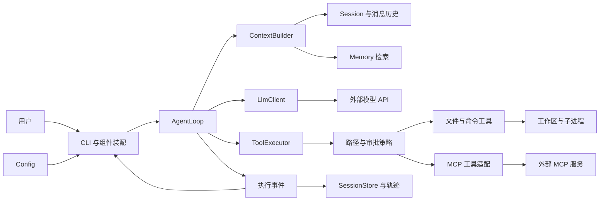
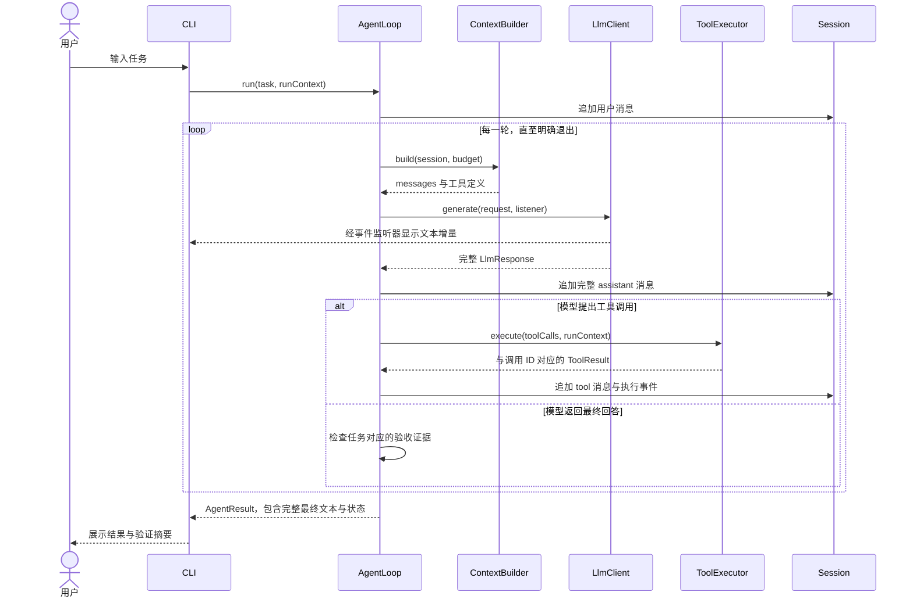

# CodeY 架构设计

> 版本：0.1，日期：2026-10-12。当前已实现配置、消息、基础提示词、非流式调用、可选工作区和本地会话保存/恢复（含全局列表、分页、标题生成与改名）；其他模块按阶段实现。验证使用本地模拟模型，真实厂商兼容性尚待验证。开发进度见 [开发路线](#roadmap)。

## 阅读导航

- 第 1—9 节：定位、技术栈、目录、架构图、执行流程与核心策略。
- [模块职责与接口契约](#modules)
- [已实现的消息模型](#messages)
- [已实现的非流式 LLM 调用](#llm)
- [已实现的 Session 与连续对话](#session-chat)
- [代码阅读顺序与当前调用流程](#code-guide)
- [Prompt 模块设计与文件约定](#prompt-design)
- [工作区选择、历史列表与会话恢复方案](#workspace-sessions)
- [配置加载与多模型选择](#configuration)
- [开发路线与验收标准](#roadmap)
- [设计决策](#decisions)
- [面试学习与项目证据](#interview)

## 1. 项目定位与范围

CodeY 是使用 Java 从零实现的 CLI 编程 Agent。通过手写模型调用、Agent 循环、工具执行与上下文管理，理解 Claude Code、Codex 等产品的运行原理，并形成可演示、可验证的学习项目。

首版场景：在用户指定的 Java 工作区中读取代码、定位问题、修改文件、执行编译与测试，根据实际结果继续修复。最终输出改动说明、验证证据和剩余问题。

Harness 在本项目中指运行核心及其策略：Agent 循环、上下文构建、工具调度、预算、权限、状态和结果验证。LLM 是提出行动的组件；Java 程序负责执行和维护真实状态。

首版采用单 Agent。多 Agent、复杂 Plan、向量 RAG、Web UI、远程 API、微信与后台任务属于后续扩展，暂不建立对应模块。

## 2. 技术基线

| 组件 | 选择 | 实现阶段与原因 |
|---|---|---|
| 语言 | Java 17 | M0；本机可用，records 等能力足够支持首版 |
| 工程 | Maven 单模块 | M0；按包组织，降低初期装配成本 |
| CLI | JDK 标准输入输出 | M0/M1；后续有输入编辑需求再接 JLine |
| HTTP | JDK HttpClient | M1 已实现非流式请求；共享连接客户端，单次配置绑定 |
| JSON | Jackson 2.18.2 | M1 已实现消息映射与响应解析 |
| 日志 | 初期标准输出；后续 SLF4J | M1/M3；模型内容与日志分流，避免输出密钥 |
| 测试 | JUnit 5.10.2 + JDK HttpServer | 配置、消息及非流式 HTTP 测试已实现，默认不调用真实模型 |
| 状态存储 | 用户目录 JSON 快照，后续 JSONL 事件 | 会话选择阶段先恢复文本；M5 补工具执行状态 |
| MCP | JSON-RPC + stdio | M6；先支持一条传输链，HTTP 后续增加 |

当前运行依赖为 Jackson 2.18.2；JUnit 5.10.2 为测试依赖。Maven Shade 3.5.1 在 package 阶段生成包含依赖与 Main 入口的可执行 JAR。此处记录已验证的项目版本，不声明其为各组件的最新版本。

## 3. 目录结构

```text
codeY/
├── README.md
├── pom.xml
├── .gitignore
├── .gitattributes
├── .env.example
├── docs/
│   ├── architecture.md     # 完整设计、配置、路线与学习笔记
│   └── diagrams/           # 可编辑 Mermaid 源文件
│       ├── architecture.mmd
│       ├── agent-flow.mmd
│       └── request-sequence.mmd
└── src/
    ├── main/
    │   ├── java/io/github/jackfeicoder/codey/
    │   │   ├── cli/          # Main、ChatCli、装配、输入与展示
    │   │   ├── config/       # 环境配置、模型配置、工作区
    │   │   ├── prompt/       # PromptLoader、PromptException
    │   │   ├── agent/        # AgentLoop、预算、取消、结果
    │   │   ├── llm/          # LlmClient、请求响应、SSE
    │   │   ├── tool/
    │   │   │   └── builtin/  # 文件、搜索、命令工具
    │   │   ├── context/      # 上下文收集、选择、预算与压缩
    │   │   ├── session/      # Message、Session、快照、存储与标题；工具事件后续实现
    │   │   ├── workspace/    # 可选目录绑定与真实路径解析
    │   │   ├── memory/       # 长期记忆的检索与保存
    │   │   ├── mcp/          # MCP 客户端及工具适配
    │   │   ├── policy/       # 路径范围、审批与执行策略
    │   │   └── observability/ # 执行轨迹、Token 与耗时
    │   └── resources/prompts/
    │       └── base.md       # 随 JAR 打包的基础提示词
    └── test/
        ├── java/io/github/jackfeicoder/codey/
        └── resources/fixtures/
```

模块包使用 package-info.java 声明用途，避免空目录在 Git 中丢失。资源空目录使用 .gitkeep 占位，不提前加入复杂抽象。prompts/base.md 保存已接入的基础系统提示词，fixtures 保存脱敏协议响应和小型测试项目；测试按主代码的包结构组织，默认不依赖真实 API Key。

会话数据按需创建，已实现布局与后续项目数据如下。会话集中放在用户目录，便于统一展示不同项目及普通聊天；项目数据目录忽略提交。详细实现见 [工作区与会话方案](#workspace-sessions)。

```text
用户目录/.codey/
└── sessions/<session-id>/
    ├── session.json           # 第一版：元数据、基础提示词与成功文本历史
    ├── session.lock           # 使用期间持有操作系统文件锁
    └── events.jsonl           # 工具阶段再增加，不提前实现

工作区/.codey/                 # 后续项目缓存、记忆与运行结果
├── cache/
├── memory/project.json
└── runs/<run-id>/summary.json
```

执行轨迹可能含源码与命令输出，日志内容应可截断、脱敏并由用户控制留存。

## 4. 模块架构



CLI 是装配入口，负责创建组件和展示事件。AgentLoop 面向接口工作，避免直接操作终端。上下文、会话与记忆职责明确：会话保存发生过什么，上下文决定当前发什么，记忆保存跨会话事实。

接口和数据契约详见 [模块与接口](#modules)。图中的持久化、记忆、MCP 是后续阶段能力。

## 5. 启动流程

1. 解析参数：help/version，后续加入 workspace/model/session。
2. 加载配置并校验模型名、地址、密钥、超时、工作区。
3. 解析工作区真实路径；按策略注册当前可用工具。
4. 创建 LlmClient、Session、ContextBuilder、ToolExecutor 和 AgentLoop。
5. M5 开始按需恢复会话；M6 开始初始化 MCP，并负责关闭资源。
6. 接收输入，启动 run，展示流式事件和最终 AgentResult。
7. 退出时关闭响应流、执行器、MCP 进程和会话存储。

已实现配置来源优先级：系统环境变量 > 启动目录 `.env` > 默认值。多 Profile 默认选择由 CODEY_ACTIVE_PROFILE 指定，--profile 可临时覆盖。`.env.example` 是字段模板，不作为有效配置加载。--list-models 列出别名，--check-config 只校验选中配置；旧版 CODEY_LLM_* 兼容为 default。其他启动装配步骤按阶段实现。解析范围与 YAML 的关系见 [配置说明](#configuration)。

## 6. 一次任务的执行流程

```mermaid
flowchart TD
    start["接收任务并创建 Run"] --> append["追加用户消息"]
    append --> guard{"取消或预算耗尽？"}
    guard -- "是" --> stopped["返回 CANCELLED 或 BUDGET_EXHAUSTED"]
    guard -- "否" --> build["构建上下文并预留输出预算"]
    build --> call["调用 LLM 并展示事件"]
    call --> valid{"响应完整且合法？"}
    valid -- "否" --> failed["分类失败与有限重试"]
    failed --> exhausted{"重试耗尽？"}
    exhausted -- "是" --> error["返回 FAILED"]
    exhausted -- "否" --> guard
    valid -- "是" --> tools{"存在工具调用？"}
    tools -- "是" --> policy["校验参数与权限"]
    policy --> execute["执行工具并回填全部结果"]
    execute --> guard
    tools -- "否" --> verify{"任务验收证据满足？"}
    verify -- "是" --> done["返回 COMPLETED 与证据"]
    verify -- "否" --> continueRun{"仍可继续？"}
    continueRun -- "是" --> feedback["追加缺失证据或失败反馈"]
    feedback --> guard
    continueRun -- "否" --> incomplete["返回 INCOMPLETE"]
```



流式回调只负责展示，完整响应始终返回调用方。模型的 assistant tool_calls 与每个 tool_call_id 对应的结果作为完整组保留，压缩时避免孤立结果。

## 7. 核心策略

### Agent 与退出

- 每个 run 创建独立 RunContext，携带 runId、workspace、budget、cancelToken。
- 限制轮次、墙钟时间、单次工具时间；Token 预算接入后单独累计。
- 区分 COMPLETED、INCOMPLETE、FAILED、CANCELLED、BUDGET_EXHAUSTED。
- 模型结束回答并不自动证明代码任务完成。代码修改任务检查约定验证命令的退出码、验证发生在最新修改之后等证据。
- 验证通过仅表示约定检查通过，未覆盖的行为在结果中说明；解释代码类任务采用不同完成条件。

### 工具

首版 read_file、list_files、search_text、write_file、execute_command。read_file 默认分页，返回路径、行号、截断信息。工具输出保留执行元数据，与发给模型的截断文本分开。

工具定义、注册与执行分开。ToolResult 结构化保存 status、errorCode、output、exitCode、duration 和 artifacts。参数验证与路径策略在执行前运行。

初期工具顺序执行。具备依赖与资源冲突判断后才并行只读操作；文件写入和改变工作区的命令按顺序执行。命令通过平台适配运行，明确工作目录、退出码和超时，不固定使用 bash。

### 上下文

每次调用模型前统一构建：项目规则、当前目标、历史摘要、近期完整消息组、相关记忆和工具定义。采用收集 → 筛选 → 组织 → 压缩的流程。

预算同时考虑工具 schema、系统规则、近期历史和预留输出。估算值与 API 返回实际 usage 分开记录。大工具输出通过限制、分页和按需读取控制。

压缩使用副本构建请求，完整会话事件保留。摘要记录目标、约束、已完成步骤、关键文件、失败与下一步；需要重新检查文件时读取最新内容。

### 记忆与 MCP

长期记忆初期只保存用户明确确认的偏好、项目约定与重要事实，携带范围、来源与时间；不自动保存每条模型推断。保存操作统一经过存储层，并采用临时文件替换等方式避免半写文件。

MCP 工具经适配器进入同一 ToolRegistry/ToolExecutor，复用权限、超时、事件与结果处理。先实现 stdio 的 initialize、initialized、tools/list、tools/call；未知能力不注册为可用功能。协议版本、能力协商和分页以接入阶段文档与测试为准。

## 8. 会话恢复与操作边界

会话保存可选的工作区绑定与模型配置引用，不持久化 API Key；无工作区会话同样可恢复。第一版只恢复文本快照，工作区与模型缺失的处理见 [详细方案](#workspace-sessions)。工具阶段再持久化步骤事件和执行状态。进程意外退出后，先检查最后一条工具是否已完成；不直接重放写文件、命令或其他有副作用的调用。

文件路径校验基于规范化路径和真实路径处理已有文件、符号链接及目标父目录；路径前缀的字符串判断不足以覆盖边界。命令工具能操作更大范围，因此路径限制与进程隔离是不同能力。初期使用命令审批，后续根据需要引入进程隔离。

## 9. 实现验证与已知边界

- 当前验收 Maven 构建、可执行 JAR、配置/消息/提示词/Session/HTTP 测试，以及 --prompt、--chat 的本地 HTTP 请求；真实服务商调用、SSE 和 Agent 循环后续验证。
- LLM 接入用本地 HTTP/SSE 替身验证，不使用真实密钥作为默认测试前提。
- 工具使用临时工作区验证路径、分页、错误和超时；命令用无网络的测试程序。
- 上下文验证工具调用组完整性、预算和规则保留；恢复验证副作用不会被盲目重放。
- 最终用固定小型 Java 项目评估，记录模型配置和任务集版本，避免把模型变化误认为架构提升。

图表提供 Mermaid 源文件，并人工检查流程与顺序；已核对独立源文件与本文内嵌图一致。初始化时尝试本地渲染，因环境缺少 Mermaid CLI（mmdc）未生成 SVG/PNG；尚未经过渲染器语法验证。可在支持 Mermaid 的 Markdown 查看器中预览，构建 Java 工程不依赖图表渲染工具。

<a id="modules"></a>

## 10. 模块职责与接口契约

> 以下含目标设计。当前已实现 Main/ChatCli/SessionLauncher、配置、基础提示词、Message/MessageRole/ToolCall、Session 及本地快照/存储/服务、可选工作区、五个 LLM 核心文件。其余具体类型按阶段实现。

### 模块边界

| 包 | 职责 | 计划核心类型 | 约束 |
|---|---|---|---|
| cli | 装配、输入、渲染、退出 | Main、ChatCli、SessionLauncher | 不持有 Agent 算法；核心代码不直接输出终端 |
| prompt | 内置提示词加载与后续片段组合 | PromptLoader、PromptException；后续 PromptAssembler | 按 classpath 读取，与模型厂商和密钥无关 |
| config | 加载、选择并验证配置 | LlmConfig、ModelProfiles、AuthMode、SessionSettings | 密钥不进入日志、会话或仓库 |
| workspace | 可选工作区与真实目录校验 | WorkspaceBinding、WorkspaceResolver | 不改变 .env 来源，不代替工具权限 |
| agent | 执行循环、预算、取消、完成判定 | AgentLoop、RunContext、AgentResult、RunBudget | 一次 run 的状态独立，明确退出原因 |
| llm | 请求编码、HTTP、SSE、响应组装 | LlmClient、LlmRequest、LlmResponse、StreamListener | 总返回完整结果；展示回调不影响返回值 |
| tool | 定义、注册、调度、参数验证 | Tool、ToolDefinition、ToolCall、ToolResult、ToolRegistry、ToolExecutor | Agent 依赖执行器，工具不反向调用 Agent |
| tool.builtin | 文件搜索、读取、修改、命令 | ReadFileTool、SearchTextTool、WriteFileTool、ExecuteCommandTool | 输出有边界，所有路径基于工作区解析 |
| context | 选择和组织本轮输入 | ContextBuilder、ContextSnapshot、TokenEstimator、HistoryCompactor | 不把长记忆与会话副本重复堆入请求 |
| session | 完整会话状态、消息、事件和存储 | Message、Session、SessionEvent、SessionStore | assistant 调用与 tool 结果具备关联关系 |
| memory | 保存和召回长期事实 | MemoryEntry、MemoryStore、MemoryRetriever | 支持项目范围、来源、时间与删除 |
| mcp | 外部协议与工具适配 | McpClient、StdioTransport、McpToolAdapter | 处理 pending request、分页与资源关闭 |
| policy | 路径范围、审批、操作策略 | ExecutionPolicy、PathPolicy、ApprovalHandler | 程序执行策略；提示词不能替代限制 |
| observability | 轨迹与指标 | AgentEvent、RunMetrics、TraceWriter | 展示信息与持久化信息可分别脱敏 |

### 最小数据模型

| 类型 | 关键字段 | 作用 |
|---|---|---|
| Message | role、content、toolCalls、toolCallId | 保持模型协议中的消息结构 |
| ToolCall | id、name、arguments | arguments 从 JSON 校验后执行；流式碎片按 index/id 拼接 |
| ToolResult | callId、status、output、errorCode、exitCode、duration | 一条调用无论成功失败都产生对应结果 |
| LlmResponse | message、finishReason、usage；text()/toolCalls() | 复用 assistant Message 保存内容，避免重复存储文本和调用 |
| RunContext | runId、workspace、budget、cancelToken | 每次任务的明确执行环境 |
| AgentResult | status、finalText、verification、metrics、artifacts | CLI 和后续 API 共用；文本不能为空只是因为已流式展示 |
| Session | systemMessage/history；元数据由 SessionSnapshot 保存 | 内存保存成功轮次，SessionService 关联 ID/工作区/存储 |
| MemoryEntry | id、scope、projectId、content、source、createdAt | 避免不同项目的相同事实被错误合并 |

只有实际需要的字段进入首版。usage 缺失表示未知，不视为零。模型 capabilities（工具支持、上下文窗口等）通过显式配置提供。

<a id="messages"></a>

### 已实现的消息模型

消息放在 session 包，作为会话和后续模型调用的共同数据结构；ToolCall 放在 tool 包，表示模型提出的调用请求。

| 类型 | 字段/方法 | 当前语义 |
|---|---|---|
| MessageRole | SYSTEM、USER、ASSISTANT、TOOL | wireValue() 映射为小写协议值，fromWireValue() 解析支持的角色 |
| Message | role、content、toolCalls、toolCallId | 不可变 record，工具调用列表进行防御性复制 |
| ToolCall | id、name、arguments | 调用 ID、工具名与完整原始 JSON 参数文本 |

四种消息的分工：system 保存指令，user 保存用户输入，assistant 保存模型文本或工具调用请求，tool 保存工具执行结果。

```java
ToolCall call = new ToolCall("call_1", "read_file", "{\"path\":\"Main.java\"}");
List<Message> history = List.of(
        Message.system("你是编程助手。"),
        Message.user("解释 Main.java。"),
        Message.assistantToolCalls(List.of(call)),
        Message.tool(call.id(), "public class Main {}"),
        Message.assistant("这是项目入口类。")
);
```

`Message.assistant(text, calls)` 支持同时保存说明文本和工具调用。一条 assistant 可提出多个调用，每个调用在后续执行后产生独立 tool 消息，toolCallId 指向原始 id。工具失败也通过对应的结果消息反馈。

单条消息约束：

- 只有 assistant 可携带 toolCalls，同一消息中调用 ID 唯一。
- 只有 tool 可携带 toolCallId，且必须提供非空 ID。
- 有工具调用的 assistant 可以让 content 为 null；其他消息必须有 content，空字符串允许表示空输出。
- ToolCall 的三个字段均需非空；arguments 保存原文，JSON 对象语法已由 LLM 适配器校验，工具 schema 校验留给执行层。
- 非法构造参数抛出 IllegalArgumentException；当前不为每种数据结构单独增加异常类。

Chat Completions 适配器已显式映射 role.wireValue()、tool_calls、tool_call_id，并把 ToolCall 转成接口要求的 function 结构；不依赖 record 的默认 JSON 形状。跨消息的调用 ID 匹配、全部结果回填和工具调用组完整性由后续 Session/Agent 层检查，当前 Message 仅校验单条消息。

当前为纯文本消息模型，已接入 JSON 映射，流式工具参数组装和真实工具执行待实现。相关测试覆盖普通对话、多个调用的结果关联、角色约束、空工具输出、重复 ID 和防御性复制。

<a id="llm"></a>

### 已实现的非流式 LLM 调用

| 文件 | 职责 |
|---|---|
| LlmClient.java | 定义 generate(LlmRequest)，供后续 Agent 使用 |
| ChatCompletionsClient.java | HTTP 传输、显式 JSON 映射、完整响应解析 |
| LlmRequest.java | 防御性复制非空消息列表；配置由客户端提供 |
| LlmResponse.java | assistant 消息、结束原因和可空 TokenUsage |
| LlmException.java | HTTP、网络、超时、中断、请求/响应错误与模型拒绝结果分类 |

```java
LlmConfig config = ConfigLoader.loadProfiles().activeConfig();
LlmClient client = new ChatCompletionsClient(config);
LlmResponse response = client.generate(new LlmRequest(List.of(
        Message.system("You are CodeY, a coding assistant."),
        Message.user("解释 Java record。")
)));
System.out.println(response.text());
```

实际执行：读取选中的 LlmConfig → 构建 model/messages/stream=false JSON → 向 BASE_URL 后追加 /chat/completions 发送 POST → 检查 HTTP 状态 → 解析 choices[0].message、finish_reason、usage → 返回 LlmResponse。

实现规则：

- 一个实现适配兼容接口，各实例绑定自己的不可变配置，复用默认 HttpClient；默认不跟随重定向。
- bearer 认证发送 Authorization，none 不发送；请求体不包含 API Key。
- 总等待超时覆盖响应头及完整响应体；超时取消 future，线程中断时取消请求并恢复中断标志。
- 明确返回完整结果；工具请求转换为 ToolCall，只解析不执行。参数必须为完整 JSON 对象，但不在此处验证具体工具 schema。
- 保留 finish_reason，length 表示截断；tool_calls 结束但没有调用时视为不完整响应。旧式 function_call、图片内容和非 function 工具类型暂不支持。
- usage 或某计数字段缺失时为 null；拒绝非法或负数计数，不把未知值计为零。
- HTTP 错误保留状态码；不输出原始响应、请求或可能包含内容的 Jackson 异常。不自动重试，isRetryable 仅为后续策略提供分类提示。
- 当前请求只有消息列表，没有 tools schema/生成参数/流式开关；这些将在后续阶段显式加入。

CLI 用法（CMD/PowerShell）：

```shell
mvn clean verify
java -jar target/codey-0.1.0-SNAPSHOT.jar --prompt "你好"
java -jar target/codey-0.1.0-SNAPSHOT.jar --prompt "解释 Java record" --profile qwen
```

每次 --prompt 是独立的一次请求，不恢复历史。help/version/list/check 不发起模型调用。参数或配置错误退出码为 2，模型调用错误为 1；获得响应时输出文本，截断时另外提示，工具调用暂不执行。

测试使用本地 HTTP 服务与假密钥，覆盖配置、协议、错误、超时及线程中断。内存对话阶段为 151 项测试；加入持久化/标题/工作区后当前为 178 项，另完成 12 项持久化 JAR 检查，见 [工作区与历史会话实现](#workspace-sessions)。没有发送真实服务商请求。

<a id="session-chat"></a>

### 已实现的 Session 与连续对话

| 类型/方法 | 当前职责 |
|---|---|
| Session(basePrompt) | 初始化一个内存会话，第一条为 system 消息 |
| messages() | 返回已保存历史的不可修改快照 |
| messagesFor(input) | 历史副本追加本轮问题，构造请求但不修改历史 |
| completeTurn(input, answer) | 校验后保存 user 与普通 assistant，形成完整成功轮次 |
| clear() | 删除所有对话轮次，保留原始 system 消息 |
| Session.restore(snapshot) | 从校验后的快照恢复，system 只出现一次 |
| ChatCli.answer(input) | 调用模型、展示并提交成功文本轮次；返回是否需要保存 |
| ChatCli.run() | 保留供内存调用者使用；实际 CLI 使用 SessionLauncher 管理持久化与命令 |

```text
Main（无参数或 --chat）
  → SessionLauncher 全局历史选择 / 新建
  → 创建或恢复 SessionService，获得会话写锁
  → SessionLauncher 读取一行
      ├─ /exit 或 EOF：保存待写内容并退出
      ├─ /clear：保存旧会话，新建 ID，保留旧记录
      ├─ 会话命令：分页、改名、切换；不作为普通问题发送
      └─ 普通问题：ChatCli.answer → Session.messagesFor → LlmRequest → generate
          ├─ 普通回答：completeTurn → 显示 → captureTurn/save → 首轮标题任务
          ├─ 调用失败：提示，不提交本轮，继续输入
          └─ 工具请求：提示未执行，不提交缺少 tool 结果的轮次
```

第二轮请求为 system → 第一问 → 第一答 → 第二问。请求快照和已保存历史独立，失败无需删除尾部消息；校验非法提交时历史也保持不变。截断回答保存已收到文本，同时提示 length，用户可继续追问。请求中断时结束交互，不再阻塞等待输入。

交互启动方式：

```shell
java -jar target/codey-0.1.0-SNAPSHOT.jar --chat
java -jar target/codey-0.1.0-SNAPSHOT.jar --chat --profile qwen
```

每行一个问题，同一活动会话的 Profile 固定；恢复时可 --profile 覆盖，/model 后续增加。终端使用 Console，重定向输入输出使用 UTF-8。正常退出或 EOF 返回 0；非法参数/单次入口配置错误返回 2；存储、提示词、输入错误返回 1。交互模型错误可继续，交互配置无效时要求选择别名，未保存结果先重试再开始下一轮。

Session 保存成功文本对话，并非完整执行审计日志；不保存失败轮次或未执行工具调用。SessionService/JsonSessionStore 已提供跨进程文本恢复。当前仍发送全部历史，没有 Token 预算、裁剪或摘要；超长时可 /clear，新会话不删除旧历史。

模块边界：Session 保存发生过的对话，ContextBuilder 后续选择和组织本次请求，Memory 后续提取/保存/召回可复用事实。当前不增加 context 或 memory 的具体实现。

阶段记录：最初新增 11 项 Session 与 7 项 ChatCli 测试，共 151 项通过，并完成 8 项内存交互 JAR 检查。目前入口与 /clear 已升级为持久化语义，最新验证见 [第 16 节](#workspace-sessions)。

协议依据：[OpenAI Chat Completions API Reference](https://developers.openai.com/api/reference/resources/chat/subresources/completions/methods/create)。其他提供商的实际兼容性需要各自的请求样例验证。

<a id="code-guide"></a>

### 代码阅读顺序与当前调用流程

主代码与测试文件已加入中文说明。类注释描述职责，方法注释描述输入输出或验证目标，字段/关键局部变量注释说明数据含义；package-info.java 说明各包职责及当前/后续状态。

建议按下面顺序读已经实现的代码：

| 顺序 | 文件 | 阅读重点 |
|---|---|---|
| 1 | cli/Main.java | action/profile/prompt 三个参数变量，操作分发与退出码 |
| 2 | config/ConfigLoader.java | 合并来源、生成别名列表、确定默认选择、转换字段 |
| 3 | config/DotEnvReader.java | 逐行解析、引号和注释规则，错误只报告行号 |
| 4 | config/ModelProfiles.java | 别名与模型 ID 区别，按需加载，不可变切换 |
| 5 | config/LlmConfig.java、AuthMode.java、ConfigException.java | 强类型配置、认证约束与配置错误 |
| 6 | session/Message.java、MessageRole.java、tool/ToolCall.java | 四种消息来源，工具请求与结果的 ID 关联 |
| 7 | llm/LlmRequest.java、LlmResponse.java | 输入/输出数据契约与完整结果保存 |
| 8 | llm/LlmClient.java | 统一接口中 generate 的调用契约 |
| 9 | llm/ChatCompletionsClient.java | encode → HTTP 等待 → decode，以及错误和超时处理 |
| 10 | llm/LlmException.java | 错误类别、可空状态码与后续重试提示 |
| 11 | prompt/PromptLoader.java、PromptException.java、resources/prompts/base.md | classpath UTF-8 加载、资源错误，以及 system 消息注入 |
| 12 | session/Session.java、cli/ChatCli.java | 请求快照、成功提交、清空与输入循环；失败如何保持历史不变 |
| 13 | cli/SessionLauncher.java、config/SessionSettings.java、workspace 包 | 列表/对话状态、延迟模型校验、可选工作区与配置来源 |
| 14 | SessionSnapshot、SessionService、SessionStore、JsonSessionStore | 版本化 DTO、dirty 重试、文件锁、原子保存和恢复 |
| 15 | SessionTitleGenerator | 一次独立短请求，输入有界，结果不进入历史，失败回退 |

运行 `--prompt` 时的实际调用链：

```text
Main.main(args)
  ├─ 解析 action、profile、prompt
  ├─ ConfigLoader.loadProfiles(...)
  │    ├─ DotEnvReader.read(.env) → 文件键值
  │    ├─ 合并 System.getenv() → 环境值覆盖文件值
  │    └─ ModelProfiles → 别名列表与当前选择的快照
  ├─ ModelProfiles.activeConfig()
  │    └─ ConfigLoader.buildConfig(prefix) → 已校验的 LlmConfig
  ├─ LlmClient client = new ChatCompletionsClient(config)
  ├─ PromptLoader.loadBase() → classpath /prompts/base.md 的 UTF-8 全文
  ├─ 创建 Message.system(basePrompt)、Message.user(...) → LlmRequest
  ├─ client.generate(request)
  │    ├─ encode → model/messages/stream=false JSON
  │    ├─ HttpRequest → 地址、认证头、超时、正文
  │    ├─ sendAsync → future.get 限时等待完整响应
  │    ├─ 校验 HTTP 状态
  │    └─ decode → assistant Message、finishReason、TokenUsage
  └─ 输出 response.text()，必要时提示工具请求或截断
```

接口、多态与 record 的区别：

- LlmClient 声明方法，ChatCompletionsClient 实现方法；变量类型为接口时，实际执行仍由具体对象决定。
- LlmRequest/LlmResponse 等 record 保存数据，访问方法和 equals/hashCode/toString 由编译器提供；源码中的紧凑构造器主要负责校验。
- record 固定字段引用，但集合需要 List.copyOf/Map.copyOf 保护内容。局部变量保存本轮中间结果，字段保存对象需要长期持有的状态。
- role.wireValue() 和 JSON 编解码明确处理协议命名，内部 Java 字段不必直接使用接口下划线格式。

测试文件也按场景加了说明。配置测试使用临时文件和假环境，消息测试检查数据约束，HTTP 测试使用本地服务器与假密钥。阅读测试可先看方法注释，再按“准备输入 → 执行 → 断言结果 → 清理”追踪代码。

### 核心接口示意

以下是职责说明，不是当前可复制编译的完整接口：

```java
interface LlmClient {
    LlmResponse generate(LlmRequest request); // 当前接口，流式/取消接口后续扩展
}

interface Tool {
    ToolDefinition definition();
    ToolResult execute(ToolCall call, RunContext context);
}

interface ContextBuilder {
    ContextSnapshot build(Session session, RunContext context);
}

interface SessionStore {
    void append(String sessionId, SessionEvent event);
    Session load(String sessionId);
}
```

选择 record 表达不可变数据，接口表达可替换边界。首轮实现中只为 LLM、工具、上下文、存储等真实边界建立接口；不机械地给所有类增加接口。

### 流式协议处理

1. 检查 HTTP 状态和响应类型，读取流时支持取消。
2. 按 SSE 事件边界收集 data 行，支持事件分片和多行 data。
3. 解析文本 delta；tool_calls 按索引组装 name 和 arguments。
4. 只有完整响应通过检查后，才执行工具。部分 JSON 参数不会直接执行。
5. 明确 finish_reason、正常终止和提前 EOF 的处理策略。服务商差异通过适配或配置显式处理。
6. 回调输出文本增量，返回值保留完整文本与工具调用；请求结束关闭流。

初期只支持一种兼容 Chat Completions 的请求格式。兼容不代表所有提供商行为相同，新增提供商时补充协议样例。

### 工具执行契约

- 工具定义包含名称、描述、JSON Schema、操作类别、超时与输出上限。
- ToolRegistry 只负责注册与查找；ToolExecutor 负责验证、审批、调度、取消、事件和归一化结果。
- 未知工具和非法参数作为工具失败回填，让模型收到可处理的原因。
- 读取默认带 offset/limit；列表和搜索分页；输出包含是否截断和继续读取方式。
- 写文件先展示或记录差异，执行后记录改动版本；初期完整写入，随后加入期望旧内容匹配的 patch。
- 同一轮有多个工具调用时，初期按模型给出的顺序执行；全部结果回填后才调用下一轮模型。
- stdout/stderr 有容量上限；保留退出码。超时后终止进程及相关子进程，并确认资源关闭。

### 错误与取消

| 场景 | 处理 |
|---|---|
| 配置缺失 | 启动前报错，说明字段名，不显示密钥 |
| HTTP 认证失败 | FAILED，不重复发送同一错误配置 |
| 限流或临时服务异常 | 有次数与总时间限制的退避；记录尝试 |
| 响应截断或解析失败 | 本轮不执行残缺工具调用，分类报错或有限重试 |
| 工具参数/路径错误 | ToolResult 失败回填，可供模型修正 |
| 写入或命令完成后结果丢失 | 先核对副作用，不自动重放 |
| 用户取消 | 每轮与工具前检查，传播到 HTTP 和进程 |
| 预算耗尽 | 返回 BUDGET_EXHAUSTED，保留已完成步骤 |

错误通过类型与状态传递，不仅返回一条包含“失败”的字符串。重试策略区分模型请求与有副作用的工具调用。

### 事件与完成验证

事件建议包括 RunStarted、LlmStarted、TextDelta、ToolStarted、ToolFinished、ContextCompacted、RunFinished。持久化关键状态事件；高频文本增量可另行汇总，避免每个字符都写状态快照。

代码修改任务的 verification 至少记录命令、工作区、执行时间、对应改动版本、退出码和输出摘要。AgentResult 中说明检查范围与未覆盖项。普通问答与代码修改采用不同的完成条件。

### 扩展边界

- 新模型：实现 LlmClient 或协议适配器。
- 新工具：实现 Tool，经统一执行器执行。
- MCP：将外部 schema 和调用结果适配成 ToolDefinition/ToolResult。
- CLI 改善或 API 接入：复用 AgentResult 与事件，不复制执行循环。
- 代码 RAG：作为检索来源进入 ContextBuilder，按实际任务需求加入。
- 多 Agent：各自拥有 Session/RunContext，资源共享必须显式协调，后续另写设计决策。

<a id="configuration"></a>

## 11. 配置加载与多模型选择

> 当前已实现：LlmConfig、AuthMode、ModelProfiles、ConfigLoader、DotEnvReader，以及 CLI 的 --list-models、--check-config、--profile、--prompt 和 --chat。支持命名 Profile 与旧版单模型配置。--check-config 仅本地校验，--prompt/--chat 才发起真实模型请求。

### .env、环境变量、YAML 和配置类

| 概念 | 是什么 | CodeY 当前行为 |
|---|---|---|
| 系统环境变量 | 进程从操作系统/父进程继承的键值 | 使用 System.getenv() 读取 |
| .env | 保存 KEY=VALUE 的普通文本文件 | DotEnvReader 显式读取启动目录的文件 |
| application.yml | YAML 格式的配置文件，常见于 Spring Boot | 当前不加载；普通 Java 需要解析与映射 |
| LlmConfig | 应用内部使用的强类型配置对象 | 将解析结果转换为 URI、Duration 等并验证 |

System.getenv() 不会因为目录里有 .env 就自动读取它。读 .env 后得到的键值只在 CodeY 配置加载器中合并，没有修改系统环境变量。

Spring Boot 有自动寻找 application.properties/application.yaml、合并多种配置来源和绑定对象的机制。普通 Java 的文件名没有这种自动行为。Spring Boot 默认也不会把 .env 当作 dotenv 文件解析，需要额外加载方式或在启动前注入环境变量。

两种文件可以协作。例如在 Spring Boot 中：

```yaml
llm:
  base-url: ${CODEY_LLM_BASE_URL}
  api-key: ${CODEY_LLM_API_KEY}
  model: ${CODEY_LLM_MODEL}
  timeout-seconds: ${CODEY_LLM_TIMEOUT_SECONDS:120}
```

这里占位符从 Spring 的配置环境解析；只创建 .env 并不会自动让这些占位符获得值。上述 YAML 是原理示例，不是 CodeY 的有效配置文件。

### 当前优先级与查找规则

```text
进程环境变量 > 启动目录的 .env > 代码默认值
            ↓
       ConfigLoader 合并
            ↓
       ModelProfiles 选择配置
            ↓
       选中的 LlmConfig 校验
            ↓
       后续提供给 LlmClient
```

- .env 只在当前工作目录查找，不搜索父目录、用户目录或 resources。
- .env 可缺失，只要环境变量提供全部必填值。
- 环境变量中存在空值时同样覆盖文件；必填配置校验失败，不偷偷回退。
- bearer 认证需要 API Key，none 认证不需要；模型和 URL 无默认值。
- 单 Profile 超时 > 公共 CODEY_LLM_TIMEOUT_SECONDS > 120 秒。字段优先级在文件与环境变量合并后应用。
- .env.example 是可提交的字段模板，不会作为运行配置读取。
- .env 无法读取、内容不符合约定或有重复字段时报错，只输出字段/行号，不回显内容。

启动目录与 Agent 工作区不同。模型配置一直从启动目录加载；SessionSettings 已加载 CODEY_WORKSPACE 作为新建菜单的建议，CODEY_DATA_DIR 控制存储位置，CODEY_AUTO_TITLE 控制额外标题请求。环境变量仍优先于启动目录 .env。

### 多 Profile 配置与选择

Profile 是一套地址、认证、模型和超时的配置别名，不要求与服务商名字一致。同一平台的两个模型可以命名为 gateway_fast 与 gateway_code。

```dotenv
CODEY_PROFILE_NAMES=deepseek,qwen,local
CODEY_ACTIVE_PROFILE=deepseek

CODEY_PROFILE_DEEPSEEK_BASE_URL=https://api.example.com/v1
CODEY_PROFILE_DEEPSEEK_API_KEY=YOUR_API_KEY
CODEY_PROFILE_DEEPSEEK_MODEL=YOUR_MODEL

CODEY_PROFILE_QWEN_BASE_URL=https://qwen.example.com/v1
CODEY_PROFILE_QWEN_API_KEY=YOUR_API_KEY
CODEY_PROFILE_QWEN_MODEL=YOUR_MODEL

CODEY_PROFILE_LOCAL_BASE_URL=http://localhost:8000/v1
CODEY_PROFILE_LOCAL_MODEL=YOUR_MODEL
CODEY_PROFILE_LOCAL_AUTH=none

CODEY_LLM_TIMEOUT_SECONDS=120
CODEY_PROFILE_LOCAL_TIMEOUT_SECONDS=60
```

上述地址是格式示例，需填写实际基础地址和模型标识。仅检查选中的配置，因此其他配置的占位符不会阻止已填写的 Profile 使用。

规则：

- CODEY_PROFILE_NAMES 声明别名，英文逗号分隔。别名以字母开头，只包含字母、数字和下划线，忽略大小写，重复报错。
- CODEY_ACTIVE_PROFILE 指定默认别名；多 Profile 模式中必填，除非 --profile 已指定。
- 字段前缀是 CODEY_PROFILE_ 加大写别名及下划线，例如 qwen 对应 CODEY_PROFILE_QWEN_。
- 支持 BASE_URL、MODEL、API_KEY、AUTH、TIMEOUT_SECONDS 五个后缀。
- AUTH 默认 bearer，必须有密钥；none 忽略密钥，LlmConfig 中不保留它，后续 HTTP 客户端应不发送认证头。
- 配置选择优先级：--profile > 环境变量 CODEY_ACTIVE_PROFILE > .env CODEY_ACTIVE_PROFILE。
- 有 CODEY_PROFILE_NAMES 就进入命名模式，缺失字段不会回退到旧版 CODEY_LLM_*，避免串用凭证；只有公共超时可共享。
- --list-models 只显示已声明的别名和当前选择，不读取校验所有模型凭证；它不表示服务商模型目录或可达性检查。

ConfigLoader.loadProfiles() 返回不可变配置快照。profileNames() 列出别名，activeConfig() 校验并返回当前配置，configFor(name) 读取指定配置。select(name) 校验目标后返回新快照，失败时原快照保持不变。

活动会话的模型客户端不会自动热更新。新建或恢复时重新从启动目录解析配置；--profile 优先于保存的别名，别名失效时要求明确选择。会话内 /model 后续实现，不修改正在进行的请求。

### 旧版单模型兼容

没有 CODEY_PROFILE_NAMES 时，旧配置仍可使用，并自动命名为 default：

| 配置项 | 必填 | 规则 |
|---|---|---|
| CODEY_LLM_BASE_URL | 是 | HTTP(S) 基础 URL，含服务商路径前缀；不含 userInfo、query、fragment |
| CODEY_LLM_API_KEY | bearer 时必填 | 非空；示例 YOUR_API_KEY 必须替换 |
| CODEY_LLM_MODEL | 是 | 服务商的模型标识，非空；YOUR_MODEL 必须替换 |
| CODEY_LLM_TIMEOUT_SECONDS | 否 | 正整数，默认 120 |
| CODEY_LLM_AUTH | 否 | bearer 或 none，默认 bearer |

BASE_URL 填服务商基础路径，例如 https://api.example.com/v1，不包含 /chat/completions。当前仅验证 URL 格式，不测试网络可达性。

模型名原样用于后续请求，不代表 CodeY 已确认该模型存在。例子中的 example.com 和占位 Key 仅说明格式。

### .env 支持范围

为了学习配置过程，当前用一个小型读取器，采用明确的单行格式：

```dotenv
# 注释行
CODEY_LLM_BASE_URL=https://api.example.com/v1
CODEY_LLM_API_KEY="replace-with-your-key"
CODEY_LLM_MODEL='replace-with-your-model'
CODEY_LLM_TIMEOUT_SECONDS=120 # 行末注释
```

支持 UTF-8（含 BOM）、空行、注释、可选 export 前缀、KEY=VALUE、单/双引号包围的单行值。首个等号后是值，值中的等号保留；引号中的 # 保留。无引号的 # 在行首或前面为空白时开始注释。

当前不做变量插值、命令替换、多行值和引号转义；反斜杠按字面保留。重复字段视为错误。它是 CodeY 的简化语法，不声称兼容所有 dotenv 实现。

### 使用方法

新建配置时，在项目目录运行。已有 .env 时手工补充字段，避免覆盖已填写的配置。

CMD：

```cmd
copy .env.example .env
```

PowerShell：

```powershell
Copy-Item .env.example .env
```

编辑 .env，替换当前需要使用的 Profile 地址、API Key 和模型名，保存为 UTF-8，然后执行（CMD/PowerShell 均可）：

```powershell
mvn clean verify
java -jar target/codey-0.1.0-SNAPSHOT.jar --check-config
java -jar target/codey-0.1.0-SNAPSHOT.jar --list-models
java -jar target/codey-0.1.0-SNAPSHOT.jar --check-config --profile qwen
java -jar target/codey-0.1.0-SNAPSHOT.jar --check-config --profile local
```

成功时输出配置已通过本地校验，并用 apiKey=<redacted> 隐藏密钥。失败时退出码为 2。help/version 不加载配置；无参数会话列表不要求模型凭证，但会读取会话设置与存储。

--profile 不修改文件，当前必须配合 --check-config、--list-models、--prompt 或 --chat。每次只指定一种操作。/model 当前尚未实现。

环境变量覆盖示例（PowerShell）：

```powershell
$env:CODEY_ACTIVE_PROFILE = "qwen"
java -jar target/codey-0.1.0-SNAPSHOT.jar --check-config
Remove-Item Env:CODEY_ACTIVE_PROFILE
```

.gitignore 已忽略 .env。当前不创建真实配置文件，也不将密钥打入 JAR。LlmConfig 的 toString 主动隐藏密钥，调用方仍需避免直接打印 apiKey()。

### 代码阅读顺序与测试

1. LlmConfig / AuthMode：理解 record、强类型、认证约束与重写 toString。
2. DotEnvReader：理解文件读取和简化语法边界。
3. ConfigLoader：理解配置合并、别名列表、类型转换与默认值。
4. ModelProfiles：理解选中时校验和不可变切换。
5. Main 的 --check-config / --list-models / --profile：理解启动前选择、校验和退出码。
6. ConfigLoaderTest / DotEnvReaderTest / ModelProfilesTest：用临时文件和显式 Map 测试，不依赖真实密钥。

测试覆盖：文件读取、环境覆盖、空值覆盖、必填字段、非法 URL/超时、示例占位符、BOM/引号/注释/等号、重复字段、错误不回显与对象输出脱敏；新增多 Profile、CLI 选择优先级、别名大小写、未知/重复别名、按需校验、认证方式、超时继承、配置隔离、切换失败保留原状态和旧配置兼容。

### 官方资料

- [Java 17 System.getenv](https://docs.oracle.com/en/java/javase/17/docs/api/java.base/java/lang/System.html#getenv())：读取当前进程环境。
- [Spring Boot 外部化配置](https://docs.spring.io/spring-boot/3.5/reference/features/external-config.html)：文件加载、环境变量、占位符和属性绑定。

<a id="roadmap"></a>

## 12. 开发路线与验收标准

> 当前：M1 的非流式对话已完成，并提前实现 M5 的文本会话保存/恢复、工作区选择和标题。SSE、Agent 工具循环与执行状态恢复仍按路线推进。

### M0：工程骨架

- [x] 克隆仓库，建立 Java 17 单模块 Maven 工程。
- [x] 建立模块包、资源和测试目录。
- [x] 提供项目介绍、架构、模块、开发路线与面试笔记。
- [x] 验证 `mvn clean verify` 与 JAR 的默认、help、version 启动；非法参数返回退出码 2。

本阶段没有业务测试用例；构建通过表示编译与打包通过，入口通过手工命令检查。LLM/工具测试从后续阶段加入。

### M1：LLM 与基础 CLI

先实现 LlmConfig，按需扩展 AppConfig；再实现消息模型、LlmClient、兼容 Chat Completions 的 HTTP 调用和 SSE 拼接，先接入一个模型提供商。

- [x] LlmConfig 从启动目录 .env 和系统环境变量加载，支持默认超时与 --check-config。
- [x] 缺少密钥、模型和地址时给出字段级错误；打印配置隐藏 API Key。
- [x] 支持多 Profile、默认选择、--profile 覆盖、--list-models、none 认证与旧格式兼容；切换接口先校验目标配置。
- [x] Message/MessageRole 支持四种消息角色；ToolCall 和 toolCallId 表达请求与结果关联，校验单条消息约束。
- [x] 实现五个核心 LLM 文件，支持非流式 Chat Completions、--prompt 和分类错误。
- [x] 本地 HTTP 测试验证请求、文本/工具响应、usage、超时、线程中断与错误处理。
- [x] 加入 Jackson 与 Shade 打包，生成包含依赖的可执行 JAR。
- [x] 从 resources/prompts/base.md 加载基础提示词，通过 system 消息注入；缺失或空白时发送前失败。
- [x] 内存 Session 与 --chat 连续非流式对话，支持 /clear、/exit、EOF；失败不提交本轮。
- [x] 全局历史启动器、每页 10 条、/new、/resume、/rename；/clear 保留旧会话并新建 ID。
- [x] 可选工作区、文本快照、写锁、dirty 重试与一次独立自动标题请求。
- [x] 连续两轮保持历史顺序，使用本地接口验证交互 JAR。
- [ ] 使用真实平台配置验证非流式调用与提供商实际兼容性。
- [ ] 支持 /model，切换在任务边界生效。
- [ ] 流式输出接通后验证最终文本与流式展示一致。
- [ ] 测试多行 SSE、拆分参数、正常结束、提前 EOF，并补充流式错误和超时场景。
- [ ] 支持取消并关闭响应流；日志不输出 API Key。
- [ ] 加入流式能力后更新独立启动验证。

产出证据：脱敏请求/响应、流式样例、协议测试结果。面试：HTTP、SSE、超时、适配。

### M2：Agent 循环与只读工具

实现 AgentLoop、ToolRegistry、ToolExecutor、read_file/list_files/search_text，使用结构化工具结果与运行状态。

- [ ] 输入“找到项目入口并解释”，模型自动搜索和读取文件。
- [ ] assistant tool_calls 与全部 tool 结果配对，未知工具也有结果。
- [ ] read_file 默认分页，大文件输出不会无限增长。
- [ ] 路径越界、符号链接等边界有明确处理。
- [ ] 达到轮次上限返回 BUDGET_EXHAUSTED，工具失败允许下一轮修正。
- [ ] 用可控 LLM 替身验证完整循环，无真实 API 依赖。

产出证据：一份任务轨迹、工具参数与失败反馈。面试：ReAct、Function Calling、Harness。

### M3：修改、命令与验证闭环

加入 write_file、execute_command、执行策略、命令审批与验收证据。初期工具顺序执行。

- [ ] 在小型 Java 项目修复一个已知 Bug，先记录失败，再修改并通过测试。
- [ ] 命令工作目录正确；收集退出码和有上限的 stdout/stderr。
- [ ] 超时或取消能终止相关进程；取消不会被标记为完成。
- [ ] 验证证据在最新修改之后产生，测试失败不会返回 COMPLETED。
- [ ] 最终结果说明改动文件、验证命令及剩余问题。

产出证据：修改 diff、失败/成功测试记录、最终 AgentResult。面试：进程管理、副作用、完成判定。

### M4：上下文工程

统一 ContextBuilder，加入规则、历史、工具输出预算和摘要。规则约定文件名及优先级在本阶段确定。

- [ ] 每次模型调用前重新构建上下文，新增规则或 Skill 内容及时生效。
- [ ] 预算包含系统提示词、工具 schema、历史和预留输出；估算与实际 usage 分开。
- [ ] 压缩保留近期完整工具调用组、当前目标和项目约束。
- [ ] 完整事件历史留存，请求压缩不破坏源记录。
- [ ] 用同一模型和任务比较策略前后的任务结果、Token 与耗时。

产出证据：压缩前后样例、预算统计、失败案例。面试：Context Engineering、Token、摘要取舍。

### M5：会话与记忆

引入 JSONL 事件和状态快照、项目级长期记忆。先完成明确的本地存储和恢复逻辑。

- [x] 新进程可恢复文本消息、可选工作区与模型配置引用，凭证不写入会话 DTO。
- [x] JSON 文本快照具备文件锁、版本检查、原子替换与损坏记录隔离。
- [ ] 工具阶段增加执行事件与状态恢复。
- [ ] 项目记忆带范围、来源与时间，跨项目不串用。
- [ ] 写入采用明确单写者/锁和原子替换；损坏尾行可检测处理。
- [ ] 中断于工具执行前后时，避免盲目重放有副作用的操作。

产出证据：恢复实验、存储样例、记忆召回记录。面试：记忆与上下文、幂等、持久化。

### M6：MCP

先实现 stdio 与一个本地 MCP 服务。HTTP、多服务管理和资源协议另行扩展。

- [ ] 完成初始化、能力协商、工具发现与调用。
- [ ] 工具接入同一注册、权限和执行路径。
- [ ] 处理工具列表分页、并发请求 ID、超时、服务退出。
- [ ] 通知处理不会阻塞响应读取线程。
- [ ] 关闭客户端时完成或取消 pending futures，并关闭线程和子进程。
- [ ] 协议版本和支持能力在文档中明确。

产出证据：协议交互轨迹、工具演示、生命周期测试。面试：MCP、JSON-RPC、stdio、异步并发。

### M7：评估与展示

- [ ] 整理不少于 6 个固定任务：解释、搜索、修复、添加功能、测试失败反馈、取消/恢复。
- [ ] 保存任务集版本、模型配置、成功标准与每次执行结果。
- [ ] 报告成功率、Token、耗时、工具错误及主要失败原因。
- [ ] 提供可复现运行方式、演示过程与三项设计取舍。
- [ ] 更新 README，只列出已完成能力；面试笔记补充代码位置和实际证据。

多 Agent、复杂 RAG、HTTP API、TUI 以实际需求触发，另写设计与验收标准。

<a id="decisions"></a>

## 13. 设计决策

> 日期：2026-10-11。状态：采用为初始方案；未完成模块的细节可在实现时修订。

### D01：Java 17 与 Maven 单模块

原因：当前环境已有 Java 17，单模块足够支撑学习与首版。包边界表达职责，便于读完整调用链。

代价：无法利用 Java 21 虚拟线程；模块边界通过设计与检查维护。

重新评估：出现独立发布组件或明确并发需求时，再讨论升级语言版本或拆 Maven 模块。

### D02：先完成单 Agent 编程闭环

原因：核心循环、工具、上下文和验证是后续编排的基础。先在小型 Java 项目中验证实际可用性。

代价：初期不覆盖大任务并行拆解。

重新评估：已有任务集证明单 Agent 的具体瓶颈时，再引入 Plan、子 Agent 或 RAG。

### D03：使用 JDK HTTP，接入时引入 JSON 库

原因：直接理解请求、流、超时和关闭行为；JSON 使用成熟解析库，聚焦 Agent 逻辑。

代价：需要自己完成协议组装、SSE 和兼容差异处理。

重新评估：多提供商、多协议造成明确维护成本时，考虑复用 SDK，同时保留核心接口。

### D04：结构化结果与完整返回值

原因：避免流式展示后返回空文本，以及将错误字符串误判为完成。ToolResult 与 AgentResult 明确表达状态。

代价：初期模型较字符串返回更复杂。

重新评估：新增入口时继续复用结果和事件，不复制 Agent 循环。

### D05：每轮统一构建上下文

原因：让规则、历史、记忆和预算有统一入口，新信息能在下一轮生效。完整事件历史与请求视图分开。

代价：需要选择与压缩策略，估算 Token 存在误差。

重新评估：结合任务集调整预算、摘要格式与检索，避免没有证据地增加复杂度。

### D06：先串行工具，再加入受控并行

原因：写文件、命令和连续读写存在顺序依赖。首先保证效果与轨迹一致。

代价：多次独立读取可能较慢。

重新评估：指标证明只读工具等待占比高，再引入有边界的并行与资源协调。

### D07：阶段式持久化与明确恢复

原因：先跑通内存会话，再用用户目录的单个 JSON 快照保存文本会话，支持跨项目历史列表与无工作区聊天；工具阶段补充 JSONL 执行事件。详细方案见 [工作区与会话方案](#workspace-sessions)。

代价：JSON 快照每轮重写完整文件，适合初期小会话；需要文件锁、版本校验和原子替换。后续 JSONL 另处理尾行损坏和事件重放。

重新评估：出现并发存储或复杂查询时考虑 SQLite。任何存储形式都不自动保证有副作用的任务可安全重放。

### D08：有证据的完成判定

原因：编码任务需要实际测试或约定检查；模型回答与验收证据分别记录。

代价：增加执行耗时，验证不覆盖全部行为。

重新评估：按任务类型定义验证策略，持续扩展任务集，不用多 Agent 的文字审查替代实际检查。

### D09：显式加载 .env，环境变量优先

原因：用户希望本地使用 .env 保存模型配置。保持纯 Java 工程，用有明确语法范围的读取器演示文件读取、配置合并、类型转换和校验。

规则：系统环境变量 > 启动目录 .env > 默认值；空环境变量同样覆盖文件，必填字段失败时显式报错。当前不加载 YAML，不修改系统环境。

代价：简化 dotenv 不支持多行、引号转义或变量插值。未来语法需求复杂时可引入成熟读取库并保持现有优先级契约。

重新评估：出现分层配置和多环境需求时再增加配置来源；不为了文件名 application.yml 单独引入 Spring Boot。

### D10：命名 Profile 与不可变配置选择

原因：官方平台、第三方服务和本地模型都可以表达为命名配置。同一平台的不同模型也可定义多个别名，通过统一前缀解析。

规则：显式别名列表 + 默认别名；CLI 选择覆盖环境/文件。选中时才校验，避免未填写的备用配置阻塞当前使用。select 返回新快照，目标无效时保留原快照。none 认证不保留 API Key。

代价：当前重复填写同一平台的地址与密钥；当前不自动热加载文件，也不识别提供商的所有协议差异。

重新评估：多个模型共享配置造成实际维护问题时考虑 provider 与 model 分层。新增请求协议通过 LlmClient 适配，不凭服务商别名推断兼容性。

<a id="interview"></a>

## 14. 面试学习与项目证据

> 随实现积累。下面是问题和回答骨架，不代表已经做出所有能力，也不要把待验证的设计写成性能结论。

### 每个问题的记录模板

```text
问题：
原理：用自己的语言说明工作机制。
CodeY 实现：类/方法、输入输出与关键控制点。
取舍：为什么这样做，有什么代价。
遇到的问题：具体触发条件和处理过程。
证据：测试、运行轨迹、diff、指标或复现步骤。
后续改进：什么情况下需要改变设计。
```

每完成模块，整理原理、设计取舍、实际问题各一道。记录真实代码位置；功能完成前使用“计划实现”。

### M1：LLM 与流式调用

已完成的配置部分可先准备：为什么将文件读取、配置合并、配置对象分开？如何定义多来源优先级？如何隔离多个 Profile 的凭证？如何在切换失败时保持原状态？相关实现与测试见 config 包；当前 /model 交互命令仍待实现。

已完成的消息部分可准备：为什么工具调用请求属于 assistant，而执行结果属于 tool？为什么 tool 消息需要 toolCallId？为什么只读消息仍需复制传入的 List？为什么有工具调用的 assistant 可以没有文本？代码和边界见 [消息模型](#messages)。

| 问题 | 回答要点 | 待补证据 |
|---|---|---|
| LLM 和 Agent 的区别？ | LLM 生成文本/行动；Agent 维护循环、状态并执行工具 | 一次完整请求流程 |
| SSE 与普通 HTTP 响应有什么区别？ | 同一 HTTP 响应逐事件读取；事件边界与 TCP 分片不同 | 拆分响应测试 |
| 流式 tool arguments 怎么处理？ | 按调用索引/ID 拼接，完整后解析和校验 | 多工具交错碎片 |
| 为什么流式展示后仍要返回完整结果？ | CLI、持久化和后续 API 都需要完整响应 | 文本一致性测试 |
| 超时、重试、取消如何区分？ | 连接/请求/总预算；可重试错误分类；取消传播 | 超时与取消轨迹 |
| 如何接入多个模型提供商？ | 协议适配、显式能力配置、同一业务接口 | 提供商样例差异 |

### M2：Agent 与工具

| 问题 | 回答要点 | 待补证据 |
|---|---|---|
| ReAct 是什么？ | 根据工具观察结果继续决定下一步；描述流程不要求展示模型内部思维 | 搜索到读取的轨迹 |
| Function Calling 谁执行？ | 模型返回结构化请求，宿主校验和执行 | 工具调用消息组 |
| Harness 是什么？ | 模型周围的循环、上下文、工具、策略和状态机制 | 模块架构图 |
| 为什么分开 Registry 与 Executor？ | 注册查找和执行策略的变化原因不同 | 核心类依赖关系 |
| 工具错误怎么反馈？ | 对应调用 ID 的结构化失败结果，让模型有机会纠正 | 参数修正案例 |
| 如何避免无限循环？ | 轮次、总时间、重复无进展检测和明确退出状态 | 预算耗尽测试 |

### M3：编程闭环

| 问题 | 回答要点 | 待补证据 |
|---|---|---|
| Agent 如何判定任务完成？ | 按任务类型检查验收证据，代码验证绑定最新修改 | 失败到成功的测试记录 |
| 为什么不能只相信模型说完成？ | 自然语言声明不是实际执行证据 | 提前结束案例 |
| 工具都并行执行会怎样？ | 数据依赖、写冲突、结果顺序与副作用顺序不同 | 冲突场景 |
| 命令工具如何管理输出？ | 并发消耗输出流、有界缓冲、退出码与超时 | 大输出与超时测试 |
| 重试写入和命令有什么问题？ | 副作用可能已发生，需检查结果和幂等条件 | 中断位置实验 |
| 路径限制等于沙箱吗？ | 文件路径校验与进程隔离是不同边界 | 路径/进程策略说明 |

### M4/M5：上下文、记忆与恢复

| 问题 | 回答要点 | 待补证据 |
|---|---|---|
| 上下文工程与提示词工程的关系？ | 上下文包含规则、历史、工具、检索与预算；提示词是其中部分 | ContextBuilder 输入输出 |
| 记忆、会话历史、RAG 有何区别？ | 长期事实、完整执行记录、外部知识检索的生命周期不同 | 实际存储与召回样例 |
| 为什么要压缩历史？ | 上下文有限且有成本，大量无关信息降低有效信息密度 | 对照任务结果与 Token |
| 压缩应该保留哪些内容？ | 目标、约束、关键发现、失败、下一步以及完整调用组 | 摘要样例 |
| Token 估算为什么不等于实际 usage？ | 分词器、schema、服务商协议和计费字段不同 | 估算/实际对照 |
| 会话恢复如何避免重复副作用？ | 持久化执行事件，检查未确认步骤与真实工作区状态 | 恢复实验 |
| 记忆如何避免项目污染？ | scope/projectId、来源、显式保存与可删除 | 两项目隔离测试 |

### M6/M7：MCP 与评估

| 问题 | 回答要点 | 待补证据 |
|---|---|---|
| MCP 与 Function Calling 的区别？ | 模型请求工具与宿主连接外部服务处于不同边界 | 两段协议流程 |
| JSON-RPC 怎么匹配异步响应？ | 请求 ID、pending future、超时清理与关闭 | 乱序响应测试 |
| 通知处理为何可能死锁？ | 在读取响应线程同步等待同一通道的响应 | 通知异步测试 |
| Agent 怎么评估？ | 固定任务、环境、模型配置、验收标准和重复实验 | 任务集与指标 |
| 如何证明优化来自 Harness？ | 保持模型与任务一致，只改变策略，记录失败原因 | 对照结果 |
| 多 Agent 一定更好吗？ | 额外协调、上下文与成本，需要任务证据支持 | 后续实验，当前未实现 |

### 项目介绍模板

完成后填入真实内容：

> CodeY 是我使用 Java 实现的 CLI 编程 Agent。它通过【已完成的工具与流程】执行代码任务。我重点处理了【实际问题一】、【实际问题二】和【实际问题三】，采用【具体设计】。在【任务集及模型配置】上，记录了【真实成功率、Token、耗时】，主要限制是【验证过的边界】。

### 三项值得积累的案例

1. 一次协议问题：例如工具参数碎片拼接或提前 EOF。
2. 一次执行问题：例如进程超时、文件冲突或错误完成状态。
3. 一次上下文问题：例如摘要遗漏约束、工具结果过大或规则注入时机。

每个案例保留触发条件、最小复现、修改和验证。案例由实际开发产生，不预先编造经历或收益。

<a id="prompt-design"></a>

## 15. Prompt 模块设计与文件约定

> 第一阶段已实现：PromptLoader 从 classpath 读取 prompts/base.md，Main 将全文作为 system 消息发送。项目指令、提示词组合、运行模式仍为后续设计。

### 主流实现的共同点与差异

提示词文件名没有统一标准。Markdown 便于阅读，但加载后仍是文本；文件发挥什么作用，取决于宿主代码的读取、组合和注入规则。

- Claude Code 使用 CLAUDE.md 保存项目约定、构建命令和工作习惯，具体发现范围与优先级由产品定义。见 [Claude Code 项目说明](https://code.claude.com/docs/en/memory)。
- Codex 使用 AGENTS.md 作为项目指令约定，并按目录范围组织指令。它与内置系统提示词属于不同来源。见 [Codex 提示词指南](https://developers.openai.com/cookbook/examples/gpt-5/codex_prompting_guide)。
- Deep Agents 组合基础提示词，并由中间件补充文件、记忆、子 Agent 等能力说明。见 [Deep Agents 架构](https://github.com/langchain-ai/deepagents/blob/main/libs/ARCHITECTURE.md)。
- Pi 选择较小的核心，允许通过模板、技能和扩展增加能力；其默认实现没有计划模式和子 Agent。见 [Pi Coding Agent](https://github.com/earendil-works/pi/blob/main/packages/coding-agent/README.md)。

因此，CodeY 根据实际能力增加提示词片段，不预先复制其他项目的完整模板集合。

### 常见文件名的含义

| 文件名 | 常见职责 | CodeY 的处理 |
|---|---|---|
| system.md / base.md | 身份、回复习惯、证据要求、基础工作规则 | 第一阶段只做一个基础文件 |
| 项目名.md / CODEY.md | 自定义项目说明；也可能被作者用作内部模板 | 不是通用约定，先不增加 |
| AGENTS.md | 工作区中的项目指令，例如测试命令、代码规范 | 后续优先支持这个约定 |
| agent.md / Agent.md | 某个项目自定义的默认 Agent 模式或角色 | 与 AGENTS.md 区分，名称相近不代表同一机制 |
| CLAUDE.md | Claude Code 常用的项目规则文件 | 后续有兼容需求时做显式回退 |
| ReAct.md | 根据行动结果继续决策的工作指导 | 工具循环实现后按需增加，不要求模型输出内部思维 |
| plan.md | 规划行为或计划任务模板 | 先定义运行模式，再决定是否增加 |
| multi-agent.md | 协作角色、委派和交接规则 | 实现任务编排后再考虑 |
| auto.md / approve.md | 审批模式下的行为说明 | 与 Java 审批策略配套，文本本身不授予权限 |

PaiCLI 的实际目录将 base.md、modes、approvals、context 等分开。特别注意：其 modes/plan.md 是带 taskType、taskDescription 占位符的任务执行模板，含义与 Claude Code 的只读计划模式不同。不要根据文件名推断运行能力。

### 第一阶段：基础提示词加载

按当前约定使用 base.md，保存在 src/main/resources/prompts 中，作为运行资源随 JAR 打包。加载后直接使用 Markdown 原文，不转换成 HTML。说明性文档仍只维护 README 和本设计文档。

```text
src/main/java/io/github/jackfeicoder/codey/
└── prompt/
    ├── PromptLoader.java
    ├── PromptException.java
    └── package-info.java
src/main/resources/
└── prompts/
    └── base.md
```

PromptLoader 使用 UTF-8 从 classpath 读取内置资源，支持打包后的 JAR。基础资源缺失或为空时明确报错；不要依赖开发机上的 src/main/resources 文件路径。

base.md 首版包含：CodeY 的编程助手身份、默认中文回复、清晰解释代码、准确说明依据、只报告实际执行的操作。当前尚无工具执行能力，提示词中明确依据用户提供的材料分析。

Main 的调用流程调整为：加载配置 → 选择模型 Profile → 读取基础提示词 → 组装 system 和 user 消息 → LlmClient.generate → 显示响应。提示词模块不依赖厂商别名，也不读取 API Key。

PromptException 表示资源缺失、空白或读取失败，由 Main 展示 Prompt error 并以退出码 1 结束；配置与模型异常继续使用各自类型。修改 base.md 后重新构建 JAR 即生效，无需调整 LLM 适配器。

### 第二阶段：项目指令与提示词组合

有工作区与会话后再增加两个类：

- ProjectInstructionsLoader：读取明确指定工作区根目录的 AGENTS.md；文件可选，缺失时继续运行。首版不递归扫描、不读取任意父目录；限制文件大小，例如 16 KiB，并校验实际路径属于工作区，记录来源路径。
- PromptAssembler：组合基础提示词、已启用模式和运行环境信息；将项目指令作为带来源标签的独立上下文块供 ContextBuilder 使用，避免与内置规则混成无来源文本。

首版只选一个项目规则来源。后续若支持 CLAUDE.md，明确使用“AGENTS.md 优先，缺失时回退 CLAUDE.md”的 CodeY 自身规则，不同时重复注入多个内容近似的文件。

```text
PromptLoader ─────────────── 基础行为说明 ─┐
ProjectInstructionsLoader ── 项目规则/来源 ─┼→ ContextBuilder → LlmRequest
PromptAssembler ──────────── 模式/运行环境 ─┤
Session ──────────────────── 历史/当前请求 ─┘
```

PromptAssembler 负责提示词片段组合；ContextBuilder 负责消息顺序、会话历史、工具结果和上下文预算。基础内容可以在会话开始时加载，模式与工具变化时重新组装相关片段；不要让 PromptLoader 同时承担记忆管理。

### 第三阶段：工具与模式提示词

工具接入后，由 ToolRegistry 提供真实的工具名称、描述和参数 schema，避免在提示词文件中维护另一份完整工具清单。只注入已实现且当前启用的能力说明；工具 schema 随后通过 LlmRequest 的协议字段传给模型。

ReAct 依赖 AgentLoop 实现“请求模型 → 校验工具调用 → 执行 → 写入 tool 消息 → 再次请求模型”，一个 ReAct.md 只是行为指导，不实现循环。原生 tool_calls 足以表达行动，不要求输出 Thought/Action/Observation 格式或模型内部思维。

如增加 PLAN 模式，先规定允许的工具范围和退出行为，再补充 plan.txt。审批模式同样先由 ToolExecutor 与 ApprovalPolicy 执行，再注入必要的说明。Claude Code 的计划与审批行为也由产品的权限机制控制，见 [Claude Code 权限说明](https://code.claude.com/docs/en/permissions)。

### 验收与面试要点

第一阶段验证 UTF-8 中文、缺失/空白基础资源，以及打包 JAR 后仍可读取。第二阶段验证可选项目文件缺失、大小限制、来源标记和路径范围；后续模式验证实际允许的工具，不以模型口头遵守规则作为权限测试。

提示词阶段的验证：PromptLoader 的 3 项测试与其余测试当时合计 133 项全部通过。另使用临时工作目录和本地模拟 HTTP 服务验证可执行 JAR：请求中的 system 内容与 base.md 全文一致且中文完整；移除资源的测试 JAR 在请求前以退出码 1 报错；--help 不依赖提示词资源。这 3 项检查没有调用真实模型。当前总测试数与交互验证见 [Session 与连续对话](#session-chat)。

面试可说明：Prompt 是给模型的行为与背景文本；Harness 通过代码控制上下文、循环、工具执行、审批和预算。MD 的数量不代表 Agent 的完整程度，应让提示词与实际能力保持一致。

<a id="workspace-sessions"></a>

## 16. 工作区选择、历史列表与会话恢复方案

> 实现状态：首版已完成。无参数/--chat 的全局最近列表、分页、新建、标题/ID 恢复、可选工作区、手动/自动标题、本地 JSON 快照与单写者锁已接入。/model、工具状态恢复与云端同步仍待实现。

### 参考依据与 CodeY 的取舍

本项目是 CLI，主要参考两者的 CLI 会话行为；不推断桌面端、云端与 CLI 使用同一套存储。

- Codex 提供 resume、--last、--all 与工作目录参数 --cd；恢复时当前目录与原目录不同会询问使用哪一个。借鉴“目录关联、可筛选历史、显式恢复”。见 [OpenAI 官方命令说明](https://learn.chatgpt.com/docs/developer-commands?surface=cli)。
- Claude Code 支持 --continue、--resume 和会话选择器，本地记录与项目目录关联；/clear 开始新上下文并保留原会话。借鉴“持续保存、恢复入口、清空与删除分离”。见 [Claude Code 会话说明](https://code.claude.com/docs/en/sessions)。

下面是 CodeY 自己的产品与工程决策，不是对上述产品内部类结构或文件格式的复制。按当前产品要求，入口默认展示所有工作区的近期会话，以标题或 ID 选择；目录作为会话属性。保留“有工作区 / 无工作区”选择，不引入云端同步、多根目录、Git worktree 和会话分支。

### 首版启动与选择流程

无参数与 --chat 使用同一会话启动器，--help/--version/--prompt 保持明确用途。启动器自动显示全局最近 10 条会话，不先显示目录筛选菜单。只有 /new 新建时才选择工作区；显式 --workspace/--no-workspace 可跳过选择。

```text
CodeY
最近会话（按最后更新时间倒序，所有工作区）
序号  会话 ID   标题              工作区             更新时间
1     a21f8b93  CodeY 配置解析    E:\...\codeY        ...
2     b34d7a62  Java record 学习  普通聊天           ...

输入序号、标题或 ID 继续会话
/new 新建   /more_session 下一批   /exit 退出

/new → 选择工作区
1. 当前目录：E:\Desktop\github\codeY
2. 输入其他目录
3. 不使用工作区，普通聊天
0. 返回

选择工作区 → 输入标题（可留空，第一轮后自动生成）→ 开始对话
```

启动器与历史列表只加载数据，不调用模型；没有历史时仍显示 /new 与 /exit。输入结束时正常退出，不在无输入的环境中反复等待或隐式新建。恢复后显示标题、工作区、选中的 Profile 与近期对话，等待下一条输入；不会自动重发上次问题。无成功轮次的空会话默认不列出。

分页采用全局最近更新顺序，更新时间相同用完整 ID 稳定排序。/more_session 明确定义为追加下一批 10 条，连续使用即可查看全部；到底时提示没有更多会话，不循环回第一页。启动器持有一次列表快照，序号在已显示项目中连续编号，不因其他进程更新会话而改变对应关系。/sessions 显式刷新并回到最近 10 条；大量数据以后改用数据库游标。

选择规则：序号只针对当前已显示列表；标题按完整标题精确匹配，ID 支持完整 UUID 或唯一前缀，标题/ID 搜索整个会话库，不只搜索最近一页。短 ID 默认展示前 8 位，冲突时增加展示长度；前缀匹配多个会话时显示候选项，不任意选择。标题允许重复，重名或不同选择方式产生歧义时同样列出候选项，要求按序号或完整 ID 指定。

启动器中的普通输入用于选择会话；进入对话后的普通输入始终视为用户问题，即使与某个会话标题相同。会话内使用 /resume 标题或ID 切换，避免标题和问题混淆。纯数字标题与序号冲突时可用 /resume 标题 明确指定。首版不自动用模糊匹配结果恢复，拼写不匹配时提示并展示可选项。

已提供直接入口，避免重复选择：

```shell
java -jar target/codey-0.1.0-SNAPSHOT.jar --chat --workspace "E:\projects\demo"
java -jar target/codey-0.1.0-SNAPSHOT.jar --chat --no-workspace
java -jar target/codey-0.1.0-SNAPSHOT.jar --chat --resume SESSION_ID_OR_TITLE
java -jar target/codey-0.1.0-SNAPSHOT.jar --chat --resume "CodeY 配置解析" --profile qwen
```

--workspace 或 --no-workspace 直接新建，跳过启动列表，二者互斥；--title 可直接提供标题，留空标题通过交互回车选择自动生成。--resume 与工作区/标题覆盖互斥，--profile 可覆盖恢复时别名。--prompt 不自动保存。只有完整 UUID 可恢复未出现在列表的空会话，其他选择方式针对已有历史。

### 标题生成、修改与唯一标识

每个会话有稳定 UUID 和可修改标题。UUID 用于文件目录、保存、恢复和引用；标题只是显示与查找字段，改名不移动目录，也不产生新会话。

- 新建时标题可由 --title 或交互输入指定，要求单行、非空白且不超过 40 个 Unicode 码点。标题可重复，不限制为文件名。
- 用户未指定时，初始为“新会话”；第一轮成功后先从第一次用户问题生成本地摘要占位，立即保存对话，再用独立模型请求生成一次简洁标题。标题不是第一轮正常回答，也不直接取模型整段回答作为标题。
- 标题请求只带生成标题的指令与第一条问题的有界副本，最多 2000 个码点；不添加到 Session.messages，不携带整个历史，不调用工具，也不触发下一次标题生成。
- 标题模型使用第一轮成功时的 Profile，超时取模型配置与 5 秒中的较小值。正常回答展示与保存后执行，可能短暂等待；后续再考虑后台任务。标题失败单独提示，不算用户的一轮对话；当前未持久化独立成本指标。
- 校验生成结果为非空、单行且长度合规；失败、超时或结果无效时保留本地摘要，不影响已保存回答，不在每次启动或每轮对话时重复请求。配置可关闭额外模型调用，采用本地摘要。
- 发起生成前保存已尝试标记；若进程在标题生成期间结束，恢复时保留本地摘要并按回退处理，不自动再发一次。当前只保存成功轮次，标题的首问指首次成功提交的用户问题。
- /rename 新标题 允许用户随时修改。用户指定或手动修改的标题优先；将来异步生成时检查会话 ID、标题来源及生成任务版本，避免旧结果覆盖用户改名或写入另一个会话。

标题生成只决定列表中的名称，不代表准确的全会话摘要。第一版不随话题变化持续改名，用户可手动修改；未来可增加显式重新生成命令。

### 工作区的语义与配置来源

WorkspaceBinding 明确区分 DIRECTORY 与 NONE：DIRECTORY 保存绝对真实路径；NONE 没有目录字段。不要用空字符串、当前目录或 user.home 冒充“无工作区”。工作区绑定在创建会话时确定，首版不支持会话内 /cd。

- 当前启动目录只用于查找 .env；选择工作区不调用 chdir，不改写 user.dir，也不自动读取选中项目的密钥文件。
- 相对路径相对启动目录解析；接受带空格的路径，使用 Path.toRealPath 校验存在且为目录，不要求必须是 Git 仓库，也不要求目录一定可写。
- 启动参数优先；没有参数时通过菜单明确选择。CODEY_WORKSPACE 提供“配置建议目录”菜单项，进程环境覆盖启动目录 .env；模板中的点号不自动跳过选择，也不覆盖历史会话的绑定。
- 配置建议目录作为额外选项展示，即使与当前目录相同也不会自动选定；失效建议不阻止选择其他目录。显式 --workspace 无效时报告参数错误。
- 工具阶段有工作区才按能力注册项目文件、搜索和命令工具；NONE 不注册这些工具。项目指令也只从绑定目录按明确规则读取。选目录本身不扫描整个项目或把全项目注入模型。

工作区是文件和命令的定位依据；工具路径规则、审批与进程隔离继续由对应模块处理。当前尚未接入工具，选定目录不会立即增加读写能力。

### 会话数据结构与保存内容

第一版采用单个版本化 SessionSnapshot，避免元数据与消息分文件更新造成不一致：

| 字段 | 含义 |
|---|---|
| schemaVersion | 磁盘格式版本，首版为 1 |
| id | UUID，与目录名一致；标题/前缀解析为合法完整 ID 后再加载 |
| title | 用户标题、模型生成标题，或首问的本地摘要 |
| titleSource | MANUAL、PENDING、LLM、FALLBACK，表示标题来源与生成状态 |
| titleGenerationAttempted | 自动生成已尝试或由手动改名终止，避免恢复后重复调用 |
| createdAt / updatedAt | UTC 时间，显示时转换为本地时间 |
| revision | 每次成功保存递增，检查是否覆盖了陈旧快照 |
| workspace | DIRECTORY + 实际路径，或 NONE |
| profileAlias | 当前继续使用的模型配置别名，不包含凭证 |
| systemPrompt / promptHash | 创建时的基础提示词快照及摘要 |
| messages | 已提交 user/assistant 列表，按原顺序保留 |

systemPrompt 单独存储，恢复时仅生成一条 system 消息，再追加保存的对话；不向已包含 system 的列表重复注入 base.md。数据 DTO 与 LLM 请求 JSON 分开，磁盘版本不依赖服务商 wire 格式。

文件中不序列化 LlmConfig、完整环境变量或 API Key；Profile 的当前凭证只在启动时重新解析。消息是用户与模型产生的原文，因此仍可能含用户主动粘贴的敏感内容。恢复旧会话首版沿用其基础提示词快照，若与当前 base.md 摘要不同则显示提示；后续项目规则与真实工具能力需重新加载，不恢复过期权限。

首版仍只保存成功文本轮次；失败调用和未执行的工具请求不进入可恢复上下文。工具阶段再增加 turnId、工具结果、执行状态和事件日志，不以文本快照承诺恢复正在执行的任务。

### 本地存储与写入策略

默认存储根为 Java user.home 下的 .codey；可通过 CODEY_DATA_DIR 显式指定，进程环境覆盖启动目录 .env。会话文件独立于工作区，项目移动或无工作区聊天不影响数据位置。保存根与工作区路径是两个字段。

```text
用户目录/.codey/sessions/<UUID>/
├── session.json       # 完整快照，唯一数据来源
└── session.lock       # 写入期间及会话使用期间的文件锁
```

SessionStore 提供 create/save/load/list；实现使用已引入的 Jackson，无需新增数据库依赖。首版扫描 session.json 形成所有会话的列表，排序后分页，不默认按工作区过滤，也不先维护另一份全局索引。代价是小会话适合，大量/大型会话后再考虑 SQLite 或可重建索引；工作区筛选可作为后续可选条件。

每个成功轮次立即保存，不能只依赖 /exit 或 shutdown hook。保存时持有会话文件锁，校验 revision，UTF-8 写同目录临时文件并 force，再原子替换 session.json。目标文件系统不支持原子替换时明确报错并保留旧快照，不把非原子覆盖描述为同等保证；正常进程中断时恢复最后完成的快照，断电耐久性仍取决于文件系统。

同一会话只允许一个进程继续写，第二个进程可以查看列表但不能取得写锁；锁由操作系统释放，不通过删除锁文件判定解锁。不同会话各用自己的锁。加载检查版本、字段、消息角色和完整轮次；损坏/不支持的文件标记错误，不覆盖为空会话，一个损坏项不阻止其他历史显示。

存储失败时保留本轮内存结果并明确标记“未保存”；先重试保存，再继续下一轮模型调用。退出时再尝试，仍失败以错误退出码报告；不把只展示了回答当作已经保存，也不自动重新请求模型生成相同回答。

### 恢复、模型选择与目录变化

恢复顺序：加载并校验快照 → 检查工作区 → 选择并校验模型配置 → 获得会话写锁后复核 revision → 重建 Session → 显示近期历史 → 等待输入。列表和历史查看不依赖有效 API Key，准备继续对话时才要求可用配置。

Profile 选择顺序为 --profile > 历史保存的别名；原别名缺失或配置无效时报告字段错误并要求输入已配置的别名（或 /back），不静默换厂商。明确选择另一模型后保留消息并保存别名，不复制旧凭证。

原工作区存在则沿用；原目录失效仍可查看历史，但不自动使用启动目录。首版提供返回菜单、新建普通聊天或新建另一工作区会话；保留原会话绑定与记录。目录迁移、复制历史后换工作区属于后续显式迁移/分支功能。

恢复会话不恢复旧进程、不还原文件版本、不重放写入或命令。后续接入工具时，重新读取当前项目状态，检查未完成执行，再决定如何继续。

### 会话内命令的语义

| 命令 | 持久化阶段计划行为 |
|---|---|
| /exit | 保存待写快照后退出，保存失败报告错误退出码 |
| /new | 保留当前记录，进入新会话工作区选择 |
| /sessions | 保留当前记录，显示所有工作区最近 10 条会话，重置分页快照 |
| /more_session | 在列表中追加下一批 10 条；会话内先打开历史列表，展示最近一批 |
| /resume [标题或ID] | 无参数打开历史选择器，有参数按精确标题或唯一 ID 解析后恢复 |
| /rename 新标题 | 只修改当前会话标题和标题来源，不改变 ID 与消息历史 |
| /clear | 保存当前会话，创建新 ID，沿用工作区与当前 Profile，使用当前 base.md；不删除原历史 |
| /model | 后续在轮次边界切换配置，沿用已有历史 |

上表除 /model 外均已实现。/clear 新建无手动标题的会话，首轮按标题流程处理；原会话仍可恢复。菜单、分页、切换、改名本身都不调用模型，只有首轮成功后的自动标题任务可能额外调用。删除会话后续另设功能。

### 模块职责与实施顺序

| 类型/模块 | 实现职责 |
|---|---|
| workspace/WorkspaceBinding、WorkspaceResolver | 表达可选工作区，解析与校验目录 |
| session/SessionSnapshot | 合并元数据与消息的版本化 DTO，校验 ID、角色、提示词摘要和时间 |
| session/Session | 保持轻量内存消息，增加 restore；元数据和工作区通过 SessionService 的快照关联 |
| session/SessionStore、JsonSessionStore | 本地读写、列表、版本检查和会话写锁 |
| session/SessionService | 协调新建、恢复、保存、标题修改与切换，不直接输出终端 |
| session/SessionTitleGenerator | 首问标题生成、长度校验与本地回退，独立于普通对话历史 |
| cli/SessionLauncher | 全局最近列表、稳定分页、标题/ID 选择与工作区输入；ChatCli 继续负责对话输入 |
| config | 解析存储位置与建议工作区，保持模型凭证来源不变 |

这些步骤已接通。SessionService 维持 dirty 快照，失败时下一次输入先重试保存；JsonSessionStore 限制单个快照 16 MiB，校验重复字段/尾随数据/版本，force 后原子替换，不使用非原子覆盖回退。/model、项目规则、上下文预算、工具执行恢复后续增加；云端存储以后通过接口扩展。

实现调用流程：

```text
Main → SessionSettings + JsonSessionStore → SessionLauncher
  ├─ list → 最近 10 条 / more → 稳定列表快照
  ├─ /new → WorkspaceResolver → 标题 → 延迟选择模型 → SessionService.create
  └─ /resume → 标题/ID 消歧 → 历史预览 → 检查目录/模型 → lock/load → Session.restore
活动会话：ChatCli.answer → Session.completeTurn → captureTurn → save
首轮无手动标题：保存摘要 → 保存尝试标记 → 独立标题请求 → 校验/回退 → 再保存
```

验收：全局列表包含不同目录与普通聊天；首次展示 10 条、下一批无重复且序号稳定、到底明确提示；标题与完整/短 ID 选择、重名与前缀冲突处理；手动标题优先、自动任务仅一次且不入历史、失败回退、改名后 ID 不变；无工作区与不同项目分别新建；相对路径/空格/链接目录解析；选工作区不改变 .env 来源；成功轮次重启恢复；失败不入历史；系统消息只有一条；/clear 后原会话仍可恢复；菜单不发请求；损坏文件与失效工作区可定位；Profile 缺失不静默切换；保存失败不谎报成功；同会话双进程仅一写者。所有测试使用临时目录和本地模型替身。

验证记录：新增 27 项持久化、启动器、标题、配置与目录测试，连同原有测试共 178 项通过。已通过本地模拟 HTTP 的 12 项 JAR 检查：默认入口与新建、跨进程按标题恢复及 Profile 覆盖、无凭证查看列表、/clear 留存旧记录、标题回退及失败/工具轮次排除、全局 23 条分页、重名/短 ID 消歧、双进程互斥写锁、单次调用兼容、参数冲突/帮助/版本，以及真实慢标题响应触发 5 秒请求超时、强制结束进程后锁释放并恢复最后快照。未向真实厂商发送请求。

## 17. 参考资料与维护方式

- [PaiCLI](https://gitcode.com/javabetter/paicli)：参考实际编程 Agent 的工程场景。本机源码分析原文保留在 `E:\Desktop\github\paicli\docs\paicli-source-architecture-guide.md`；其中描述的是 PaiCLI，不代表 CodeY 已实现的能力。
- [Hello-Agents](https://github.com/datawhalechina/hello-agents)：按需参考框架、记忆、上下文工程相关章节。
- [Agent Harness 概念划分](https://www.langchain.com/blog/agent-frameworks-runtimes-and-harnesses-oh-my)：理解框架、运行时与 Harness 的职责边界。
- [长期任务 Harness 实践](https://www.anthropic.com/engineering/effective-harnesses-for-long-running-agents)：理解进度交接、验收与跨会话工作。

说明性文档仅维护两份 Markdown：README 展示项目和快速使用，本设计文档集中记录架构、配置、实现顺序、取舍和学习笔记。resources/prompts/base.md 是程序使用的提示词资源。实现变化时同步更新状态，完成阶段后补充运行证据；规划中的能力始终明确标注为待实现。
