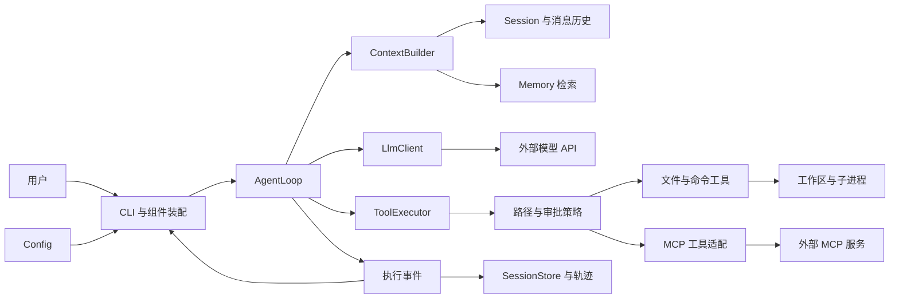
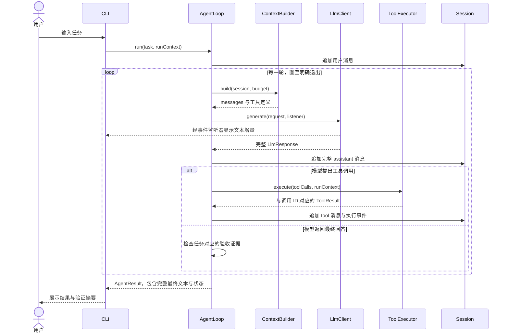

# CodeY 架构设计

> 版本：0.1，日期：2026-10-11。本文描述目标架构；当前已实现 Maven 骨架和说明型 CLI，其他模块为占位。开发进度见 [roadmap](roadmap.md)。

## 1. 项目定位与范围

CodeY 是使用 Java 从零实现的 CLI 编程 Agent。通过手写模型调用、Agent 循环、工具执行与上下文管理，理解 Claude Code、Codex 等产品的运行原理，并形成可演示、可验证的学习项目。

首版场景：在用户指定的 Java 工作区中读取代码、定位问题、修改文件、执行编译与测试，根据实际结果继续修复。最终输出改动说明、验证证据和剩余问题。

Harness 在本项目中指运行核心及其策略：Agent 循环、上下文构建、工具调度、预算、权限、状态和结果验证。LLM 是提出行动的组件；Java 程序负责执行和维护真实状态。

首版采用单 Agent。多 Agent、复杂 Plan、向量 RAG、Web UI、远程 API、微信与后台任务属于后续扩展，暂不建立对应模块。

## 2. 技术基线

| 组件 | 选择 | 实现阶段与原因 |
|---|---|---|
| 语言 | Java 17 | M0；本机可用，records 等能力足够支持首版 |
| 工程 | Maven 单模块 | M0；按包组织，降低初期装配成本 |
| CLI | JDK 标准输入输出 | M0/M1；后续有输入编辑需求再接 JLine |
| HTTP | JDK HttpClient | M1 计划；明确读写协议、超时与流关闭 |
| JSON | Jackson | M1 计划；接入时锁定具体版本并记录 |
| 日志 | 初期标准输出；后续 SLF4J | M1/M3；模型内容与日志分流，避免输出密钥 |
| 测试 | JUnit 5 + 本地 HTTP 替身 | M1 计划；默认测试不调用真实模型 |
| 状态存储 | 项目内 JSON/JSONL 文件 | M5；先实现可解释的事件与状态恢复 |
| MCP | JSON-RPC + stdio | M6；先支持一条传输链，HTTP 后续增加 |

当前 pom 仅声明构建插件，没有第三方运行时依赖。加入 Jackson 等依赖时同步配置依赖打包。依赖版本在实际接入阶段选择、锁定和验证，不直接继承原项目的完整依赖列表。

## 3. 目录结构

```text
codeY/
├── README.md
├── pom.xml
├── .gitignore
├── .gitattributes
├── .env.example
├── docs/
│   ├── README.md
│   ├── architecture.md
│   ├── modules.md
│   ├── roadmap.md
│   ├── interview.md
│   ├── decisions.md
│   ├── diagrams/
│   │   ├── architecture.mmd
│   │   ├── agent-flow.mmd
│   │   └── request-sequence.mmd
│   └── references/
│       └── paicli-source-architecture-guide.md
└── src/
    ├── main/
    │   ├── java/io/github/jackfeicoder/codey/
    │   │   ├── cli/          # Main、装配、输入与展示
    │   │   ├── config/       # 环境配置、模型配置、工作区
    │   │   ├── agent/        # AgentLoop、预算、取消、结果
    │   │   ├── llm/          # LlmClient、请求响应、SSE
    │   │   ├── tool/
    │   │   │   └── builtin/  # 文件、搜索、命令工具
    │   │   ├── context/      # 上下文收集、选择、预算与压缩
    │   │   ├── session/      # 消息、执行事件、会话存储
    │   │   ├── memory/       # 长期记忆的检索与保存
    │   │   ├── mcp/          # MCP 客户端及工具适配
    │   │   ├── policy/       # 路径范围、审批与执行策略
    │   │   └── observability/ # 执行轨迹、Token 与耗时
    │   └── resources/prompts/
    └── test/
        ├── java/io/github/jackfeicoder/codey/
        └── resources/fixtures/
```

模块包当前使用 package-info.java 声明用途，避免空目录在 Git 中丢失。不会为每个占位模块提前加入复杂抽象。

运行时数据目录 `.codey/` 按需创建并忽略提交，目标布局如下，当前未生成：

```text
工作区/.codey/
├── sessions/<session-id>/events.jsonl
├── sessions/<session-id>/state.json
├── memory/project.json
└── runs/<run-id>/summary.json
```

执行轨迹可能含源码与命令输出，日志内容应可截断、脱敏并由用户控制留存。

## 4. 模块架构



CLI 是装配入口，负责创建组件和展示事件。AgentLoop 面向接口工作，避免直接操作终端。上下文、会话与记忆职责明确：会话保存发生过什么，上下文决定当前发什么，记忆保存跨会话事实。

接口和数据契约详见 [modules](modules.md)。图中的持久化、记忆、MCP 是后续阶段能力。

## 5. 启动流程

1. 解析参数：help/version，后续加入 workspace/model/session。
2. 加载配置并校验模型名、地址、密钥、超时、工作区。
3. 解析工作区真实路径；按策略注册当前可用工具。
4. 创建 LlmClient、Session、ContextBuilder、ToolExecutor 和 AgentLoop。
5. M5 开始按需恢复会话；M6 开始初始化 MCP，并负责关闭资源。
6. 接收输入，启动 run，展示流式事件和最终 AgentResult。
7. 退出时关闭响应流、执行器、MCP 进程和会话存储。

配置初期只读取系统环境变量；`.env.example` 是字段说明，当前 CLI 不读取它，也不承诺自动加载 `.env`。

## 6. 一次任务的执行流程

```mermaid
flowchart TD
    start["接收任务并创建 Run"] --> append["追加用户消息"]
    append --> guard{"取消或预算耗尽？"}
    guard -- "是" --> stopped["返回 CANCELLED 或 BUDGET_EXHAUSTED"]
    guard -- "否" --> build["构建上下文并预留输出预算"]
    build --> call["调用 LLM 并展示事件"]
    call --> valid{"响应完整且合法？"}
    valid -- "否" --> failed["分类失败与有限重试"]
    failed --> exhausted{"重试耗尽？"}
    exhausted -- "是" --> error["返回 FAILED"]
    exhausted -- "否" --> guard
    valid -- "是" --> tools{"存在工具调用？"}
    tools -- "是" --> policy["校验参数与权限"]
    policy --> execute["执行工具并回填全部结果"]
    execute --> guard
    tools -- "否" --> verify{"任务验收证据满足？"}
    verify -- "是" --> done["返回 COMPLETED 与证据"]
    verify -- "否" --> continueRun{"仍可继续？"}
    continueRun -- "是" --> feedback["追加缺失证据或失败反馈"]
    feedback --> guard
    continueRun -- "否" --> incomplete["返回 INCOMPLETE"]
```



流式回调只负责展示，完整响应始终返回调用方。模型的 assistant tool_calls 与每个 tool_call_id 对应的结果作为完整组保留，压缩时避免孤立结果。

## 7. 核心策略

### Agent 与退出

- 每个 run 创建独立 RunContext，携带 runId、workspace、budget、cancelToken。
- 限制轮次、墙钟时间、单次工具时间；Token 预算接入后单独累计。
- 区分 COMPLETED、INCOMPLETE、FAILED、CANCELLED、BUDGET_EXHAUSTED。
- 模型结束回答并不自动证明代码任务完成。代码修改任务检查约定验证命令的退出码、验证发生在最新修改之后等证据。
- 验证通过仅表示约定检查通过，未覆盖的行为在结果中说明；解释代码类任务采用不同完成条件。

### 工具

首版 read_file、list_files、search_text、write_file、execute_command。read_file 默认分页，返回路径、行号、截断信息。工具输出保留执行元数据，与发给模型的截断文本分开。

工具定义、注册与执行分开。ToolResult 结构化保存 status、errorCode、output、exitCode、duration 和 artifacts。参数验证与路径策略在执行前运行。

初期工具顺序执行。具备依赖与资源冲突判断后才并行只读操作；文件写入和改变工作区的命令按顺序执行。命令通过平台适配运行，明确工作目录、退出码和超时，不固定使用 bash。

### 上下文

每次调用模型前统一构建：项目规则、当前目标、历史摘要、近期完整消息组、相关记忆和工具定义。采用收集 → 筛选 → 组织 → 压缩的流程。

预算同时考虑工具 schema、系统规则、近期历史和预留输出。估算值与 API 返回实际 usage 分开记录。大工具输出通过限制、分页和按需读取控制。

压缩使用副本构建请求，完整会话事件保留。摘要记录目标、约束、已完成步骤、关键文件、失败与下一步；需要重新检查文件时读取最新内容。

### 记忆与 MCP

长期记忆初期只保存用户明确确认的偏好、项目约定与重要事实，携带范围、来源与时间；不自动保存每条模型推断。保存操作统一经过存储层，并采用临时文件替换等方式避免半写文件。

MCP 工具经适配器进入同一 ToolRegistry/ToolExecutor，复用权限、超时、事件与结果处理。先实现 stdio 的 initialize、initialized、tools/list、tools/call；未知能力不注册为可用功能。协议版本、能力协商和分页以接入阶段文档与测试为准。

## 8. 会话恢复与操作边界

会话恢复必须绑定工作区与模型配置引用，不持久化 API Key。持久化步骤事件和状态快照。进程意外退出后，先检查最后一条工具是否已完成；不直接重放写文件、命令或其他有副作用的调用。

文件路径校验基于规范化路径和真实路径处理已有文件、符号链接及目标父目录；路径前缀的字符串判断不足以覆盖边界。命令工具能操作更大范围，因此路径限制与进程隔离是不同能力。初期使用命令审批，后续根据需要引入进程隔离。

## 9. 实现验证与已知边界

- 当前骨架只验收 Maven 构建、可执行 JAR 和 help/version；没有模型调用。
- LLM 接入用本地 HTTP/SSE 替身验证，不使用真实密钥作为默认测试前提。
- 工具使用临时工作区验证路径、分页、错误和超时；命令用无网络的测试程序。
- 上下文验证工具调用组完整性、预算和规则保留；恢复验证副作用不会被盲目重放。
- 最终用固定小型 Java 项目评估，记录模型配置和任务集版本，避免把模型变化误认为架构提升。

图表提供 Mermaid 源文件，并人工检查流程与顺序；已核对独立源文件与本文内嵌图一致。初始化时尝试本地渲染，因环境缺少 Mermaid CLI（mmdc）未生成 SVG/PNG；尚未经过渲染器语法验证。可在支持 Mermaid 的 Markdown 查看器中预览，构建 Java 工程不依赖图表渲染工具。
