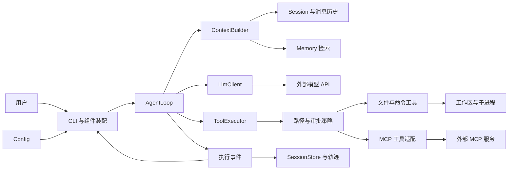
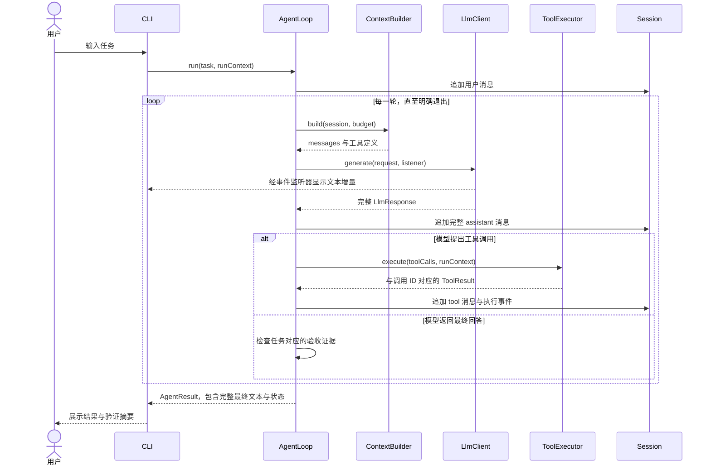

# CodeY 架构设计

> 版本：0.1，日期：2026-10-26。当前已实现配置、消息、基础提示词、普通与 SSE 流式调用、可选工作区、本地会话管理、六个文件工具、execute_command 本地命令、AgentLoop、ask/规则 auto/full、会话文件授权、ReAct/Plan 切换、终端状态栏及按模型配置上下文容量。请求组装、Token 估算、输入预算与预警已实现，发送前有界摘要压缩与 /compact 已实现。完成的工具消息组可保存和恢复；执行中恢复、专用网络/删除工具、OS 进程沙箱、持久审计及多 Agent 仍待实现。验证使用本地替身与临时文件，真实厂商兼容性尚待验证。开发进度见 [开发路线](#roadmap)。

## 阅读导航

- 第 1—9 节：定位、技术栈、目录、架构图、执行流程与核心策略。
- [模块职责与接口契约](#modules)
- [已实现的消息模型](#messages)
- [工具模块骨架与工具描述](#tool-foundation)
- [读文件工具实现与独立调用](#read-file)
- [完整写入与局部编辑](#file-writes)
- [本地命令执行、结果与审批](#execute-command)
- [权限审批模块设计与三种模式](#permission-design)
- [Agent 循环与工具请求接入](#agent-loop)
- [简洁控制台进度与 exit 返回列表](#console-debug)
- [模型切换、目录、帮助与最后使用默认](#model-commands)
- [Windows CMD 全局启动](#global-cmd)
- [LLM 普通与流式调用](#llm)
- [SSE 流式实现与验证](#streaming)
- [模型上下文容量配置与加载](#model-capacity)
- [已实现的 Session 与连续对话](#session-chat)
- [代码阅读顺序与当前调用流程](#code-guide)
- [Prompt 模块设计与文件约定](#prompt-design)
- [工作区选择、历史列表与会话恢复方案](#workspace-sessions)
- [配置加载与多模型选择](#configuration)
- [开发路线与验收标准](#roadmap)
- [设计决策](#decisions)
- [面试学习与项目证据](#interview)

## 1. 项目定位与范围

CodeY 是使用 Java 从零实现的 CLI 编程 Agent。通过手写模型调用、Agent 循环、工具执行与上下文管理，理解 Claude Code、Codex 等产品的运行原理，并形成可演示、可验证的学习项目。

首版场景：在用户指定的 Java 工作区中读取代码、定位问题、修改文件、执行编译与测试，根据实际结果继续修复。最终输出改动说明、验证证据和剩余问题。

Harness 在本项目中指运行核心及其策略：Agent 循环、上下文构建、工具调度、预算、权限、状态和结果验证。LLM 是提出行动的组件；Java 程序负责执行和维护真实状态。

首版采用单 Agent。多 Agent、复杂 Plan、向量 RAG、Web UI、远程 API、微信与后台任务属于后续扩展，暂不建立对应模块。

## 2. 技术基线

| 组件 | 选择 | 实现阶段与原因 |
|---|---|---|
| 语言 | Java 17 | M0；本机可用，records 等能力足够支持首版 |
| 工程 | Maven 单模块 | M0；按包组织，降低初期装配成本 |
| CLI | JLine 3.30.17 + JDK 标准输入输出 | 原生终端补全、候选选择；管道/测试保留逐行输入 |
| HTTP | JDK HttpClient | 已实现普通 JSON / SSE 请求；共享连接客户端，单次配置绑定 |
| JSON | Jackson 2.18.2 | M1 已实现消息映射与响应解析 |
| 日志 | 初期标准输出；后续 SLF4J | M1/M3；模型内容与日志分流，避免输出密钥 |
| 测试 | JUnit 5.10.2 + JDK HttpServer | 配置、消息及普通 HTTP / SSE 测试已实现，默认不调用真实模型 |
| 状态存储 | 用户目录 JSON 快照，后续 JSONL 事件 | 会话选择阶段先恢复文本；M5 补工具执行状态 |
| MCP | JSON-RPC + stdio | M6；先支持一条传输链，HTTP 后续增加 |

当前运行依赖为 Jackson 2.18.2；JUnit 5.10.2 为测试依赖。Maven Shade 3.5.1 在 package 阶段生成包含依赖与 Main 入口的可执行 JAR。此处记录已验证的项目版本，不声明其为各组件的最新版本。

## 3. 目录结构

```text
codeY/
├── README.md
├── pom.xml
├── .gitignore
├── .gitattributes
├── .env.example
├── docs/
│   ├── architecture.md     # 完整设计、配置、路线与学习笔记
│   └── diagrams/           # 可编辑 Mermaid 源文件
│       ├── architecture.mmd
│       ├── agent-flow.mmd
│       └── request-sequence.mmd
└── src/
    ├── main/
    │   ├── java/io/github/jackfeicoder/codey/
    │   │   ├── cli/          # Main、ChatCli、装配、输入与展示
    │   │   ├── config/       # 环境配置、模型配置、工作区
    │   │   ├── prompt/       # PromptLoader、PromptException
    │   │   ├── instruction/  # AGENTS.md 加载、大小校验、/init任务
    │   │   ├── agent/        # AgentLoop、预算、取消、结果
    │   │   ├── llm/          # LlmClient、请求响应、SSE
    │   │   ├── tool/
    │   │   │   └── builtin/  # 文件、搜索、命令工具
    │   │   ├── context/      # 上下文收集、选择、预算与压缩
    │   │   ├── session/      # Message、Session、快照、存储与标题；工具事件后续实现
    │   │   ├── workspace/    # 可选目录绑定与真实路径解析
    │   │   ├── memory/       # 长期记忆的检索与保存
    │   │   ├── mcp/          # MCP 客户端及工具适配
    │   │   ├── policy/       # 路径范围、审批与执行策略
    │   │   └── observability/ # 执行轨迹、Token 与耗时
    │   └── resources/prompts/
    │       ├── base.md       # 随 JAR 打包的基础提示词
    │       ├── compact.md
    │       ├── compact-reduce.md
    │       └── init.md       # 项目规则初始化指令
    └── test/
        ├── java/io/github/jackfeicoder/codey/
        └── resources/fixtures/
```

模块包使用 package-info.java 声明用途，避免空目录在 Git 中丢失。资源空目录使用 .gitkeep 占位，不提前加入复杂抽象。prompts/base.md 保存已接入的基础系统提示词，fixtures 保存脱敏协议响应和小型测试项目；测试按主代码的包结构组织，默认不依赖真实 API Key。

会话数据按需创建，已实现布局与后续项目数据如下。会话集中放在用户目录，便于统一展示不同项目及普通聊天；项目数据目录忽略提交。详细实现见 [工作区与会话方案](#workspace-sessions)。

```text
用户目录/.codey/
└── sessions/<session-id>/
    ├── session.json           # 第一版：元数据、基础提示词与成功文本历史
    ├── session.lock           # 使用期间持有操作系统文件锁
    └── events.jsonl           # 工具阶段再增加，不提前实现

工作区/.codey/                 # 后续项目缓存、记忆与运行结果
├── cache/
├── memory/project.json
└── runs/<run-id>/summary.json
```

执行轨迹可能含源码与命令输出，日志内容应可截断、脱敏并由用户控制留存。

## 4. 模块架构



CLI 是装配入口，负责创建组件和展示事件。AgentLoop 面向接口工作，避免直接操作终端。上下文、会话与记忆职责明确：会话保存发生过什么，上下文决定当前发什么，记忆保存跨会话事实。

接口和数据契约详见 [模块与接口](#modules)。图中的持久化、记忆、MCP 是后续阶段能力。

## 5. 启动流程

1. 解析参数：help/version，后续加入 workspace/model/session。
2. 加载配置并校验模型名、地址、密钥、超时、工作区。
3. 解析工作区真实路径；按策略注册当前可用工具。
4. 创建 LlmClient、Session、ContextBuilder、ToolExecutor 和 AgentLoop。
5. M5 开始按需恢复会话；M6 开始初始化 MCP，并负责关闭资源。
6. 接收输入，启动 run，展示流式事件和最终 AgentResult。
7. 退出时关闭响应流、执行器、MCP 进程和会话存储。

配置字段来源为系统环境变量 > 启动目录 `.env` > 默认值。模型首次选择为 --profile > 用户最后选择 > 恢复会话保存别名 > CODEY_ACTIVE_PROFILE；后续 /new 采用最后选择。`.env.example` 是模板，旧 CODEY_LLM_* 兼容为 default。--check-config 只校验配置；/list model 展示目录，/model 切换会话模型。详见 [模型命令](#model-commands)。

## 6. 一次任务的执行流程

```mermaid
flowchart TD
    start["接收任务并创建 Run"] --> append["追加用户消息"]
    append --> guard{"取消或预算耗尽？"}
    guard -- "是" --> stopped["返回 CANCELLED 或 BUDGET_EXHAUSTED"]
    guard -- "否" --> build["构建上下文并预留输出预算"]
    build --> call["调用 LLM 并展示事件"]
    call --> valid{"响应完整且合法？"}
    valid -- "否" --> failed["分类失败与有限重试"]
    failed --> exhausted{"重试耗尽？"}
    exhausted -- "是" --> error["返回 FAILED"]
    exhausted -- "否" --> guard
    valid -- "是" --> tools{"存在工具调用？"}
    tools -- "是" --> policy["校验参数与权限"]
    policy --> execute["执行工具并回填全部结果"]
    execute --> guard
    tools -- "否" --> verify{"任务验收证据满足？"}
    verify -- "是" --> done["返回 COMPLETED 与证据"]
    verify -- "否" --> continueRun{"仍可继续？"}
    continueRun -- "是" --> feedback["追加缺失证据或失败反馈"]
    feedback --> guard
    continueRun -- "否" --> incomplete["返回 INCOMPLETE"]
```



流式回调只负责展示，完整响应始终返回调用方。模型的 assistant tool_calls 与每个 tool_call_id 对应的结果作为完整组保留，压缩时避免孤立结果。

## 7. 核心策略

### Agent 与退出

- 每个 run 创建独立 RunContext，携带 runId、workspace、budget、cancelToken。
- 限制轮次、墙钟时间、单次工具时间；Token 预算接入后单独累计。
- 区分 COMPLETED、INCOMPLETE、FAILED、CANCELLED、BUDGET_EXHAUSTED。
- 模型结束回答并不自动证明代码任务完成。代码修改任务检查约定验证命令的退出码、验证发生在最新修改之后等证据。
- 验证通过仅表示约定检查通过，未覆盖的行为在结果中说明；解释代码类任务采用不同完成条件。

### 工具

工具按职责分为 read_file（内容阅读）、list_files（目录浏览）、search_file（名称/路径定位）、grep_code（字面内容搜索）、write_file（完整写入）和 edit_file（局部精确替换）；execute_command 后续实现。read_file 默认分页，返回路径、行号、截断信息。工具输出保留执行元数据，与发给模型的截断文本分开。

工具定义、注册与执行分开。当前 ToolResult 保存调用 ID、工具名称、status、errorCode、output、durationMillis 与 truncated；exitCode、artifacts、路径策略及命令审批随具体工具接入。基础执行器只解析 JSON 对象，并调用工具的显式校验方法。

初期工具顺序执行。具备依赖与资源冲突判断后才并行只读操作；文件写入和改变工作区的命令按顺序执行。命令通过平台适配运行，明确工作目录、退出码和超时，不固定使用 bash。

### 上下文

每次调用模型前统一构建：项目规则、当前目标、历史摘要、近期完整消息组、相关记忆和工具定义。采用收集 → 筛选 → 组织 → 压缩的流程。

预算同时考虑工具 schema、系统规则、近期历史和预留输出。估算值与 API 返回实际 usage 分开记录。大工具输出通过限制、分页和按需读取控制。

压缩使用副本构建请求，完整会话事件保留。摘要记录目标、约束、已完成步骤、关键文件、失败与下一步；需要重新检查文件时读取最新内容。

### 记忆与 MCP

长期记忆初期只保存用户明确确认的偏好、项目约定与重要事实，携带范围、来源与时间；不自动保存每条模型推断。保存操作统一经过存储层，并采用临时文件替换等方式避免半写文件。

MCP 工具经适配器进入同一 ToolRegistry/ToolExecutor，复用权限、超时、事件与结果处理。先实现 stdio 的 initialize、initialized、tools/list、tools/call；未知能力不注册为可用功能。协议版本、能力协商和分页以接入阶段文档与测试为准。

## 8. 会话恢复与操作边界

会话保存可选的工作区绑定与模型配置引用，不持久化 API Key；无工作区会话同样可恢复。第一版只恢复文本快照，工作区与模型缺失的处理见 [详细方案](#workspace-sessions)。工具阶段再持久化步骤事件和执行状态。进程意外退出后，先检查最后一条工具是否已完成；不直接重放写文件、命令或其他有副作用的调用。

文件路径校验基于规范化路径和真实路径处理已有文件、符号链接及目标父目录；路径前缀的字符串判断不足以覆盖边界。命令工具能操作更大范围，因此路径限制与进程隔离是不同能力。初期使用命令审批，后续根据需要引入进程隔离。

## 9. 实现验证与已知边界

- 当前验收 Maven 构建、可执行 JAR、配置/消息/提示词/Session/HTTP/Agent 测试，以及 --prompt、--chat 和工具闭环的本地 HTTP 请求；SSE 已本地验证，真实服务商调用后续验证。
- LLM 接入用本地 HTTP/SSE 替身验证，不使用真实密钥作为默认测试前提。
- 工具使用临时工作区验证路径、分页、错误和超时；命令用无网络的测试程序。
- 上下文验证工具调用组完整性、预算和规则保留；恢复验证副作用不会被盲目重放。
- 最终用固定小型 Java 项目评估，记录模型配置和任务集版本，避免把模型变化误认为架构提升。

图表提供 Mermaid 源文件，并人工检查流程与顺序；已核对独立源文件与本文内嵌图一致。初始化时尝试本地渲染，因环境缺少 Mermaid CLI（mmdc）未生成 SVG/PNG；尚未经过渲染器语法验证。可在支持 Mermaid 的 Markdown 查看器中预览，构建 Java 工程不依赖图表渲染工具。

<a id="modules"></a>

## 10. 模块职责与接口契约

> 以下含目标设计。当前已实现 CLI、配置、提示词、消息/工具、AgentLoop/AgentResult、Session/MessageHistory 及快照/存储/服务、可选工作区和普通/流式 LLM。其余具体类型按阶段实现。

### 模块边界

| 包 | 职责 | 计划核心类型 | 约束 |
|---|---|---|---|
| cli | 装配、输入、渲染、退出 | Main、ChatCli、SessionLauncher | 不持有 Agent 算法；核心代码不直接输出终端 |
| prompt | 内置提示词加载与后续片段组合 | PromptLoader、PromptException；后续 PromptAssembler | 按 classpath 读取，与模型厂商和密钥无关 |
| config | 加载、选择并验证配置 | LlmConfig、ModelProfiles、AuthMode、SessionSettings | 密钥不进入日志、会话或仓库 |
| workspace | 可选工作区与真实目录校验 | WorkspaceBinding、WorkspaceResolver | 不改变 .env 来源，不代替工具权限 |
| agent | 执行循环、预算、取消、完成判定 | AgentLoop、RunContext、AgentResult、RunBudget | 一次 run 的状态独立，明确退出原因 |
| llm | 请求编码、HTTP、SSE、响应组装 | LlmClient、LlmRequest、LlmResponse、ChatStreamDecoder | 总返回完整结果；展示回调不影响返回值 |
| tool | 定义、注册、调度、参数验证 | Tool、ToolDefinition、ToolCall、ToolResult、ToolRegistry、ToolExecutor | Agent 依赖执行器，工具不反向调用 Agent |
| tool.builtin | 文件搜索、读取、修改、命令 | ReadFileTool、SearchTextTool、WriteFileTool、ExecuteCommandTool | 输出有边界，所有路径基于工作区解析 |
| context | 选择和组织本轮输入 | ContextBuilder、ContextSnapshot、TokenEstimator、HistoryCompactor | 不把长记忆与会话副本重复堆入请求 |
| session | 完整会话状态、消息、事件和存储 | Message、Session、SessionEvent、SessionStore | assistant 调用与 tool 结果具备关联关系 |
| memory | 保存和召回长期事实 | MemoryEntry、MemoryStore、MemoryRetriever | 支持项目范围、来源、时间与删除 |
| mcp | 外部协议与工具适配 | McpClient、StdioTransport、McpToolAdapter | 处理 pending request、分页与资源关闭 |
| policy | 路径范围、审批、操作策略 | ExecutionPolicy、PathPolicy、ApprovalHandler | 程序执行策略；提示词不能替代限制 |
| observability | 轨迹与指标 | AgentEvent、RunMetrics、TraceWriter | 展示信息与持久化信息可分别脱敏 |

### 最小数据模型

| 类型 | 关键字段 | 作用 |
|---|---|---|
| Message | role、content、toolCalls、toolCallId | 保持模型协议中的消息结构 |
| ToolCall | id、name、arguments | arguments 从 JSON 校验后执行；流式碎片按 index/id 拼接 |
| ToolResult | callId、name、status、output、errorCode、durationMillis、truncated | 已实现同步结果，exitCode/artifacts 后续按需加入 |
| LlmResponse | message、finishReason、usage；text()/toolCalls() | 复用 assistant Message 保存内容，避免重复存储文本和调用 |
| RunContext | runId、workspace、budget、cancelToken | 每次任务的明确执行环境 |
| AgentResult | status、turnMessages、response、modelCalls、toolCalls | 当前为不可变任务结果；verification/artifacts 后续增加 |
| Session | systemMessage/history；元数据由 SessionSnapshot 保存 | 内存保存成功轮次，SessionService 关联 ID/工作区/存储 |
| MemoryEntry | id、scope、projectId、content、source、createdAt | 避免不同项目的相同事实被错误合并 |

只有实际需要的字段进入首版。usage 缺失表示未知，不视为零。模型 capabilities（工具支持、上下文窗口等）通过显式配置提供。

<a id="messages"></a>

### 已实现的消息模型

消息放在 session 包，作为会话和后续模型调用的共同数据结构；ToolCall 放在 tool 包，表示模型提出的调用请求。

| 类型 | 字段/方法 | 当前语义 |
|---|---|---|
| MessageRole | SYSTEM、USER、ASSISTANT、TOOL | wireValue() 映射为小写协议值，fromWireValue() 解析支持的角色 |
| Message | role、content、toolCalls、toolCallId | 不可变 record，工具调用列表进行防御性复制 |
| ToolCall | id、name、arguments | 调用 ID、工具名与完整原始 JSON 参数文本 |

四种消息的分工：system 保存指令，user 保存用户输入，assistant 保存模型文本或工具调用请求，tool 保存工具执行结果。

```java
ToolCall call = new ToolCall("call_1", "read_file", "{\"path\":\"Main.java\"}");
List<Message> history = List.of(
        Message.system("你是编程助手。"),
        Message.user("解释 Main.java。"),
        Message.assistantToolCalls(List.of(call)),
        Message.tool(call.id(), "public class Main {}"),
        Message.assistant("这是项目入口类。")
);
```

`Message.assistant(text, calls)` 支持同时保存说明文本和工具调用。一条 assistant 可提出多个调用，每个调用在后续执行后产生独立 tool 消息，toolCallId 指向原始 id。工具失败也通过对应的结果消息反馈。

单条消息约束：

- 只有 assistant 可携带 toolCalls，同一消息中调用 ID 唯一。
- 只有 tool 可携带 toolCallId，且必须提供非空 ID。
- 有工具调用的 assistant 可以让 content 为 null；其他消息必须有 content，空字符串允许表示空输出。
- ToolCall 的三个字段均需非空；arguments 保存原文，JSON 对象语法已由 LLM 适配器校验，工具 schema 校验留给执行层。
- 非法构造参数抛出 IllegalArgumentException；当前不为每种数据结构单独增加异常类。

Chat Completions 适配器已显式映射 role.wireValue()、tool_calls、tool_call_id，并把 ToolCall 转成接口要求的 function 结构；不依赖 record 的默认 JSON 形状。跨消息的调用 ID 匹配、全部结果回填和工具调用组完整性由后续 Session/Agent 层检查，当前 Message 仅校验单条消息。

当前消息内容采用文本，已接入 JSON 映射、真实只读工具与完整历史配对校验；流式工具参数按 index 聚合，完整流校验后执行。相关测试覆盖普通对话、多个调用的结果关联、角色约束、空工具输出、重复 ID 和防御性复制。

<a id="tool-foundation"></a>

### 已实现的工具模块骨架与描述

> 基础模块与六个文件工具已支持独立调用，并已在工作区 CLI 会话通过 tools 字段和 AgentLoop 接通。普通聊天筛掉工作区工具；模型客户端只编解码协议，执行由 Agent 层调度。新增 write_file/edit_file 详见下文。

```text
tool/
├── Tool.java              # 实现契约：定义、具体参数校验、执行
├── ToolDefinition.java    # name、description、parameters JSON Schema
├── ToolCall.java          # 已有：模型请求的 id/name/arguments
├── ToolContext.java       # 宿主提供的工作区与输出上限
├── ToolRegistry.java      # 注册、查找、稳定定义快照、可用能力筛选
├── ToolExecutor.java      # 统一同步调度与错误归一化
├── ToolResult.java        # 成功/错误、调用关联、耗时、截断；可转 tool 消息
├── ToolException.java     # 工具预期业务失败，保留可展示错误类别
├── package-info.java
└── builtin/
    ├── ReadFileTool.java  # UTF-8 文本分页、路径范围与读取上限
    └── package-info.java
```

ToolDefinition 将描述与执行分开。description 用自然语言说明用途与限制；parameters 使用 Jackson JsonNode 表达 JSON Schema，当前校验其顶层为 object，并在构造和访问时复制，避免外部修改已注册说明。它不绑定服务商接口形状，后续由 LLM 适配器转换。

工具说明与参数 schema 放在具体 Tool 的 definition() 中，形成一份来源；不在 base.md 中维护另一份工具清单。较长的操作建议以后可单独放提示词资源，但不代替工具 schema、Java 实现或参数校验。当前调用协议的结构参考 [OpenAI Function Calling 官方说明](https://developers.openai.com/api/docs/guides/function-calling)。

read_file 的定义映射为下面的请求片段；此处是格式示例，实际元数据以 ReadFileTool.definition() 为准，已接入 LlmRequest：

```json
{
  "tools": [
    {
      "type": "function",
      "function": {
        "name": "read_file",
        "description": "读取当前工作区内的文本文件。path 使用相对工作区的路径。",
        "parameters": {
          "type": "object",
          "properties": {
            "path": { "type": "string", "minLength": 1, "description": "文件的相对路径" },
            "startLine": { "type": "integer", "minimum": 1, "maximum": 2147483647, "default": 1 },
            "maxLines": { "type": "integer", "minimum": 1, "maximum": 500, "default": 200 }
          },
          "required": ["path"],
          "additionalProperties": false
        }
      }
    }
  ]
}
```

基础执行流程：

```text
Java 装配 Tool → registry.register(tool)
registry.definitions(context) → 当前可用定义 → LlmRequest.tools → HTTP tools
ToolCall → ToolExecutor
  → 查已注册名称，不反射加载任意类
  → 解析完整 JSON 对象，拒绝重复键、尾随数据和超过 64 Ki 字符的输入
  → 按 requiresWorkspace 检查宿主绑定与真实目录是否可用
  → Tool.validateArguments：具体字段、类型、业务限制
  → Tool.execute：得到文本或预期异常
  → ToolResult：保留原调用 ID、状态/错误码、毫秒耗时、输出截断
  → toMessage()：结构化正文 + Message.tool(callId, ...)
```

Registry 以名称绑定定义和实现，按注册顺序展示；重复名称明确失败，定义列表不可修改。需要工作区的工具在 NONE 或失效目录下不展示给模型，执行器也会拒绝对应调用；这只是基础可用性检查。ReadFileTool 已负责具体路径与链接范围检查；统一路径策略和命令隔离仍待实现。

ToolContext 由宿主提供，默认输出上限为 16000 个 Unicode 码点。模型 arguments 不决定工作区或宿主上限。输出截断保留完整字符，truncated 字段表明信息不完整；该限制在执行后作用于返回文本，读取工具仍需先限制实际读取量。

ToolResult 的基础失败类别包括 UNKNOWN_TOOL、INVALID_ARGUMENTS、WORKSPACE_REQUIRED、WORKSPACE_UNAVAILABLE、EXECUTION_FAILED、INTERRUPTED，读文件的专用类别见下一节。预期 ToolException 保留可展示说明；未知 RuntimeException 使用通用错误，不回显原始异常或参数。InterruptedException 恢复线程标志；JVM Error 不当作业务错误吞掉。成功和失败结果都可转为原 toolCallId 对应的消息，转换本身不追加历史或调用模型。

当前没有通用 JSON Schema 校验器：Tool 必须显式实现 validateArguments，schema 用于声明和发送，不能假设定义 schema 就自动完成业务校验。执行器为同步串行调用，durationMillis 只是测量值；工具超时、审批、取消令牌、并行调度与审计事件尚未实现。接 MCP 的复杂 schema 时再引入完整校验能力。

ReadFileTool 已实现定义、参数/路径校验与有界读取；LlmRequest 与协议适配器已发送 tools，AgentLoop 回填 assistant/tool 后继续请求，v2 SessionSnapshot 保存完整成功工具轮次。list_files 已接入目录探索，search_file 已接入文件名/路径定位；grep_code 已支持正文定位；已接入统一审批入口，完整进程/网络隔离仍待实现。

写入阶段验证：当时完整 mvn verify 共 506 项通过，无失败、错误或跳过。写入/编辑新增 45 项临时文件测试与 3 项 Agent 组合测试；其他阶段的历史验证记录见各工具段落。仅使用本地模型替身与临时测试文件。

<a id="read-file"></a>

### 已实现的读文件工具：read_file

实现文件：[ReadFileTool.java](../src/main/java/io/github/jackfeicoder/codey/tool/builtin/ReadFileTool.java)。一个类提供定义、实际参数校验、路径检查和读取逻辑；复用 ToolRegistry / ToolExecutor / ToolResult，不依赖模型提供商。该工具可独立执行，Main 已装配到工作区会话。

| 参数 | 类型与默认值 | 用途 |
|---|---|---|
| path | 必填非空字符串 | 工作区相对路径，保留文件名空格，拒绝绝对/带根路径 |
| startLine | 整数，默认 1，范围 1～2147483647 | 第一条要返回的文件行号 |
| maxLines | 整数，默认 200，范围 1～500 | 本次最多返回的完整行数，可能受输出预算提前分页 |

拒绝未知参数、显式 null、浮点数、字符串行数与越界数字；工作区和输出预算由宿主 ToolContext 提供。

```text
ToolExecutor → validateArguments → execute
  → 检查工作区存在且仍是绑定的真实目录
  → resolve(path).normalize()：拒绝词法越界
  → toRealPath()：解析目录及文件链接，拒绝真实目标越界
  → 普通文件 / 可读 / 文件 ≤ 4 MiB
  → 打开真实路径（最终路径 NOFOLLOW_LINKS）
  → 有界字节流 → 严格 UTF-8 Reader → 移除开头 BOM
  → 顺序跳过前文 → 完整行读取 → JSON 序列化长度检查
  → 生成分页 JSON → ToolResult → 原调用 ID 的 tool 消息
```

内存只保留当前页；文件大小及实际读取字节上限均为 4 MiB，限制实际读取可应对检查后文件增长。每行上限 16384 个 UTF-16 单元，包括跳过的行；不把整文件装入内存。顺序跳过意味着深页仍需从头扫描，首版不建立文件索引。

兼容 LF / CRLF / CR，保留空行和行内空白，末尾换行不额外生成一行。严格 UTF-8 解码会拒绝非法字节，NUL 被视为非文本。只验证实际读取区域；解码器有预读，附近非法字节也可能触发编码错误。该工具不是完整文件格式检测器。

返回值为 JSON **文本**，存放在 ToolResult.output；例如读取第 2 行、最多 1 行：

```json
{
  "path": "src/Main.java",
  "startLine": 2,
  "returnedLines": 1,
  "endLine": 2,
  "lines": [{ "line": 2, "text": "public class Main {" }],
  "hasMore": true,
  "nextStartLine": 3
}
```

输出预算计入元数据、行号和 JSON 转义，并按 Unicode 码点测量。放不下下一条完整行时提前结束，下一次从未返回的行继续；连第一行或空页元数据都放不下时返回 OUTPUT_LIMIT_TOO_SMALL。成功输出保持完整 JSON，ToolResult.truncated 为 false；`hasMore` 表示分页未结束。EOF 时 nextStartLine 为 null；空文件或起始行超出 EOF 时 lines 为空、endLine 为 null。不扫描尾部计算总行数。

独立装配示例（导入 tool、tool.builtin、workspace 包中的对应类）：

```java
// 工作区由宿主解析，模型只给相对文件路径。
var root = java.nio.file.Path.of("E:/Desktop/github/codeY").toRealPath();
var binding = new WorkspaceBinding(WorkspaceBinding.Mode.DIRECTORY, root.toString());
var context = new ToolContext(binding);
var registry = new ToolRegistry().register(new ReadFileTool());
var executor = new ToolExecutor(registry);
var call = new ToolCall("call-read-1", "read_file",
        "{\"path\":\"README.md\",\"startLine\":1,\"maxLines\":20}");
ToolResult result = executor.execute(call, context);
System.out.println(result.output());
// 在生产 CLI 中，由 AgentLoop 把 result.toMessage() 回填给模型。
```

| 错误码 | 含义 |
|---|---|
| PATH_OUTSIDE_WORKSPACE | 绝对/带根路径、归一化越界或链接目标在工作区外 |
| FILE_NOT_FOUND / NOT_A_FILE | 文件不存在，或目标不是普通文件 |
| FILE_NOT_READABLE / FILE_READ_FAILED | 无读取权限，或其他 I/O 失败 |
| FILE_TOO_LARGE / LINE_TOO_LONG | 文件/实际读取量超过 4 MiB，或单行超限 |
| INVALID_ENCODING / NOT_TEXT_FILE | 读取区域不是有效 UTF-8，或出现 NUL |
| OUTPUT_LIMIT_TOO_SMALL | 完整单行或元数据放不进宿主输出预算 |

工作区内链接可读，输出 path 使用真实目标的相对路径；工作区外链接被拒绝。打开时不跟随新出现的最终符号链接，但目录在检查与打开之间仍可能被并发替换，因此这不是完整操作系统沙箱。后续统一权限模块再处理强隔离、敏感路径策略等需求。写入能力见后文 write_file/edit_file；当前仍没有工具执行超时；顺序读取期间检查线程中断。

测试：[ReadFileToolTest.java](../src/test/java/io/github/jackfeicoder/codey/tool/builtin/ReadFileToolTest.java)，36 项使用临时真实文件，覆盖编码、换行、默认参数、分页、空文件、输出预算、非法参数、路径/链接范围、大小边界与中断。当前环境符号链接专项已执行，无跳过。独立运行：`mvn -Dtest=ReadFileToolTest test`；完整构建：`mvn verify`。

<a id="list-files"></a>

### 已实现的目录工具：list_files

实现文件：[ListFilesTool.java](../src/main/java/io/github/jackfeicoder/codey/tool/builtin/ListFilesTool.java)。在 Main.createTools 注册，复用 ToolRegistry / ToolExecutor / AgentLoop，LLM 只接收结构化工具说明，不新增目录专用客户端。

| 参数 | 默认值 | 约束 |
|---|---|---|
| path | `.` | 相对工作区的目录路径；拒绝空白、绝对/带根和越界路径 |
| maxDepth | 10（可由 CODEY_LIST_FILES_DEFAULT_DEPTH 配置） | 整数 1–20；直接子项算第一层，所选目录本身不算结果条目 |
| maxEntries | 200 | 整数 1–1000，文件/目录/链接都占一条 |

执行流程：校验字段类型与范围 → 检查真实工作区及目标目录 → 打开目录流，收集扫描预算内的子项并关闭流 → 按文件名自然顺序排序 → 深度优先返回并递归下一层 → 在加入每个条目时验证完整 JSON 输出预算 → 用原 callId 回填 tool 结果。扫描总量上限 10000，限制单目录排序缓存及全次遍历工作量；线程中断在目录枚举和条目处理期间检查。

工具输出是 ToolResult.output 中的 JSON 字符串，例如对 path=`src`、maxDepth=2 的结果：

```json
{
  "path": "src",
  "maxDepth": 2,
  "maxEntries": 200,
  "returnedEntries": 2,
  "entries": [
    {"path": "src/main", "type": "directory", "depth": 1},
    {"path": "src/main/java", "type": "directory", "depth": 2}
  ],
  "truncated": false,
  "limitReason": null,
  "scannedEntries": 2,
  "ignoredDirectoryNames": [".git", "target", "node_modules", ".gradle", "build", "dist"]
}
```

每个 entry.path 相对工作区，而不是相对参数 path，可直接用于 read_file。条目类型为 file/directory/symlink/other，不包含正文、链接目标或工作区绝对路径。scannedEntries 包括被忽略项，不是整个工作区文件总数；truncated=false 只表示指定深度及默认过滤范围内未因预算提前终止，不能据此声称查看了整个项目。

达到 maxEntries、输出预算、扫描上限时，内部 JSON 的 truncated=true，limitReason 分别为 maxEntries/outputLimit/scanLimit。工具预留扫描计数及最长原因的元数据空间，保证成功结果没有被 ToolExecutor 切成残缺 JSON；外层 ToolResult.truncated 因此为 false，与内部“目录结果不完整”不同。若一个条目或元数据都放不下，返回 OUTPUT_LIMIT_TOO_SMALL。第一版无分页游标，模型应选择具体子目录、适度调整深度/条数继续探索；巨大平坦目录不保证可通过多次调用遍历全部内容。

默认跳过遍历中遇到的 .git、target、node_modules、.gradle、build、dist 目录；同名普通文件仍列出，显式以这些目录为起点也可查看其内部。这是减少噪声的固定规则，不代表 .gitignore 解析、敏感文件保护或权限策略。

发现的符号链接（含损坏/循环/外部链接）只按 symlink 列出，不跟随或输出目标；真实路径发生变化的 junction 等目录也不进入。显式 path 会先解析真实位置：工作区内链接目录可作为起点，指向工作区外则拒绝。目录与子项读取失败返回明确错误，当前不返回局部成功及 warning 列表。目录并发变化可能触发失败；路径检查到打开之间仍有竞争窗口，不是操作系统沙箱。

| 错误码 | 含义 |
|---|---|
| INVALID_ARGUMENTS | 未知字段、类型/范围错误或非法路径语法 |
| WORKSPACE_REQUIRED / WORKSPACE_UNAVAILABLE | 无工作区或绑定已失效 |
| PATH_OUTSIDE_WORKSPACE | 带根/绝对/越界路径、外部链接目标或遍历目录被替换 |
| DIRECTORY_NOT_FOUND / NOT_A_DIRECTORY | 目录/条目已不存在，或传入普通文件 |
| DIRECTORY_NOT_READABLE / DIRECTORY_READ_FAILED | 无读取权限或其他目录 I/O 失败 |
| OUTPUT_LIMIT_TOO_SMALL / INTERRUPTED | 输出容不下完整数据或线程中断 |

提示词 base.md 增加“未知路径时先 list_files，再 read_file；结果截断时选择更具体目录”的行为指导，参数说明仍以工具 schema 为准。新建会话使用新版提示词；恢复旧会话继续使用原快照，但请求 tools 仍按实际工作区动态提供当前注册的七个工具。

测试：[ListFilesToolTest.java](../src/test/java/io/github/jackfeicoder/codey/tool/builtin/ListFilesToolTest.java) 使用真实临时目录覆盖默认/显式参数、顺序/深度/相对路径、忽略规则、空目录/恰好达到条数、Unicode/输出预算、非法参数、路径/链接边界、扫描上限与中断；AgentLoopTest 验证列目录 → 读取发现的文件 → 最终回答的三次模型请求及历史完整性。

验证结果：ListFilesToolTest 29 项、Agent 组合 1 项，该阶段新增 30 项；当时完整 mvn verify 共 343 项通过，无失败或跳过，符号链接测试已执行。6 项本地 HTTP JAR 场景验证生产入口注册两个 tools、目录结果用于读文件、工具历史保存/恢复不重放、无工作区的 --prompt/会话隐藏两个工具、越界错误回填和条数限制。未读取项目真实 .env，也未调用真实模型厂商。

<a id="search-file"></a>

### 已实现的文件定位工具：search_file

职责是按文件名或路径模式找到文件位置，不读取正文、不匹配代码内容。它采用之前讨论的 glob 文件定位语义，统一命名为 `search_file`，不另建同义的 `glob_files`、`search_files` 或 `search_code`。`grep_code` 独立负责文件内容搜索。

| 工具 | 解决的问题 | 结果 |
|---|---|---|
| list_files | 项目目录是什么结构 | 文件/目录条目、类型、层级 |
| search_file | 某个名称或路径模式对应哪些文件 | 匹配的工作区相对文件路径 |
| read_file | 已知文件的具体内容是什么 | 连续文本行、行号与分页信息 |
| grep_code | 某段文本在哪些代码位置出现 | 路径、行号和匹配行 |

实现文件与依赖：

| 文件 | 职责 |
|---|---|
| [SearchFileTool.java](../src/main/java/io/github/jackfeicoder/codey/tool/builtin/SearchFileTool.java) | 工具定义/参数校验，筛选普通文件，生成有界路径结果 |
| [WorkspaceFiles.java](../src/main/java/io/github/jackfeicoder/codey/tool/filesystem/WorkspaceFiles.java) | 与 ListFilesTool 共用的工作区目录校验、忽略/链接规则、有界排序和深度优先遍历 |
| [FileGlob.java](../src/main/java/io/github/jackfeicoder/codey/tool/filesystem/FileGlob.java) | 跨平台通配符校验与匹配，按 Unicode 码点处理，不使用模型输入构造正则 |
| [SearchFileToolTest.java](../src/test/java/io/github/jackfeicoder/codey/tool/builtin/SearchFileToolTest.java) | 文件名/路径模式、范围、大小写、Unicode、无正文读取、链接和预算测试 |

工具互不调用：SearchFileTool 不调用 ListFilesTool 或 ReadFileTool；ListFilesTool 与 SearchFileTool 依赖同一个 WorkspaceFiles。目录遍历器只提供 entry 与扫描统计，由各工具决定返回结构或匹配条件。ReadFileTool 继续独立负责 UTF-8 文本读取。ToolRegistry/ToolExecutor/AgentLoop 沿用原接口，无需每加一个工具就新增循环分支。

| 参数 | 默认 / 范围 | 规则 |
|---|---|---|
| pattern | 必填，最多 256 个 Unicode 字符 | 精确文件名或相对 path 的通配符模式 |
| path | `.` | 工作区相对目录，作为本次匹配起点 |
| maxResults | 100 / 1–1000 | 返回文件路径条数，不是扫描文件数 |
| caseSensitive | false | 明确控制大小写，跨平台一致；结果保留实际名称 |

匹配约定：

- `AgentLoop.java`：递归查找任意层的精确同名文件。`Config` 不会自动匹配 ConfigLoader.java，需要 `*Config*`。
- `*Config*.java`：按文件名匹配，星号可匹配零个或多个字符；问号匹配一个 Unicode 字符。
- `src/*.java`：只匹配搜索起点的 src 目录下直接 Java 文件，单星不跨越目录。
- `**/prompts/*.md`：独立的双星目录段匹配零层或多层，包括搜索起点直接存在 prompts 的情况。末尾双星表示所选目录下的文件，例如 `src/**` 不会命中名为 src 的普通文件。
- 模式包含 `/` 时相对 path 匹配，不相对工作区根目录；结果却始终相对工作区，可直接交给 read_file。
- 模式中的 Windows 反斜杠统一为 `/`。不支持正则、字符类或花括号分组，`[]`、`{}` 和其他普通字符按字面匹配。拒绝绝对模式、`.`/`..` 段、空段、控制字符及不独立占段的双星。
- FileGlob 分别对路径段与 Unicode 字符执行动态规划，避免依赖操作系统 glob 大小写规则或产生正则回溯。模式长度及扫描量有上限；文件定位不设置人为目录深度限制。

调用示例及流程：

```json
{"pattern":"*Config*.java","path":"src","maxResults":50}
```

```text
模型返回 search_file 调用
  → AgentLoop → ToolExecutor：解析 JSON、检查工作区、校验参数
  → SearchFileTool：构造 FileGlob，调用 WorkspaceFiles.directory/scan
  → 遍历 entry：只保留普通文件，按相对搜索起点的名称/路径匹配
  → 生成 {pattern, path, caseSensitive, maxResults, returnedFiles, files,
           truncated, limitReason, scannedEntries, ignoredDirectoryNames}
  → ToolResult 关联原调用 ID → 下一次模型请求
  → 模型可直接回答文件位置，或按需调用 read_file 阅读
```

不要求先 list_files；知道命名特征时可直接定位。结果只包含路径和搜索元数据，二进制文件也能按名称定位，不尝试解码正文。发现的符号链接、junction、目录和特殊文件不作为命中；显式搜索起点可通过指向工作区内的链接解析到真实目录，越界链接拒绝。忽略目录为 `.git`、`target`、`node_modules`、`.gradle`、`build`、`dist`；显式指定这些目录为 path 时允许检查。

限制与错误：扫描最多 10000 个条目，包含目录与忽略项；每层关闭目录流后按名称排序，通过显式栈执行深度优先遍历，不依赖 Java 方法递归层数。search_file 遍历到目录末端，不接受 maxDepth 参数，schema 与结果均移除该字段；list_files 继续通过有深度参数的遍历入口控制展示范围。结果还受 maxResults 与宿主 16000 码点输出预算限制。条数、输出、扫描未覆盖全部区域时返回 `truncated=true`，limitReason 分别为 maxResults/outputLimit/scanLimit。空 files 仅表示已检查范围内无命中。没有分页游标或 `.gitignore` 解析，截断后优先缩小 path。刚好达到条数上限且无额外命中不误报截断。

成功输出预留最坏扫描统计和截断字段，始终保持完整 JSON；元数据或第一条完整路径放不下时返回 OUTPUT_LIMIT_TOO_SMALL。非法模式/参数使用 INVALID_ARGUMENTS；工作区、目录越界、缺失、非目录与读取错误复用现有错误码。共享遍历器保留线程中断，权限/读取失败不伪装为空结果。路径检查仍不等于完整操作系统沙箱。

Main 当前注册七个工具（六个文件工具和 execute_command），NONE 工作区全部隐藏。工具说明仍由 SearchFileTool.definition → Registry → LlmRequest.tools → ChatCompletionsClient 编码，无需增加工具说明 Markdown。base.md 仅补充“按名称定位优先 search_file，阅读正文用 read_file”的行为指导；旧会话继续使用提示词快照，`/new` 或 `/clear` 采用新版指导。控制台只增加搜索范围和模式摘要，例如 `[第 1 轮] 调用 search_file · src · *Config*.java`，不打印搜索结果正文。

验证：SearchFileToolTest 现有 42 项，AgentLoopTest 新增 1 项“按名称定位 → 读取 → 回答及进度/历史”组合测试；原 ListFilesToolTest 30 项全部通过共享遍历回归。完整 `mvn verify` 共 408 项通过，无失败、错误或跳过。另通过 7 组本地 HTTP JAR 验证：生产工具注册与模型驱动搜索/读取/保存、跨进程恢复不重放、无工作区的单次/会话隐藏工具、越界错误回填、条数截断结果、真实仓库十层 Java 文件定位与目录工具资源发现、超过二十层查找与目录展示深度回归。配置/会话隔离，使用本地模型替身；真实仓库只读取路径元数据，不读取真实 .env，也不调用真实厂商。

<a id="grep-code"></a>

### 已实现的正文搜索工具：grep_code

用途：模型从用户问题提炼 login、auth、API_KEY 等关键词，工具在所选范围内逐行做字面包含匹配，返回路径、行号和匹配行。函数名、变量、注释与字符串中的相同文本都可能命中，相关性由模型判断；不做语义相似度、函数识别或正则展开。无需先调用 search_file；该工具可直接搜索目录，也可搜索已知的单个文件。

| 文件 | 职责 |
|---|---|
| [GrepCodeTool.java](../src/main/java/io/github/jackfeicoder/codey/tool/builtin/GrepCodeTool.java) | 参数/schema、逐行匹配、文件失败回退、预算与结构化结果 |
| [WorkspaceFiles.java](../src/main/java/io/github/jackfeicoder/codey/tool/filesystem/WorkspaceFiles.java) | scope 支持目录或文件；与目录浏览/名称定位共用真实路径校验与显式栈遍历 |
| [FileGlob.java](../src/main/java/io/github/jackfeicoder/codey/tool/filesystem/FileGlob.java) | filePattern 筛选候选文件，语义与 search_file 的名称/路径模式一致 |
| [Utf8TextReader.java](../src/main/java/io/github/jackfeicoder/codey/tool/filesystem/Utf8TextReader.java) | 与 ReadFileTool 共用严格 UTF-8、BOM、换行处理、4 MiB/单行限制；ByteBudget 额外约束搜索的总读取字节 |
| [GrepCodeToolTest.java](../src/test/java/io/github/jackfeicoder/codey/tool/builtin/GrepCodeToolTest.java) | 正文/名称职责区分、范围/编码/链接/参数与各预算边界测试 |

工具各自实现 Tool，互不调用。遍历器负责枚举、文本读取器负责解码和有界行读取，GrepCodeTool 负责匹配及结果。底层只使用 Java NIO/文本流/字符串包含匹配，不启动 Shell、不依赖 grep/rg 或外部索引。Main 当前注册七个工具，AgentLoop 和 LLM 适配器沿用已有调度协议，不新增 grep 专用循环。

| 参数 | 默认 / 范围 | 规则 |
|---|---|---|
| query | 必填，最多 256 个 Unicode 字符 | 非空白单行字面文本，不 strip 首尾空格；拒绝换行、NUL 等控制字符，允许查询内的制表符 |
| path | `.` | 工作区相对目录或普通文件；不接受 maxDepth，没有人为递归深度限制 |
| filePattern | `*` | 限定候选文件。相对所选目录匹配；单文件范围则匹配该文件名 |
| caseSensitive | false | 同时控制正文匹配和文件模式大小写；正文使用 Locale.ROOT 大小写转换后包含匹配，结果保留原文 |
| maxResults | 50 / 1–500 | 最多返回多少条匹配行；同一行重复出现关键词只返回一次 |

例如模型请求：

```json
{"query":"login","path":"src","filePattern":"*.java","caseSensitive":false,"maxResults":50}
```

```text
AgentLoop → ToolExecutor → GrepCodeTool.options
  → WorkspaceFiles.scope 检查工作区、归一化路径、真实路径与目录/文件类型
  → 目录：共享遍历器按每层名称排序并深度优先处理，FileGlob 限定候选
  → 单文件：直接执行文件检查与读取
  → Utf8TextReader（严格 UTF-8、去开头 BOM、兼容 LF/CRLF/CR）逐行读取
  → 字符串包含匹配：追加 {path, line, text}，不返回整文件
  → 完整 JSON 输出 → ToolResult 原调用 ID → 模型按需 read_file 阅读连续上下文
```

结果的关键字段：

| 字段 | 含义 |
|---|---|
| matches / returnedMatches | 工作区相对 path、1 起始行号、完整匹配行及实际返回数 |
| scannedEntries | 目录流实际收集的条目数，包含目录与忽略项；单文件范围按一个条目计 |
| scannedFiles | 已开始检查的候选文件数，包含成功、跳过和部分读取的文件 |
| searchedFiles | 已完整扫描并成功关闭的 UTF-8 文本文件数 |
| skippedFiles / skippedReasons | 文件大小、长行、NUL、非法编码、失效/不可读或读取失败等计数 |
| partialFiles | 因结果/输出/字节预算未读完的文件数 |
| readBytes | 底层流实际读取的字节，包含解码器预读，不由行数或文件元数据估算 |
| truncated / limitReason | 是否因预算提前停止；原因 maxResults/outputLimit/fileLimit/byteLimit/scanLimit |
| complete | 没有预算截断且没有候选文件被跳过时为 true；false 时空匹配不能证明未检查区域不存在关键词 |

每次工具调用最多扫描 10000 条目、检查 1000 个候选文件、实际读取 32 MiB；模型不能通过参数修改这些硬预算。单文件最多 4 MiB、单行最多 16384 个 UTF-16 单元，JSON 输出仍受宿主默认 16000 码点限制。精确耗尽总字节预算时也不额外读取一个字节探测 EOF，保守标记 byteLimit。刚好达到匹配上限但没有额外匹配时不误报 maxResults。文件模式排除项及忽略目录内未枚举的文件不计入候选文件统计。

目录忽略规则与 search_file/list_files 一致，发现的符号链接、junction 和特殊文件不进入候选集合；显式起点可解析指向工作区内的链接，外部链接拒绝。文件读取前再次检查真实路径与普通文件类型，打开时不跟随最终路径的符号链接；仍不宣称完整操作系统沙箱。UTF-8/NUL 检查用于文本判定，不做 MIME 或语法分析；合法 UTF-8 且无 NUL 的文件可以按文本检查，不依赖扩展名判断语言。

文件问题按候选文件处理：遇到晚出现的编码/NUL/长行/读取失败时，撤回该文件此前暂存的匹配，再增加跳过计数，其他成功文件的结果保留。预算耗尽则保留已检查区域的有效匹配并标记 partialFiles/truncated。目录读取失败、非法参数和路径越界仍通过工具错误通道返回，线程中断传播。成功结果预留最坏统计/原因字段空间，不让执行器把 JSON 切碎；元数据或首条完整匹配行放不下时返回 OUTPUT_LIMIT_TOO_SMALL。无分页游标，截断后优先缩小目录、文件模式或直接搜索已知文件。

base.md 增加“已知关键词直接 grep_code，连续上下文用 read_file”的指导，参数说明仍以结构化 tools 为准。控制台沿用路径摘要，不打印查询正文、匹配内容或完整上下文。完成的 assistant/tool 消息组随 v2 会话保存，恢复后仅加载观察结果，不重放搜索。普通聊天和 --prompt 没有工作区，当前六个文件工具全部隐藏。

验证：GrepCodeToolTest 新增 42 项、AgentLoopTest 新增 1 项，完整 mvn verify 共 458 项通过，无失败/错误/跳过；共享读取/路径重构同时通过既有 ReadFileToolTest 36 项、ListFilesToolTest 30 项、SearchFileToolTest 42 项回归。另通过 9 组本地 HTTP JAR 验证：四工具注册与正文搜索→按行读取→回答/保存、跨进程恢复不重放、单文件范围、无工作区单次/会话隐藏四工具、跳过原因与不完整状态、匹配条数截断、越界错误回填、真实 src 目录搜索、超过二十层目录的正文匹配。使用临时配置/会话与本地模型替身；真实仓库只在 src 内按指定 Java 文件筛选搜索，未读取真实 .env 或请求真实厂商。

<a id="file-writes"></a>

### 已实现的完整写入与局部编辑：write_file / edit_file

两个工具按修改粒度分工：WriteFileTool 接收完整内容并新建/重写；EditFileTool 精确替换已有文件的一段或多段匹配文本。工具互不调用，文件系统实现复用 WorkspaceTextFiles。它们沿用 Tool → ToolRegistry → LlmRequest.tools → ChatCompletionsClient → AgentLoop → ToolExecutor，不额外创建写文件专用 Agent 或提示词文件。

| 文件 | 职责 |
|---|---|
| [WriteFileTool.java](../src/main/java/io/github/jackfeicoder/codey/tool/builtin/WriteFileTool.java) | 定义/schema、完整内容参数、默认覆盖保护、相同内容不重写、结果元数据 |
| [EditFileTool.java](../src/main/java/io/github/jackfeicoder/codey/tool/builtin/EditFileTool.java) | 精确匹配计数、唯一匹配保护、替换/插入/删除、全量替换与结果大小预检 |
| [WorkspaceTextFiles.java](../src/main/java/io/github/jackfeicoder/codey/tool/filesystem/WorkspaceTextFiles.java) | 路径及链接检查、严格 UTF-8 编解码、读取快照、提交前冲突检查、临时文件发布、错误归一化 |
| [TextWriteToolsTest.java](../src/test/java/io/github/jackfeicoder/codey/tool/builtin/TextWriteToolsTest.java) | 真实临时文件、参数/编码/预算/路径/链接边界、冲突与失败保留原文 |
| [AgentLoopTest.java](../src/test/java/io/github/jackfeicoder/codey/agent/AgentLoopTest.java) | 模型驱动新建/读取/编辑、错误后修正、模型失败后的文件副作用 |

**write_file 参数**：

```json
{"path":"notes/demo.txt","content":"hello\n","overwrite":false}
```

path/content 必填，空 content 合法，overwrite 可省略且由 Java 默认 false。不存在时创建文件及缺失父目录；存在且默认不允许覆盖时报 FILE_ALREADY_EXISTS，显式 true 才请求整体覆盖。覆盖需要完整的新文件正文，不追加。允许覆盖但内容相同时 changed=false、bytesWritten=0，不改变文件时间。overwrite 是模型提出的参数，不是用户授权。

**edit_file 参数**：

```json
{"path":"notes/demo.txt","oldText":"hello","newText":"你好","replaceAll":false}
```

path/oldText/newText 必填。oldText 非空、且与 newText 不同；精确匹配大小写、空白及换行，按非重叠出现次数计数。零匹配报 TEXT_NOT_FOUND；默认多匹配报 AMBIGUOUS_MATCH，要求模型重新读取并补充周围上下文。显式 replaceAll=true 才替换所有匹配，不使用正则、模糊相似度或行号编辑。删除用空 newText，插入用包含原锚点及新增文本的 newText。空文件添加内容可使用 write_file 并显式允许覆盖，edit_file 不接受空锚点。未改动的 BOM、空白和 CRLF/LF/CR 原样保留；read_file 返回逐行文本时不包含行结束符，跨行编辑仍需确认原换行方式，不能默认所有文件均为 LF。

**调用流程**：

```text
用户要求创建/修改 → 模型生成结构化 tool_calls
  → AgentLoop 按调用顺序调度 → ToolExecutor 解析参数、校验工作区
  → WriteFileTool / EditFileTool 计算新内容
  → WorkspaceTextFiles.target + snapshot 检查路径、文件及完整 UTF-8 文本
  → 检查完整成功结果能放入输出预算
  → 同目录临时文件写入 → 重新检查路径及原文件身份/mtime/完整字节
  → 新建：createLink 发布完整内容，目标已存在则失败
  → 修改：ATOMIC_MOVE + REPLACE_EXISTING 原子替换
  → finally 清理临时名称 → JSON 结果 → 同 callId 的 tool 消息
  → 模型继续或回答 → 完成的消息组保存，恢复不重放
```

实际代码先获取目标与原文件，再由各工具计算结果。使用 Java NIO，不启动 Shell。参数 schema 在工具类中维护，validateArguments/options 执行实际校验；拒绝未知参数、显式 null 或字符串布尔值。ToolExecutor 保留重复键/尾随内容/参数长度保护，DebugPrinter 仅打印轮次、工具名和 path，不展示写入正文。

**输入与路径边界**：

- 单段模型输入（content 或 oldText/newText 各段）最多 64 KiB UTF-8；执行器完整 JSON 另有 64 Ki UTF-16 单元上限，所以实际可传内容还受转义和字段开销影响。已有文件与编辑后结果最多 4 MiB，允许多次局部修改大文件。
- 相对工作区定位、规范化后检查范围；拒绝已有路径组件中的符号链接/junction，即使链接仍指向工作区内部也不写。拒绝绝对路径、Windows ADS/盘符、控制字符、目录及父级普通文件。原文件含 NUL 或非法 UTF-8 时不覆盖；新文本含无效 Unicode 或 NUL 时不写入。
- 写前检查完整输出是否容纳，预算不足不落盘。成功输出为完整 JSON：path、operation(create/overwrite/edit)、changed、bytesWritten、fileBytes、sha256；edit 另有 replacements。sha256 是写后内容指纹，不是跨工具读取凭证或审批状态。
- 失败类型包含 FILE_ALREADY_EXISTS、TEXT_NOT_FOUND、AMBIGUOUS_MATCH、FILE_CONFLICT、FILE_NOT_WRITABLE、FILE_WRITE_FAILED 以及共用参数/路径/文本/大小错误。错误不带原始文件内容或宿主绝对路径。

**原子性、权限与恢复边界**：

创建采用同目录临时文件硬链接发布，避免并发创建时覆盖新出现的目标；要求文件系统支持硬链接，当前 NTFS 测试通过。已有文件要求支持同目录原子替换，否则失败并保留原文件，不退化成直接截断重写。提交前复查本次工具读取的文件身份、mtime、完整字节；仍存在检查到提交之间的竞态窗口，不承诺任意并发下的事务隔离。这个检查也不表示验证了模型先前 read_file 所见的版本：模型调用之间的变动，后续可增加版本/hash 参数进一步约束。

POSIX 平台复制模式位；尚未完整保留 ACL、扩展属性和全部时间元数据。写入失败可留下已经创建的空父目录，进程强制终止也可能留下临时文件。已接入 prepare → 审批 → 提交，默认 ask 按文件确认；当前没有持久操作日志、备份或自动回滚。提示词要求仅在用户要求修改时调用，实际审批由 Java policy 落实，overwrite=true 不是批准。

会话保存与磁盘修改是不同操作：文件写入成功后，即使下一次模型调用出现 429、空回答或预算耗尽，本轮消息未提交也不会撤回文件。CLI 在工作区任务失败时提示检查文件。重新恢复会话只加载历史，不重放任何写工具；执行中恢复和失败任务操作日志仍待实现。

验证：新增 TextWriteToolsTest 45 项与 AgentLoopTest 3 项，完整 `mvn verify` 共 506 项通过，无失败/错误/跳过。覆盖默认不覆盖、整体清空、原文/编码/换行保留、插入/删除/精确匹配、歧义与错误恢复、输入/输出/结果文件预算、越界及内部/外部/失效链接、提交前同大小同 mtime 内容变化、并发出现/删除文件、中断和临时文件清理。打包 CLI 的本地 HTTP 验证见 README 验证记录。

<a id="agent-loop"></a>

### 已实现的 AgentLoop 与结构化工具请求

实现位置是 `src/main/java/io/github/jackfeicoder/codey/agent/`。核心是有次数限制的 for 循环，不使用 ReAct.md 实现调度，也不要求模型展示内部思考过程。这是基于 Function Calling 的 ReAct 风格执行机制；CLI 接收下一条用户输入的外层循环与它不同。

| 文件 | 职责 |
|---|---|
| [AgentLoop.java](../src/main/java/io/github/jackfeicoder/codey/agent/AgentLoop.java) | 一条用户任务的请求、工具执行、结果回填、中断与预算退出 |
| [AgentResult.java](../src/main/java/io/github/jackfeicoder/codey/agent/AgentResult.java) | COMPLETED/BUDGET_EXHAUSTED、本轮不可变消息、最终响应、模型/工具次数、budgetLimited 收尾标记 |
| [LlmRequest.java](../src/main/java/io/github/jackfeicoder/codey/llm/LlmRequest.java) | messages/tools 两份不可变列表，工具名称唯一；toolCallsAllowed 控制收尾禁用工具，保留原构造方式 |
| [ChatCompletionsClient.java](../src/main/java/io/github/jackfeicoder/codey/llm/ChatCompletionsClient.java) | 显式编码 tools 的 function 包装，不执行工具 |
| [MessageHistory.java](../src/main/java/io/github/jackfeicoder/codey/session/MessageHistory.java) | 完整轮次与调用 ID/结果配对校验，供提交和磁盘恢复共用 |

实际装配入口是 `Main.main()` 与 `startChat()`，Main 当前没有 run 方法。`Main.createTools(AgentSettings)` 注册 ReadFileTool、ListFilesTool、SearchFileTool、GrepCodeTool、WriteFileTool 与 EditFileTool，传给 SessionLauncher；后者为当前会话装配 AgentLoop 和 ToolContext，ChatCli 调用它并处理最终展示/提交。Main 不实现工具循环。

```text
AgentLoop.run(session, input, context)
  → history = Session.messages() 快照；currentTurn = [当前 user]
  → 每步检查线程中断
  → registry.definitions(context) 筛选本次可用工具
  → ContextBuilder 组合 history/currentTurn/definitions，叠加 PLAN/轮次指令并估算
  → 观察器更新状态 → client.generateStream(snapshot.request())（非流式入口使用 generate）
      ├─ 无工具调用、正文非空白且 finish_reason=stop/length
      │    → 追加最终 assistant → 返回 COMPLETED
      └─ 工具调用且 finish_reason=tool_calls
           → 整组检查：最多 16 个、同一任务 ID 不重复
           → 追加原始 assistant（含所有 tool_calls）
           → 顺序执行全部调用，每个结果生成对应 tool 消息
           → 下一次 generate 携带观察结果和工具定义
  → 最后一次请求使用 tool_choice=none，只生成基于已有证据的回答
      ├─ 有效文本 → COMPLETED，budgetLimited=true，提示预算受限并保存完整消息组
      └─ 仍返回工具调用 → 不执行、不追加该调用，返回 BUDGET_EXHAUSTED
```

工具定义传输的职责分工：具体 Tool 声明自身 name/description/parameters，ToolRegistry 汇总并筛选，AgentLoop 放入 LlmRequest，ChatCompletionsClient 编码成 `tools[].type="function"` 与 `function.name/description/parameters`。`base.md` 的工具使用指导作为 system 消息发送，两者不拼成一份字符串。无工具时省略 tools 字段；普通轮次不强制 tool_choice；最后一次存在工具定义时显式发送 tool_choice="none"，程序也拦截该轮工具。无工具定义时省略 tools 和 tool_choice。

AgentLoop 不提交本次任务原消息，已验收的旧历史摘要单独应用并由宿主保存。COMPLETED 返回仅本轮的 user、所有 assistant/tool 与最终 assistant；ChatCli 调用 `completeAgentTurn()` 完整校验后提交，Launcher 再 capture/save。最后一次获得有效文本时，仍提交完整消息组并提示预算受限，未确认部分由模型在回答中说明；若服务商仍请求工具或网络/协议失败、中断，则不提交残缺本轮。预算提醒只附加到当次 system 消息副本，不进入历史或磁盘，下一用户任务重新计数；强制执行由代码保证，提示词仅用于引导。当前已包含写入/编辑/命令工具；失败不提交消息，但已执行的文件修改不会自动回滚。执行事件和未完成任务恢复仍待实现。

空最终回答校验：finish_reason=stop/length 只表示服务端结束生成，不代表任务已经完成。AgentLoop 在没有工具调用时要求正文非空、非纯空白，否则抛 INVALID_RESPONSE，CLI 明确报错并继续等待用户输入，不打印空 CodeY 回答，也不把本轮工具轨迹与空回答保存为成功轮次。不会自动请求下一轮或重放工具；已有历史不自动改写。HTTP 429 属于独立的服务端请求限制错误，当前仅分类为可重试，不自动重试；频率、并发或额度原因需结合厂商信息确认。失败任务不提交，随后输入“继续”只会携带已成功保存的历史。

验证：新增 7 项 Agent/CLI 测试，完整 mvn verify 共 415 项通过；本地 HTTP JAR 另验证工具后空正文报错且不保存、后续问题可继续、429 单次失败且保留旧成功历史、预算末轮 length 空正文不保存。

工具业务失败、未知工具等转换为 tool 错误结果，可以让模型下一轮纠正。LLM 适配器拒绝语法错误的 arguments JSON；这种协议错误直接终止任务。工具调用组结束原因异常、过多调用或跨步骤重复 ID 在整组执行前拒绝；纯文本 length 响应仍保存并提示截断。线程中断传播，不继续下一工具或模型请求。

v2 磁盘格式支持 `user → (assistant tool_calls → 全部 tool 结果)* → assistant 最终回答`。调用 ID 在一条用户任务内唯一；每组结果可按不同顺序保存，但必须全部匹配且每个仅一次。历史不能夹入 system、额外 tool、下一用户问题或缺失最终回答。v1 仅允许旧文本轮次，恢复并保存时升级 v2。恢复只是加载原始工具结果进入上下文，不重放旧调用。

边界：默认最多 20 次模型请求，包含最后一次仅文本请求；AgentSettings 从同一配置目录的 .env 和环境加载 CODEY_MAX_ITERATIONS，范围 1～100，Main 同时接入交互与 --prompt 入口。最大值为 20 时最多 19 轮可执行工具；设为 1 时只回答。运行设置启动时固定，修改后需重启。每次最多 16 个工具，因此单任务调度次数有界；toolCalls 计入未知工具和校验失败等执行器调用。但尚无任务总时间/累计 Token 消耗预算、重复无进展检测、工具超时或完整审计日志。COMPLETED 只表示最终文本响应，不代表修改/测试验收已通过。中间步骤显示轮次、工具与文件摘要，AgentStreamListener 接入正文展示；完整事件轨迹仍待实现。

运行配置与收尾实现（已实现）：

| 字段 | 默认 / 范围 | 用途 |
|---|---|---|
| CODEY_MAX_ITERATIONS | 20 / 1–100 | 每条用户任务的模型请求上限，包含最后一次仅文本收尾；不限制会话用户输入总数 |
| CODEY_LIST_FILES_DEFAULT_DEPTH | 10 / 1–20 | 模型省略 list_files.maxDepth 时使用；模型显式传参仍受硬上限校验 |

[AgentSettings.java](../src/main/java/io/github/jackfeicoder/codey/config/AgentSettings.java) 从同一配置目录的 `.env` 读取，进程环境覆盖，缺字段使用默认；显式空值、非整数与越界值报 ConfigException，不回显原值。Main 将 maxIterations 注入 SessionLauncher/AgentLoop，将 defaultDepth 注入 ListFilesTool。工具动态生成 schema，保证展示的默认值与执行一致。修改后重启；`/model` 不重载这两项运行设置。

当前仓库从 `.` 开始计数，最深 Java 文件为第 10 层，`src/main/resources/prompts/base.md` 为第 5 层。默认深度可覆盖这些路径，仍受 200 条返回条数、16000 码点输出预算与 10000 扫描条数限制；大项目需根据 truncated/limitReason 选择子目录继续，深度不保证整棵树一次返回。新版 base.md 指导复用已有目录结果、沿关键调用链阅读和批量读取独立文件；旧会话沿用提示词快照，需 `/new` 或 `/clear` 采用新版基础指导，程序预算限制则启动后对所有会话生效。

轮次配置阶段验证：新增 22 项测试，当时完整 `mvn verify` 共 365 项通过，无失败/错误/跳过；6 组打包 JAR 本地 HTTP 验证覆盖真实仓库目录深度与默认配置、三次预算/自定义深度/收尾保存/下一任务重置、跨进程恢复不重放、服务商忽略 none 的程序拦截、无工作区单次入口、非法运行配置在网络请求前报错。HTTP 使用隔离配置和本地模型替身，真实仓库验证只列路径，不读取文件正文，未请求真实厂商。

可运行示例（CMD/PowerShell 都可用）：

```shell
java -jar target/codey-0.1.0-SNAPSHOT.jar --chat --workspace E:/Desktop/github/codeY --title 了解项目
```

输入“请读取 README.md，说明已实现的模块”。没有工作区的聊天及 `--prompt` 不展示 list_files/search_file/grep_code/read_file。模型可用 list_files 浏览、search_file 按名称定位或 grep_code 搜索正文，再用 read_file 阅读具体文件。旧会话保留旧基础提示词，会显示摘要变化提示；`/new` 或 `/clear` 可采用新版工具指导。

首版验证记录：AgentLoopTest 15 项；工具请求对象/HTTP 映射 4 项；完整历史校验 12 项；工具快照/旧版本迁移 3 项；CLI 预算退出 1 项，合计新增 35 项。旧的“工具请求只提示”测试已更新为“未知工具反馈并提交完整轮次”。当时完整 `mvn verify` 为 272 项，调试阶段最新记录见下一节。

另以临时目录、假配置和本地 HTTP 替身执行 5 项 JAR 场景：read_file 定义发送/真实读取/回填/保存；关闭进程后恢复纯工具 assistant 与关联结果再继续；无工作区不发送 tools；--prompt 兼容；8 次预算退出不保存残缺任务。没有使用项目真实 .env 或真实模型服务。

<a id="console-debug"></a>

### 简洁控制台进度与 exit 返回列表

采用直接打印：AgentLoop 在请求和工具执行位置调用 [DebugPrinter.java](../src/main/java/io/github/jackfeicoder/codey/observability/DebugPrinter.java)。只显示轮次、工具名称、相关文件以及工具失败类别，不增加事件观察接口、日志框架或消息类型。ChatCompletionsClient 不打印请求/响应正文。

Main 在 --chat 和 --prompt 默认启用进度；旧 AgentLoop 构造器默认 DebugPrinter.NONE。终端沿用 Console 编码，重定向输出为 UTF-8。每条任务的输出例如：

```text
[第 1 轮] 请求模型
  [第 1 轮] 调用 read_file · missing.txt
  [第 1 轮] read_file 失败 · FILE_NOT_FOUND
[第 2 轮] 请求模型
  [第 2 轮] 调用 read_file · src/main/java/.../ConfigLoader.java
[第 3 轮] 请求模型
CodeY> 配置加载流程是……
```

工具参数只提取字符串 path 作为涉及文件，不打印 arguments、调用 ID、工具定义或执行结果正文；缺失或非法参数没有文件摘要，错误仍由执行器正常处理。长名称/路径按码点限制显示到 240 个，控制字符替换为空格，保持一行摘要；实际模型参数不裁剪。

系统提示词、历史、HTTP 请求/响应和工具文件内容不作为日志显示；最终回答由 CLI 正常输出，仍可能根据任务引用文件内容。完整上下文和工具结果继续发送模型并按原逻辑保存，简化显示不影响推理与恢复。打印不进入 Session、不保存额外日志。自动标题不显示请求正文、不算作 ReAct 步骤；新用户输入从第 1 轮重新计数。

会话管理导航：

| 输入位置 | 命令 | 行为 |
|---|---|---|
| 聊天中 | exit（忽略大小写、两侧空白） | 先重试待保存数据，再刷新全局最近列表；保留活动会话，可 /back 继续 |
| 管理列表中 | exit | 保存待写数据并退出程序 |
| 任意输入阶段 | /exit 或 EOF | 保留原行为：保存待写数据并退出程序 |

exit 不发送给模型，不新增消息或会话；返回列表后可 /new、选择其他标题/ID 或 /back。保存失败时停留在原状态并提示重试，避免丢失结果。旧的独立 ChatCli.run 内存入口没有管理页面，exit 与 /exit 都结束该内存入口；实际程序的导航由 SessionLauncher 实现。

当前进度/exit 有 3 项：简洁轮次/工具/文件与上下文隔离、exit/back 保持同一会话、exit 后新建与列表退出。移除旧完整 HTTP 打印的 2 项专用检查，完整 mvn verify 为 275 项，无失败或跳过。另通过本地 HTTP 的 3 项 JAR 检查：文件失败修正的摘要与完整结果持久化/exit/back；--prompt 仅一行进度和最终文本；HTTP 错误只展示业务错误、无原始响应正文。没有调用真实模型服务。

<a id="llm"></a>

### LLM 普通与流式调用

| 文件 | 职责 |
|---|---|
| LlmClient.java | 定义 generate 和 generateStream，均返回完整结果；流式方法额外回调正文 |
| ChatCompletionsClient.java | HTTP JSON / SSE 传输、总超时与取消、显式映射和完整响应解析 |
| ChatStreamDecoder.java | 有界 SSE 帧解析、正文回调、工具分片合并及正常结束校验 |
| StreamingSettings.java | 全局流式与 usage 开关，默认开启，环境覆盖 .env |
| LlmRequest.java | 防御性复制非空消息与 tools 定义；toolCallsAllowed=false 时禁用工具，模型配置由客户端提供 |
| LlmResponse.java | assistant 消息、结束原因和可空 TokenUsage |
| LlmException.java | HTTP、网络、超时、中断、请求/响应错误与模型拒绝结果分类 |

```java
LlmConfig config = ConfigLoader.loadProfiles().activeConfig();
LlmClient client = new ChatCompletionsClient(config);
LlmResponse response = client.generate(new LlmRequest(List.of(
        Message.system("You are CodeY, a coding assistant."),
        Message.user("解释 Java record。")
)));
System.out.println(response.text());
```

上述显式 generate 为非流式路径，标题也使用它。CLI 聊天和 --prompt 默认改走 generateStream，见 [流式实现](#streaming)。非流式实际执行：读取选中的 LlmConfig → 构建 model/messages/stream=false JSON → 向 BASE_URL 后追加 /chat/completions 发送 POST → 检查 HTTP 状态 → 解析 choices[0].message、finish_reason、usage → 返回 LlmResponse。

实现规则：

- 一个实现适配兼容接口，各实例绑定自己的不可变配置，复用默认 HttpClient；默认不跟随重定向。
- bearer 认证发送 Authorization，none 不发送；请求体不包含 API Key。
- 总等待超时覆盖响应头及完整响应体；超时取消 future，线程中断时取消请求并恢复中断标志。
- 明确返回完整结果；工具请求转换为 ToolCall，只解析不执行。参数必须为完整 JSON 对象，但不在此处验证具体工具 schema。
- 保留 finish_reason，length 表示截断；tool_calls 结束但没有调用时视为不完整响应。旧式 function_call、图片内容和非 function 工具类型暂不支持。
- usage 或某计数字段缺失时为 null；拒绝非法或负数计数，不把未知值计为零。
- HTTP 错误保留状态码；不输出原始响应、请求或可能包含内容的 Jackson 异常。不自动重试，isRetryable 仅为后续策略提供分类提示。
- 当前请求包含 messages 和可选 tools schema；流式额外设置 stream=true 与可选 stream_options。其他生成参数后续加入。

CLI 用法（CMD/PowerShell）：

```shell
mvn clean verify
java -jar target/codey-0.1.0-SNAPSHOT.jar --prompt "你好"
java -jar target/codey-0.1.0-SNAPSHOT.jar --prompt "解释 Java record" --profile qwen
```

每次 --prompt 是独立的一次请求，不恢复历史。help/version/list/check 不发起模型调用。参数或配置错误退出码为 2，模型调用错误为 1；获得响应时输出文本，截断时另外提示，工具调用暂不执行。

测试使用本地 HTTP 服务与假密钥，覆盖配置、协议、错误、超时及中断。正文搜索完成时完整构建为 458 项，加入写入/编辑的 48 项后当前为 506 项通过，无失败/错误/跳过。没有发送真实服务商请求。

<a id="session-chat"></a>

### 已实现的 Session 与连续对话

| 类型/方法 | 当前职责 |
|---|---|
| Session(basePrompt) | 初始化一个内存会话，第一条为 system 消息 |
| messages() | 返回已保存历史的不可修改快照 |
| messagesFor(input) | 历史副本追加本轮问题，构造请求但不修改历史 |
| completeTurn(input, answer) | 校验后保存 user 与普通 assistant，形成完整成功轮次 |
| completeAgentTurn(turn) | 校验完整 user/assistant/tool 消息组后一次提交 |
| clear() | 删除所有对话轮次，保留原始 system 消息 |
| Session.restore(snapshot) | 从校验后的快照恢复，system 只出现一次 |
| ChatCli.answer(input) | 调用 AgentLoop、展示最终回答、提交完整轮次；返回是否需要保存 |
| ChatCli.run() | 保留供内存调用者使用；实际 CLI 使用 SessionLauncher 管理持久化与命令 |

```text
Main（无参数或 --chat）
  → SessionLauncher 全局历史选择 / 新建
  → 创建或恢复 SessionService，获得会话写锁
  → SessionLauncher 读取一行
      ├─ /exit 或 EOF：保存待写内容并退出
      ├─ 聊天 exit：保存并返回列表；列表 exit：退出程序
      ├─ /clear：保存旧会话，新建 ID，保留旧记录
      ├─ 会话命令：分页、改名、切换；不作为普通问题发送
      └─ 普通问题：ChatCli.answer → AgentLoop → ContextBuilder → LlmRequest → generateStream
          ├─ 工具请求：执行各工具、回填关联结果、继续 generate
          ├─ 最终回答：completeAgentTurn → 显示 → captureTurn/save → 首轮标题任务
          └─ 模型失败/中断/预算结束仍无文本：提示，不提交残缺本轮
```

第二轮请求为 system → 第一问 → 第一答 → 第二问。请求快照和已保存历史独立，失败无需删除尾部消息；校验非法提交时历史也保持不变。截断回答保存已收到文本，同时提示 length，用户可继续追问。请求中断时结束交互，不再阻塞等待输入。

交互启动方式：

```shell
java -jar target/codey-0.1.0-SNAPSHOT.jar --chat
java -jar target/codey-0.1.0-SNAPSHOT.jar --chat --profile qwen
```

每行一个问题，/model 可在任务输入边界切换客户端并保留历史。默认采用最后选择，首次 --profile 可覆盖。终端使用 Console，重定向使用 UTF-8。正常退出返回 0；非法参数/单次入口配置错误返回 2；存储、提示词、输入错误返回 1。交互模型错误可继续，配置无效时保留原模型，未保存结果先重试。

Session 保存完整文本/工具对话，并非完整执行审计日志；不保存模型失败、中断或预算耗尽的轮次。SessionService/JsonSessionStore 已提供跨进程恢复，不重放旧工具调用。当前仍发送全部历史，没有 Token 预算、裁剪或摘要；超长时可 /clear，新会话不删除旧历史。

模块边界：Session 保存发生过的对话，ContextBuilder 后续选择和组织本次请求，Memory 后续提取/保存/召回可复用事实。context 已实现统一组装、预算与摘要；memory 独立模块仍待实现。

阶段记录：最初新增 11 项 Session 与 7 项 ChatCli 测试，共 151 项通过，并完成 8 项内存交互 JAR 检查。目前入口与 /clear 已升级为持久化语义，最新验证见 [第 16 节](#workspace-sessions)。

协议依据：[OpenAI Chat Completions API Reference](https://developers.openai.com/api/reference/resources/chat/subresources/completions/methods/create)。其他提供商的实际兼容性需要各自的请求样例验证。

<a id="code-guide"></a>

### 代码阅读顺序与当前调用流程

主代码与测试文件已加入中文说明。类注释描述职责，方法注释描述输入输出或验证目标，字段/关键局部变量注释说明数据含义；package-info.java 说明各包职责及当前/后续状态。

建议按下面顺序读已经实现的代码：

| 顺序 | 文件 | 阅读重点 |
|---|---|---|
| 1 | cli/Main.java | action/profile/prompt 三个参数变量，操作分发与退出码 |
| 2 | config/ConfigLoader.java | 合并来源、生成别名列表、确定默认选择、转换字段 |
| 3 | config/DotEnvReader.java | 逐行解析、引号和注释规则，错误只报告行号 |
| 4 | config/ModelProfiles.java | 别名与模型 ID 区别，按需加载，不可变切换 |
| 5 | config/LlmConfig.java、AuthMode.java、ConfigException.java | 强类型配置、认证约束与配置错误 |
| 6 | session/Message.java、MessageRole.java、tool/ToolCall.java | 四种消息来源，工具请求与结果的 ID 关联 |
| 7 | llm/LlmRequest.java、LlmResponse.java | 输入/输出数据契约与完整结果保存 |
| 8 | llm/LlmClient.java | 统一接口中 generate 的调用契约 |
| 9 | llm/ChatCompletionsClient.java | encode → HTTP 等待 → decode，以及错误和超时处理 |
| 10 | llm/LlmException.java | 错误类别、可空状态码与后续重试提示 |
| 11 | prompt/PromptLoader.java、PromptException.java、resources/prompts/base.md | classpath UTF-8 加载、资源错误，以及 system 消息注入 |
| 12 | session/Session.java、cli/ChatCli.java | 请求快照、成功提交、清空与输入循环；失败如何保持历史不变 |
| 13 | cli/SessionLauncher.java、config/SessionSettings.java、workspace 包 | 列表/对话状态、延迟模型校验、可选工作区与配置来源 |
| 14 | SessionSnapshot、SessionService、SessionStore、JsonSessionStore | 版本化 DTO、dirty 重试、文件锁、原子保存和恢复 |
| 15 | SessionTitleGenerator | 一次独立短请求，输入有界，结果不进入历史，失败回退 |
| 16 | tool/Tool、ToolDefinition、ToolContext、ToolRegistry、ToolExecutor、ToolResult、ToolException | 描述与实现分开、注册与执行分开、具体参数校验契约和结果回填 |
| 17 | tool/builtin/ReadFileTool、agent/AgentLoop、AgentResult、session/MessageHistory | 有界文件读取、工具定义发送、行动/观察循环、完整历史提交 |

运行 `--prompt` 时的实际调用链：

```text
Main.main(args)
  ├─ 解析 action、profile、prompt
  ├─ ConfigLoader.loadProfiles(...)
  │    ├─ DotEnvReader.read(.env) → 文件键值
  │    ├─ 合并 System.getenv() → 环境值覆盖文件值
  │    └─ ModelProfiles → 别名列表与当前选择的快照
  ├─ ModelProfiles.activeConfig()
  │    └─ ConfigLoader.buildConfig(prefix) → 已校验的 LlmConfig
  ├─ LlmClient client = new ChatCompletionsClient(config)
  ├─ PromptLoader.loadBase() → classpath /prompts/base.md 的 UTF-8 全文
  ├─ 创建临时 Session、工具注册表、无工作区 ToolContext → AgentLoop.run
  ├─ AgentLoop 创建 LlmRequest（无可用工具时省略 tools）→ client.generate(request)
  │    ├─ encode → model/messages/stream=false/可选 tools JSON
  │    ├─ HttpRequest → 地址、认证头、超时、正文
  │    ├─ sendAsync → future.get 限时等待完整响应
  │    ├─ 校验 HTTP 状态
  │    └─ decode → assistant Message、finishReason、TokenUsage
  └─ AgentLoop 正常结束输出 response.text()；截断或预算耗尽时提示状态
```

接口、多态与 record 的区别：

- LlmClient 声明方法，ChatCompletionsClient 实现方法；变量类型为接口时，实际执行仍由具体对象决定。
- LlmRequest/LlmResponse 等 record 保存数据，访问方法和 equals/hashCode/toString 由编译器提供；源码中的紧凑构造器主要负责校验。
- record 固定字段引用，但集合需要 List.copyOf/Map.copyOf 保护内容。局部变量保存本轮中间结果，字段保存对象需要长期持有的状态。
- role.wireValue() 和 JSON 编解码明确处理协议命名，内部 Java 字段不必直接使用接口下划线格式。

测试文件也按场景加了说明。配置测试使用临时文件和假环境，消息测试检查数据约束，HTTP 测试使用本地服务器与假密钥。阅读测试可先看方法注释，再按“准备输入 → 执行 → 断言结果 → 清理”追踪代码。

### 核心接口示意

以下是职责说明，不是当前可复制编译的完整接口：

```java
interface LlmClient {
    LlmResponse generate(LlmRequest request); // 非流式完整结果，标题采用此路径
    LlmResponse generateStream(LlmRequest request, Consumer<String> onText); // 正文增量 + 完整结果；默认实现回退 generate
}

interface Tool {
    ToolDefinition definition();
    boolean requiresWorkspace();
    void validateArguments(JsonNode arguments, ToolContext context);
    String execute(JsonNode arguments, ToolContext context) throws InterruptedException;
}

interface ContextBuilder {
    ContextSnapshot build(Session session, RunContext context);
}

interface SessionStore {
    void append(String sessionId, SessionEvent event);
    Session load(String sessionId);
}
```

选择 record 表达不可变数据，接口表达可替换边界。首轮实现中只为 LLM、工具、上下文、存储等真实边界建立接口；不机械地给所有类增加接口。

### 流式协议处理

1. 检查 HTTP 状态和响应类型，读取流时支持取消。
2. 按 SSE 事件边界收集 data 行，支持事件分片和多行 data。
3. 解析文本 delta；tool_calls 按索引组装 name 和 arguments。
4. 只有完整响应通过检查后，才执行工具。部分 JSON 参数不会直接执行。
5. 同时要求 finish_reason 和 [DONE]；提前 EOF 视为协议错误，不执行该响应的工具。服务商差异通过适配或配置显式处理。
6. 回调输出文本增量，返回值保留完整文本与工具调用；请求结束关闭流。

初期只支持一种兼容 Chat Completions 的请求格式。兼容不代表所有提供商行为相同，新增提供商时补充协议样例。

### 工具执行契约

- 工具定义包含名称、描述、JSON Schema、操作类别、超时与输出上限。
- ToolRegistry 只负责注册与查找；ToolExecutor 负责验证、审批、调度、取消、事件和归一化结果。
- 未知工具和非法参数作为工具失败回填，让模型收到可处理的原因。
- 读取默认带 offset/limit；列表和搜索分页；输出包含是否截断和继续读取方式。
- 写文件先展示或记录差异，执行后记录改动版本；初期完整写入，随后加入期望旧内容匹配的 patch。
- 同一轮有多个工具调用时，初期按模型给出的顺序执行；全部结果回填后才调用下一轮模型。
- stdout/stderr 有容量上限；保留退出码。超时后终止进程及相关子进程，并确认资源关闭。

### 错误与取消

| 场景 | 处理 |
|---|---|
| 配置缺失 | 启动前报错，说明字段名，不显示密钥 |
| HTTP 认证失败 | FAILED，不重复发送同一错误配置 |
| 限流或临时服务异常 | 有次数与总时间限制的退避；记录尝试 |
| 响应截断或解析失败 | 本轮不执行残缺工具调用，分类报错或有限重试 |
| 工具参数/路径错误 | ToolResult 失败回填，可供模型修正 |
| 写入或命令完成后结果丢失 | 先核对副作用，不自动重放 |
| 用户取消 | 每轮与工具前检查，传播到 HTTP 和进程 |
| 预算接近上限 | 提醒剩余次数，最后一次禁用工具；有效总结可保存，仍请求工具则返回 BUDGET_EXHAUSTED 且不提交残缺本轮 |

错误通过类型与状态传递，不仅返回一条包含“失败”的字符串。重试策略区分模型请求与有副作用的工具调用。

### 事件与完成验证

事件建议包括 RunStarted、LlmStarted、TextDelta、ToolStarted、ToolFinished、ContextCompacted、RunFinished。持久化关键状态事件；高频文本增量可另行汇总，避免每个字符都写状态快照。

代码修改任务的 verification 至少记录命令、工作区、执行时间、对应改动版本、退出码和输出摘要。AgentResult 中说明检查范围与未覆盖项。普通问答与代码修改采用不同的完成条件。

### 扩展边界

- 新模型：实现 LlmClient 或协议适配器。
- 新工具：实现 Tool，经统一执行器执行。
- MCP：将外部 schema 和调用结果适配成 ToolDefinition/ToolResult。
- CLI 改善或 API 接入：复用 AgentResult 与事件，不复制执行循环。
- 代码 RAG：作为检索来源进入 ContextBuilder，按实际任务需求加入。
- 多 Agent：各自拥有 Session/RunContext，资源共享必须显式协调，后续另写设计决策。

<a id="configuration"></a>

## 11. 配置加载与多模型选择

> 当前已实现：LlmConfig、AuthMode、ModelProfiles、ConfigLoader、DotEnvReader，以及 CLI 的 --list-models、--check-config、--profile、--prompt 和 --chat。支持命名 Profile 与旧版单模型配置。--check-config 仅本地校验，--prompt/--chat 才发起真实模型请求。

### .env、环境变量、YAML 和配置类

| 概念 | 是什么 | CodeY 当前行为 |
|---|---|---|
| 系统环境变量 | 进程从操作系统/父进程继承的键值 | 使用 System.getenv() 读取 |
| .env | 保存 KEY=VALUE 的普通文本文件 | DotEnvReader 显式读取启动目录的文件 |
| application.yml | YAML 格式的配置文件，常见于 Spring Boot | 当前不加载；普通 Java 需要解析与映射 |
| LlmConfig | 应用内部使用的强类型配置对象 | 将解析结果转换为 URI、Duration 等并验证 |

System.getenv() 不会因为目录里有 .env 就自动读取它。读 .env 后得到的键值只在 CodeY 配置加载器中合并，没有修改系统环境变量。

Spring Boot 有自动寻找 application.properties/application.yaml、合并多种配置来源和绑定对象的机制。普通 Java 的文件名没有这种自动行为。Spring Boot 默认也不会把 .env 当作 dotenv 文件解析，需要额外加载方式或在启动前注入环境变量。

两种文件可以协作。例如在 Spring Boot 中：

```yaml
llm:
  base-url: ${CODEY_LLM_BASE_URL}
  api-key: ${CODEY_LLM_API_KEY}
  model: ${CODEY_LLM_MODEL}
  timeout-seconds: ${CODEY_LLM_TIMEOUT_SECONDS:120}
```

这里占位符从 Spring 的配置环境解析；只创建 .env 并不会自动让这些占位符获得值。上述 YAML 是原理示例，不是 CodeY 的有效配置文件。

### 当前优先级与查找规则

```text
进程环境变量 > 启动目录的 .env > 代码默认值
            ↓
       ConfigLoader 合并
            ↓
       ModelProfiles 选择配置
            ↓
       选中的 LlmConfig 校验
            ↓
       后续提供给 LlmClient
```

- .env 只在当前工作目录查找，不搜索父目录、用户目录或 resources。
- .env 可缺失，只要环境变量提供全部必填值。
- 环境变量中存在空值时同样覆盖文件；必填配置校验失败，不偷偷回退。
- bearer 认证需要 API Key，none 认证不需要；模型和 URL 无默认值。
- 单 Profile 超时 > 公共 CODEY_LLM_TIMEOUT_SECONDS > 120 秒。字段优先级在文件与环境变量合并后应用。
- .env.example 是可提交的字段模板，不会作为运行配置读取。
- .env 无法读取、内容不符合约定或有重复字段时报错，只输出字段/行号，不回显内容。

启动目录与 Agent 工作区不同。模型配置一直从启动目录加载；SessionSettings 已加载 CODEY_WORKSPACE 作为新建菜单的建议，CODEY_DATA_DIR 控制存储位置，CODEY_AUTO_TITLE 控制额外标题请求。环境变量仍优先于启动目录 .env。

### 多 Profile 配置与选择

Profile 是一套地址、认证和超时的配置别名，不要求与服务商名字一致。MODEL 支持英文逗号分隔的多个模型 ID，同一 Profile 的模型共用连接配置。

```dotenv
CODEY_PROFILE_NAMES=deepseek,qwen,local
CODEY_ACTIVE_PROFILE=deepseek

CODEY_PROFILE_DEEPSEEK_BASE_URL=https://api.example.com/v1
CODEY_PROFILE_DEEPSEEK_API_KEY=YOUR_API_KEY
CODEY_PROFILE_DEEPSEEK_MODEL=YOUR_MODEL

CODEY_PROFILE_QWEN_BASE_URL=https://qwen.example.com/v1
CODEY_PROFILE_QWEN_API_KEY=YOUR_API_KEY
CODEY_PROFILE_QWEN_MODEL=YOUR_MODEL

CODEY_PROFILE_LOCAL_BASE_URL=http://localhost:8000/v1
CODEY_PROFILE_LOCAL_MODEL=YOUR_MODEL
CODEY_PROFILE_LOCAL_AUTH=none

CODEY_LLM_TIMEOUT_SECONDS=120
CODEY_PROFILE_LOCAL_TIMEOUT_SECONDS=60
```

上述地址是格式示例，需填写实际基础地址和模型标识。仅检查选中的配置，因此其他配置的占位符不会阻止已填写的 Profile 使用。

规则：

- CODEY_PROFILE_NAMES 声明别名，英文逗号分隔。别名以字母开头，只包含字母、数字和下划线，忽略大小写，重复报错。
- CODEY_ACTIVE_PROFILE 指定首次无偏好时的候选默认；无最后选择/保存别名/--profile 时，多 Profile 模式需填写。
- 字段前缀是 CODEY_PROFILE_ 加大写别名及下划线，例如 qwen 对应 CODEY_PROFILE_QWEN_。
- 支持 BASE_URL、MODEL、API_KEY、AUTH、TIMEOUT_SECONDS 五个后缀。
- AUTH 默认 bearer，必须有密钥；none 忽略密钥，LlmConfig 中不保留它，后续 HTTP 客户端应不发送认证头。
- 选择优先级：首次 --profile > 最后使用 > 恢复会话保存别名 > CODEY_ACTIVE_PROFILE；同名环境字段仍覆盖 .env。
- 有 CODEY_PROFILE_NAMES 就进入命名模式，缺失字段不会回退到旧版 CODEY_LLM_*，避免串用凭证；只有公共超时可共享。
- MODEL 可填多个 ID，英文逗号分隔；省略具体 ID 选择第一个，明确 ID 必须在该 Profile 列表内。
- --list-models 每个已配置模型显示一行，并标记本地配置校验状态；它不表示远端目录或可达性检查。

ConfigLoader.loadProfiles() 返回不可变配置快照。profileNames() 列出别名，activeConfig() 校验并返回当前配置，configFor(name) 读取指定配置。select(name) 校验目标后返回新快照，失败时原快照保持不变。

模型客户端不自动热更新；新建、恢复和 /model 明确切换时重新从启动目录解析配置。最后使用的模型作为默认，选择无效时要求明确输入别名。切换在两条用户任务之间生效，不改变正在进行的请求。

### 旧版单模型兼容

没有 CODEY_PROFILE_NAMES 时，旧配置仍可使用，并自动命名为 default：

| 配置项 | 必填 | 规则 |
|---|---|---|
| CODEY_LLM_BASE_URL | 是 | HTTP(S) 基础 URL，含服务商路径前缀；不含 userInfo、query、fragment |
| CODEY_LLM_API_KEY | bearer 时必填 | 非空；示例 YOUR_API_KEY 必须替换 |
| CODEY_LLM_MODEL | 是 | 服务商的模型标识，非空；YOUR_MODEL 必须替换 |
| CODEY_LLM_TIMEOUT_SECONDS | 否 | 正整数，默认 120 |
| CODEY_LLM_AUTH | 否 | bearer 或 none，默认 bearer |

BASE_URL 填服务商基础路径，例如 https://api.example.com/v1，不包含 /chat/completions。当前仅验证 URL 格式，不测试网络可达性。

模型名原样用于后续请求，不代表 CodeY 已确认该模型存在。例子中的 example.com 和占位 Key 仅说明格式。

<a id="model-commands"></a>

### 模型切换、目录、帮助与最后使用默认

交互入口位于 cli/SessionLauncher，仍用直接命令分发，无需新建命令框架：

| 命令 | 行为 |
|---|---|
| /help | 查看全部交互命令，管理页和聊天均可用 |
| /list model | 列出配置别名、实际模型 ID、本地配置状态，标记当前会话模型 |
| /model | 查看当前模型和切换用法 |
| /model qwen | 校验并切换到别名 qwen，保留当前会话的全部历史 |
| /model qwen MODEL_ID | 校验 MODEL_ID 属于 qwen 的 MODEL 列表，再切换到指定模型 |

第一个参数填写左列的 Profile 别名，第二个参数填写该供应商的真实模型 ID；省略第二个参数使用列表第一个模型。同一真实模型 ID 可出现在不同 Profile 下，由别名明确选择凭证与地址。未知别名、未登记的 ID 或未填齐配置会报告错误并保留原选择。目录通过 ConfigLoader.loadModelCatalog / ModelProfiles.listInfo 构造，每个模型单独一行，只展示非敏感字段，本地配置有效不表示远端一定连通。

配置例子（模型名称为占位示例，替换为平台提供的实际 ID）：

```dotenv
CODEY_PROFILE_QWEN_MODEL=model-a,model-b
CODEY_PROFILE_SENSENOVA_MODEL=nova-a,nova-b
```

```text
/model qwen model-b
/model sensenova nova-a
```

[ProfileSelection.java](../src/main/java/io/github/jackfeicoder/codey/config/ProfileSelection.java) 统一解析 `别名 [模型ID]`，最多两个参数；别名忽略大小写，模型 ID 大小写原样保存，支持斜杠/冒号/连字符。ModelProfiles.modelIdsFor 拆分逗号、去除首尾空白，拒绝空项和重复项；configFor 确认指定 ID 在列表内，再复制配置并用单个 MODEL 值构建原来的 LlmConfig。ChatCompletionsClient、AgentLoop 和消息组织不感知列表，不会把逗号串发给模型。--profile "qwen model-b" 和 CODEY_ACTIVE_PROFILE="qwen model-b" 也能指定模型；原来的单别名、单模型配置继续有效。

```text
/model 别名
  → 模型工厂重新加载启动目录配置，校验目标并创建聊天/标题客户端
  → SessionService.switchProfile：持锁保存新别名，成功后才改内存快照
  → 替换当前 ModelChoice（Session、ID、标题、工作区、提示词和历史不变）
  → ModelPreferenceStore 保存最后选择
下一条问题 → AgentLoop → 同一 Session 的 system/文本/完整工具消息组 → 新模型
```

新模型可以获得原会话上下文，因为宿主程序每次都发送完整历史，不是服务商内部记住了先前请求。模型切换本身不调用远端、不重放旧工具调用、不自动生成第二次标题；下一任务才使用新客户端。不同模型的上下文容量与工具协议兼容性可能不同，当前没有 Token 裁剪或转换为其他协议。

默认规则：首次显式 --profile > 用户最后选择 > 旧会话保存别名（恢复时）> .env CODEY_ACTIVE_PROFILE。启动覆盖只用于本次运行第一次选择；用户随后 /model 改选后，/new 使用新选择。新建、恢复、成功 /model 会记住选择，成功 --prompt 也更新默认；帮助、目录和 --check-config 不修改默认。新配置验证失败或会话别名保存失败保持旧客户端/默认；不存在用户偏好时才回退至会话/配置候选。

实现文件：[ModelPreferenceStore.java](../src/main/java/io/github/jackfeicoder/codey/config/ModelPreferenceStore.java)，位置为 CODEY_DATA_DIR/model-preference.json（默认 user.home/.codey）：

```json
{"schemaVersion":1,"lastUsedProfile":"qwen model-b"}
```

偏好只保存供应商别名与实际模型 ID，不保存密钥、地址或完整配置，不改 .env。会话的 profileAlias 字段同样保存 `供应商 模型ID`，保持快照版本兼容；旧单别名记录仍读取为该供应商的第一个模型。明确 ID 的记录不受 MODEL 列表重排影响；已保存模型被移除时报告错误并要求选择，不静默换模型。读取最多 4 KiB，校验版本、选择格式、重复键和尾随数据；保存到同目录临时文件、force 后原子替换，多进程最后成功写入生效。偏好损坏会提示并忽略；默认保存失败会报告重启默认未保存，但不撤销已经持锁保存成功的会话切换。偏好缓存属于当前进程，不实时监视其他进程或 .env。

SessionService.switchProfile 不重建内存 Session；会话快照只更新别名和 revision，不清空 user/assistant/tool。未保存的对话必须先保存；别名写入失败时不更新内存快照或客户端，可继续使用旧模型。切换在用户任务之间进行，当前 CLI 为单线程，不会在一轮工具执行途中改变客户端。

验证新增 19 项：CLI 模型命令 6 项、偏好存储 11 项、目录 1 项、工具历史保留 1 项。完整 mvn verify 为 294 项，无失败或跳过。最初一项既有快照测试遇到原子写入 I/O 失败，单独检查与随后完整重跑均通过，未调整原存储逻辑。另通过 8 项本地 HTTP JAR 场景，确认真实请求的 model ID 改变且历史保留、错误配置保持原选择、跨进程默认、--prompt 默认、启动覆盖、旧会话默认、浏览页命令无 HTTP、配置检查/模型列表；未向真实厂商发请求。

<a id="command-completion"></a>

### 命令与模型参数补全

使用 [JLine 的补全 API](https://jline.org/docs/tab-completion/)，版本 3.30.17，依赖 jline-reader、jline-terminal-jni；JNI provider 支持 Java 17 的 Windows 原生终端，Maven Shade 合并服务发现与原生资源。

| 文件 | 职责 |
|---|---|
| [ConsoleInput.java](../src/main/java/io/github/jackfeicoder/codey/cli/ConsoleInput.java) | 选择原生终端或逐行输入，配置编辑器与按键，关闭恢复终端状态 |
| [CommandCatalog.java](../src/main/java/io/github/jackfeicoder/codey/cli/CommandCatalog.java) | /help 与命令候选共用名称、参数格式、说明 |
| [CommandCompleter.java](../src/main/java/io/github/jackfeicoder/codey/cli/CommandCompleter.java) | 根据当前位置生成前缀匹配候选，按供应商筛选模型 ID |

流程：Main 打开 ConsoleInput → JLine 读取按键 → Tab 调用 CommandCompleter → 返回 Candidate → 唯一匹配直接补全，多个匹配在输入下方显示菜单 → 上下/Tab 选择、Enter 确认 → 再 Enter 提交完整命令 → SessionLauncher 分派。补全时不执行命令、不创建 LLM 客户端、不请求远端、不写模型偏好。

`/h` 补全 `/help`；`/model q` 补全供应商；`/model qwen ` 提示该供应商的模型；`/list m` 补全 `model`。第一词之后只补全约定的参数位置，普通聊天、标题和路径不提供命令候选。辅助输入关闭补全；Ctrl+C 取消当前行，EOF 沿用保存退出行为。JLine 只保留进程内编辑历史，没有新增命令历史文件。

DefaultParser 关闭引号/反斜杠解析和事件展开，外层引号仍由原 CLI unquote 处理，Windows 路径保持原样。移除部分终端的字面量鼠标前缀 `\\E[M`，并重建按键映射，避免反斜杠后接中文时被前缀匹配吞掉。无原生控制台的管道/IDE或终端初始化失败沿用 BufferedReader，不提供 Tab 菜单。命令执行仍在 SessionLauncher，CommandCatalog 只是说明目录，新增命令要同步实现分派。

TERM=dumb 或没有原生 Console 的输入继续逐行读取；窗口太小（不足 4 行或 20 列）时 Tab 只补全文字，不打开菜单，尺寸恢复后恢复菜单。

本次新增 16 项测试：多模型列表/隔离/指定选择/非法值/偏好与重启、命令候选与供应商筛选、虚拟终端实际 Tab/方向键/中文路径/小终端输入。完整 mvn verify 共 313 项通过，无失败或跳过。

打包验证：7 项本地 HTTP 场景确认单 ID 请求、历史保留、无效切换保持原模型、重启恢复、跨供应商认证隔离和 list/check 不发 HTTP；Windows 终端（xterm-256color，80×24）验证 `/h` + Tab、`/model qwen M` 候选菜单、下键选 Model-B、Enter 确认、再次 Enter 切换，以及 `/model` 显示确切选择。使用临时 .env 与数据目录，未修改用户实际凭证。

<a id="global-cmd"></a>

### Windows CMD 全局启动

入口文件：[bin/codey.cmd](../bin/codey.cmd)。当前开发安装将仓库 bin 目录加入用户 PATH，命令名称为 codey；系统 PATH 不需要修改。重新打开 CMD 即可从任意目录调用，无参数仍进入会话管理页面。

```text
CMD 当前目录 → PATH 查找 codey.cmd
  → %~dp0 定位脚本和 ../target/codey-0.1.0-SNAPSHOT.jar
  → 未显式设置时：CODEY_CONFIG_DIR = 仓库根目录
  → java -jar JAR %*：转发原参数，保留调用者当前目录
  → 返回 Java 原退出码；setlocal 不改变调用者配置变量
```

配置目录与工作区分开：ConfigLoader.configurationDirectory 从进程环境 CODEY_CONFIG_DIR 读取显式目录，缺失时保持原启动目录语义。指定值应是存在的目录，可相对启动目录解析；变量来自进程环境，不从 .env 自引用。模型和会话设置都从该目录 .env 加载，字段仍由进程环境覆盖。

SessionSettings 的相对 CODEY_DATA_DIR 以配置目录为基准；默认 user.home/.codey 是绝对路径，保持不变。Launcher 的启动目录和工作区相对路径仍来自原 CMD 目录，所以 `codey --chat --workspace .` 可操作当前项目而不丢失共享配置。脚本不会自动把本仓库当工作区，也不会扫描项目。

```cmd
codey
codey --help
codey --chat --workspace .
codey --chat --no-workspace
```

缺少 JAR 时提示在仓库执行 mvn package 并返回 1；脚本不隐式构建。需要 Java 17+ 位于 PATH，更新代码后重新构建；开发版脚本固定当前 JAR 版本，升级版本号时同步更新。首次安装可在 Windows 用户环境变量 Path 中添加仓库 bin 目录；当前窗口临时运行可用 `set "PATH=E:\Desktop\github\codeY\bin;%PATH%"`。

验证：新增 3 项共享配置目录测试，完整 mvn verify 共 297 项通过，无失败或跳过；5 项 CMD 场景验证解析命令、版本/帮助、带空格参数和当前工作区、共享配置/数据、跨目录历史、退出码及缺包提示。使用临时配置和本地 HTTP 模型替身，没有读取用户项目真实密钥或调用真实厂商。

### .env 支持范围

为了学习配置过程，当前用一个小型读取器，采用明确的单行格式：

```dotenv
# 注释行
CODEY_LLM_BASE_URL=https://api.example.com/v1
CODEY_LLM_API_KEY="replace-with-your-key"
CODEY_LLM_MODEL='replace-with-your-model'
CODEY_LLM_TIMEOUT_SECONDS=120 # 行末注释
```

支持 UTF-8（含 BOM）、空行、注释、可选 export 前缀、KEY=VALUE、单/双引号包围的单行值。首个等号后是值，值中的等号保留；引号中的 # 保留。无引号的 # 在行首或前面为空白时开始注释。

当前不做变量插值、命令替换、多行值和引号转义；反斜杠按字面保留。重复字段视为错误。它是 CodeY 的简化语法，不声称兼容所有 dotenv 实现。

### 使用方法

新建配置时，在项目目录运行。已有 .env 时手工补充字段，避免覆盖已填写的配置。

CMD：

```cmd
copy .env.example .env
```

PowerShell：

```powershell
Copy-Item .env.example .env
```

编辑 .env，替换当前需要使用的 Profile 地址、API Key 和模型名，保存为 UTF-8，然后执行（CMD/PowerShell 均可）：

```powershell
mvn clean verify
java -jar target/codey-0.1.0-SNAPSHOT.jar --check-config
java -jar target/codey-0.1.0-SNAPSHOT.jar --list-models
java -jar target/codey-0.1.0-SNAPSHOT.jar --check-config --profile qwen
java -jar target/codey-0.1.0-SNAPSHOT.jar --check-config --profile local
```

成功时输出配置已通过本地校验，并用 apiKey=<redacted> 隐藏密钥。失败时退出码为 2。help/version 不加载配置；无参数会话列表不要求模型凭证，但会读取会话设置与存储。

--profile 不修改 .env，必须配合 --check-config、--list-models、--prompt 或 --chat。每次只指定一种操作。/model 切换当前会话并更新最后选择，/help 和 /list model 已实现。

环境变量覆盖示例（PowerShell）：

```powershell
$env:CODEY_ACTIVE_PROFILE = "qwen"
java -jar target/codey-0.1.0-SNAPSHOT.jar --check-config
Remove-Item Env:CODEY_ACTIVE_PROFILE
```

.gitignore 已忽略 .env。当前不创建真实配置文件，也不将密钥打入 JAR。LlmConfig 的 toString 主动隐藏密钥，调用方仍需避免直接打印 apiKey()。

### 代码阅读顺序与测试

1. LlmConfig / AuthMode：理解 record、强类型、认证约束与重写 toString。
2. DotEnvReader：理解文件读取和简化语法边界。
3. ConfigLoader：理解配置合并、别名列表、类型转换与默认值。
4. ModelProfiles：理解选中时校验和不可变切换。
5. Main 的 --check-config / --list-models / --profile：理解启动前选择、校验和退出码。
6. ConfigLoaderTest / DotEnvReaderTest / ModelProfilesTest：用临时文件和显式 Map 测试，不依赖真实密钥。

测试覆盖：文件读取、环境覆盖、空值覆盖、必填字段、非法 URL/超时、示例占位符、BOM/引号/注释/等号、重复字段、错误不回显与对象输出脱敏；新增多 Profile、CLI 选择优先级、别名大小写、未知/重复别名、按需校验、认证方式、超时继承、配置隔离、切换失败保留原状态和旧配置兼容。

### 官方资料

- [Java 17 System.getenv](https://docs.oracle.com/en/java/javase/17/docs/api/java.base/java/lang/System.html#getenv())：读取当前进程环境。
- [Spring Boot 外部化配置](https://docs.spring.io/spring-boot/3.5/reference/features/external-config.html)：文件加载、环境变量、占位符和属性绑定。

<a id="roadmap"></a>

## 12. 开发路线与验收标准

> 当前：普通/流式对话、六个文件工具与命令工具的 Agent 循环、完整工具对话保存/恢复、工作区选择和标题已完成。交互审批与 ReAct/Plan 已接入；持久审计与执行中恢复继续推进。

### M0：工程骨架

- [x] 克隆仓库，建立 Java 17 单模块 Maven 工程。
- [x] 建立模块包、资源和测试目录。
- [x] 提供项目介绍、架构、模块、开发路线与面试笔记。
- [x] 验证 `mvn clean verify` 与 JAR 的默认、help、version 启动；非法参数返回退出码 2。

本阶段没有业务测试用例；构建通过表示编译与打包通过，入口通过手工命令检查。LLM/工具测试从后续阶段加入。

### M1：LLM 与基础 CLI

先实现 LlmConfig，按需扩展 AppConfig；再实现消息模型、LlmClient、兼容 Chat Completions 的 HTTP 调用和 SSE 拼接，先接入一个模型提供商。

- [x] LlmConfig 从启动目录 .env 和系统环境变量加载，支持默认超时与 --check-config。
- [x] 缺少密钥、模型和地址时给出字段级错误；打印配置隐藏 API Key。
- [x] 支持多 Profile、默认选择、--profile 覆盖、--list-models、none 认证与旧格式兼容；切换接口先校验目标配置。
- [x] Message/MessageRole 支持四种消息角色；ToolCall 和 toolCallId 表达请求与结果关联，校验单条消息约束。
- [x] 实现五个核心 LLM 文件，支持非流式 Chat Completions、--prompt 和分类错误。
- [x] 本地 HTTP 测试验证请求、文本/工具响应、usage、超时、线程中断与错误处理。
- [x] 加入 Jackson 与 Shade 打包，生成包含依赖的可执行 JAR。
- [x] 从 resources/prompts/base.md 加载基础提示词，通过 system 消息注入；缺失或空白时发送前失败。
- [x] 内存 Session 与 --chat 连续非流式对话，支持 /clear、/exit、EOF；失败不提交本轮。
- [x] 全局历史启动器、每页 10 条、/new、/resume、/rename；/clear 保留旧会话并新建 ID。
- [x] 可选工作区、文本快照、写锁、dirty 重试与一次独立自动标题请求。
- [x] 连续两轮保持历史顺序，使用本地接口验证交互 JAR。
- [ ] 使用真实平台配置验证非流式调用与提供商实际兼容性。
- [x] 支持 /model、/help、/list model 与最后选择默认，切换在任务输入边界生效。
- [x] 流式输出接通后验证最终文本与流式展示一致。
- [x] 测试多行 SSE、拆分参数、正常结束、提前 EOF，并补充流式错误和超时场景。
- [ ] 支持取消并关闭响应流；日志不输出 API Key。
- [x] 加入流式能力后更新独立启动验证。

产出证据：脱敏请求/响应、流式样例、协议测试结果。面试：HTTP、SSE、超时、适配。

### M2：Agent 循环与只读工具

实现 AgentLoop、ToolRegistry、ToolExecutor、read_file/list_files/search_file/grep_code，使用结构化工具结果与运行状态。

- [x] 工具定义/接口、宿主上下文、注册表、基础同步执行器、结果与异常类型。
- [x] 校验完整 JSON 对象、调用具体参数校验、工作区可用性检查、有界输出与关联 tool 消息。
- [x] 内置 ReadFileTool，可通过 Java 注册表与执行器独立调用。
- [x] 工具请求 tools 字段与 CLI 装配接入。
- [ ] 输入“找到项目入口并解释”，模型自动搜索和读取文件。
- [x] assistant tool_calls 与全部 tool 结果配对，未知工具也有结果。
- [x] list_files 支持工作区目录探索，深度/条数/扫描量/输出预算有界；不跟随发现的链接。
- [x] search_file 按名称/路径通配符定位文件；与 list_files 共用路径/遍历基础能力，不读取正文。
- [x] grep_code 按字面关键词搜索目录或单文件，返回路径、行号、匹配行与完整性统计。
- [ ] grep_code 正则与语义/符号检索后续按需求扩展。
- [x] read_file 默认分页，大文件读取与输出有上限。
- [x] read_file 路径越界、符号链接等边界有明确处理；统一策略和强隔离后续完善。
- [x] 轮次与目录默认深度支持启动配置；临近上限提醒，最后一次仅回答；服务商仍请求工具时返回 BUDGET_EXHAUSTED。工具失败可在剩余预算内修正。
- [x] 用可控 LLM 替身验证完整循环，无真实 API 依赖。

产出证据：一份任务轨迹、工具参数与失败反馈。面试：ReAct、Function Calling、Harness。

### M3：修改、命令与验证闭环

write_file、edit_file、权限审批与 ReAct/Plan 已实现；继续加入 execute_command、持久审计与验收证据。初期工具顺序执行。

- [x] 完整写入与精确局部编辑，默认覆盖/歧义保护、编码及大小限制、提交前常规冲突检查。

- [ ] 在小型 Java 项目修复一个已知 Bug，先记录失败，再修改并通过测试。
- [ ] 命令工作目录正确；收集退出码和有上限的 stdout/stderr。
- [ ] 超时或取消能终止相关进程；取消不会被标记为完成。
- [ ] 验证证据在最新修改之后产生，测试失败不会返回 COMPLETED。
- [ ] 最终结果说明改动文件、验证命令及剩余问题。

产出证据：修改 diff、失败/成功测试记录、最终 AgentResult。面试：进程管理、副作用、完成判定。

### M4：上下文工程

- [x] 按供应商和模型 ID 配置最大上下文，切换时加载并显示；未知值明确标识。
- [x] 每次 Agent 请求前统一组装完整历史、本次工具组和可用定义；运行时指令不写入历史。
- [x] Token 分类估算、输入前预览、/context 和底栏占比；与实际 usage 分开。

统一 ContextBuilder，加入规则、历史、工具输出预算和摘要。规则约定文件名及优先级在本阶段确定。

- [x] 根目录 AGENTS.md 加载、预算统计和 /init 初始化；子目录规则与 Skill 另行扩展。
- [x] 预算包含系统提示词、工具 schema、历史、输出预留和安全余量；估算与实际 usage 分开。
- [x] 有界摘要保留近期完整工具组、当前任务，摘要包含目标/约束/验证/下一步。
- [x] 完整成功消息历史留存，请求压缩不破坏源记录（失败/执行中事件另行设计）。
- [ ] 用同一模型和任务比较策略前后的任务结果、Token 与耗时。

产出证据：压缩前后样例、预算统计、失败案例。面试：Context Engineering、Token、摘要取舍。

### M5：会话与记忆

引入 JSONL 事件和状态快照、项目级长期记忆。先完成明确的本地存储和恢复逻辑。

- [x] 新进程可恢复文本消息、可选工作区与模型配置引用，凭证不写入会话 DTO。
- [x] JSON 文本快照具备文件锁、版本检查、原子替换与损坏记录隔离。
- [ ] 工具阶段增加执行事件与状态恢复。
- [ ] 项目记忆带范围、来源与时间，跨项目不串用。
- [ ] 写入采用明确单写者/锁和原子替换；损坏尾行可检测处理。
- [ ] 中断于工具执行前后时，避免盲目重放有副作用的操作。

产出证据：恢复实验、存储样例、记忆召回记录。面试：记忆与上下文、幂等、持久化。

### M6：MCP

先实现 stdio 与一个本地 MCP 服务。HTTP、多服务管理和资源协议另行扩展。

- [ ] 完成初始化、能力协商、工具发现与调用。
- [ ] 工具接入同一注册、权限和执行路径。
- [ ] 处理工具列表分页、并发请求 ID、超时、服务退出。
- [ ] 通知处理不会阻塞响应读取线程。
- [ ] 关闭客户端时完成或取消 pending futures，并关闭线程和子进程。
- [ ] 协议版本和支持能力在文档中明确。

产出证据：协议交互轨迹、工具演示、生命周期测试。面试：MCP、JSON-RPC、stdio、异步并发。

### M7：评估与展示

- [ ] 整理不少于 6 个固定任务：解释、搜索、修复、添加功能、测试失败反馈、取消/恢复。
- [ ] 保存任务集版本、模型配置、成功标准与每次执行结果。
- [ ] 报告成功率、Token、耗时、工具错误及主要失败原因。
- [ ] 提供可复现运行方式、演示过程与三项设计取舍。
- [ ] 更新 README，只列出已完成能力；面试笔记补充代码位置和实际证据。

多 Agent、复杂 RAG、HTTP API、TUI 以实际需求触发，另写设计与验收标准。

<a id="decisions"></a>

## 13. 设计决策

> 日期：2026-10-11。状态：采用为初始方案；未完成模块的细节可在实现时修订。

### D01：Java 17 与 Maven 单模块

原因：当前环境已有 Java 17，单模块足够支撑学习与首版。包边界表达职责，便于读完整调用链。

代价：无法利用 Java 21 虚拟线程；模块边界通过设计与检查维护。

重新评估：出现独立发布组件或明确并发需求时，再讨论升级语言版本或拆 Maven 模块。

### D02：先完成单 Agent 编程闭环

原因：核心循环、工具、上下文和验证是后续编排的基础。先在小型 Java 项目中验证实际可用性。

代价：初期不覆盖大任务并行拆解。

重新评估：已有任务集证明单 Agent 的具体瓶颈时，再引入 Plan、子 Agent 或 RAG。

### D03：使用 JDK HTTP，接入时引入 JSON 库

原因：直接理解请求、流、超时和关闭行为；JSON 使用成熟解析库，聚焦 Agent 逻辑。

代价：需要自己完成协议组装、SSE 和兼容差异处理。

重新评估：多提供商、多协议造成明确维护成本时，考虑复用 SDK，同时保留核心接口。

### D04：结构化结果与完整返回值

原因：避免流式展示后返回空文本，以及将错误字符串误判为完成。ToolResult 与 AgentResult 明确表达状态。

代价：初期模型较字符串返回更复杂。

重新评估：新增入口时继续复用结果和事件，不复制 Agent 循环。

### D05：每轮统一构建上下文

原因：让规则、历史、记忆和预算有统一入口，新信息能在下一轮生效。完整事件历史与请求视图分开。

代价：需要选择与压缩策略，估算 Token 存在误差。

重新评估：结合任务集调整预算、摘要格式与检索，避免没有证据地增加复杂度。

### D06：先串行工具，再加入受控并行

原因：写文件、命令和连续读写存在顺序依赖。首先保证效果与轨迹一致。

代价：多次独立读取可能较慢。

重新评估：指标证明只读工具等待占比高，再引入有边界的并行与资源协调。

### D07：阶段式持久化与明确恢复

原因：先跑通内存会话，再用用户目录的单个 JSON 快照保存文本会话，支持跨项目历史列表与无工作区聊天；工具阶段补充 JSONL 执行事件。详细方案见 [工作区与会话方案](#workspace-sessions)。

代价：JSON 快照每轮重写完整文件，适合初期小会话；需要文件锁、版本校验和原子替换。后续 JSONL 另处理尾行损坏和事件重放。

重新评估：出现并发存储或复杂查询时考虑 SQLite。任何存储形式都不自动保证有副作用的任务可安全重放。

### D08：有证据的完成判定

原因：编码任务需要实际测试或约定检查；模型回答与验收证据分别记录。

代价：增加执行耗时，验证不覆盖全部行为。

重新评估：按任务类型定义验证策略，持续扩展任务集，不用多 Agent 的文字审查替代实际检查。

### D09：显式加载 .env，环境变量优先

原因：用户希望本地使用 .env 保存模型配置。保持纯 Java 工程，用有明确语法范围的读取器演示文件读取、配置合并、类型转换和校验。

规则：系统环境变量 > 启动目录 .env > 默认值；空环境变量同样覆盖文件，必填字段失败时显式报错。当前不加载 YAML，不修改系统环境。

代价：简化 dotenv 不支持多行、引号转义或变量插值。未来语法需求复杂时可引入成熟读取库并保持现有优先级契约。

重新评估：出现分层配置和多环境需求时再增加配置来源；不为了文件名 application.yml 单独引入 Spring Boot。

### D10：命名 Profile 与不可变配置选择

原因：官方平台、第三方服务和本地模型都可以表达为命名配置。同一平台的不同模型也可定义多个别名，通过统一前缀解析。

规则：显式别名列表 + 默认别名；CLI 选择覆盖环境/文件。选中时才校验，避免未填写的备用配置阻塞当前使用。select 返回新快照，目标无效时保留原快照。none 认证不保留 API Key。

代价：当前重复填写同一平台的地址与密钥；当前不自动热加载文件，也不识别提供商的所有协议差异。

重新评估：多个模型共享配置造成实际维护问题时考虑 provider 与 model 分层。新增请求协议通过 LlmClient 适配，不凭服务商别名推断兼容性。

<a id="interview"></a>

## 14. 面试学习与项目证据

> 随实现积累。下面是问题和回答骨架，不代表已经做出所有能力，也不要把待验证的设计写成性能结论。

### 每个问题的记录模板

```text
问题：
原理：用自己的语言说明工作机制。
CodeY 实现：类/方法、输入输出与关键控制点。
取舍：为什么这样做，有什么代价。
遇到的问题：具体触发条件和处理过程。
证据：测试、运行轨迹、diff、指标或复现步骤。
后续改进：什么情况下需要改变设计。
```

每完成模块，整理原理、设计取舍、实际问题各一道。记录真实代码位置；功能完成前使用“计划实现”。

### M1：LLM 与流式调用

配置面试问题：为什么分开读取、合并、对象转换与用户默认偏好？如何隔离 Profile 凭证、保证切换失败保持原状态？为什么新模型能收到旧历史？相关实现见 config 包、SessionService.switchProfile 与 SessionLauncher 的模型命令。

已完成的消息部分可准备：为什么工具调用请求属于 assistant，而执行结果属于 tool？为什么 tool 消息需要 toolCallId？为什么只读消息仍需复制传入的 List？为什么有工具调用的 assistant 可以没有文本？代码和边界见 [消息模型](#messages)。

| 问题 | 回答要点 | 待补证据 |
|---|---|---|
| LLM 和 Agent 的区别？ | LLM 生成文本/行动；Agent 维护循环、状态并执行工具 | 一次完整请求流程 |
| SSE 与普通 HTTP 响应有什么区别？ | 同一 HTTP 响应逐事件读取；事件边界与 TCP 分片不同 | 拆分响应测试 |
| 流式 tool arguments 怎么处理？ | 按调用索引/ID 拼接，完整后解析和校验 | 多工具交错碎片 |
| 为什么流式展示后仍要返回完整结果？ | CLI、持久化和后续 API 都需要完整响应 | 文本一致性测试 |
| 超时、重试、取消如何区分？ | 连接/请求/总预算；可重试错误分类；取消传播 | 超时与取消轨迹 |
| 如何接入多个模型提供商？ | 协议适配、显式能力配置、同一业务接口 | 提供商样例差异 |

### M2：Agent 与工具

| 问题 | 回答要点 | 待补证据 |
|---|---|---|
| ReAct 是什么？ | 根据工具观察结果继续决定下一步；描述流程不要求展示模型内部思维 | 搜索到读取的轨迹 |
| Function Calling 谁执行？ | 模型返回结构化请求，宿主校验和执行 | 工具调用消息组 |
| Harness 是什么？ | 模型周围的循环、上下文、工具、策略和状态机制 | 模块架构图 |
| 为什么分开 Registry 与 Executor？ | 注册查找和执行策略的变化原因不同 | 核心类依赖关系 |
| 工具错误怎么反馈？ | 对应调用 ID 的结构化失败结果，让模型有机会纠正 | 参数修正案例 |
| 如何避免无限循环？ | 轮次、总时间、重复无进展检测和明确退出状态 | 预算耗尽测试 |

### M3：编程闭环

| 问题 | 回答要点 | 待补证据 |
|---|---|---|
| Agent 如何判定任务完成？ | 按任务类型检查验收证据，代码验证绑定最新修改 | 失败到成功的测试记录 |
| 为什么不能只相信模型说完成？ | 自然语言声明不是实际执行证据 | 提前结束案例 |
| 工具都并行执行会怎样？ | 数据依赖、写冲突、结果顺序与副作用顺序不同 | 冲突场景 |
| 命令工具如何管理输出？ | 并发消耗输出流、有界缓冲、退出码与超时 | 大输出与超时测试 |
| 重试写入和命令有什么问题？ | 副作用可能已发生，需检查结果和幂等条件 | 中断位置实验 |
| 路径限制等于沙箱吗？ | 文件路径校验与进程隔离是不同边界 | 路径/进程策略说明 |

### M4/M5：上下文、记忆与恢复

| 问题 | 回答要点 | 待补证据 |
|---|---|---|
| 上下文工程与提示词工程的关系？ | 上下文包含规则、历史、工具、检索与预算；提示词是其中部分 | ContextBuilder 输入输出 |
| 记忆、会话历史、RAG 有何区别？ | 长期事实、完整执行记录、外部知识检索的生命周期不同 | 实际存储与召回样例 |
| 为什么要压缩历史？ | 上下文有限且有成本，大量无关信息降低有效信息密度 | 对照任务结果与 Token |
| 压缩应该保留哪些内容？ | 目标、约束、关键发现、失败、下一步以及完整调用组 | 摘要样例 |
| Token 估算为什么不等于实际 usage？ | 分词器、schema、服务商协议和计费字段不同 | 估算/实际对照 |
| 会话恢复如何避免重复副作用？ | 持久化执行事件，检查未确认步骤与真实工作区状态 | 恢复实验 |
| 记忆如何避免项目污染？ | scope/projectId、来源、显式保存与可删除 | 两项目隔离测试 |

### M6/M7：MCP 与评估

| 问题 | 回答要点 | 待补证据 |
|---|---|---|
| MCP 与 Function Calling 的区别？ | 模型请求工具与宿主连接外部服务处于不同边界 | 两段协议流程 |
| JSON-RPC 怎么匹配异步响应？ | 请求 ID、pending future、超时清理与关闭 | 乱序响应测试 |
| 通知处理为何可能死锁？ | 在读取响应线程同步等待同一通道的响应 | 通知异步测试 |
| Agent 怎么评估？ | 固定任务、环境、模型配置、验收标准和重复实验 | 任务集与指标 |
| 如何证明优化来自 Harness？ | 保持模型与任务一致，只改变策略，记录失败原因 | 对照结果 |
| 多 Agent 一定更好吗？ | 额外协调、上下文与成本，需要任务证据支持 | 后续实验，当前未实现 |

### 项目介绍模板

完成后填入真实内容：

> CodeY 是我使用 Java 实现的 CLI 编程 Agent。它通过【已完成的工具与流程】执行代码任务。我重点处理了【实际问题一】、【实际问题二】和【实际问题三】，采用【具体设计】。在【任务集及模型配置】上，记录了【真实成功率、Token、耗时】，主要限制是【验证过的边界】。

### 三项值得积累的案例

1. 一次协议问题：例如工具参数碎片拼接或提前 EOF。
2. 一次执行问题：例如进程超时、文件冲突或错误完成状态。
3. 一次上下文问题：例如摘要遗漏约束、工具结果过大或规则注入时机。

每个案例保留触发条件、最小复现、修改和验证。案例由实际开发产生，不预先编造经历或收益。

<a id="prompt-design"></a>

## 15. Prompt 模块设计与文件约定

> 第一阶段已实现：PromptLoader 从 classpath 读取 prompts/base.md，Main 将全文作为 system 消息发送。根目录 AGENTS.md 与 /init 已由 instruction 接入；PLAN 运行时指令已接入。更多提示词组合仍属后续设计。

### 主流实现的共同点与差异

提示词文件名没有统一标准。Markdown 便于阅读，但加载后仍是文本；文件发挥什么作用，取决于宿主代码的读取、组合和注入规则。

- Claude Code 使用 CLAUDE.md 保存项目约定、构建命令和工作习惯，具体发现范围与优先级由产品定义。见 [Claude Code 项目说明](https://code.claude.com/docs/en/memory)。
- Codex 使用 AGENTS.md 作为项目指令约定，并按目录范围组织指令。它与内置系统提示词属于不同来源。见 [Codex 提示词指南](https://developers.openai.com/cookbook/examples/gpt-5/codex_prompting_guide)。
- Deep Agents 组合基础提示词，并由中间件补充文件、记忆、子 Agent 等能力说明。见 [Deep Agents 架构](https://github.com/langchain-ai/deepagents/blob/main/libs/ARCHITECTURE.md)。
- Pi 选择较小的核心，允许通过模板、技能和扩展增加能力；其默认实现没有计划模式和子 Agent。见 [Pi Coding Agent](https://github.com/earendil-works/pi/blob/main/packages/coding-agent/README.md)。

因此，CodeY 根据实际能力增加提示词片段，不预先复制其他项目的完整模板集合。

### 常见文件名的含义

| 文件名 | 常见职责 | CodeY 的处理 |
|---|---|---|
| system.md / base.md | 身份、回复习惯、证据要求、基础工作规则 | 第一阶段只做一个基础文件 |
| 项目名.md / CODEY.md | 自定义项目说明；也可能被作者用作内部模板 | 不是通用约定，先不增加 |
| AGENTS.md | 工作区中的项目指令，例如测试命令、代码规范 | 已支持根目录加载和 /init |
| agent.md / Agent.md | 某个项目自定义的默认 Agent 模式或角色 | 与 AGENTS.md 区分，名称相近不代表同一机制 |
| CLAUDE.md | Claude Code 常用的项目规则文件 | 后续有兼容需求时做显式回退 |
| ReAct.md | 根据行动结果继续决策的工作指导 | 工具循环实现后按需增加，不要求模型输出内部思维 |
| plan.md | 规划行为或计划任务模板 | 先定义运行模式，再决定是否增加 |
| multi-agent.md | 协作角色、委派和交接规则 | 实现任务编排后再考虑 |
| auto.md / approve.md | 审批模式下的行为说明 | 与 Java 审批策略配套，文本本身不授予权限 |

PaiCLI 的实际目录将 base.md、modes、approvals、context 等分开。特别注意：其 modes/plan.md 是带 taskType、taskDescription 占位符的任务执行模板，含义与 Claude Code 的只读计划模式不同。不要根据文件名推断运行能力。

### 第一阶段：基础提示词加载

按当前约定使用 base.md，保存在 src/main/resources/prompts 中，作为运行资源随 JAR 打包。加载后直接使用 Markdown 原文，不转换成 HTML。说明性文档仍只维护 README 和本设计文档。

```text
src/main/java/io/github/jackfeicoder/codey/
└── prompt/
    ├── PromptLoader.java
    ├── PromptException.java
    └── package-info.java
src/main/resources/
└── prompts/
    └── base.md
```

PromptLoader 使用 UTF-8 从 classpath 读取内置资源，支持打包后的 JAR。基础资源缺失或为空时明确报错；不要依赖开发机上的 src/main/resources 文件路径。

base.md 包含：CodeY 的编程助手身份、默认中文回复、清晰解释代码、准确说明依据、只报告实际执行的操作；已加入按 tools 使用读取能力、分页、错误修正与文件内容作为数据的指导。没有相应工具时依据用户提供材料分析。

Main 的调用流程调整为：加载配置 → 选择模型 Profile → 读取基础提示词 → 组装 system 和 user 消息 → LlmClient.generate → 显示响应。提示词模块不依赖厂商别名，也不读取 API Key。

PromptException 表示资源缺失、空白或读取失败，由 Main 展示 Prompt error 并以退出码 1 结束；配置与模型异常继续使用各自类型。修改 base.md 后重新构建 JAR 即生效，无需调整 LLM 适配器。

### 第二阶段：项目指令与提示词组合（根目录已实现）

`instruction` 是独立项目规则来源；`context` 消费规则并管理请求预算；长期记忆仍是独立待实现模块。

- `ProjectInstructionLoader.load(workspace)` 返回 `ProjectInstructions(path,content,tokens,status,detail)`，NONE/MISSING/LOADED/INVALID 区分状态。根目录普通 AGENTS.md 有界读取，每次组装刷新，拒绝符号链接与越界真实路径；不扫描其他目录或隐式回退其他文件名。
- 字节上限32768、估算 token 上限2000，JVM 系统属性 `codey.instructions.maxBytes`、`codey.instructions.maxTokens` 可覆盖（分别1..1048576、1..1000000）。UTF-8严格解码，允许BOM。空白、超限或错误返回INVALID且内容为空，显示原因后继续普通对话；绝不截断或沿用过期规则。
- `ContextBuilder(Supplier<String>)` 在每次组装时获取带来源标签的规则，拼到基础 system 之后、任务/PLAN/预算指令之前，只注入一份。`TokenBreakdown.projectInstructions` 包含规则和包装，计入总量。压缩固定成本也经由同一 Builder 计算；项目规则不属于被摘要替代的历史。
- `/init` 由命令目录统一提供帮助与补全。`ProjectInitializer` 检查工作区，`PromptLoader.loadInit()` 加载 `prompts/init.md`；用 `withTaskInstructions` 创建本次专用 Builder，AgentLoop和HistoryCompactor共用它，结束后恢复普通 Builder。初始化提示词不写入基础 system 或保存历史。
- 初始化由现有 ReAct 探索目录、README、构建和关键入口，生成简介/关键目录/必要约定/验证命令/按任务的文档索引。生成目标约1000 token、200行，详细文档不展开；现有规则先读后针对性编辑。生成是否属实与高质量仍需要检查，提示词约束不冒充程序验证。
- 写入通过原 write_file/edit_file 与 PermissionService；PLAN不提供写工具且执行器也拦截。拒绝或失败不另走文件写入通道。完成后宿主重新读磁盘，显示实际加载状态，不仅采信模型的完成声明；即使新文件超限，文件仍保留，明确显示未加载并提示精简。
- 初始化完整任务与普通任务一样保存用户/assistant/tool原始记录，初始化 system指令不持久化；文件规则作为请求视图，不加入原始历史。工具读取规则正文仍正常保存。会话恢复按当前工作区加载，不恢复规则旧快照，也不跨项目共享规则。

```text
/init → ProjectInitializer → init.md → task ContextBuilder → AgentLoop
                                                    ↓
                               工具审批 → write/edit AGENTS.md
                                                    ↓
工作区 → ProjectInstructionLoader → ContextBuilder → 输入预算检查 → LLM
                                          ↓
                                  /context 规则状态与计数
```

首版没有子目录继承、路径匹配规则、链接自动展开、自动记忆写入和CLAUDE.md回退。首次接触项目只检查文件，不自动发起初始化扫描。

验证：ProjectInstructionsTest 与 ProjectInitCliTest 共12项，使用临时目录和模型替身覆盖加载/限制/刷新/跨项目隔离、请求单份注入/压缩保留/临时指令隔离、真实审批创建与拒绝、PLAN阻止写入、已有文件保护与局部编辑。完整构建通过，汇总795项测试无失败、错误或跳过。生成规则质量不由结构测试保证。

### 第三阶段：工具与模式提示词

工具接入后，由 ToolRegistry 提供真实的工具名称、描述和参数 schema，避免在提示词文件中维护另一份完整工具清单。只注入已实现且当前启用的能力说明；工具 schema 随后通过 LlmRequest 的协议字段传给模型。

ReAct 依赖 AgentLoop 实现“请求模型 → 校验工具调用 → 执行 → 写入 tool 消息 → 再次请求模型”，一个 ReAct.md 只是行为指导，不实现循环。原生 tool_calls 足以表达行动，不要求输出 Thought/Action/Observation 格式或模型内部思维。

如增加 PLAN 模式，先规定允许的工具范围和退出行为，再补充 plan.txt。审批模式同样先由 ToolExecutor 与 ApprovalPolicy 执行，再注入必要的说明。Claude Code 的计划与审批行为也由产品的权限机制控制，见 [Claude Code 权限说明](https://code.claude.com/docs/en/permissions)。

### 验收与面试要点

第一阶段验证 UTF-8 中文、缺失/空白基础资源，以及打包 JAR 后仍可读取。第二阶段验证可选项目文件缺失、大小限制、来源标记和路径范围；后续模式验证实际允许的工具，不以模型口头遵守规则作为权限测试。

提示词阶段的验证：PromptLoader 的 3 项测试与其余测试当时合计 133 项全部通过。另使用临时工作目录和本地模拟 HTTP 服务验证可执行 JAR：请求中的 system 内容与 base.md 全文一致且中文完整；移除资源的测试 JAR 在请求前以退出码 1 报错；--help 不依赖提示词资源。这 3 项检查没有调用真实模型。当前总测试数与交互验证见 [Session 与连续对话](#session-chat)。

面试可说明：Prompt 是给模型的行为与背景文本；Harness 通过代码控制上下文、循环、工具执行、审批和预算。MD 的数量不代表 Agent 的完整程度，应让提示词与实际能力保持一致。

<a id="workspace-sessions"></a>

## 16. 工作区选择、历史列表与会话恢复方案

> 实现状态：会话、完整工具对话与模型切换已完成；支持全局列表、分页、标题/ID 恢复、工作区、自动标题、JSON 快照、单写者锁和最后选择默认。执行中任务恢复与云端同步仍待实现。

### 参考依据与 CodeY 的取舍

本项目是 CLI，主要参考两者的 CLI 会话行为；不推断桌面端、云端与 CLI 使用同一套存储。

- Codex 提供 resume、--last、--all 与工作目录参数 --cd；恢复时当前目录与原目录不同会询问使用哪一个。借鉴“目录关联、可筛选历史、显式恢复”。见 [OpenAI 官方命令说明](https://learn.chatgpt.com/docs/developer-commands?surface=cli)。
- Claude Code 支持 --continue、--resume 和会话选择器，本地记录与项目目录关联；/clear 开始新上下文并保留原会话。借鉴“持续保存、恢复入口、清空与删除分离”。见 [Claude Code 会话说明](https://code.claude.com/docs/en/sessions)。

下面是 CodeY 自己的产品与工程决策，不是对上述产品内部类结构或文件格式的复制。按当前产品要求，入口默认展示所有工作区的近期会话，以标题或 ID 选择；目录作为会话属性。保留“有工作区 / 无工作区”选择，不引入云端同步、多根目录、Git worktree 和会话分支。

### 首版启动与选择流程

无参数与 --chat 使用同一会话启动器，--help/--version/--prompt 保持明确用途。启动器自动显示全局最近 10 条会话，不先显示目录筛选菜单。只有 /new 新建时才选择工作区；显式 --workspace/--no-workspace 可跳过选择。

```text
CodeY
最近会话（按最后更新时间倒序，所有工作区）
序号  会话 ID   标题              工作区             更新时间
1     a21f8b93  CodeY 配置解析    E:\...\codeY        ...
2     b34d7a62  Java record 学习  普通聊天           ...

输入序号、标题或 ID 继续会话
/new 新建   /more_session 下一批   /exit 退出

/new → 选择工作区
1. 当前目录：E:\Desktop\github\codeY
2. 输入其他目录
3. 不使用工作区，普通聊天
0. 返回

选择工作区 → 输入标题（可留空，第一轮后自动生成）→ 开始对话
```

启动器与历史列表只加载数据，不调用模型；没有历史时仍显示 /new 与 /exit。输入结束时正常退出，不在无输入的环境中反复等待或隐式新建。恢复后显示标题、工作区、选中的 Profile 与近期对话，等待下一条输入；不会自动重发上次问题。无成功轮次的空会话默认不列出。

分页采用全局最近更新顺序，更新时间相同用完整 ID 稳定排序。/more_session 明确定义为追加下一批 10 条，连续使用即可查看全部；到底时提示没有更多会话，不循环回第一页。启动器持有一次列表快照，序号在已显示项目中连续编号，不因其他进程更新会话而改变对应关系。/sessions 显式刷新并回到最近 10 条；大量数据以后改用数据库游标。

选择规则：序号只针对当前已显示列表；标题按完整标题精确匹配，ID 支持完整 UUID 或唯一前缀，标题/ID 搜索整个会话库，不只搜索最近一页。短 ID 默认展示前 8 位，冲突时增加展示长度；前缀匹配多个会话时显示候选项，不任意选择。标题允许重复，重名或不同选择方式产生歧义时同样列出候选项，要求按序号或完整 ID 指定。

启动器中的普通输入用于选择会话；进入对话后的普通输入视为用户问题，即使与某个会话标题相同，但保留 exit 作为返回列表命令。会话内使用 /resume 标题或ID 切换，避免标题和问题混淆。纯数字标题或标题 exit 可用 /resume 标题 明确指定。首版不自动用模糊匹配结果恢复，拼写不匹配时提示并展示可选项。

已提供直接入口，避免重复选择：

```shell
java -jar target/codey-0.1.0-SNAPSHOT.jar --chat --workspace "E:\projects\demo"
java -jar target/codey-0.1.0-SNAPSHOT.jar --chat --no-workspace
java -jar target/codey-0.1.0-SNAPSHOT.jar --chat --resume SESSION_ID_OR_TITLE
java -jar target/codey-0.1.0-SNAPSHOT.jar --chat --resume "CodeY 配置解析" --profile qwen
```

--workspace 或 --no-workspace 直接新建，跳过启动列表，二者互斥；--title 可直接提供标题，留空标题通过交互回车选择自动生成。--resume 与工作区/标题覆盖互斥，--profile 可覆盖恢复时别名。--prompt 不自动保存。只有完整 UUID 可恢复未出现在列表的空会话，其他选择方式针对已有历史。

### 标题生成、修改与唯一标识

每个会话有稳定 UUID 和可修改标题。UUID 用于文件目录、保存、恢复和引用；标题只是显示与查找字段，改名不移动目录，也不产生新会话。

- 新建时标题可由 --title 或交互输入指定，要求单行、非空白且不超过 40 个 Unicode 码点。标题可重复，不限制为文件名。
- 用户未指定时，初始为“新会话”；第一轮成功后先从第一次用户问题生成本地摘要占位，立即保存对话，再用独立模型请求生成一次简洁标题。标题不是第一轮正常回答，也不直接取模型整段回答作为标题。
- 标题请求只带生成标题的指令与第一条问题的有界副本，最多 2000 个码点；不添加到 Session.messages，不携带整个历史，不调用工具，也不触发下一次标题生成。
- 标题模型使用第一轮成功时的 Profile，超时取模型配置与 5 秒中的较小值。正常回答展示与保存后执行，可能短暂等待；后续再考虑后台任务。标题失败单独提示，不算用户的一轮对话；当前未持久化独立成本指标。
- 校验生成结果为非空、单行且长度合规；失败、超时或结果无效时保留本地摘要，不影响已保存回答，不在每次启动或每轮对话时重复请求。配置可关闭额外模型调用，采用本地摘要。
- 发起生成前保存已尝试标记；若进程在标题生成期间结束，恢复时保留本地摘要并按回退处理，不自动再发一次。当前只保存成功轮次，标题的首问指首次成功提交的用户问题。
- /rename 新标题 允许用户随时修改。用户指定或手动修改的标题优先；将来异步生成时检查会话 ID、标题来源及生成任务版本，避免旧结果覆盖用户改名或写入另一个会话。

标题生成只决定列表中的名称，不代表准确的全会话摘要。第一版不随话题变化持续改名，用户可手动修改；未来可增加显式重新生成命令。

### 工作区的语义与配置来源

WorkspaceBinding 明确区分 DIRECTORY 与 NONE：DIRECTORY 保存绝对真实路径；NONE 没有目录字段。不要用空字符串、当前目录或 user.home 冒充“无工作区”。工作区绑定在创建会话时确定，首版不支持会话内 /cd。

- 当前启动目录只用于查找 .env；选择工作区不调用 chdir，不改写 user.dir，也不自动读取选中项目的密钥文件。
- 相对路径相对启动目录解析；接受带空格的路径，使用 Path.toRealPath 校验存在且为目录，不要求必须是 Git 仓库，也不要求目录一定可写。
- 启动参数优先；没有参数时通过菜单明确选择。CODEY_WORKSPACE 提供“配置建议目录”菜单项，进程环境覆盖启动目录 .env；模板中的点号不自动跳过选择，也不覆盖历史会话的绑定。
- 配置建议目录作为额外选项展示，即使与当前目录相同也不会自动选定；失效建议不阻止选择其他目录。显式 --workspace 无效时报告参数错误。
- Main 注册六个文件工具与 execute_command，按会话工作区筛选是否展示；NONE 不展示且拒绝执行工作区工具。权限审批与本地命令已接入，根目录项目指令已接入。选目录本身不扫描整个项目或把全项目注入模型。

工作区是文件和命令的定位依据；读写工具已检查路径范围，审批已由策略模块处理，进程隔离后续实现。选定目录后模型可浏览、定位、搜索、读取及写入文件，命令通过 execute_command 接入，工作目录不构成进程沙箱。

### 会话数据结构与保存内容

第一版采用单个版本化 SessionSnapshot，避免元数据与消息分文件更新造成不一致：

| 字段 | 含义 |
|---|---|
| schemaVersion | 无摘要为 v2，含摘要为 v3；保存全量原始消息并兼容 v1 文本记录 |
| id | UUID，与目录名一致；标题/前缀解析为合法完整 ID 后再加载 |
| title | 用户标题、模型生成标题，或首问的本地摘要 |
| titleSource | MANUAL、PENDING、LLM、FALLBACK，表示标题来源与生成状态 |
| titleGenerationAttempted | 自动生成已尝试或由手动改名终止，避免恢复后重复调用 |
| createdAt / updatedAt | UTC 时间，显示时转换为本地时间 |
| revision | 每次成功保存递增，检查是否覆盖了陈旧快照 |
| workspace | DIRECTORY + 实际路径，或 NONE |
| profileAlias | 当前继续使用的模型配置别名，不包含凭证 |
| systemPrompt / promptHash | 创建时的基础提示词快照及摘要 |
| messages | 已提交 user/assistant/tool 列表，完整轮次与调用 ID 配对，按原顺序保留 |

systemPrompt 单独存储，恢复时仅生成一条 system 消息，再追加保存的对话；不向已包含 system 的列表重复注入 base.md。数据 DTO 与 LLM 请求 JSON 分开，磁盘版本不依赖服务商 wire 格式。

文件中不序列化 LlmConfig、完整环境变量或 API Key；Profile 的当前凭证只在启动时重新解析。消息是用户与模型产生的原文，因此仍可能含用户主动粘贴的敏感内容。恢复旧会话首版沿用其基础提示词快照，若与当前 base.md 摘要不同则显示提示；项目规则与真实工具能力重新加载，不恢复过期权限。

当前保存有最终回答的完整文本/工具轮次；工具业务失败可作为结果随完成轮次保存，模型失败、中断或预算结束仍无文本时不提交残缺本轮；有效收尾总结可保存并提示预算受限。执行状态和事件日志后续增加，不承诺恢复正在执行的任务。

### 本地存储与写入策略

默认存储根为 Java user.home 下的 .codey；可通过 CODEY_DATA_DIR 显式指定，进程环境覆盖启动目录 .env。会话文件独立于工作区，项目移动或无工作区聊天不影响数据位置。保存根与工作区路径是两个字段。

```text
用户目录/.codey/sessions/<UUID>/
├── session.json       # 完整快照，唯一数据来源
└── session.lock       # 写入期间及会话使用期间的文件锁
```

SessionStore 提供 create/save/load/list；实现使用已引入的 Jackson，无需新增数据库依赖。首版扫描 session.json 形成所有会话的列表，排序后分页，不默认按工作区过滤，也不先维护另一份全局索引。代价是小会话适合，大量/大型会话后再考虑 SQLite 或可重建索引；工作区筛选可作为后续可选条件。

每个成功轮次立即保存，不能只依赖 /exit 或 shutdown hook。保存时持有会话文件锁，校验 revision，UTF-8 写同目录临时文件并 force，再原子替换 session.json。目标文件系统不支持原子替换时明确报错并保留旧快照，不把非原子覆盖描述为同等保证；正常进程中断时恢复最后完成的快照，断电耐久性仍取决于文件系统。

同一会话只允许一个进程继续写，第二个进程可以查看列表但不能取得写锁；锁由操作系统释放，不通过删除锁文件判定解锁。不同会话各用自己的锁。加载检查版本、字段、消息角色和完整轮次；损坏/不支持的文件标记错误，不覆盖为空会话，一个损坏项不阻止其他历史显示。

存储失败时保留本轮内存结果并明确标记“未保存”；先重试保存，再继续下一轮模型调用。退出时再尝试，仍失败以错误退出码报告；不把只展示了回答当作已经保存，也不自动重新请求模型生成相同回答。

### 恢复、模型选择与目录变化

恢复顺序：加载并校验快照 → 检查工作区 → 选择并校验模型配置 → 获得会话写锁后复核 revision → 重建 Session → 显示近期历史 → 等待输入。列表和历史查看不依赖有效 API Key，准备继续对话时才要求可用配置。

首次 Profile 选择为 --profile > 用户最后选择 > 历史保存别名 > .env 默认；最后选择失效时报告并要求明确选择，不静默换厂商。成功进入/切换后保存最后选择，旧会话恢复也采用该默认；只有缺少用户偏好时才参考旧会话别名。不复制旧凭证或清空消息。

原工作区存在则沿用；原目录失效仍可查看历史，但不自动使用启动目录。首版提供返回菜单、新建普通聊天或新建另一工作区会话；保留原会话绑定与记录。目录迁移、复制历史后换工作区属于后续显式迁移/分支功能。

恢复会话不恢复旧进程、不还原文件版本、不重放写入或命令。后续接入工具时，重新读取当前项目状态，检查未完成执行，再决定如何继续。

### 会话内命令的语义

| 命令 | 持久化阶段计划行为 |
|---|---|
| /exit | 保存待写快照后退出，保存失败报告错误退出码 |
| exit | 聊天返回列表，列表中退出；不发模型，保留可 /back 的活动会话 |
| /new | 保留当前记录，进入新会话工作区选择 |
| /sessions | 保留当前记录，显示所有工作区最近 10 条会话，重置分页快照 |
| /more_session | 在列表中追加下一批 10 条；会话内先打开历史列表，展示最近一批 |
| /resume [标题或ID] | 无参数打开历史选择器，有参数按精确标题或唯一 ID 解析后恢复 |
| /rename 新标题 | 只修改当前会话标题和标题来源，不改变 ID 与消息历史 |
| /clear | 保存当前会话，创建新 ID，沿用工作区与当前 Profile，使用当前 base.md；不删除原历史 |
| /model [配置别名] | 查看当前模型或切换会话模型，保留历史并保存最后选择 |
| /list model | 模型配置目录：别名、模型 ID、配置状态；不探测远端 |
| /help | 列出全部交互命令，不调用模型 |

上表均已实现。/clear 新建无手动标题的会话，原会话仍可恢复。菜单、模型目录、模型切换、分页、改名本身不调用模型，只有首轮成功后的标题任务可能额外调用。删除会话后续另设功能。

### 模块职责与实施顺序

| 类型/模块 | 实现职责 |
|---|---|
| workspace/WorkspaceBinding、WorkspaceResolver | 表达可选工作区，解析与校验目录 |
| session/SessionSnapshot | 合并元数据与消息的版本化 DTO，校验 ID、角色、提示词摘要和时间 |
| session/Session | 保持轻量内存消息，增加 restore；元数据和工作区通过 SessionService 的快照关联 |
| session/SessionStore、JsonSessionStore | 本地读写、列表、版本检查和会话写锁 |
| session/SessionService | 协调新建、恢复、保存、标题修改与切换，不直接输出终端 |
| session/SessionTitleGenerator | 首问标题生成、长度校验与本地回退，独立于普通对话历史 |
| cli/SessionLauncher | 全局最近列表、稳定分页、标题/ID 选择与工作区输入；ChatCli 继续负责对话输入 |
| config | 解析存储位置与建议工作区，保持模型凭证来源不变 |

这些步骤已接通。SessionService 维持 dirty 快照，失败时先重试保存；switchProfile 先保存成功再更新属性。JsonSessionStore 限制快照 16 MiB，严格校验并原子替换。/model 和用户默认已实现，项目规则和上下文预算已接入，执行中恢复和云端接口后续增加。

实现调用流程：

```text
Main → SessionSettings + JsonSessionStore → SessionLauncher
  ├─ list → 最近 10 条 / more → 稳定列表快照
  ├─ /new → WorkspaceResolver → 标题 → 延迟选择模型 → SessionService.create
  └─ /resume → 标题/ID 消歧 → 历史预览 → 检查目录/模型 → lock/load → Session.restore
活动会话：ChatCli.answer → Session.completeTurn → captureTurn → save
首轮无手动标题：保存摘要 → 保存尝试标记 → 独立标题请求 → 校验/回退 → 再保存
```

验收：全局列表包含不同目录与普通聊天；首次展示 10 条、下一批无重复且序号稳定、到底明确提示；标题与完整/短 ID 选择、重名与前缀冲突处理；手动标题优先、自动任务仅一次且不入历史、失败回退、改名后 ID 不变；无工作区与不同项目分别新建；相对路径/空格/链接目录解析；选工作区不改变 .env 来源；成功轮次重启恢复；失败不入历史；系统消息只有一条；/clear 后原会话仍可恢复；菜单不发请求；损坏文件与失效工作区可定位；Profile 缺失不静默切换；保存失败不谎报成功；同会话双进程仅一写者。所有测试使用临时目录和本地模型替身。

验证记录：新增 27 项持久化、启动器、标题、配置与目录测试，连同原有测试共 178 项通过。已通过本地模拟 HTTP 的 12 项 JAR 检查：默认入口与新建、跨进程按标题恢复及 Profile 覆盖、无凭证查看列表、/clear 留存旧记录、标题回退及失败/工具轮次排除、全局 23 条分页、重名/短 ID 消歧、双进程互斥写锁、单次调用兼容、参数冲突/帮助/版本，以及真实慢标题响应触发 5 秒请求超时、强制结束进程后锁释放并恢复最后快照。未向真实厂商发送请求。

<a id="permission-design"></a>

## 17. 权限审批模块设计与三种模式（2026-10-19 更新）

本节记录设计及当前实现。已接入六个文件工具及 execute_command、ask/规则 auto/full、会话文件授权/拒绝、撤销、准备后变更预览、PLAN 执行限制、CLI 命令和状态栏。execute_command 已接入，ask/auto 逐次批准；专用网络/删除工具、多 Agent、持久审计、模型审查器和完整 OS 沙箱尚未实现；下文涉及这些能力时按扩展设计理解。

### 当前实现与实际调用

核心仍复用 SessionLauncher/AgentLoop/ToolExecutor，没有新建一套 Agent 核心。SessionLauncher 持有 WorkMode、PermissionMode、PermissionService 和 RuntimeStatus；每次任务创建固定模式的 ToolContext。ToolRegistry 固定 ToolAccess 元数据，默认 UNKNOWN，四个只读工具声明 READ_ONLY，两个写工具声明 FILE_MUTATION，命令工具声明 PROCESS；PLAN 过滤掉修改/未知定义，并在执行器中再次检查，full 不解除限制。

Tool 新增 prepare，WriteFileTool/EditFileTool 准备旧快照、新字节、完整成功结果和 ApprovalRequest。PreparedToolOperation 先 authorize，再执行封装的相同内容；原文件版本变化产生 FILE_CONFLICT，成功后 PermissionService.completed 才保存文件授权。直接调用写工具 execute 也走 prepare/审批，不会绕过默认 ask。默认 ToolContext 为 react + ask + 无审批来源，独立库调用不会默默允许写入。

PermissionService 绑定真实工作区并在当前活动会话中复用：ask 的文件批准按规范化目标共享给 write/edit，其他文件不共享；拒绝同目标后其他写工具也被拦截，直到用户撤销或切换模式/会话。auto 每次重新审查，不复用普通写入的文件批准来跳过后续风险操作；auto 转人工也只批准当前一次。原内容不保存在授权表中。未知工具仅可一次人工批准，不建立文件授权。授权只覆盖已接入的文件操作，不能扩散为 Shell/联网授权。

auto 的 ApprovalReviewer.rules 自动允许非敏感、非明显破坏性文件操作；.env、私钥后缀、工具/Agent 配置、构建入口、脚本等路径以及清空/明显大幅删减转人工。路径和比例规则是启发式，不是语义风险检测；读工具仍沿用原读取范围检查，尚无统一敏感读取禁止规则。审查器报错转人工，未提供审批器时 APPROVAL_REQUIRED；人工拒绝 PERMISSION_DENIED，均不写入目标。没有真实二次 LLM 审查请求，也没有联网控制假实现。

ConsoleApprovalHandler 复用 ConsoleInput，仅明确 y/yes 批准，其他输入拒绝，EOF/Ctrl+C 不批准。敏感/执行配置路径只显示统计和隐藏正文提示，普通文件显示最多各 400 码点的差异片段，终端控制字符转义。当前不是可滚动完整 diff 查看器。full 的配置或命令选择要求用户本次确认，不自动继承历史 full，进入另一会话时回到 ask；在同一会话切换模型保留批准，但清除旧 token 显示。

实际命令 `/permissions [ask|auto|full|revoke]`、`/mode [react|plan]`、`/status` 均已接入命令目录与参数补全；无参数命令在交互终端显示选择输入，在管道仅显示当前状态。multi 明确未启用。PermissionSettings 从相同配置目录的 .env 和环境读取 CODEY_PERMISSION_MODE（默认 ask）与 CODEY_ALLOW_PIPED_APPROVALS（默认 false）；无原生交互终端且未显式开启管道审批时，不读取下一条聊天作为批准。显式开启管道审批后，调用方负责按交互顺序提供 y/n。

RuntimeStatus 保存模式、模型、上下文估算和最近实际 promptTokens；StatusRenderer 按终端显示列宽对齐并转义控制字符，窄屏优先保留模式。ConsoleInput 在原生终端用 JLine Status 显示底栏，管道显示普通单行，关闭时移除。模型窗口由 models.json 配置；当前采用 heuristic-v1 本地估算而非精确分词。右侧“已用 ≈... / ... (...)”以 K/M 显示，百分比为原始估算 / 配置容量，未知容量为 ?%。/context 显示拆分，/status 单独显示实际 usage。输入前与每次 ReAct 请求前重新组装；已知容量进行请求前输入预算检查，已接入自动摘要与 /compact。鼠标菜单、统一事件总线和 RunCoordinator 抽象未提前实现。

终端展示通过 `cli/ConsoleTheme` 集中管理，ConsoleInput 配置输入分隔线、用户/命令高亮与候选选中样式；ChatCli 展示回答，ConsoleApprovalHandler 展示黄色审批提示，SessionLauncher 使用同一主题展示帮助与错误。DebugPrinter 只产生 REQUEST/TOOL/ERROR 三类简洁进度，由 ConsoleInput 注入的接收器决定颜色和缩进，AgentLoop 不依赖终端库。黄色“思考中 · 等待模型响应”是请求状态，不展示推理正文或等待动画；模型正文由 ConsoleStreamOutput 随 SSE 片段即时显示。

StatusRenderer.styled 使用属性串排版并保留颜色：react 青色、plan 紫色、ask 黄、auto 绿、full 红，模型青色、已知 token 紫色、未知量灰色。底栏左侧留白，宽度不足先压缩模型名、再使用简短用量标签，极窄窗口只保留模式；按显示列而不是 UTF-16 长度裁剪。颜色/边框不写入模型上下文或会话，NO_COLOR 关闭主题着色，非交互输出保留旧文本协议。模型正文在着色展示时转义 ANSI/控制序列并保留完整文本、缩进和换行；这是展示处理，不修改已提交消息。

UI 阶段新增 4 项测试，最新完整 mvn verify 为 545 项通过，无失败/错误/跳过；验证 JLine 实际编辑、纯文本/NO_COLOR、展示与历史隔离、长模型名与中文列宽及分段颜色。开启配色的虚拟终端另外验证输入和菜单行为。权限阶段新增 35 项测试，当时完整 mvn verify 为 541 项通过，无失败/错误/跳过。7 组本地 HTTP JAR 验证覆盖真实注册、逐文件批准及复用、恢复不重放、管道边界、模式组合、规则 auto/拒绝与撤销。JLine 虚拟终端验证底栏及窗口尺寸变化。旧协议/配置/会话/文件工具回归保留，未请求真实厂商或读取真实 .env。

### 参考行为与层次

OpenAI 官方文档将 sandbox（实际文件/网络限制）、approval policy（何时需要批准）和 reviewer（谁来批准）分开。用户界面的三种选项是预设组合，不是三个不同 Agent：

| 产品预设 | 基本访问边界 | 需要批准时的处理 |
|---|---|---|
| Ask for approval | 工作区写入边界 | 用户批准超出边界/触发规则的操作；不是所有工作区编辑逐次询问 |
| Approve for me | 与上一项相同 | 独立 reviewer 审查符合条件的请求；不是扩大文件/网络权限 |
| Full access | 移除产品可解除的沙箱限制 | 跳过常规审批；操作系统和组织/宿主限制仍然存在 |

依据：[OpenAI Sandboxing](https://learn.chatgpt.com/docs/sandboxing)、[OpenAI Auto-review](https://learn.chatgpt.com/docs/sandboxing/auto-review)。Claude Code 另有 default、acceptEdits、auto、plan、bypassPermissions 等模式，并非恰好三种；其规则由宿主程序执行，模型提示词不授予权限。参考 [Anthropic 权限说明](https://code.claude.com/docs/en/permissions)。CodeY 借鉴分层和执行前审查，不承诺复刻产品的完整沙箱或模型审查实现。

### CodeY 三种模式

对用户提供三个预设，内部保留“访问范围、审批策略、审查者”三个维度，避免后续把规则写成散落的 if/else。

默认组合为普通 ReAct + ask；PLAN、REACT、MULTI 是工作模式，ASK、AUTO、FULL 是权限预设，模型选择独立保存。以下 CodeY ask 按用户明确选择采用“只读自动执行，文件修改首次审批”的行为，不直接照搬上方 Codex 工作区编辑默认放行的预设。工作模式硬约束先执行，因此 PLAN + FULL 仍不允许写入/编辑/删除，子 Agent 也继承父任务的权限上限。

| 模式 | 已确认的普通只读操作 | 工作区内写入、编辑、删除 | 其他需要授权或有风险的操作 |
|---|---|---|---|
| ask（默认） | 自动允许 | 当前会话每个文件首次修改时批准，之后复用该文件授权 | 展示具体操作，交给用户批准 |
| auto | 自动允许 | 大部分普通修改自动批准，不逐文件打断；风险/未知转人工 | 独立审查明确批准后执行，否则转人工或报错 |
| full | 自动允许 | 跳过常规审批 | 在实际工具能力和宿主限制内直接执行，硬禁止及非法操作仍报错 |

“需要额外授权”由宿主根据真实操作确定，例如工作区之外的目标、未授予的网络访问、凭证文件、改变工具/审批规则的项目配置，以及未来的高影响命令或外部 MCP 操作。ask 中普通源码文件首次写入同样询问，但同文件后续写/编辑/删除不反复询问；批准界面必须明确包含哪些操作。文件级授权不能顺带批准联网、运行任意程序或修改其他文件；已有明确硬禁止先于人工批准、模式和文件授权，full 也不跳过硬禁止。

只读类别由可信工具实现与实际副作用确定，不由工具名字或模型声明决定。当前 read_file/list_files/search_file/grep_code 可作为普通只读工具；未来 Shell 中包含下载、重定向、脚本或构建产物写入的调用不能因为名字像“查看/测试”就按只读放行。删除工具尚未实现，规则先覆盖该操作类别，不能据此宣称已经可删文件。

首版 auto 是清晰标注的规则版：只自动批准规则能确认的具体低风险请求，未知操作转人工，不声称具备语义完整的风险识别。后续 LlmApprovalReviewer 可以使用独立、权限更窄的调用，输入真实用户任务与具体操作证据、结构化输出决定和理由；主执行模型不自行批准自己的操作。审查器错误/超时不默认放行，规则检查仍先执行。

当前有六个工作区文件工具与 execute_command。文件工具继续保留工作区路径检查；ask/auto 每次命令都需人工批准，full 跳过审批。命令进程继承当前用户的文件/网络能力，可能影响工作区外目标，cwd 不是沙箱。没有专用网络/删除工具或 OS 隔离。CLI 的 full 确认会说明实际能力；不能把文件路径检查误称为进程访问限制。

### 模块职责与实际文件

| 文件/组件 | 职责 |
|---|---|
| policy/PermissionMode.java | ask/auto/full 预设、名称、说明与配置解析 |
| policy/PermissionPolicy.java | 基于操作、目标及宿主规则返回 ALLOW/ASK/DENY 和理由，不读取终端 |
| policy/ApprovalRequest.java | callId、工具名、操作类型、真实目标、参数/变更指纹、风险说明、有限预览 |
| policy/ApprovalReviewer.java | 独立自动审查接口；首版规则实现，模型实现后续接入 |
| policy/ApprovalHandler.java | 人工审批接口，不绑定 System.in 或具体 CLI |
| policy/PermissionService.java | 按模式协调规则、自动审查、人工选择和窄范围授权，不执行文件写入 |
| PermissionService 内部授权/拒绝集合 | 每个活动会话一个服务，按真实工作区及规范化目标保存，不持久化；尚未单独建立 FileGrant 类型 |
| cli/ConsoleApprovalHandler.java | 使用已有 ConsoleInput 展示预览并读取选择，避免另开 Reader 抢占输入 |
| config/PermissionSettings.java | 从宿主配置/环境选择默认模式和管道审批开关 |
| tool/PreparedToolOperation.java、ToolAccess.java | 准备后的操作与可信类别，审批在副作用之前；未知工具默认需审 |
| agent/WorkMode.java | react/plan/multi 名称，multi 不开放执行 |
| cli/RuntimeStatus.java、StatusRenderer.java | 模式/模型/估算已用量、容量和百分比；实际 usage 单独保留，按终端列宽渲染 |

现有 ToolDefinition 的 name/description/JSON Schema 是模型使用说明，不足以做可信权限分类。新增操作类别等元数据由宿主 Java 实现提供，不接受模型在 arguments 中声明 safe=true、permission=full 或 approved=true 来改变权限。

### 执行流程与批准绑定

```text
用户选择模式 → CLI 持有运行时权限状态
模型生成 tool_calls → ToolExecutor 严格解析/校验
  → 工具准备操作：检查真实路径、读取必要快照、计算写后内容/有限差异
  → PermissionPolicy
     DENY：不执行，回填 PERMISSION_DENIED
     ALLOW：继续
     ASK：ask → 人工；auto → 独立审查 → 明确批准/转人工；full → 跳过可交互审批
  → 得到本次操作授权；ask 已有该文件授权时复用，首次批准建立文件级授权
  → 重新校验目标、原版本和规则 → 执行准备好的相同操作
  → 记录结果 → 原 callId 的 ToolResult → AgentLoop 继续
```

工具准备阶段可能需要有限读取已有文件来计算 diff，这也是访问，必须先通过相应读取规则；不能为了展示写入预览先读出原本受禁止的凭证。grep_code/search_file/list_files 的范围检查也不能只看顶层 path 参数：正文搜索需在打开每个候选文件前落实读权限，目录结果按规则过滤或标明省略，避免从目录工具绕过文件规则。后续命令、MCP、Skill 触发的操作也经过同一执行入口。

区分“文件级授权”与“本次具体操作”：文件级授权绑定会话 ID、真实工作区、规范化目标文件和用户确认的操作类别，支持同文件后续不同内容的修改；本次准备的操作另绑定参数/内容指纹及原版本，确保执行的是刚准备/展示的那一份。等待首次审批时目标/原版本变化，需要重新准备并确认；已获文件授权的后续正常修改不因内容指纹不同而反复弹框。文件冲突则停止当前写入并重新读取，文件级授权仍不能覆盖硬限制。批准 A.java 不能用于 B.java 或目录内全部文件；重命名到新路径按新目标处理。文件冲突检查仍存在检查至提交的竞态窗口，权限模块不宣称提供文件系统事务隔离。

### 人工交互与生命周期

拟支持 `/mode plan|react|multi`（默认 react）、`/permissions` 查看模式/范围/文件授权，`/permissions ask|auto|full` 切换，`CODEY_PERMISSION_MODE=ask` 配置启动默认权限；命令目录和 JLine 补全同步添加。模式属于宿主运行状态，不由模型切换；只在用户输入空闲阶段切换，本次任务固定配置快照。旧会话恢复不自动恢复历史 full 或历史文件授权。进入 full 需要用户本次显式选择；从项目内容或模型回复解析到的模式指令不生效。LLM API 的正常模型请求是宿主已配置的通信，不因选择 ask 而每轮弹出一次“联网审批”；未来模型主动调用的 HTTP/Shell 联网才属于工具访问审查。

一次审批示例：

```text
待批准：write_file · src/App.java
操作：完整覆盖已有文件
原因：当前会话尚未批准修改这个文件
批准范围：当前会话对此文件的写入、编辑、删除（按已支持工具执行）
预览：有限差异，超限标记已省略，可取消后自行查看
[y] 批准本会话对此文件的修改  [n] 拒绝（默认）
```

按用户“一个文件确认一次”的要求，首版就支持文件级会话授权，不提供默认整目录或整机放行按钮；针对已明确展示的文件写入/编辑/删除范围，同文件后续修改复用批准。未包含的操作或新的目标重新检查，不把文件授权扩大为任意命令/联网授权。提供清晰查看和撤销入口；会话/工作区/权限模式变化、会话关闭及重启清除临时授权，单纯切换模型不额外提升权限。需要人工但无人输入、EOF、中断、审批器失败均不执行待批准操作。管道交互须明确启用或注入审批处理器，否则不能消费下一条普通聊天当作批准。

审批预览对终端控制字符和换行做处理，文件名/工具结果不当作可信指令。普通改动可展示有限 diff；凭证等敏感目标只展示路径、操作和统计，不将密钥正文复制到终端、审查模型或审计记录。审计建议仅记录时间、会话/任务/callId、模式、工具、目标、指纹、决定/理由、批准来源和执行结果，默认不记录完整参数或文件正文；审计失败时的处理要在实现中明确。

拒绝返回带 callId 的错误结果，模型可以解释或继续被允许的任务，但不能通过换工具或拆分调用规避同一拒绝。拒绝/授权状态由程序保留，必要时中止本轮反复请求。首版需区分用户拒绝、策略禁止、无人审批和原文件变化，不能都压成 EXECUTION_FAILED。

### 实施进度与后续边界

1. 已完成现有工具检查、逐文件人工审批及会话授权、拒绝回填、有限预览、模式切换与终端状态；默认 ReAct + ask，只读自动执行。
2. 已接规则版独立审查接口和测试；模型审查器、持久审计、精确上下文计数后续实现，窗口配置已接入 models.json。
3. execute_command 已接入逐次审批、超时与进程结果；联网和 MCP 各自实现时接入统一策略；Shell 子进程访问范围要靠容器/操作系统沙箱等实际约束，设置 ProcessBuilder.directory() 不限制文件或网络访问，也不能只靠命令字符串黑名单。

验收至少覆盖：默认 ReAct + ask；普通只读不询问；ask 首次修改 A 文件需确认，同会话后续写/编辑/删除 A 复用展示过的授权，修改 B 需另确认；需审操作先审批再落盘；拒绝/EOF/中断/未知操作不产生副作用；批准范围不串文件/操作类别/会话；预览与实际修改一致；等待首次审批时原文件变化重新确认；规则禁止与 PLAN 只读约束在 full 下仍有效；后续敏感读取策略应覆盖 grep_code 等入口（当前尚未实现）；auto 审查失败转人工且不默认允许；恢复不重放批准或写入；网络/删除专用工具和进程沙箱未实现时如实展示能力范围，execute_command 的进程访问范围单独说明。

## 18. 参考资料与维护方式

- [PaiCLI](https://gitcode.com/javabetter/paicli)：参考实际编程 Agent 的工程场景。本机源码分析原文保留在 `E:\Desktop\github\paicli\docs\paicli-source-architecture-guide.md`；其中描述的是 PaiCLI，不代表 CodeY 已实现的能力。
- [Hello-Agents](https://github.com/datawhalechina/hello-agents)：按需参考框架、记忆、上下文工程相关章节。
- [Agent Harness 概念划分](https://www.langchain.com/blog/agent-frameworks-runtimes-and-harnesses-oh-my)：理解框架、运行时与 Harness 的职责边界。
- [长期任务 Harness 实践](https://www.anthropic.com/engineering/effective-harnesses-for-long-running-agents)：理解进度交接、验收与跨会话工作。

说明性文档仅维护两份 Markdown：README 提供快速使用，并按模块记录功能、涉及文件、调用流程与实现方式；本设计文档集中保留完整架构、配置契约、实施顺序、取舍和学习笔记。后续实现模块时同步更新 README 导航、对应模块章节与此处状态。resources/prompts/base.md 是运行资源。完成阶段后补充真实验证证据，规划能力始终明确标注为待实现。


<a id="execute-command"></a>

## 19. 本地命令执行（2026-10-23 已实现）

### 功能与模块

execute_command 是进程工具，用于运行编译、测试及诊断程序。程序定位、进程控制、工具协议和权限协调分别处理，工具内部不调用 LLM、不自动编辑代码或重试。

2026-10-24 补充调用策略：只有已确认的项目任务且确需运行程序时才使用；先参考项目配置、结构或已有脚本，目录绑定不等于项目。独立 HTML/CSS/JS 等单文件任务使用文件工具完成修改与静态检查，“测试一下”不触发运行时探测、安装、构建项目初始化或服务器启动。项目内修改单个文件仍使用项目已有验证方式，任务分类不按文件数量判断。静态检查不冒充运行测试或浏览器验证；COMMAND_NOT_FOUND 根据已有证据处理，不连续猜测 node/python/系统解释器，系统程序也未找到时报告环境/程序查找问题。指导同时写入工具 description 与 base.md，由模型选择调用；本次未增加 Java 项目识别或项目类型硬拦截，不把提示词约束描述为权限保证。

| 文件 | 职责 |
|---|---|
| [ExecuteCommandTool.java](../src/main/java/io/github/jackfeicoder/codey/tool/builtin/ExecuteCommandTool.java) | 定义 schema、校验输入、准备审批、固定参数及目录身份、编码完整结果 |
| [CommandResolver.java](../src/main/java/io/github/jackfeicoder/codey/tool/process/CommandResolver.java) | PATH 与真实程序定位，Windows 启动适配、程序基本身份复检 |
| [CommandRunner.java](../src/main/java/io/github/jackfeicoder/codey/tool/process/CommandRunner.java) | ProcessBuilder 启动、stdin 关闭、两个日志流同时排空、超时/中断与后代清理 |
| [CommandSettings.java](../src/main/java/io/github/jackfeicoder/codey/config/CommandSettings.java) | 启动时加载超时、日志预算和字符集，环境覆盖 .env |
| ApprovalRequest / PermissionService | 命令专属操作摘要，逐次审批，拒绝缓存，不保存文件或命令长期授权 |
| Main / DebugPrinter | 注册生产第七个工具，进度显示程序/cwd 与退出摘要，不打印日志全文 |

### 参数与校验

```json
{"command":"mvn","args":["test"],"workingDirectory":".","timeoutSeconds":60}
```

command 是单个程序名称或路径，args 默认空数组，workingDirectory 默认工作区根目录，timeoutSeconds 默认宿主配置。目录必须存在、属于工作区且链接真实目标不越界。程序可以来自 PATH 或明确的程序路径，允许系统目录下的 Java/Maven/Git；程序路径与工作目录具有不同含义，不把程序定位限制误用为进程访问沙箱。

未知字段、null、非字符串 argv、NUL、非法 Unicode、非整数/越界超时在启动前拒绝。最多 32 个参数、单项最多 1024 个 UTF-16 单元；为完整审批，每项 JSON 可见编码最多 1050 字符、参数预览合计最多 8192 字符，超过时显式报错。目录与实际程序的显示同样有长度约束。终端控制/双向格式字符在审批预览中可见，参数逐项编号，不将完整命令压成一条可能省略尾部的摘要。

### 执行流程

```text
AgentLoop 收到模型 tool_call
  → ToolExecutor 严格解析 / 工作区与 PLAN 检查
  → ExecuteCommandTool.prepare
      → 校验参数、解析实际目录及程序、捕获身份、固定启动向量
      → 生成真实程序/argv/cwd/超时的审批预览
      → 检查最小结果 JSON 是否适配输出预算
  → PreparedToolOperation / PermissionService
      → ask/auto 每次人工确认，full 放行，plan 已拒绝
  → 再检查程序元数据及目录身份
  → ProcessBuilder.start，关闭 stdin
  → 两个消费任务排空 stdout/stderr，超过保留预算仍继续消费
  → 主线程等待退出，定期观察子进程，检查超时/中断
  → 清理已观察后代、等待退出与管道关闭，生成有界完整结果
  → ToolResult.toMessage 按原 callId 回填
  → AgentLoop 下一轮由模型判断任务完成、分析报错或继续修复
```

准备后的 argv 不再从可变 JSON 读取。程序真实路径、大小/修改时间/fileKey 与工作目录 fileKey/创建时间在批准后复检，常规变化返回 FILE_CONFLICT；检查与系统启动之间仍有窗口，没有宣称原子 exec 或不可替换程序能力。

### 返回结果与错误

```json
{
  "status":"completed",
  "exitCode":1,
  "stdout":"...",
  "stderr":"...",
  "durationMs":5230,
  "timedOut":false,
  "stdoutTruncated":false,
  "stderrTruncated":false,
  "outputIncomplete":false,
  "cleanupIncomplete":false
}
```

外层 ToolResult 的 success 表示取得执行结果；进程非零退出仍是有效结果。completed 只表示主进程退出，必须检查 exitCode。超时为 timed_out、timedOut=true、exitCode=null；输出/回收不完整通过单独字段表达，不能等同于完整验证通过。durationMs 包含进程启动、等待及返回前清理，不含人工审批；ToolResult.durationMillis 还包含工具准备和审批。

COMMAND_NOT_FOUND 表示定位失败，COMMAND_START_FAILED 表示启动/输入初始化失败；不回显任意底层异常。审批不可用、拒绝、PLAN、工作区/参数错误沿统一错误通道返回。中断尽力清理后抛 InterruptedException，执行器恢复中断标志，沿现有 Agent 中断逻辑停止本轮，不自动重试或提交半轮轨迹。进程实际文件副作用不因此回滚。

两个日志流并发读取；各保留一半日志预算，超出的字节继续消费，避免管道满后死锁。保留缓冲有界，按宿主字符集解码，最后按 Unicode 码点限制；截断边界的残缺多字节字符可能显示替代字符，同时标记截断。最终 JSON 转义后若仍过大，继续缩短正文并设置各流截断标记，避免 ToolExecutor 截掉半个 JSON。启动前最小元数据预检失败时不产生进程副作用。

### 权限与 Windows

ask/auto 下每个命令都人工审批，不因名字看似只读而自动放行，也不因文件已授权而跳过。批准只用于当前固定操作。拒绝摘要使用真实程序 + argv + 真实 cwd 的 SHA-256，修改超时不会绕过同一拒绝；不同命令仍可独立申请，摘要不具备语义等价操作的完备识别能力。撤销、会话切换、重启沿既有机制清除状态。full 跳过命令审批，plan 即使 full 也拒绝，NONE 会话不提供命令工具。

普通程序使用独立 argv，不自动解释管道/重定向/&&。JDK 17 Windows 默认 legacy 启动模式中，对普通程序按 CRT 规则编码空参数、引号与末尾反斜杠；程序仍可自行解释其参数。Windows .cmd/.bat 由系统 cmd.exe /d /v:off /s /c 适配，为避免参数被重新解释，首版批处理的程序路径/参数不接受引号、% ! ^ & | < > ( ) 和控制字符；带这些字符的路径也会被拒绝。该限制是批处理适配边界，不是通用命令风险判断器。没有“通过命令名黑名单就能限制文件/网络”的假设。

工作目录只是定位依据。批准的进程继承当前用户的文件、网络和环境访问能力，可能删除文件、加载构建脚本或作用于工作区外目标；没有专用删除/联网工具不代表进程没有这些能力。full 确认与命令审批界面会说明这个范围。没有 OS 沙箱、Windows Job Object 或进程组强隔离；首版不支持后台服务、交互输入或运行中再次提供 stdin。

超时、取消或正常主进程结束时，尽力终止实际观察到的后代，并等待退出通知及日志任务关闭。快速脱离、未观察到的后代存在遗漏可能，无法确认的清理通过 cleanupIncomplete 报告；该标记也不是不存在未观察后代的证明。清理、系统启动和 IO 收尾可能额外耗时，超时值不表示整个工具调用的绝对墙钟上限。要实现强约束需后续 OS/容器层隔离。

### 配置与验证方式

与配置模块共用 CODEY_CONFIG_DIR，环境优先，显式空值或越界报 ConfigException，修改后重启。

| 配置 | 默认及范围 |
|---|---|
| CODEY_COMMAND_TIMEOUT_SECONDS | 60，满足 1 <= 默认值 <= 最大值 |
| CODEY_COMMAND_MAX_TIMEOUT_SECONDS | 300，硬范围 1..600 |
| CODEY_COMMAND_MAX_OUTPUT_CHARS | 8000，范围 256..32000，stdout/stderr 各一半 |
| CODEY_COMMAND_CHARSET | Java 平台默认字符集，可显式 UTF-8、GBK 等 |

测试通过真实隔离 Java 子进程覆盖正常/非零退出、stdout/stderr、大日志、EOF、超时后代清理、中断释放、Windows argv/批处理、审批/拒绝/PLAN/NONE、参数冻结、目录/程序变化和最小预算；AgentLoop 替身验证非零结果按原 callId 回填后进入下一轮。配置测试使用临时 .env，CLI 的生产工具注册另用本地 HTTP 替身验证，不需要真实厂商凭证。历史会话保留原 system 快照，新 base.md 的命令指导在新会话生效，工具定义仍由当前 Registry 提供。

命令阶段验证：当时完整 `mvn verify` 为 577 项，失败/错误/跳过均为 0。命令阶段新增 32 项；本机 Windows + JDK 17 的 argv、批处理、超时和中断用真实隔离子进程验证。另通过 6 组本地 HTTP 生产 JAR 场景，ask/auto 各两次实际 `mvn --version` 均逐次批准，结果和历史回填正常；验证 Java 非零退出、管道审批不可用不误读下一条问题、PLAN 强制拦截和无工作区隐藏工具。Maven 版本检查不构建用户项目、不下载依赖，所有会话/配置/工作区隔离，不使用真实厂商凭证。


<a id="streaming"></a>

## 20. SSE 流式输出（2026-10-24 已实现）

### 功能与代码职责

聊天与 --prompt 默认使用真正的 HTTP 流式响应。正文分片一到就打印并 flush，不等待整段回复后模拟打字。每轮仍返回完整 LlmResponse，工具调用与历史保存保持原有契约。首版只展示 content，不展示 reasoning_content，也不回显提示词、原始 data 帧或工具参数。

| 文件 | 职责 |
|---|---|
| config/StreamingSettings | 加载 enabled/includeUsage，全局生效，默认 true/true |
| llm/LlmClient | generate 保留非流式；generateStream(request, Consumer) 增加正文展示回调并返回完整响应，默认实现兼容旧客户端 |
| llm/ChatCompletionsClient | 编码 stream、使用 InputStream、管理响应头与正文总超时、取消读取、完整 JSON 兼容与最终 decode 校验 |
| llm/ChatStreamDecoder | 解析 SSE 帧，聚合 content/tool_calls/finish_reason/usage，返回统一完整响应结构 |
| agent/AgentStreamListener | 每轮开始、正文增量、每轮结束的轻量展示接口；结束回调本身不代表任务成功 |
| agent/AgentLoop | 新增带 listener 的 run 重载，传递正文，整组工具仍在响应完成并校验后执行 |
| cli/ConsoleStreamOutput | 懒加载回答标签、增量打印、控制字符转义、跨片段 Unicode/CRLF、段落收尾与底栏刷新 |
| cli/ChatCli、SessionLauncher、Main | 注入配置、转发流式调用、避免重复打印最终全文，完成后提交历史；自动标题继续使用 generate |

### 实际调用流程

```text
Main → StreamingSettings.load → ChatCompletionsClient(config, settings)
  → SessionLauncher 的客户端包装器：清空上次 token → 转发 generateStream
  → ChatCli / --prompt 创建 ConsoleStreamOutput → AgentLoop.run(..., listener)
  → 每轮 onResponseStart → generateStream：请求 stream=true
  → 等待响应头 → 读取线程消费 InputStream → SSE 帧 → content delta
  → listener.onText → 控制台立即显示并 flush
  → 完整 finish_reason + [DONE] → 聚合并 decode → LlmResponse
  → 记录实际 usage → onResponseEnd 关闭正文段落并刷新底栏
  → AgentLoop 校验整组 tool_calls → 原有审批/执行/回填 → 下一轮
  → 非空最终回答 → 返回 AgentResult → 完整历史提交和本地保存
```

原三参数 AgentLoop.run 与显式 LlmClient.generate 保留非流式行为，方便原测试/库调用；CLI 两个入口选择新重载。标题生成走 generate，结果只用于标题，不流入聊天正文。最终回答已经流式显示时不再次打印整段。

### 协议与工具参数

按空行切分 SSE 事件，支持 LF/CRLF/CR、BOM、注释/心跳和多行 data。JSON 从 choices[0].delta 获取正文，usage 可由 choices=[] 的独立帧返回。tool_calls 按 index 分组，name/arguments 逐片追加，允许多个调用交错；ID 一经指定保持一致。处理依据为 [Chat Completions 流式事件定义](https://developers.openai.com/api/reference/resources/chat/subresources/completions/streaming-events) 与 [Function calling 流式参数示例](https://developers.openai.com/api/docs/guides/function-calling)。

2026-10-27 工具 ID 兼容修复：id 缺省/null/空字符串均视为未提供身份，不覆盖先前非空 ID；允许首片空占位后补 ID、相同非空 ID 重复。纯空白 ID 和超过 1024 字符的 ID 明确拒绝。同一响应同一 index 的非空 ID 冲突仍拒绝，不把 ID 文本任意拼接或将 index 自动改成另一工具；诊断只输出 index、JSON 分片序号、既有/新 ID 长度，不回显原始 ID 或参数。每个响应新建解码器，因此跨 ReAct 轮次复用 index=0 并使用不同 ID 正常。所有身份及工具组完整校验通过前不执行任何该组工具，不保存失败用户轮次。未采集具体厂商的异常流时，只能确认兼容路径已修复，不能据单条旧日志认定实际返回的是空占位还是非空冲突。

完整 `mvn verify` 783 项通过，失败/错误/跳过为 0；新增 8 项真实本地 HTTP 流式测试覆盖上述身份兼容与拒绝路径，异常组通过 AgentLoop 验证不执行工具、不提交消息。生产 JAR 本地 SSE 两组场景验证空占位后读取临时文件及配对历史持久化、非空冲突时停止且输出脱敏定位信息；未使用真实厂商、密钥或会话。

当前仅支持单候选 index=0，每轮最多 16 个工具，工具索引需从 0 连续，函数名最多 64 个 UTF-16 单元，参数最多 64 Ki 单元。单 SSE 行/事件上限 128 Ki 单元，整个流上限 4 Mi 单元（含协议文本），防止坏帧无限增长。正文聚合后校验 Unicode；UTF-8 字节解码使用严格校验。

必须收到非空 finish_reason 和 [DONE] 才返回完整响应；仅收到结束原因就断开仍按 INVALID_RESPONSE。聚合后复用原有 decode 校验 JSON 对象参数、工具 ID、角色与用量，再由 AgentLoop 校验整组结束状态与重复 ID。完整流之前不进入 ToolExecutor，即使 full 模式也不执行半截调用。整组有一项参数损坏时该组均不执行。

### 超时、异常和持久化边界

同一配置 timeout 覆盖响应头和整个正文流，持续发送心跳也不延长总时间。读取在线程中进行，主调用限时等待；失败时取消任务、关闭 InputStream、恢复中断标志，并通过共享锁关闭回调交付，避免错误提示后出现晚到片段。HTTP 错误保留状态码，异常不携带厂商原始正文或密钥。不自动重试。

已显示正文属于实时预览，终端文字不会撤回。中途断流、格式错误或超时时收尾段落并标注“本轮未保存”，当前任务消息仍不提交；重新提问可继续使用此前成功历史。此前已完成的工具副作用保持原有语义，不因为后续流中断而自动回滚。只有完整最终回答和配对工具消息组提交后才保存会话。

### 配置、展示与兼容性

```dotenv
CODEY_LLM_STREAM=true
CODEY_LLM_STREAM_INCLUDE_USAGE=true
```

与现有配置共用 CODEY_CONFIG_DIR，环境覆盖 .env，缺省 true，显式空值或非 true/false 报 ConfigException。两项为全局启动设置，修改后重启，不随 /model 重载；无需修改每个供应商配置。流式可用于新旧会话，历史消息格式不变。

默认请求 stream_options.include_usage；平台拒绝该字段时关闭 INCLUDE_USAGE。用量仅在完整响应后更新；缺失显示 ?，不靠字符数冒充 token，不表示当前上下文占用。平台不支持 SSE 时关闭 STREAM，使用原非流式协议。平台忽略 stream=true 而返回完整 JSON 时，解析同一响应体并回调一次，不重复发请求；此情况没有首片提前显示的效果。真实厂商的方言仍需各自验证。

流式回答标签沿用绿色，正文使用终端默认前景色；首版不实现逐片 Markdown 高亮或推理正文。ConsoleStreamOutput 只保留待处理代理对、CRLF 与段落状态，完整文本由 LLM 聚合；展示转义控制字符不会改变保存的消息。管道和 NO_COLOR 保持纯文本。

### 验证

完整 mvn verify：608 项，失败/错误/跳过均为 0。其中新增 31 项流式测试，覆盖首片到达时序、中文/emoji 字节和字符分片、CR-only/CRLF、多行 SSE、交错工具参数、usage、缺少 finish_reason/[DONE]、无效第二项工具参数、HTTP 错误、超时、中断、JSON 兼容、无重复打印和会话保存。

生产 JAR 另通过 8 组隔离本地 HTTP 验证：--prompt 首片提前可见；工具调用后继续对话与完整保存；断流预览不入历史；关闭 SSE；关闭 usage；自动标题仍静默非流式；超时后无晚到正文且下一问正常；full 下未完整的 write_file 流不产生文件副作用。全部使用临时配置、工作区与会话，无真实厂商请求或凭证。


<a id="model-capacity"></a>

## 21. 模型上下文容量配置与加载（2026-10-26 已实现）

### 功能与边界

本节记录上下文模块第一步：每个模型的最大上下文元数据。后续已实现请求组装与本地 Token 估算，见[组装与估算](#context-assembly)；输出预留与输入预算校验现已接入，见[预算管理](#context-budget)；已接入[动态历史摘要](#context-compaction)。完整原始历史保留，请求可使用摘要；配置容量不保证请求能被远端接受，也不改变 HTTP 请求内容、权限或消息持久化格式。

同一个 Profile 的不同模型独立配置，不同 Profile 下相同模型 ID 也相互独立。模型选择仍由 .env、启动覆盖与最后选择决定；models.json 不注册模型，不替代 API Key、BASE_URL 或 MODEL 列表，不向模型提问其容量，也未查询厂商元数据。

### 文件与职责

| 文件 | 作用 |
|---|---|
| config/ModelCapabilities.java | 不可变 record，contextWindow 为可空 Long；null=未知，已知值为正整数 token 数；source 标识本地配置 |
| config/ModelCapabilitiesLoader.java | 共用 ConfigLoader.configurationDirectory，读取 models.json，校验整份文件并按 ProfileSelection 查找 |
| models.example.json | 两个示例模型的模板，数值只是格式演示；实际文件 models.json 加入 Git 忽略 |
| cli/Main.java | --check-config 展示；--prompt 加载/校验；聊天模型工厂在选择时加载容量 |
| cli/SessionLauncher.java | ModelChoice 携带容量，进入/恢复/切换模型更新状态；三参数旧构造兼容为未知 |
| cli/RuntimeStatus.java、StatusRenderer.java | 保留上次实际输入 token，新增配置上限与来源；已知容量青色，未知灰色 |

### 格式与匹配

配置文件位于环境 CODEY_CONFIG_DIR 指定目录，否则为启动目录；工作区不参与查找。配置值仅从 models.json 读取，当前没有容量的 .env 覆盖字段。配置示例中的名称与数值均需换成真实路由规格：

```json
{
  "models": [
    {"profile": "example_provider", "modelId": "EXAMPLE_MODEL_SMALL", "contextWindow": 128000},
    {"profile": "example_provider", "modelId": "EXAMPLE_MODEL_LARGE", "contextWindow": 1000000}
  ]
}
```

Profile 使用现有别名规则并转小写，modelId 使用现有 ID 规则、剔除首尾空白并保留大小写；斜杠、冒号等按既有选择规则处理。旧单 Profile 配置的别名为 default。按 profile/modelId 二元键精确匹配，不对子串或厂商名称推断窗口。

文件可提前登记未来模型，但 API 可选模型仍必须加入 .env 的 MODEL 列表。文件不存在、models=[] 或无匹配项返回 unknown，原有配置继续工作；存在文件时严格验证所有条目，未选中条目的错误也需修复。顶层只接受 models 数组，每项必填 profile/modelId/contextWindow，可选 outputReserveTokens/safetyMarginTokens/maxOutputTokens，未知字段、重复 JSON 键、归一化后重复的模型键、尾随 JSON、空标识、非整数、非正数和 Long 越界均报 ConfigException。现已支持可选 maxOutputTokens，用于约束摘要请求的单次输出上限，不等于普通回答预留。

文件最多 1 MiB、最多 1024 项，拒绝目录及链接等异常文件；有界读取，异常说明不带文件正文、填入值或底层 Jackson 异常。容量只校验合法整数范围，不宣称校验了平台真实规格；总窗口、最大输入及最大输出的差异后续接能力查询时归一化。

### 调用流程与更新

```text
Main 模型工厂
  → ConfigLoader.loadProfiles → activeProfile + activeConfig.model
  → ModelCapabilitiesLoader.load(startup, environment, profile, modelId)
  → configurationDirectory/models.json → 校验全部条目 → 精确查找/unknown
  → ModelChoice(profile, chatClient, titleClient, capabilities)
  → SessionLauncher 成功切换/恢复 → RuntimeStatus.model(profile, capabilities)
  → 清除旧输入计数 → /status 与底栏展示新上限
```

每次 --check-config、--prompt 或模型工厂调用均重新加载文件；进入/恢复会话和 /model（包括重选同一模型）都会走模型工厂。原会话中的已加载值保持到下一次选择，没有文件监听；编辑后重选或重启。--list-models 和会话列表仍可用于浏览，不额外校验此文件。容量文件损坏时切换失败，现有模型、用量、容量和历史保留；恢复会话按当前文件重新取值，不把旧窗口锁定到快照。

--check-config 在本地打印容量、来源、有效预留、输入预算和预警水位，无模型 HTTP 请求。--prompt 加载容量并执行同样的预算检查，超限时 HTTP 前报错；Agent 请求经过 ContextBuilder。聊天 /status 显示“已用 ≈估算”与模型上限，使用 K/M 缩写并显示估算占容量百分比，同时单列最近实际 usage，明确容量来源、有效输入预算及剩余空间。

### 后续接入

ContextBuilder/TokenEstimator 现已提供统一请求视图与分类估算。ContextBudgetPolicy 已结合选中模型容量、输出预留及安全余量计算输入预算和预警水位。未知容量保持未知；摘要已有独立输出上限，普通业务输出参数与供应商能力发现后续逐项接入，继续保留原始会话提交边界。

### 验证

完整 mvn verify：640 项通过，失败/错误/跳过均为 0。本阶段新增 32 项测试，覆盖同供应商多模型、跨供应商同名模型、ID 大小写和斜杠、旧 default 别名、共享目录、缺失/空文件内容/未匹配、重新加载、重复键与字段拼写、非正整数和越界、异常 UTF-8/文件大小/条目数、目录错误、脱敏、模型切换与恢复、失败保留旧状态、已知容量底栏宽度/颜色。CLI 使用真实本地会话库与模型替身，原有消息请求和保存不变。

生产 JAR 另通过 6 组隔离本地 HTTP/SSE 验证：--check-config 无 HTTP；同供应商不同容量与跨供应商未知；实际聊天切换、SSE 与历史保存；恢复时加载当前配置且不重放模型调用；错误文件在 --check-config/--prompt 入口报配置错误且不泄露正文；容量阶段只展示元数据（现已增加预算检查，见第 23 节），缺文件仍回退未知。使用临时 .env、数据目录与容量文件，不读取真实用户配置或使用厂商凭证。

<a id="configured-model-capacities"></a>

### 本地规格配置记录（2026-10-26）

按用户要求，读取 .env 中供应商别名和模型 ID，使用下列公开官方资料填写本地 models.json。只提取模型清单，没有输出或使用 API Key，没有向厂商推理或鉴权接口发请求。表中是静态参考规格，不是对具体账号、转发别名或网关容量的实测；实际路由若有更低限制，应修正本地配置。占位 gateway/local 的 YOUR_MODEL 未配置。

| Profile | modelId | 配置 token 数 | 依据 |
|---|---|---:|---|
| deepseek | deepseek-flash | 1,048,576 | [DeepSeek 官方 Models 示例](https://api-docs.deepseek.com/zh-cn/api/list-models/)，当前示例指向 V4.1 Flash |
| qwen | qwen3.8-flash | 1,000,000 | [百炼官方模型详情](https://help.aliyun.com/zh/model-studio/qwen3-8-flash) |
| qwen | qwen3.8-27b | 1,000,000 | [百炼托管版详情](https://help.aliyun.com/zh/model-studio/qwen3-8-27b)，与开源原生 262,144 不同 |
| qwen | qwen3.8-max | 1,000,000 | [百炼官方模型详情](https://help.aliyun.com/zh/model-studio/qwen3-8-max) |
| qwen | kimi-k3 | 1,048,576 | [百炼官方模型详情](https://help.aliyun.com/zh/model-studio/kimi-k3) |
| qwen | deepseek-v4.1-flash | 1,000,000 | [百炼同名托管模型详情](https://help.aliyun.com/zh/model-studio/deepseek-v4-1-flash)，与原厂 1,048,576 区分 |
| qwen | glm-5.3 | 1,048,576 | [百炼官方模型详情](https://help.aliyun.com/zh/model-studio/glm-5-3) |
| qwen | qwen3.8-omni-flash | 65,536 | [官方同名模型详情](https://help.aliyun.com/zh/model-studio/qwen3-8-omni-flash)；保守值，存在下述官方资料冲突 |
| sensenova | deepseek-flash | 1,048,576 | 参考上述 DeepSeek 官方同名模型；转发别名实际映射未验证 |
| sensenova | deepseek-v4-flash | 1,048,576 | 参考 [DeepSeek V4 Flash 官方配置](https://huggingface.co/deepseek-ai/DeepSeek-V4-Flash/raw/main/config.json) 的 max_position_embeddings，网关上限未验证 |
| sensenova | sensenova-6.8-flash-lite | 262,144 | [SenseNova 官方文档](https://platform.sensenova.ai/docs#list-models)，模型列表示例 context_length=262144；从官方公开文档页面脚本读取 |
| sensenova | glm-5.2 | 1,048,576 | 参考 [智谱官方模型配置](https://huggingface.co/zai-org/GLM-5.2/raw/main/config.json)，路由上限未验证 |
| sensenova | kimi-k3 | 1,048,576 | 参考 [Moonshot 官方模型仓库](https://github.com/MoonshotAI/Kimi-K3) 的 Context Length，路由上限未验证 |
| agentrouter | deepseek-v4-flash | 1,048,576 | 参考上述 DeepSeek V4 Flash 原厂配置，路由上限未验证 |
| modelscope | deepseek-ai/DeepSeek-V4.1-Flash | 1,048,576 | 参考 [DeepSeek 官方模型配置](https://huggingface.co/deepseek-ai/DeepSeek-V4.1-Flash/raw/main/config.json) 的 text_config.max_position_embeddings |
| modelscope | stepfun-ai/Step-3.7-Flash | 262,144 | 参考 [阶跃官方模型配置](https://huggingface.co/stepfun-ai/Step-3.7-Flash/raw/main/config.json) 的 text_config.max_position_embeddings |
| modelscope | deepseek-ai/DeepSeek-V4.1-Flash-1017 | 1,000,000 | 后续新增。参考 [DeepSeek 官方模型规格](https://api-docs.deepseek.com/zh-cn/quick_start/pricing/)公布的该精确版本 1M 上下文，本地暂按十进制 1,000,000 预算；未验证魔搭部署的实际窗口 |

qwen3.8-omni-flash 的[官方概述](https://help.aliyun.com/zh/model-studio/qwen-omni)写 1M，官方同名详情页写 65,536，两者不一致。暂用较小详情值，明确这是保守配置，不宣称已验证真实最大窗口；后续有明确版本/地域规格或实际接口容量时再修正。

以下条目维持未知，没有为它们编造正整数或改写 .env：

| Profile / modelId | 原因 |
|---|---|
| qwen / qwen3.8-omni-flash-realtime | [官方 Realtime 说明](https://help.aliyun.com/zh/model-studio/realtime)给出 196,608 的总输入上限；它不是已确认的输入输出总窗口，且当前 CLI 未接 Realtime 协议 |
| qwen / qwen-mt-uni | [官方模型说明](https://docs.bailian.console.aliyun.com/zh/model-studio/qwen-mt-uni)为专用全模态翻译，限制按文件/页数/时长描述，未确认通用聊天 token 总窗口 |
| sensenova / sensenova-u1.5-lite | [SenseNova U1.5 官方仓库](https://github.com/OpenSenseNova/SenseNova-U1)主要提供图像生成与编辑；未确认该调用 ID 的通用聊天窗口 |
| sensenova / sensenova-u1.5-fast | 未确认此精确调用 ID 对应的官方聊天窗口，保留未知 |

已通过现有生产 JAR 的真实 ModelCapabilitiesLoader 对全部 20 个非占位配置做隔离 --check-config：16 项匹配配置值，4 项显示 unknown。验证使用临时假地址和 AUTH=none，不使用用户密钥、不发送模型 HTTP 请求。仅修改本地配置与两份文档，无需重新编译。


2026-10-26 展示调整：先统一 K/M 与百分比，后续组装阶段将底栏升级为“已用 ≈118.5K / 1.05M (11.3%)”。K=1000、M=1000000；K 最多一位、M 最多两位小数，HALF_UP 舍入并去尾零；百万边界避免显示 1000K。百分比用原始计数与容量经 BigDecimal 计算，保留一位小数，不对未知值填零，也不钳制超过 100% 的结果。窄屏先缩短模型名和空格，保留已用、容量、比例及模式。估算与实际 usage 的区分见下节。

<a id="context-assembly"></a>

## 22. 请求上下文组装与 Token 估算（2026-10-26）

### 职责与目录

本阶段统一普通 Agent 请求的组装入口，提供输入前预览与逐次请求统计。Session 保存原始成功历史，ContextBuilder 创建发送视图，AgentLoop 负责请求/工具循环，LLM 层负责 HTTP 编码和 SSE。标题生成是独立短任务，继续直接构造自己的 LlmRequest，不把全部聊天上下文发送给标题模型。

```text
context/
  ContextBuilder.java     校验并合并 history/currentTurn，叠加运行时规则，构造请求和统计
  ContextSnapshot.java    不可变 LlmRequest + TokenBreakdown，统计只用于本地展示
  TokenEstimator.java     heuristic-v1：文本、调用数据、schema 和消息协议开销估算
  package-info.java       包边界说明
```

ContextBuilder.build(history, currentTurn, tools, mode, step, maxSteps) 不依赖终端、密钥、存储或实际模型客户端。currentTurn 为空表示预览；非空时必须只有一个未结束的用户任务，每组 assistant tool_calls 后已有且只有一个对应 tool 结果。历史仍由 MessageHistory 按完整成功轮次校验。调用 ID 可在不同历史任务间复用，同一任务内重复或悬空结果在请求前报错。原始历史顺序保留；已有摘要时，只在请求视图用摘要替代已覆盖前缀，近期与当前任务保留。

### 实际组装内容

| 部分 | 来源及形式 | 本阶段行为 |
|---|---|---|
| 基础 system | 新会话读取 resources/prompts/base.md，恢复读取快照 systemPrompt | 请求首条，只注入一次 |
| 运行时指令 | PLAN 只读提示、剩余 3/2 次模型请求提醒、最终请求收尾指令 | 只叠加到请求 system 副本，不写回 Session |
| 成功历史 | 已完成任务的 user、assistant 正文/工具调用、tool 结果和最终回答 | 全量保留，包括过去读到的文件内容 |
| 本次任务 | 当前 user，加本次 ReAct 已产生的 assistant 调用及 tool 结果 | 工具回填后逐次增长，每次请求重新组装 |
| 可用工具定义 | ToolRegistry.definitions(ToolContext) 筛选 | 独立 tools 数组：type/function/name/description/parameters JSON Schema，不再复制为 md 提示词 |
| 工具选择控制 | 最后一次请求 toolCallsAllowed=false | LLM 层发 tool_choice=none；原 Agent 执行防线继续生效 |

模型 ID、URL、认证、stream 和 stream_options 仍由客户端按配置编码，不注入 messages；估算数字不进入 HTTP。工作区在工具筛选和真实路径执行时生效，不自动读取整个工作区或注入目录树；根目录项目规则有界读取并注入。权限审批仍由 Java policy 执行，提示词不授予工具权限。长期记忆、MCP 和 Skill 待后续模块接入。

### 数据流与持久化边界

```text
打开/恢复会话、输入下一条命令前
  → SessionLauncher.previewContext
  → 历史 + 空 currentTurn + 当前工作区/模式可用工具 → ContextBuilder
  → RuntimeStatus → 输入框底栏（预览不含下一条尚未提交的输入）

用户提交问题 → AgentLoop 保存 history 快照，currentTurn=[user]
  → 每次循环：筛选 tools → ContextBuilder.build → ContextSnapshot
  → 观察器更新估算 → LlmClient.generateStream / generate
      ├─ tool_calls：执行并追加原始 assistant 和全部 tool，重新 build
      └─ 最终回答：追加 assistant → AgentResult(currentTurn) → Session/Store
  → 回到输入前预览，此时完整刚结束任务归入历史
```

AgentResult 直接返回独立 currentTurn，不再用请求列表的 historySize 下标截取。未来裁剪请求视图时，也不会误把裁剪后视图当作原始历史提交。运行时规则和 Token 统计不持久化；恢复无需模型请求即可重新估算。失败任务保持既有不提交语义，下一次输入重新预览成功历史；已执行文件操作仍不会自动回滚。

### 算法、拆分和显示

heuristic-v1 为纯本地、确定性的启发式估算。ASCII 约 3 字符/token，其他 Unicode 按码点对应 UTF-8 字节数乘 2/3 估算，向上取整。消息正文之外计入 tool_call_id、调用名称/ID/原始 JSON 参数及调用包装估算；工具定义计入完整 function 包装 JSON，覆盖描述和 schema。消息角色/边界按每条约 4 token 加回复起始 3 token 估算，最后的 none 控制另外计入。它不是精确 tokenizer、HTTP 字节统计或所有模型的硬上界，现已接入输出预留及安全余量，真实 usage 校准与输出 API 硬限制仍待完善。

TokenBreakdown 八项互不重复：basePrompt、runtimeInstructions、history、userInput、assistant、toolResults、toolDefinitions、protocolOverhead。history 只统计历史正文及调用数据，当前 assistant 包含本次正文和调用参数，消息角色/边界统一归协议开销；过去的工具调用/结果只计入 history。尚未生成的输出不计入当前输入估算；回填后的工具结果和最终答案在下一次请求/预览中才进入统计。

/context 为纯本地命令，展示预览各项原始估算、总量、可用工具数量、容量和比例，不输出消息全文、不调用模型或执行工具，不保存为用户消息；初始列表尚无活动会话时给出选择提示。PLAN 隐藏写工具、无工作区隐藏文件工具后，预览按同样筛选结果变化。命令登记于 CommandCatalog，/help 和 Tab 共用。

底栏优先显示本地“已用 ≈估算 / 容量 (百分比)”。≈ 也适用于由此计算的百分比。/status 单独列出最近一次服务商 usage.promptTokens，缺失或刚恢复为未知；不把实际值加到估算，不以 totalTokens 或累计调用费用充当当前输入。切换模型清除旧实际 usage，按新容量和原历史重新估算比例；窗口未知时仍显示估算，分母和比例保持未知。终端窄屏保留模式与尽可能完整的用量，工具/文本流式正文中途不插入统计行。

### 当前限制和下一步

组装阶段之后已接入[预算管理](#context-budget)：输入预算 = 模型窗口 - 输出预留 - 安全余量，每次发送前检查，80% 输入预算为默认预警水位，超过输入预算时阻止。已接入[历史摘要](#context-compaction)，完整原始记录保留，近期工具组不拆分。摘要请求单独限制输出，普通业务请求继续原协议。单文件/工具输出上限与任务模型请求次数保护继续有效。

### 验证

完整 mvn verify：658 项通过，失败/错误/跳过为 0。本阶段新增 18 项，覆盖完整消息/schema 计数、不可变请求、PLAN/轮次指令、不完整/重复/悬空工具组、Unicode 与大文本、每次 ReAct 请求重估、失败不污染历史、输入前预览、模式工具筛选、恢复时不调用模型、未知容量、估算与实际 usage 分开、窄屏颜色和比例；原 Agent/权限/流式/持久化测试继续通过。

生产 JAR 另连接隔离本地 SSE 服务：第一次返回 read_file，第二次收到配对工具结果并给出最终回答；确认 HTTP 仅有原业务字段、7 份工具定义、统计不进入请求/快照、完整 user/assistant/tool/assistant 持久化、/status 实际 usage 独立显示。随后新进程恢复会话，/context 和底栏重新估算，实际 usage 保持未知，服务调用总数仍为 2。未读取真实 .env、厂商密钥或发送厂商请求。

<a id="context-budget"></a>

## 23. 上下文输入预算管理（2026-10-26）

### 功能与模块职责

在组装和估算之后、每次模型调用之前增加输入预算判断，包括工具结果回填后的后续 ReAct 请求。支持全局预留、模型覆盖、预警、超限阻止、未知容量状态及 CLI 详情；本阶段不裁剪历史或请求摘要。该预算限制每次请求的上下文输入，与 maxIterations 模型请求次数、单工具输出上限和累计费用分别管理。

| 文件/方法 | 职责 |
|---|---|
| config/ContextBudgetSettings.load | 启动时加载输出预留、安全余量、预警比例；环境覆盖共享目录 .env |
| config/ModelCapabilities、ModelCapabilitiesLoader | 保留原 contextWindow，增加两个可选覆盖字段，严格校验类型/范围/字段名 |
| context/ContextBudgetPolicy 构造器 | 解析当前模型有效值，检查是否留下正的输入预算；不读取配置、不请求网络 |
| ContextBudgetPolicy.evaluate | 输入 ContextSnapshot 或原始非负 Token 估算，返回不可变 Assessment |
| context/ContextLimitException | 本地容量错误及实际模型/工具次数，区别于 HTTP 错误与请求次数耗尽 |
| agent/AgentLoop | 每次请求前评估，超限在 HTTP/流式回调/请求进度之前阻止；每任务只报一次预警 |
| cli/SessionLauncher、RuntimeStatus | 预览与实际请求使用同一选中模型策略，/context、/status 展示预算、预留、水位和剩余空间 |
| cli/ChatCli、Main | 交互错误后继续接受命令；--prompt 同样检查，超限退出 1、配置错误退出 2 |
| observability/DebugPrinter、cli/ConsoleInput | WARNING 事件按终端主题着色，普通管道为单行文本，不输出提示词或文件正文 |

### 配置、优先级和校验

```dotenv
CODEY_CONTEXT_OUTPUT_RESERVE_TOKENS=8192
CODEY_CONTEXT_SAFETY_MARGIN_TOKENS=4096
CODEY_CONTEXT_WARNING_RATIO=0.8
```

以上也是缺配置时的默认值，修改 .env 后重启。输出预留必须为正整数，安全余量允许 0；均按 Long 解析，拒绝空值、小数、负数和溢出。warningRatio 为 (0,1]，最多六位小数，不接受 NaN 或指数格式。默认设置不代表各模型的官方最大输出。

models.json 原来的三字段条目继续有效，可选增加：

```json
{
  "models": [
    {
      "profile": "example_provider",
      "modelId": "EXAMPLE_MODEL_SMALL",
      "contextWindow": 128000,
      "outputReserveTokens": 8192,
      "safetyMarginTokens": 4096
    }
  ]
}
```

预留值优先级：当前模型的非空覆盖字段 > 环境变量 > .env > 内置默认；两个覆盖字段独立继承，预警比例目前只支持全局设置。覆盖字段省略表示继承，显式 null 视为配置错误，0 只用于安全余量。配置另支持可选 maxOutputTokens，要求正整数且不超过 API Integer 范围；与预留独立。模型元数据读取继续有界，全部条目的类型/基本范围均校验；选择模型时再组合全局默认并验证有效预留合计小于窗口，错误说明不回显配置原文。

已加载的模型覆盖值在重选 /model 或重启后重新读取；全局设置是本次启动快照。选择/恢复先验证预算再创建或保存会话。/model 的预算构造在 active.switchProfile 前完成，失败保留旧模型、容量、实际 usage、历史和默认偏好。没有对其他未选中模型套用当前全局预留，因此可提前配置不同窗口的模型，等选中时验证有效组合。小窗口需要显式降低预留，程序不静默缩减或猜测。

### 计算与状态

```text
inputBudget      = contextWindow - outputReserveTokens - safetyMarginTokens
warningThreshold = ceil(inputBudget × warningRatio)
remainingTokens  = inputBudget - estimatedInput
```

所有判断使用原始整数，不使用 K/M 舍入值；水位通过 BigDecimal 乘法向上取整，不用浮点数。先比较/减法验证预留，不直接相加，避免 Long 最大边界溢出。窗口 128000、输出预留 8192、安全余量 4096 时，输入预算 115712，80% 预警水位 92570。

| 状态 | 条件 | 行为 |
|---|---|---|
| UNKNOWN | 未配置当前模型 contextWindow | 输入预算/水位/剩余空间为未知，允许请求，继续原有工具与次数限制 |
| NORMAL | estimate < warningThreshold | 正常请求 |
| WARNING | warningThreshold ≤ estimate ≤ inputBudget | 允许请求；同一用户任务最多提醒一次；压缩由独立触发比例控制 |
| EXCEEDED | estimate > inputBudget | 阻止即将发出的请求，剩余空间为负数，明确报告超限 |

因此 80% 不是拒绝线，也不等于模型总窗口的 80%；等于输入预算仍可发送。底栏继续显示估算 / 总窗口，/context 和 /status 另列输入预算占比、精确预算、预留、预警水位和剩余 Token，避免混淆两种分母。预览不含下一条尚未提交的输入，真正发送时会重新判断。

### 请求流程及失败语义

```text
Main 读取全局设置 + 选中模型容量/覆盖值
  → ContextBudgetPolicy 固定当前有效预算
  → SessionLauncher 预览或 AgentLoop 每次组装 ContextSnapshot
  → evaluate(snapshot.tokens.total)
      ├─ UNKNOWN / NORMAL：请求模型
      ├─ WARNING：单任务一次提醒，继续请求模型
      └─ EXCEEDED：ContextLimitException，当前请求不发送
  → 有完整 tool_calls：保留原审批与执行流程，回填全部结果后重新组装/检查
```

AgentLoop 不提交本次任务原消息；通过验收的旧历史摘要单独应用并由宿主先保存。被阻止的请求没有进入客户端或 stream.onResponseStart，也不打印已请求的轮次；异常记录 step-1 次已完成模型请求和实际调度的工具数。库调用没有模型资料时默认 UNKNOWN，生产交互和 --prompt 显式注入选中模型策略。

交互端显示数量、预算和可选下一步（/model 切换大窗口、/new 或 /clear 新开），随后继续接受输入；本轮不作为成功对话提交，不更新自动标题。之前成功历史、完整调用配对及持久化格式不变。已执行的文件写入仍保留，超限不回滚或重放工具。预算按每次模型请求检查，不为预算在同一工具组中途切断；执行组仍按既有权限、参数和中断规则处理。下一次输入前预览会回到成功历史，因此失败任务的临时工具上下文不会偷偷写入新请求。

--check-config 验证预算配置并输出有效预留、输入预算及预警水位，不请求模型；--prompt 超限在 HTTP 前退出 1，预留组合非法退出 2；未知窗口继续请求。上下文容量检查与 ask/auto/full、PLAN 约束无关，full 不绕过预算检查。

### 边界与后续

当前 outputReserveTokens 是本地预算预留，不是模型官方输出上限；普通业务请求不自动新增 API 输出限制，摘要请求显式发送 max_tokens，不同网关的输出参数兼容性后续扩展。heuristic-v1 与服务端分词、网关实际窗口存在差异，配置预留/安全余量只能降低超限概率，不保证远端接受或限制模型实际输出。实际 usage 继续单独显示，没有自动反向调整估算或预算。

已在同一检查点接入独立的摘要触发配置，先准备并保存更小请求视图，再估算/检查。完整成功历史留存，近期工具调用组完整保留。预警比例与压缩触发比例相互独立，默认均为 0.8。失败任务事件持久化、通用业务请求重试及成本预算待实现。

### 验证

完整 mvn verify：698 项通过，失败、错误和跳过均为 0。本阶段新增 40 项覆盖全局来源/优先级/脱敏、模型字段及独立继承、精确边界、水位取整、Long 溢出、未知窗口、请求前/工具参数及结果增长后的超限、预警继续且每任务一次、实际调用计数、文件修改保留、历史不污染、切换模型继续和配置失败回退。

生产 JAR 使用临时配置和本地 HTTP/SSE 服务验证：--check-config 默认值、全局环境覆盖、模型覆盖和非法组合；--prompt 首次超限未发 HTTP；工作区 read_file 后超限阻止下一请求，切换大模型恢复；接近水位正常请求且只提醒一次；未知窗口跳过检查。成功快照只有恢复后的完整任务，内部预算字段未写入请求或快照，未使用真实 .env、密钥或厂商服务。

<a id="context-compaction"></a>

## 24. 历史摘要压缩实现

### 职责与文件

压缩减少本次发送的历史信息量。Session 和磁盘仍保留全部成功 user/assistant/tool 原记录，ContextBuilder 负责请求视图，HistoryCompactor 负责选择、生成和验收摘要，SessionService 负责原子保存派生状态。长期记忆跨任务召回、失败任务事件和当前任务内部压缩不在本版范围。

| 文件 | 职责 |
|---|---|
| config/CompactionSettings.java | 全局启用、水位、近期保留数、摘要输出、总调用数和总超时 |
| context/HistoryCompactor.java | 保护近期原文、协调规划及执行、最终候选验收与状态应用 |
| context/CompactionPlanner.java、CompactionPlan.java | 策略选择、来源块/顺序、任务/工具组边界及 Map/Reduce 预算的只读计划 |
| context/SingleSummaryStrategy.java、MapReduceSummaryStrategy.java | 单次请求或并行 Map + 一次模型 Reduce |
| context/SummaryExecution.java | 整次压缩的线程池、截止时间、实际请求计数、验收及取消，工作线程不更新 Session |
| context/SummaryDocument.java | 八类字符串数组；严格 JSON、字段/条目/长度与输出 Token 校验 |
| context/CompactionState.java | 覆盖的原始消息条数、SHA-256 源指纹、摘要和生成时间 |
| resources/prompts/compact.md | 独立摘要 system 指令；旧历史只作资料，区分执行/建议/验证 |
| prompt/PromptLoader.java | 从 classpath 加载摘要指令，每次压缩读取，不覆盖会话 base 快照 |
| context/ContextBuilder.java | 校验源指纹，只在请求视图替代已覆盖前缀，单列摘要 Token |
| session/SessionSnapshot.java、SessionService.java | v3 摘要与原文同一快照，沿用文件锁、revision、原子替换和 dirty 重试 |
| agent/AgentLoop.java、cli/SessionLauncher.java | 每次发送前触发、持久化回调、/compact 和状态展示 |
| llm/LlmRequest.java、ChatCompletionsClient.java | 可选 maxOutputTokens 映射 max_tokens，旧业务请求继续省略此字段 |

### 配置与预算

来源沿用环境变量覆盖共享配置目录 `.env`，启动时读取；修改后重启。模型窗口和输出/安全预留继续按当前 `(profile, modelId)` 计算，切换模型即时重建策略。

| 配置 | 默认 | 范围/意义 |
|---|---|---|
| CODEY_CONTEXT_COMPACTION_ENABLED | true | 是否启用自动和手动压缩 |
| CODEY_CONTEXT_COMPACTION_TRIGGER_RATIO | 0.8 | 输入预算触发比例，(0,1]，最多 6 位小数 |
| CODEY_CONTEXT_COMPACTION_TARGET_RATIO | 0.2 | 整个新请求的期望上限，严格小于触发比例；必要时另放宽 5 个百分点 |
| CODEY_CONTEXT_KEEP_RECENT_TURNS | 3 | 优先保留 3 轮，放宽后的空间仍不够放最小摘要才降为 2 轮 |
| CODEY_CONTEXT_SUMMARY_MAX_TOKENS | 0 | 0 为动态剩余空间；正数为额外限制，128..1000000；不是目标长度 |
| CODEY_CONTEXT_COMPACTION_MAX_CALLS | 24 | 一次压缩最多 1..32 次摘要请求，与业务模型轮次独立 |
| CODEY_CONTEXT_COMPACTION_TIMEOUT_SECONDS | 60 | 一次压缩总时限 1..300 秒，所有分块共享 |
| CODEY_CONTEXT_COMPACTION_SINGLE_MAX_SOURCE_TOKENS | 64000 | 来源 Token 分界，512..1000000，仍需满足模型单次请求预算 |
| CODEY_CONTEXT_COMPACTION_CHUNK_TOKENS | 64000 | Map 块目标，512..1000000，模型预算较小时自动缩小 |
| CODEY_CONTEXT_COMPACTION_CONCURRENCY | 3 | 单次压缩最多 1..8 个并行 Map，Reduce 等待所有 Map 完成 |

```text
inputBudget = contextWindow - outputReserveTokens - safetyMarginTokens
trigger     = ceil(inputBudget × compactionTriggerRatio)
target      = floor(inputBudget × compactionTargetRatio)
fixed       = system + tools + 近期保留原文 + 当前任务 + 协议估算
softLimit   = min(inputBudget, target + ceil(inputBudget × 0.05))
space       = target - fixed - 256
              若 space < 128，则使用 softLimit - fixed - 256
summaryCap  = min(space, 可选模型 maxOutputTokens, 可选用户摘要上限, API Integer 上限)
summaryInputBudget = min(inputBudget, contextWindow - safetyMarginTokens - summaryCap)
```

256 是摘要包装预留。先把期望上限内的全部剩余空间提供给摘要；没有足够空间时允许额外 5 个百分点，默认最多 25%。最终不足 128 时跳过，不截断近期完整任务。20% 针对整体请求，不要求摘要填满，没有最低生成长度。摘要输出不再受普通回答预留限制；分块时同步预留完整摘要输出额度，避免大输入加大输出超窗口。触发比例与预警比例独立，底栏百分比继续以总窗口为分母。

容量未知时自动和手动摘要都跳过，普通请求仍按原 UNKNOWN 规则执行。没有足够旧轮次时不勉强丢弃近期原文。期望 20% 可以适度放宽，但候选必须不超过容许总量与硬输入预算；保护内容过大时明确跳过，原始记录不删。模型单次输出能力未配置则标记未知，仅按本地动态空间设置请求，远端可能拒绝，不能把它当成已验证的输出能力。

### 发送前流程

```text
AgentLoop 每一步组装已有摘要 + 近期原文 + 当前任务 + tools
  → 未到触发水位：沿原请求继续
  → 到水位：选原始历史前缀，边界必须是完整用户任务
      → 优先保留 3 轮，放宽 5 个百分点仍无最小摘要空间时尝试 2 轮；当前任务完整保留
      → 旧摘要 + 新覆盖原文，序列化为历史资料
      → CompactionPlanner：按来源 Token 与单次预算选 Single / MapReduce
      → Single：compact.md + 旧摘要 + 新覆盖历史，一次非流式请求
      → MapReduce：完整任务优先分块，必要时退到消息/工具组和连续资料片段
      → 最多三个 Map 并行，按原始块顺序收集子摘要
      → compact-reduce.md + 一份旧摘要 + 全部子摘要，模型执行合并去重
      → 每步 max_tokens 限制输出，所有阶段共用总时限
      → stop/无工具、严格 JSON、长度/Token 通过
      → 最终重建请求：必须比原来小且符合容许总量与硬输入预算
      → 应用摘要状态 → 宿主保存成功后 → 再次预算检查 → 业务模型请求
```

消息是 JSON 历史资料；分块先保持完整用户任务，其次保持 assistant 与全部关联工具结果，超大组才跨连续资料片段。每段标注原始消息范围与字符偏移，避开 Unicode 代理对。摘要请求自身只有 system + user，不把资料片段作为孤立业务 tool 消息发送。Map 只整理本块，Reduce 按来源顺序判断约束是否被明确替代，未提及不代表失效。后续压缩只使用旧摘要与新覆盖原文，已覆盖大段历史不重复加入来源。

八个字段分别为 goals、constraints、facts、decisions、changes、verification、openIssues、nextSteps；每字段最多 64 条，每条最多 65536 字符，总 JSON 最多 1 MiB 字符（资源保护，独立于 Token 预算），至少一项非空。只接受纯 JSON 或完整 json 围栏，拒绝重复/未知/缺失键、非字符串项及尾随内容。模型新近信息通常优先，旧约束只有明确替代后才作废；事实正确性仍依赖模型，程序结构校验不作事实担保。

摘要放在第一条保留 user 的历史资料前缀，原 user 文本完整保留为后缀，不加入 system。近期 assistant/tool 消息不变，当前任务保持原样。TokenBreakdown 单列 summary，history 只统计未覆盖原文，避免重复计数。

### 持久化、恢复与失败边界

v1 文本、v2 工具消息继续加载；无摘要保存为 v2，首次成功摘要保存为 v3。v3 的 messages 仍为全量原始成功记录，新增 compaction：coveredMessages（不含 system 的严格前缀条数）、sourceHash、summary、createdAt。保存及恢复校验完整历史、前缀任务边界和 SHA-256 指纹；摘要没有权限授予作用，指纹只检查来源一致性。

摘要覆盖旧的已成功历史，因此可以先单独保存，即使之后业务 HTTP 失败也继续有效；当前失败任务不会混进摘要或原始成功记录。写盘失败时保留 dirty 待重试并停止业务请求，沿用原文件与 revision 保护。保存大小仍受 16 MiB 限制，压缩不缩减原始日志文件。

Map 的网络/限流/部分服务端错误以及无效摘要按块有限重试；超过重试上限或遇到全局时限、调用预算、不可重试错误，放弃整次候选。Reduce 失败也放弃候选；已成功的 Map 子摘要只在本次压缩内保留，不单独应用。保留旧摘要和原请求，继续硬预算检查：尚有空间时允许业务调用，超限则明确阻止。同一任务中有实际摘要调用后失败，不在后续 ReAct 步反复尝试。中断取消等待并沿原中断通道退出；工作线程只返回候选，迟到响应不能更新 Session。

响应验收单独区分 null、length、非空 tool_calls、非 stop 原因、空正文、JSON 结构/长度及正文估算 Token 超限。失败同时显示 finish_reason、tool_calls 数量、正文 Unicode 码点数、实际 max_tokens 和 completion_tokens；用量缺失显示 unknown，未知远端结束原因显示 other。只输出固定标签和数字，原文、工具名称/参数及任意远端结束原因不回显，避免日志混入敏感资料或终端控制字符。length 提示检查摘要剩余空间、CODEY_CONTEXT_SUMMARY_MAX_TOKENS 和模型 maxOutputTokens，不自动增大额度；Map 可有限重试，Single/Reduce 不自动重试；推理用量是否包含在输出额度中取决于供应商。

`/compact` 跳过自动水位条件，仍受启用、容量、完整轮次、预算和时间限制；不增加用户轮次，不请求标题。`/context`/`/status`/底栏只预览和统计，不触发摘要网络请求。恢复会话或切换模型复用摘要与原文，按新窗口重新估算，必要时下一次业务请求再压缩。

摘要请求使用当前模型的同一个客户端，非流式，不挂工具；普通聊天仍流式。摘要 API 输出上限只发送 max_tokens，某些推理模型会把推理用量纳入这个参数，也有网关不支持它；拒绝或 length 时按失败流程处理，未做自动兼容重试。摘要调用不占业务轮次或最近业务 usage，但仍会产生厂商调用费用，本版尚未汇总费用。

当前任务内部、极大的近期单轮、system/tools 占用过大仍可能超限；保留两轮不是强行截短单轮。摘要可能遗漏或漂移，完整原文保留用于后续查阅和改进。长期记忆、精确 tokenizer、通用业务请求重试、成本预算及失败事件日志后续实现。

### 验证

动态额度更新后完整 `mvn verify`：759 项通过，失败、错误、跳过均为 0。新增 7 项验证所有剩余空间可用于摘要、与普通回答预留解耦、模型输出能力与额外上限、三轮优先及两轮回退、20%～25% 范围、无可用空间时跳过、大于旧 64K 字符存储限制的有效摘要、分块时输入加允许输出与安全余量不超过窗口、大整数计算边界。生产 JAR 本地 HTTP/SSE 联测确认动态 max_tokens 大于普通回答预留且受模型 maxOutputTokens 限制，原有完整工具组、v3 原文留存、恢复/切模型与失败回退通过；未请求真实厂商。

完整 `mvn verify`：744 项通过，失败、错误、跳过均为 0。压缩阶段新增 46 项，覆盖全局设置来源及范围、严格 JSON/大小约束、保留 3/2 完整轮次与工具组、前缀增量、分块/代理对、总超时/调用数、截断与无效响应拒绝、无实际缩小拒绝、中断、未知容量、写盘失败重试、v3 指纹验证、原文留存、业务计数不受摘要影响、CLI 预览/手动压缩/恢复/切模型。

生产 JAR 使用临时配置和本地 HTTP/SSE 验证摘要非流式且有 max_tokens、业务流式且无新增输出字段、近期工具调用结果成组、自动及手动摘要、全量原文与摘要同存 v3、恢复和切模型不请求网络、业务 HTTP 失败保留已保存摘要、无效摘要时按原预算继续或阻止。本地替身只验证机制与协议，真实厂商的摘要质量、延迟和参数兼容性需另行实测。


### 自适应 Single / MapReduce（2026-10-27）

触发方式（手动/自动）与算法路由独立。规划器根据“旧摘要 + 新覆盖原文”的来源 Token 数判断，来源不超过 singleMaxSourceTokens 且单次请求容纳时用 Single；如果仅有旧摘要没有新原文，能容纳时直接 Single。其他情况 MapReduce。64K 是起始策略，不代表所有模型的最优延迟；轮数不是容量依据。

先按完整用户任务打包，再按完整消息或 assistant+全部关联 tool 组拆超大任务；仍超大的组序列化为带原消息范围和字符偏移的资料片段，二分选择可容纳的前缀并避开代理对。业务历史不做拆写。Map 的实际请求预算使用最终摘要额度预留，因 Map 输出不超过最终上限，这是保守的可容纳检查。

规划阶段计算 Reduce 的提示词、旧摘要、来源标记与包装开销，另留 1024 估算 Token 余量；剩余 Reduce 输入空间平均分配给 N 个 Map 作为每块输出上限，再与最终摘要上限取较小值。子摘要先规范化为 JSON 并校验 Token，按原始块编号而非完成顺序组织；旧摘要只提供给 Reduce 一次，不挂工具。实际 Reduce 请求发送前重新估算输入。预算不足或 N+1 超过调用上限时不发送任何请求，本版不做多级 Reduce。

Map 通过有上限的线程池并发执行，完成队列只负责取得已完成结果，子摘要按索引放回原顺序。工作线程仅返回验收后的数据，最终摘要应用仍在宿主线程，Map 不写入 Session 或持久化。一个截止时间覆盖规划、排队、所有 Map 和 Reduce；只有进入模型客户端才计为一次实际摘要请求，不占业务 ReAct 轮次。Map 可重试错误只补发该块，已完成块保留，所有块验收成功后才 Reduce。最终失败/中断/总超时取消等待和未完成 future，关闭线程池；迟到响应不能更新会话。无跨次缓存或部分结果落盘。

控制台显示来源 Token、策略、预计总调用数、块数、并发上限、逐块完成数及 Map/Reduce 耗时。/context 和 /status 展示路由参数，但预览不调用模型。SummaryDocument 结构和 v3 完整原文保存规则不变。Reduce 提示词位于 prompts/compact-reduce.md，强调来源顺序、旧约束只有明确新要求才能替代、区分计划/执行/验证以及保留不确定性。并发不保证更快，也可能增加费用或触发限流；跨块摘要质量需通过真实任务样本另行评估。

完整 `mvn verify`：770 项通过，失败、错误及跳过均为 0；新增 11 项自适应规划和并发执行测试。同步信号验证实际重叠执行及并发上限、故意乱序完成后按来源顺序合并、旧摘要仅进入 Reduce 一次、失败/超时取消工作线程、排队块不计为已请求、调用方中断标志保留，以及 Reduce 失败不替换旧状态。规划测试覆盖轮数与 Token 分流区别、完整任务/工具组边界、超大资料片段和 Unicode、窗口输入输出共同预算、合并总空间及超调用数预检。生产 JAR 使用隔离本地 HTTP/SSE 服务验证 Single 和真实并行 Map、一次模型 Reduce、两种触发入口、v3 原文留存、恢复/切模型与失败回退。未请求真实厂商，测试替身不证明真实摘要质量或加速比例。


### Map 失败块重试（2026-10-27）

Map 完成队列返回块编号、尝试次数、验收后的 JSON 或分类错误。成功结果按原索引保存在内存，不重新发送；失败结果只有在适合重试且尚有名额时才将同一块同一请求重新排队，最多 3 次重试（首次 + 3，第四次仍失败时取消压缩）。没有任何未完成或失败块时才开始 Reduce；Single 与 Reduce 不自动重试。

重试适用于网络故障、请求超时、HTTP 408/429/5xx、无效响应/拒绝，以及空正文、截断、JSON 或输出 Token 验收失败。认证/参数等不可重试错误直接终止。退避依次 250、500、1000ms，在工作线程中等待，主线程仍收集其他完成块；排队与退避共享原截止时间，不创建新的总时限。暂不解析供应商 Retry-After 头。

所有 Map 尝试都使用 CAS 抢占共享调用预算，并为一次 Reduce 保留名额；没有进入客户端的排队或预算拒绝不计数。全局时限/预算可在块重试三次之前结束压缩。重试日志仅输出来源块编号、次数、分类错误与固定诊断，不回显远端异常正文。失败块恢复后复用已成功子摘要，按原来源顺序合并；最终失败则关闭并取消剩余工作，旧摘要及完整原记录不变。成功子摘要仅在本次压缩内保留，不跨 /compact 调用或进程缓存。

完整 `mvn verify`：775 项通过，失败、错误、跳过均为 0。新增 5 项覆盖失败块恢复且成功块只请求一次、相同请求按块重发、全部成功后的 Reduce 屏障、第四次失败时停止、认证错误不重试、为 Reduce 保留预算、并发计数不超发以及退避期间共享总时限。既有取消/中断、原状态保护及单次 Reduce 失败回归保留。生产 JAR 本地 HTTP/SSE 联测模拟单块首次 HTTP 429 后恢复，确认仅失败块补发，其他块仅请求一次，所有块成功后仅执行一次 Reduce；同时验证 Single、自动/手动入口、v3 原文留存、恢复和失败回退。未调用真实厂商。
