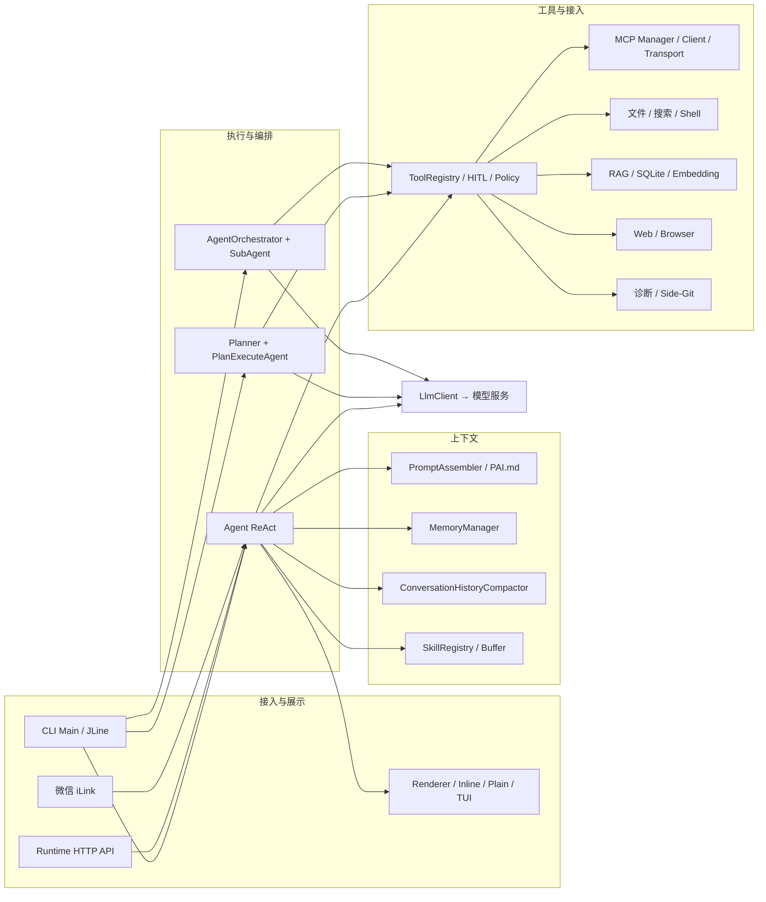
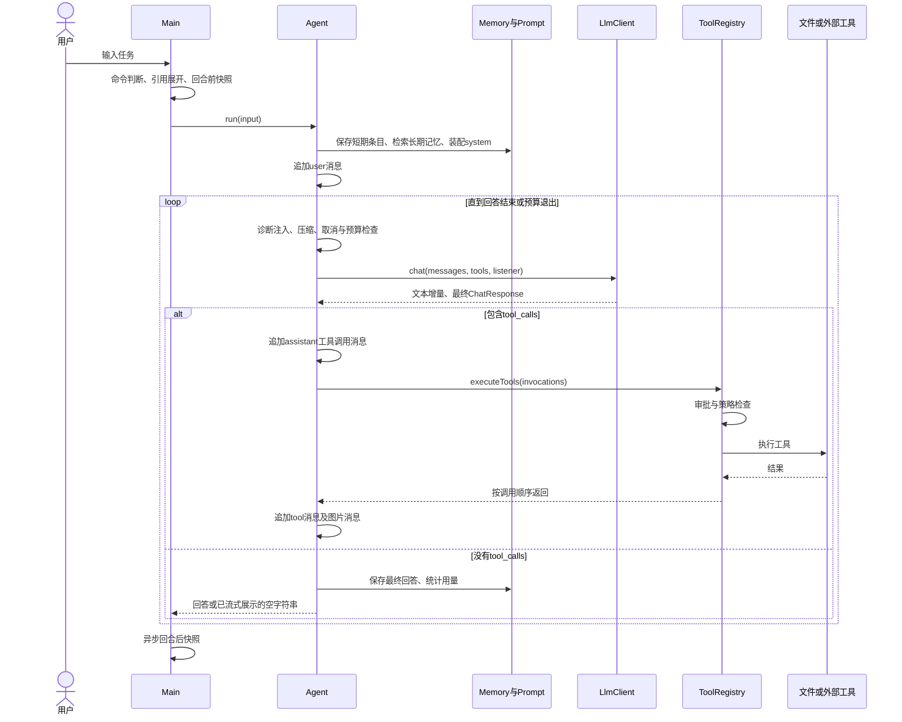
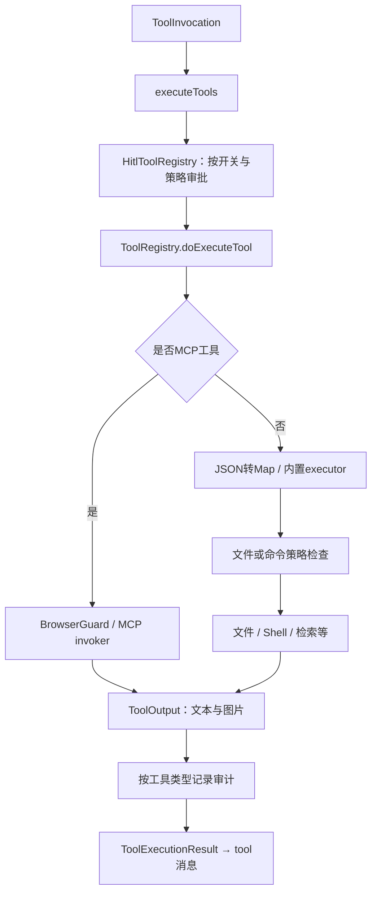
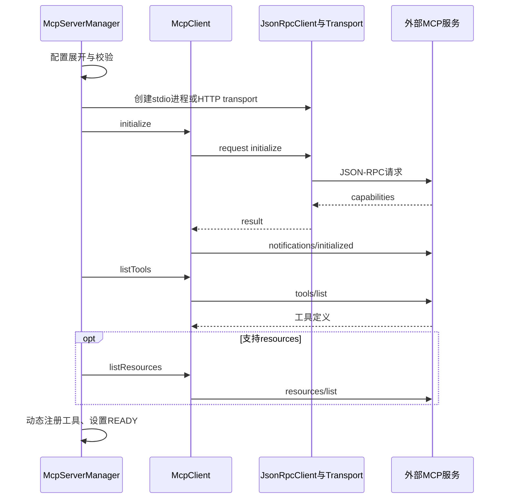
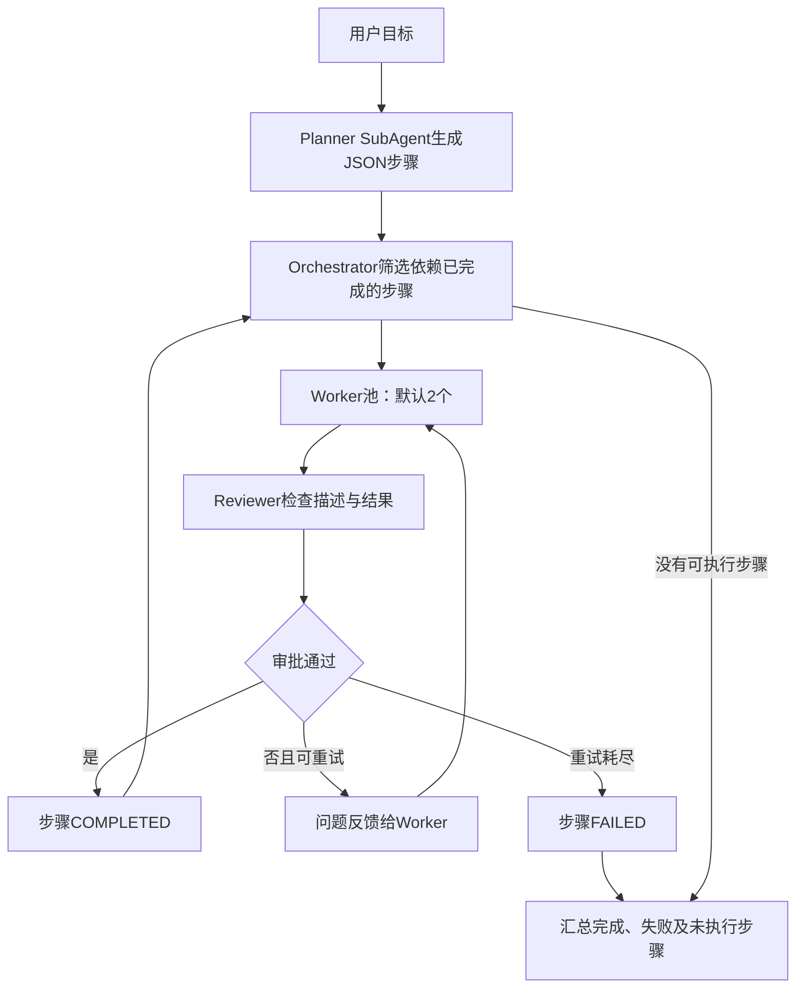
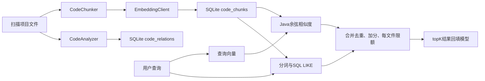

# PaiCLI 源码架构与重写参考手册

> CodeY 参考快照：2026-10-11 从本机 PaiCLI 分析文档复制。本文描述 PaiCLI 的实现，不代表 CodeY 当前能力；CodeY 目标设计见 [architecture.md](../architecture.md)。源码导航沿用分析时的本机绝对路径，在 GitHub 上不具备可移植性。源项目的本地改动与后续变更可能使行号发生变化。

> 分析日期：2026-10-11。目标：理解当前实现，并据此独立实现一个 Java Coding Agent。
>
> 基线：`E:\Desktop\github\paicli` 当前工作区，HEAD 为 `25d2e930d77589b9540cfaf12ac91f834e51f2ca`。工作区已有未提交修改；本文包含当前 Main、LlmClientFactory 和新增 AgnesClient 的实际状态，不能仅凭这个 commit 复原全部分析对象。
>
> 方法：静态阅读主执行链、重点模块、配置与测试源码；代码行为优先于注释和宣传文案。本文没有运行真实模型、MCP 服务、微信通道或完整端到端任务。问题分为“源码可确认的行为”和“需要实验确认的影响”；优化方案均为建议，尚未改入业务代码。没有读取真实 `.env` 内容。

## 目录

1. [整体定位与最重要的结论](#1-整体定位与最重要的结论)
2. [技术栈与工程组织](#2-技术栈与工程组织)
3. [总架构与模块地图](#3-总架构与模块地图)
4. [启动与一次用户请求](#4-启动与一次用户请求)
5. [Agent：循环、消息与退出条件](#5-agent循环消息与退出条件)
6. [LLM：接口、适配与流式解析](#6-llm接口适配与流式解析)
7. [Tool：定义、调度、执行与反馈](#7-tool定义调度执行与反馈)
8. [Memory：短期、长期与项目记忆](#8-memory短期长期与项目记忆)
9. [Context：预算、压缩与信息注入](#9-context预算压缩与信息注入)
10. [Prompt 与 Skill](#10-prompt-与-skill)
11. [MCP：配置、协议、传输与资源](#11-mcp配置协议传输与资源)
12. [Plan 与 Multi-Agent](#12-plan-与-multi-agent)
13. [代码搜索与 RAG](#13-代码搜索与-rag)
14. [审批、策略与审计](#14-审批策略与审计)
15. [诊断、快照与图片](#15-诊断快照与图片)
16. [CLI、渲染与取消](#16-cli渲染与取消)
17. [Runtime API、持久任务与微信](#17-runtime-api持久任务与微信)
18. [数据落盘与配置](#18-数据落盘与配置)
19. [问题清单与优化方向](#19-问题清单与优化方向)
20. [推荐的重写架构与实施顺序](#20-推荐的重写架构与实施顺序)
21. [测试、评测与面试准备](#21-测试评测与面试准备)
22. [源码导航](#22-源码导航)

## 1. 整体定位与最重要的结论

PaiCLI 是一个 **Java 单进程编程助手**：终端接收自然语言，模型决定下一步，Java 执行工具，再把结果交给模型，循环到回答结束。它还包含规划、多角色协作、代码索引、远程接入等扩展。

核心链条可以概括为：

```text
用户输入 → 构造 messages 和 tools → LLM 返回文本或 tool_calls
        → Java 执行工具 → tool 结果回填 messages → 再次调用 LLM
```

理解本仓库时，先记住以下区别：

| 容易混淆的概念 | 当前实现 |
|---|---|
| Agent 与 LLM | Agent 管流程、状态、工具和预算；LLM 负责生成回答或工具调用请求 |
| Tool Calling 与 MCP | 前者是模型提出调用的机制；后者是宿主与外部工具服务通信的协议 |
| conversationHistory 与短期记忆 | 两套并行的数据；真正发给模型的是前者 |
| 长期记忆与 RAG | 前者保存用户事实/偏好到 JSON；后者保存代码块和向量到 SQLite |
| 项目规则与会话记录 | PAI.md 是规则文件；不会自动变成完整会话恢复记录 |
| 流式输出与完整结果 | 流式回调用于展示；当前 Agent 有“已展示则返回空字符串”的 CLI 约定 |
| Plan 与 Team | 前者有 ExecutionPlan/Task；后者有另一套 ExecutionStep 和角色编排 |
| LSP 名称与实际能力 | 当前是 JavaParser 语法诊断，尚未接入完整语言服务器 |
| 持久任务与断点续跑 | 当前重启后重新排队整个 prompt，没有逐工具恢复执行点 |
| 路径限制与进程隔离 | PathGuard 约束文件工具；shell/MCP 子进程仍在宿主机运行 |

**值得学习**：明确的工具反馈循环、多模型适配层、MCP 分层、消息边界压缩、渲染抽象、可测试的协议与策略模块。

**重写时优先改善**：统一结果类型、统一会话状态、读写工具调度、按任务隔离上下文、真实验证闭环。先完成可靠的单 Agent，再扩展多 Agent。

## 2. 技术栈与工程组织

依据 [pom.xml][S01]，主项目是 Maven 单模块，包名根为 `com.paicli`，入口为 `com.paicli.cli.Main`。使用纯 Java 手工装配，无 Spring Boot、Spring AI、LangChain4j 依赖。示例目录中的 Spring Boot 项目不代表主程序架构。

| 技术 | 源码声明版本 | 作用 |
|---|---|---|
| Java | source/target 17 | records、文本块、接口默认方法、并发和进程 API |
| Jackson Databind | 2.16.0 | 请求响应、工具参数、配置与持久化 JSON |
| OkHttp | 4.12.0 | LLM、Embedding、HTTP MCP 和 Web 请求 |
| Logback | 1.5.18 | 日志实现 |
| JLine | 4.0.0，jdk11 classifier | 输入编辑、补全、高亮、历史、终端状态区 |
| Lanterna | 3.1.3 | 可选的旧全屏 TUI |
| SQLite JDBC | 3.49.1.0 | 代码索引、任务、Runtime 事件 |
| JavaParser | 3.28.0 | Java AST 分块、关系提取、语法诊断 |
| JGit | 7.6.0.202603022253-r | 独立 Side-Git 快照 |
| Jieba | 1.0.2 | 中文关键词切分 |
| jsoup | 1.18.1 | HTML 正文抽取 |
| ZXing | 3.5.3 | 微信绑定二维码 |
| JUnit Jupiter / Mockito | 5.10.2 / 5.11.0 | 单元测试和替身 |
| MockWebServer | 4.12.0 | HTTP 协议测试 |
| Maven Shade Plugin | 3.5.1 | 将依赖打入可执行 JAR |

这是当前源码的版本清单，不是依赖升级建议。模型窗口等参数也应理解为代码配置值，不是已向服务商实时验证的能力。

并发主要使用 `ExecutorService`、`Future`、`CompletableFuture`、`BlockingQueue`、`synchronized` 和并发集合。核心执行器创建的是普通线程；不要将其描述为已经基于 Java 21 虚拟线程实现。

## 3. 总架构与模块地图

### 3.1 架构图



图中仅绘出主要依赖，避免把所有连线挤在一起。Plan/SubAgent 也使用提示词、压缩器和 Skill。**CLI 三模式共享对象，不表示 HTTP、微信和后台任务已经采用相同的装配流程**，其差异见第 17 节。

### 3.2 模块职责

| 包 | 主要类 | 职责与边界 |
|---|---|---|
| cli | Main、CliCommandParser | 对象装配、命令分发、任务模式、交互控制 |
| agent | Agent、AgentBudget | 单 Agent 工具循环与退出预算 |
| plan / agent | Planner、ExecutionPlan、PlanExecuteAgent | 生成 DAG、用户审阅、依赖调度 |
| agent | AgentOrchestrator、SubAgent | 规划者、执行者、检查者编排 |
| llm | LlmClient、AbstractOpenAiCompatibleClient | 模型协议、流式解析、provider 差异 |
| memory / context | MemoryManager、ContextProfile | 记忆、token 估算、压缩策略 |
| prompt | PromptRepository、PromptAssembler | 文件化提示词装配 |
| tool | ToolRegistry、CodeSearchEngine | 工具定义、动态注册、执行、代码搜索 |
| mcp | McpServerManager、McpClient | 外部服务生命周期、工具与资源协议 |
| hitl / policy | HitlToolRegistry、PathGuard、AuditLog | 审批、执行限制、审计 |
| skill | SkillRegistry、SkillContextBuffer | 技能索引和正文按需加载 |
| rag | CodeIndex、CodeRetriever、VectorStore | 代码分块、向量与关键词检索 |
| lsp | LspManager | 写入 Java 文件后的语法诊断 |
| snapshot | SnapshotService、SideGitManager | 回合前后快照、文件恢复 |
| web / browser | WebFetcher、BrowserSession | 联网获取、浏览器会话策略 |
| image | ImageReferenceParser、ImageProcessor | 图片引用和消息内容转换 |
| render / tui | Renderer、InlineRenderer、LanternaRenderer | 展示与终端适配 |
| runtime | CancellationContext、DurableTaskManager | 取消信号和持久任务 |
| runtime.api | RuntimeApiServer、RuntimeThreadStore | 本地 HTTP 接入和事件存储 |
| wechat | WechatAgentSession、WechatPolicyDecider | 微信文本入口及独立策略 |

## 4. 启动与一次用户请求

源码入口：[Main][S02]。

### 4.1 CLI 启动顺序

1. 根据启动参数分流：`wechat`、`serve --http` 或普通 CLI。
2. 配置日志，读取 `PaiCliConfig`，由 `LlmClientFactory` 选择可用 provider。
3. 创建 JLine Terminal、HITL handler、`HitlToolRegistry`、浏览器会话、MCP manager。
4. 创建 LineReader，绑定历史、补全、高亮和快捷键；启动 Renderer。
5. 加载 MCP 配置并发启动服务；CLI 默认最多等待 8 秒，剩余初始化继续在后台运行。
6. 将内置 Skill 解压到缓存，扫描用户与项目 Skill，创建共享 SkillContextBuffer。
7. 创建一个持久存在的 ReAct Agent，接入资源索引、Skill、渲染器、写入 diff 观察者。
8. 启动 DurableTaskManager，准备微信控制入口，进入 CLI 输入循环。

Main 是当前组合根，也承载了大量 UI、配置与命令处理逻辑。后续重写可将它收缩为装配和启动入口。

### 4.2 输入处理

`CliCommandParser` 先识别斜杠命令。`/clear`、`/compact`、`/model`、`/save`、`/memory`、`/index`、`/search`、`/mcp` 等直接由 CLI 处理；未知斜杠命令直接提示错误。

普通任务依次经过：

```text
原始输入回显
  → 展开 @server:uri MCP resource
  → 展开本地 @path 文件/目录
  → 根据 /plan、/team 或默认状态选择执行模式
  → runWithCancelSupport
  → SnapshotService.runTurn
  → 实际 Agent.run
  → 展示最终结果
```

默认 ReAct Agent 跨输入保留消息；Plan 和 Team 在任务执行时创建，并复用 ReAct 的 ToolRegistry、MemoryManager。**共享 MemoryManager 不会让它们自动共享完整 conversationHistory**。

### 4.3 ReAct 时序图



## 5. Agent：循环、消息与退出条件

源码：[Agent][S03]、[AgentBudget][S04]、[LlmClient][S05]。

### 5.1 Agent 持有的状态

- `LlmClient`：当前 provider，可以在 CLI 中切换。
- `ToolRegistry`：可执行工具集合。
- `List<Message> conversationHistory`：下一次模型调用的主要输入。
- `MemoryManager`：额外的记忆管理门面。
- `ConversationHistoryCompactor`：实际消息历史的压缩器。
- `Renderer`、Skill、外部上下文 supplier：展示及扩展点。

### 5.2 核心数据结构

| 类型 | 关键字段 | 用途 |
|---|---|---|
| Message | role、content、reasoningContent、toolCalls、toolCallId、contentParts | 一条协议消息 |
| ToolCall | id、function.name、function.arguments | 模型提出的调用；arguments 是 JSON 字符串 |
| Tool | name、description、parameters | 告诉模型工具用途及参数结构 |
| ChatResponse | content、reasoningContent、toolCalls、token 用量 | 一次模型调用的聚合结果 |
| ToolInvocation | id、name、argumentsJson | 工具调度请求 |
| ToolExecutionResult | result、elapsedMillis、timedOut、imageParts | 工具执行后回填的数据 |

标准工具消息结构示意：

```json
[
  {"role":"user","content":"读取 pom.xml 并说明依赖"},
  {"role":"assistant","content":"","tool_calls":[
    {"id":"call_1","type":"function","function":{
      "name":"read_file","arguments":"{\"path\":\"pom.xml\",\"offset\":1,\"limit\":100}"
    }}
  ]},
  {"role":"tool","tool_call_id":"call_1","content":"文件内容..."}
]
```

`tool_call_id` 必须关联前面的调用 ID；调用历史与结果应成组保留。模型输出的参数不会直接变成 Java 代码，而是通过工具注册表路由到预先实现的执行函数。

### 5.3 单轮 run 的实际行为

开始时移除历史图片负载，记录用户短期记忆，处理明确的浏览器登录记忆提示，检索长期记忆并重建首条 system 消息。随后消费已有 Skill buffer，将用户输入转为支持图片的 Message。

每次迭代先注入待处理诊断、尝试历史压缩、检查预算，再调用模型。有工具调用就追加 assistant 消息、执行工具、逐条追加 tool 结果；有图片结果时再构造多模态 user 消息。没有工具调用就保存回答并结束。

这里的 ReAct 是“模型决策—行动—观察”的工程循环；控制流依赖结构化 `tool_calls`，无需自行解析模型思考文本来决定动作。

### 5.4 退出语义

| 条件 | 当前行为 |
|---|---|
| 没有 tool_calls | 返回最终回答；这仅是模型结束信号 |
| 连续 3 轮相同工具签名 | 停滞退出；签名来自工具名与原始参数文本 |
| 达到 50 次迭代 | 硬轮数退出 |
| 达到显式 token budget | 退出；默认 `Integer.MAX_VALUE`，实际不作日常成本上限 |
| 取消 | ReAct 在循环前和模型返回后检查 |
| IOException | 返回错误文字 |

`ContextProfile.agentTokenBudget = window × 0.8` 不是当前 AgentBudget 默认硬限制。两处概念已经发生分离，复现时应直接统一命名和语义。

**任务完成需要外部证据**：没有 tool_calls、没有抛异常、模型说“完成”，均不等同于编译或测试成功。当前主要依赖模型自行选择验证工具，没有统一的任务验收器。

## 6. LLM：接口、适配与流式解析

源码：[LlmClient][S05]、[AbstractOpenAiCompatibleClient][S06]、[LlmClientFactory][S07]。

### 6.1 分层

```text
Agent / Planner / SubAgent
  → LlmClient 接口
  → AbstractOpenAiCompatibleClient 公共协议逻辑
  → GLM / DeepSeek / Step / Kimi / FreeLlmApi / Xfyun / Agnes 差异
  → OkHttp → 外部模型服务
```

公共逻辑负责 HTTP 鉴权、messages 序列化、tool schema、SSE 读取、工具参数分片合并和 token 用量解析。子类覆盖 URL、模型名、上下文窗口和请求定制点。

这体现了接口隔离和模板方法思路；Factory 则根据 provider 名及别名构造具体 client。

### 6.2 SSE 解析

1. 请求始终设置 `stream=true`。
2. 同步执行 OkHttp Call，逐行读取响应。
3. 只处理 `data:` 行，遇到 `[DONE]` 停止。
4. 读取 `usage`，兼容多个缓存 token 字段。
5. 取第一个 choice，解析 delta；必要时取 message。
6. 将 reasoning 和 content 追加到 StringBuilder，并触发 listener。
7. 按 `tool_calls[].index` 合并 ID、函数名和 arguments 分片。
8. 流结束后生成完整 ChatResponse，工具才开始执行。

**流式不等于异步 API**：当前 `chat()` 会阻塞到这一轮响应结束；只是文本在此期间持续回调展示。

### 6.3 provider 差异

| provider | 代码声明窗口 | 需要关注的适配 |
|---|---:|---|
| glm | 200,000 | GLMClient |
| deepseek | 1,000,000 | 保留 reasoning 历史；HTTP/1.1 client |
| step | 256,000 | 请求定制，部分模型与 StepSearch 工具联动 |
| kimi | 256,000 | 保留 reasoning 历史 |
| freellmapi | 128,000 | 可配置 base URL |
| xfyun | 128,000 | `supportsTools=false`；可附带 lora_id |
| agnes | 1,000,000 | 当前工作区新增的 provider |

窗口是 provider 类返回值；用户配置不同模型时，实际窗口未必相同。重写建议按 `provider + model` 维护能力描述，并允许显式覆盖。

### 6.4 失败、超时与待补能力

公共 HTTP client 默认连接/写入 60 秒、读取间隔 300 秒、总调用 600 秒，支持系统属性覆盖。HTTP 非成功状态、显式 error 和完全空内容转为 IOException。

当前公共 client 没有应用层的退避重试、完整结束原因建模、通用流完整性检查，也没有把取消 token 绑定到持有的 OkHttp Call。OkHttp 自身的连接恢复行为不应当作完整业务重试策略。

建议增加 `ChatRequest`、`ModelCapabilities`、`FinishReason`、`Usage` 和可取消调用句柄。限流重试与“工具副作用重试”必须分开处理。

## 7. Tool：定义、调度、执行与反馈

源码：[ToolRegistry][S08]、[ToolOutput][S09]、[HitlToolRegistry][S10]。

### 7.1 注册方式

内置工具通过 `tools.put(name, new Tool(...))` 注册。Tool 同时保存模型可见描述、JSON Schema 和 Java executor。内置 executor 接收 `Map<String,String>`；嵌套对象和数组没有通用的强类型处理。

MCP 动态工具额外记录 `McpToolDescriptor` 与 invoker，参数 JSON 原样交给远端。模型看到的名称为 `mcp__server__tool`。

当前注册了 **16 个内置工具**，不是仅有文档中经常提到的“11 个核心工具”：

| 分类 | 工具 | 行为 |
|---|---|---|
| 文件 | read_file、write_file、list_dir | 读取、整文件写入、列目录 |
| 实时搜索 | glob_files、grep_code | 文件名定位、内容/正则定位 |
| 命令 | execute_command | 在项目目录执行 shell |
| 模板 | create_project | 建立 Java/Python/Node 基础文件 |
| 代码 RAG | search_code | 查询预先建立的索引 |
| 联网 | web_search、web_fetch | 搜索、网页正文获取 |
| 浏览器 | browser_connect、browser_disconnect、browser_status | 会话连接与状态 |
| 记忆 | save_memory | 保存稳定事实 |
| Skill | load_skill | 读取正文并放入缓冲 |
| 快照 | revert_turn | 回滚到指定 pre-turn |

### 7.2 执行链



图表达一般成功路径；策略失败、审批跳过和异常会提前返回文本结果。审计并非覆盖所有工具，也不代表业务执行一定成功。

### 7.3 并行与超时

- 单工具：当前线程直接执行，没有外层 batch 超时。
- 多工具：每批创建普通固定线程池，最多 4 个线程。
- `invokeAll(tasks, 90s)` 对整个批次设超时；排队时间也包含在内。
- Future 按输入顺序取结果，因此回填顺序稳定，但实际副作用发生顺序不保证。
- 最后调用 `shutdownNow()`；中断不等于工具已经停止。

这里实际采用 `ExecutorService.invokeAll`，不要仅根据旧介绍写成工具层使用 CompletableFuture。

### 7.4 文件、命令与反馈

`read_file` 只有传入 offset 或 limit 才进入按行分段路径，最多 2,000 行；省略两个参数时直接 `Files.readString()` 读全文。分段路径本身也先 `readAllLines()`，输出限额不等于读取内存限额。

`write_file` 是整文件覆盖，单次写入最多 5 MiB。写入前读旧内容，写入后通知 diff observer，并触发 Java 诊断。它没有专门的 patch 匹配、文件版本检查或写冲突控制。

`execute_command` 当前固定使用 `bash -c`，默认 60 秒；合并 stderr/stdout，独立线程读取输出，返回文本最多 8,000 字符。Windows 运行依赖 Bash 环境，JDK 本身不包含 Bash。

工具返回值多数是自然语言字符串。命令退出非零、文件写入失败、策略失败和成功，缺少统一机器可读状态。这会影响 Plan/API 对成功的判断。

## 8. Memory：短期、长期与项目记忆

源码：[MemoryManager][S11]、[ConversationMemory][S12]、[LongTermMemory][S13]、[MemoryRetriever][S14]、[ProjectMemoryLoader][S15]。

### 8.1 数据分工

| 数据 | 存放位置 | 谁维护 | 是否直接成为下一次模型请求 |
|---|---|---|---|
| conversationHistory | Agent 内存 ArrayList | Agent | 是 |
| shortTermMemory | LinkedHashMap | MemoryManager | 默认 ReAct 不从它重建 messages |
| longTermMemory | 内存 ConcurrentHashMap + JSON | LongTermMemory | 检索后少量注入 |
| PAI.md 项目规则 | Markdown 文件 | 用户/初始化命令 | 加载后进入 system |
| 代码索引 | SQLite | RAG 模块 | search_code 返回结果后进入 tool 消息 |

### 8.2 短期记忆

MemoryEntry 包含 ID、内容、类型、时间、metadata、估算 token。MemoryManager 在用户输入、最终回答、工具结果时追加条目；工具结果在这里截到 500 字符，完整工具结果另在 conversationHistory。

ConversationMemory 保持插入顺序，超预算时淘汰最旧条目。`compressedSummaries` 实际保存的是被淘汰条目，名称不代表已经生成 LLM 摘要。

ContextCompressor 按每 5 条旧条目生成摘要，然后合并摘要，保留最近 3 **条条目**。变量名为 `retainRecentRounds`，但实现并未按完整 user 回合分组。

### 8.3 长期记忆

默认文件为 `~/.paicli/memory/long_term_memory.json`。每次 store/delete/clear 都将集合重写到文件，启动时读回。

- 支持 project/global metadata；项目标识由规范化项目路径生成。
- 查询只注入当前项目与 global 可见事实。
- store 当前按内容完全相同去重，不是向量相似度去重。
- 主要写入口：`/save`、`save_memory`、特定的明确浏览器登录记忆提示。
- ContextCompressor 中虽然有 `extractFacts()`，主 Agent 路径没有调用它来自动提取事实。

“仅在用户明确要求时保存”主要通过 prompt 和工具描述约束；save_memory executor 自身仅验证 fact 和 scope，没有独立检查请求来源是否包含明确保存意图。

### 8.4 记忆检索

实际 prompt 构建走 `buildContextForQuery()` → `retrieveLongTerm()`，仅从长期记忆检索，避免把当前用户请求重复当作事实注入。

评分由精确包含、分词关键词命中比例、时间衰减组成，再排序取最多 10 条，并按 token 上限拼接。无需 Embedding 服务。

通用 `retrieve()` 可以搜索短期+长期，但与默认 prompt 注入路径不同；复现时不要误接无项目过滤的通用检索接口。

### 8.5 PAI.md

加载顺序：用户目录 PAI.md → 项目根 PAI.md → 项目 `.paicli/PAI.md` → 根目录 PAI.local.md → `.paicli/PAI.local.md`。

各文件按顺序拼接，并非解析同名规则后自动覆盖。支持独立行的 `@relative/path` 导入，递归深度最多 3，总正文约 24,000 字符预算；维护 importStack 防止循环。

ReAct 每次 run 重建 system 时会重新加载项目规则，所以不只是启动时读取一次。项目规则适合放构建命令、目录约定和稳定限制；临时任务和大量执行日志应放会话状态。

## 9. Context：预算、压缩与信息注入

源码：[ContextProfile][S16]、[TokenBudget][S17]、[ConversationHistoryCompactor][S18]、[ContextCompressor][S19]。

### 9.1 上下文由什么组成

```text
system：基础指令 + 模式 + 项目规则 + 相关长期记忆 + 资源索引 + Skill索引
messages：用户输入 + assistant回答/工具请求 + tool结果 + 诊断/图片
tools：工具名称、描述和JSON Schema
response reserve：为本次模型输出预留空间
```

上下文占用是“下一次请求会携带多少内容”；累计 token 用量是“整个任务已调用多少输入输出”。二者不能直接相加或混作一个指标。

### 9.2 ContextProfile 公式

令窗口为 W，最低按 8,000 处理：

```text
summaryReserve = min(20,000, max(1,000, W/4))
buffer         = min(13,000, max(1,000, W/8))
historyTrigger = W - summaryReserve - buffer
shortTermBudget = max(4,000, floor(W × 0.45))
memoryInjection = max(500, min(5,000, W/200))
MCP资源索引     = W >= 32,000
```

例如 W=200,000，historyTrigger=167,000；W=1,000,000，阈值为 967,000。这是本地经验策略，不是模型服务返回的动态阈值。

TokenBudget 的文本估算为中文字符数/1.5 + 其他字符数/4，消息另加约 4 token；图片是启发式估算。这里没有精确 tokenizer。

### 9.3 两套压缩的差别

| 压缩器 | 输入 | 策略 | 对真实请求的作用 |
|---|---|---|---|
| ContextCompressor | MemoryEntry 集合 | 每5条 map摘要，再reduce；保留最近3条 | 默认 ReAct 不直接用这份列表构建请求 |
| ConversationHistoryCompactor | List<Message> | 保留最近3个 user 边界后的消息；旧部分摘要 | 直接减少下一次请求的历史 |

自动压缩触发后，实际历史被重建为：

```text
system
user：[已压缩的历史对话摘要] ...
assistant：已了解之前上下文
保留的近期原始消息
```

手动 `/compact` 保留最近 1 个 user 边界。摘要请求没有工具。旧内容序列化约超过 60,000 字符后停止追加；这是消息级截断检查，并非严格的输入字符硬上限。

### 9.4 当前边界

- 压缩器只数 Message，未把 tools schema 纳入触发计算；状态栏估算却包含 schema，二者口径不同。
- 估算未计入可能被 provider 回传的 reasoningContent。
- user 消息很少而工具结果很长时，保留回合策略可能直接跳过压缩。
- 摘要失败后继续原始调用，缺少确保请求落入窗口的最终裁剪步骤。
- 诊断和工具图片也作为 user 消息注入；“user 边界”不严格等于真实用户回合。
- 压缩后未强制检查 token 是否下降、是否已经低于目标预算。

重写时推荐 `ContextBuilder` 统一计算 system、tools、history、attachments、output reserve，并以真实 turn ID 和工具调用组确定裁剪边界。

## 10. Prompt 与 Skill

源码：[PromptAssembler][S20]、[PromptRepository][S21]、[SkillRegistry][S22]、[SkillContextBuffer][S23]。

### 10.1 Prompt 文件化

PromptRepository 从内置资源加载，再按用户目录、项目目录覆盖相同文件。覆盖单位是文件，不是段落。

PromptAssembler 的顺序为：

```text
base.md
→ personalities/calm.md
→ modes/<当前模式>.md
→ approvals/<模式>.md
→ 当前日期与时区
→ Project Context（PAI.md、相关记忆、外部上下文）
→ Skills索引
→ context/context-management.md
→ handoff.md
```

assembly 会验证 `## Language` 段。对于不支持工具的模型，增加工具不可用说明并移除部分工具段。

审批 prompt 默认 suggest，但执行层 HITL 有独立开关。阅读 prompt 并不足以判定实际审批是否开启。

### 10.2 Skill 的三个层次

1. 内置资源解压到 skills-cache。
2. 用户目录 skills。
3. 项目 `.paicli/skills`。

后加载的同名 Skill 覆盖前者；启停状态由 SkillStateStore 存储。扫描 SKILL.md frontmatter 的 name/description，system 中只放索引，正文通过 load_skill 加载。

索引最多 20 个，描述最多 500 code point，总段约 4,096 字符；正文截到 5×1024 字符。常量和提示里的 bytes 与实际 Java String 长度计量并不完全一致。

### 10.3 正文注入时机的重要问题

当前 `load_skill` 返回“已加载”的提示，正文放入共享 buffer；Agent 的 `prependSkillBodies()` 仅在进入 `run()` 时执行一次。

因此，模型在当前 run 中调用 load_skill 后，下一次 chat 只看到确认文字，**同一个 run 里尚未消费正文**。正文通常等下一次用户输入才进入 messages。Plan 每个任务、SubAgent 每次 execute 也在各自入口消费。

建议让 load_skill 的 tool result 直接返回带来源的正文，或者在每次工具批次完成后、下一次 chat 前注入，并使用按 agent/session 隔离的 context buffer。

## 11. MCP：配置、协议、传输与资源

源码：[McpServerManager][S24]、[McpClient][S25]、[JsonRpcClient][S26]、[StdioTransport][S27]、[StreamableHttpTransport][S28]、[McpConfigLoader][S29]。

### 11.1 MCP 在架构中的位置

```text
LLM产生 mcp__docs__search(args)
 → ToolRegistry找到动态invoker
 → McpClient.callToolOutput("search", args)
 → JsonRpcClient.request("tools/call", params)
 → McpTransport发送
 → 外部MCP server执行
 → MCP content转换为ToolOutput
 → 回填LLM的tool消息
```

LLM 接触的是工具定义和结果；JSON-RPC 请求 ID、MCP session ID、进程生命周期都由 Java 宿主管理。

### 11.2 配置与生命周期

用户级 `~/.paicli/mcp.json` 与项目级 `.paicli/mcp.json` 合并，同名 server 由项目覆盖。配置可选择 command/args/env 或 url/headers，二者择一。

`${VAR}` 在单个 server 启动时展开，顺序为系统环境变量、系统属性、项目 `.env`、用户 `~/.env`；另支持 PROJECT_DIR/HOME。STEP_API_KEY 存在且没有同名配置时，会补充 StepSearch server。

启动阶段最多并发 8 个 server：



初始化协议版本常量为 `2025-03-26`。McpClient 当前存 capabilities，没有完整的协商结果校验流程。启动失败记 ERROR；支持手工 restart/enable/disable，不等于实现了自动恢复 supervisor。

### 11.3 JSON-RPC

JsonRpcClient 用 AtomicLong 生成请求 ID，以 `ConcurrentHashMap<Long, CompletableFuture<JsonNode>>` 保存待响应请求。

发送前登记 Future 和超时任务；收到响应后按 ID 找 Future，并正常/异常完成。无 ID 消息发给 notification listeners。对上层暴露的是同步 `request()`，内部利用 Future 关联请求响应。

典型等待时间：initialize 60 秒、list 30 秒、call/read 60 秒。关闭时关闭 transport 与 scheduler，pending Future 没有被统一立即异常完成；连接断开后的快速失败与清理值得补齐。

### 11.4 两种 transport

| 项目 | stdio | HTTP |
|---|---|---|
| 连接 | ProcessBuilder 子进程 | OkHttp POST |
| 编码 | 每行一条 JSON，UTF-8 | JSON 或 SSE 响应 |
| 接收 | 独立 stdout 线程读取 | send() 内同步读取响应 |
| 日志 | 独立 stderr 线程，保留最近200行 | HTTP状态和异常 |
| 会话 | 进程生命周期 | Mcp-Session-Id header |
| 关闭 | 关stdin→等待→destroy→强制结束 | 尝试DELETE session，短超时 |

HTTP transport 目前先 `responseBody.string()` 获取完整响应，再解析 SSE；不是持续解析长连接上的事件。也没有独立 GET 事件流、断线游标恢复等实现。

### 11.5 tools、resources、prompts

- tools：发现后做 schema 整理，按 server 命名空间注册。
- resources：缓存资源描述；提供 list/read 虚拟工具，并支持 `@server:uri` 展开。
- notifications：工具列表变更时刷新工具；资源列表/内容变更时使对应缓存失效。
- prompts：实现列表展示；不应泛称完整 prompts 协议生命周期已完成。
- listTools/listResources/listPrompts 当前都只请求一页，没有循环消费 nextCursor。
- OAuth、sampling、server 自动重启没有形成完整可用链路。

### 11.6 通知线程隔离：已实现的良好设计

stdio stdout 线程调用 JsonRpcClient 通知监听器，但 [NotificationRouter][S56] 会把 handler 提交到独立的单线程 daemon executor；handler 再同步调用 tools/list 时，stdout 线程仍能读取响应。这避免了“等响应的线程也是唯一读取响应的线程”的等待闭环。

通知单线程调度也保留派发顺序。已有 NotificationRouterTest 覆盖异步派发和顺序行为。重写时可直接借鉴这个边界。

当前仍有生命周期问题：McpServerManager 创建 router 后仅注册为 listener，没有将其纳入 server/client 的关闭流程。router 提供 close()，但生产路径未调用；反复重启并收到通知后，旧通知线程可能残留。建议让 McpClient/McpServer 显式拥有并关闭 router。

## 12. Plan 与 Multi-Agent

源码：[PlanExecuteAgent][S30]、[Planner][S31]、[ExecutionPlan][S32]、[AgentOrchestrator][S33]、[SubAgent][S34]。

### 12.1 Plan-and-Execute

```text
用户目标
  → Planner：简单目标生成最小计划，否则LLM生成JSON
  → 两遍解析：建任务，再建立依赖
  → DFS拓扑排序与环检测
  → 用户审阅：执行 / 补充重规划 / 取消
  → 找出依赖已完成的任务
  → 同批最多4个任务并行
  → 每个任务独立消息列表与最多5次工具循环
  → 更新状态、收集结果
```

任务上下文包括总目标、当前任务、依赖任务结果和相关长期记忆；每个任务不是继承全部 ReAct 对话。

并行输出写入各自 ByteArrayOutputStream，批次结束后按任务顺序输出，避免终端交错。副作用仍发生在同一工作目录。

任务抛异常且计划进度小于 50% 时，调用 replan 并重新进入审阅执行流程。当前没有独立的全局重规划次数/总费用上限。

达到单任务 5 次迭代后会把累计工具结果作为普通返回值；外层只看是否有异常，仍可能 `markCompleted()`。这是“达到上限”和“成功”混为一谈的具体位置。

### 12.2 Multi-Agent



- planner/worker/reviewer 各有独立对话历史，共享 LlmClient 和 ToolRegistry。
- 只有 Worker 向模型提供工具；Planner/Reviewer 主要处理文本。
- 两个 Worker 用 BlockingQueue 池化，避免一个 Worker 被并行复用。
- 多步骤批次为每一步新建 Reviewer；串行路径复用 reviewer 后清空历史。
- 检查不通过最多重试 2 次；JSON 审核结果之外还有文本关键词解析。
- AgentMessage 是进程内消息值对象，不是远程消息队列。

### 12.3 能力边界

Reviewer 默认看任务描述与 Worker 提交的结果，没有直接读取文件/运行测试的工具能力。它能做第二次语言模型审阅，但不等于独立验证代码。

当前也没有 worktree/独立工作目录隔离和合并器；“并行任务逻辑上独立”不保证“文件写入独立”。源码注释里“解决冲突”的职责表述不应当作已经实现文件冲突合并。

Team 自己解析 ExecutionStep，未复用 ExecutionPlan 的完整拓扑检查；环和未知依赖可能最终表现为没有可执行步骤。重写建议统一计划数据结构和校验器。

## 13. 代码搜索与 RAG

源码：[CodeRetriever][S35]、[CodeIndex][S36]、[VectorStore][S37]、[CodeChunker][S38]、[CodeAnalyzer][S39]、[EmbeddingClient][S40]。

### 13.1 两条不同检索路径

| 场景 | 路径 |
|---|---|
| 已知类名、方法名、报错文本 | glob_files → grep_code → read_file |
| 模糊语义，如“哪里做记忆压缩” | search_code → 语义+关键词 → 回到源码验证 |

grep 优先调用本机 ripgrep，缺失时使用 Java 扫描；支持路径、glob、结果数、每文件命中数、上下文行、总字符预算。搜索结果有文件/行号、截断标识和后续读取提示。

RAG 需要先 `/index`。工具不会把整个代码库自动塞入 prompt。

### 13.2 索引流程



Java 文件通过 AST 提取类与方法；解析失败以及其他文本文件走按行分段。类块只取声明附近少量行；方法块可能很长。EmbeddingClient 会将输入截为 2,000 字符，因此长方法尾部可能不进入向量表征。

CodeAnalyzer 提取 extends、implements、imports、contains、calls 等关系，是语法级近似分析，没有完整符号求解，不能当作精确跨模块调用图。

### 13.3 存储与排序

SQLite `code_chunks` 存 project_path、file_path、chunk_type、name、content、embedding_json；`code_relations` 存来源、目标和关系类型。

向量以 JSON 字符串保存。查询取出当前项目向量，在 Java 中逐个算余弦相似度后排序；这是线性扫描，不是 ANN 向量索引。

hybridSearch 先做语义检索，再逐关键词 SQL 查询，按 `filePath#name` 去重，叠加关键词、双重命中、代码类型分；每个文件最多保留 2 个结果。

它是启发式混合排序，没有 BM25、RRF 或模型 reranker。语义检索抛异常时，当前流程会提前结束，关键词路径不会独立兜底。

### 13.4 重建策略

CodeIndex 当前遍历文件、逐块调用 embedding，将全部结果留在内存，最后清空该项目旧索引并重新写入。没有文件哈希增量索引、模型版本元数据或后台文件监听。

对小项目易理解；更大项目优先做批量 embedding、内容哈希、分批事务写入和索引版本切换，再考虑更复杂向量引擎。

## 14. 审批、策略与审计

源码：[HitlToolRegistry][S10]、[ApprovalPolicy][S41]、[PathGuard][S42]、[CommandGuard][S43]、[AuditLog][S44]。

HITL 表示执行前人工参与。HitlToolRegistry 继承 ToolRegistry，在 executeToolOutput 前做审批，支持单次同意、按工具/服务放行、跳过及修改参数。

ApprovalPolicy 将 write_file、execute_command、create_project、revert_turn 和 MCP 工具列入审批范围。**Main 创建 TerminalHitlHandler(false)，当前普通 CLI 默认审批开关为关闭状态**；是否实际启用要看运行状态。

PathGuard 对文件路径规范化，并解析已有路径或最近存在祖先的真实路径，约束文件工具停留在项目根。CommandGuard 对命令字符串做黑名单检查。

两者都是宿主侧策略，不提供 OS 级沙箱。`ProcessBuilder.directory()` 只设置初始目录，不限制进程后续访问范围；外部 MCP server 也拥有其进程/服务自身的权限。

AuditLog 对指定写工具和 MCP 工具记录 JSONL，区分策略阻断、审批阻断、异常和 allow。allow 表示调用被执行，不是命令 exit code 为零的证明。

浏览器另有 BrowserSession 的 isolated/shared 模式，以及 BrowserGuard/SensitivePagePolicy 的页面策略。web_fetch 前有 NetworkPolicy 校验；其限流实现是固定时间窗计数，虽然注释称 token bucket。

重写建议将“是否允许执行”和“执行是否成功”分为两个字段；所有入口使用同一 PolicyEngine，CLI 只负责提供人工审批界面。

### 14.1 Web 与 Browser 的内部协作

Web 链路是 `web_search → SearchProvider` 和 `web_fetch → NetworkPolicy → WebFetcher → HtmlExtractor`。SearchProviderFactory 支持 zhipu、serpapi、searxng；未显式配置 provider 时依次检查相应配置。工具描述里“默认SerpAPI”的文字已经与工厂的自动选择逻辑不完全一致，应以工厂代码为准。

WebFetcher 默认设置约30秒总超时和5 MiB响应读取上限；HtmlExtractor 使用 jsoup 清理并抽取正文。Step特定模型且StepSearch MCP就绪时，工具层先转调用对应MCP工具，结果不可用时再回到内置provider。

浏览器实际操作通过 Chrome DevTools MCP 工具进行。BrowserSession 保存 isolated/shared、连接URL、最近导航URL及Agent打开的标签页集合；BrowserGuard 根据工具类型与页面信息执行策略，操作结果会更新会话记录。连接/断开由 Main 注入的 BrowserConnector 协调MCP配置和重启。

重写时可把浏览器作为一种可选ToolProvider，工具执行仍走统一dispatcher；不要让Agent循环直接知道某个provider或浏览器服务的特殊名称。

## 15. 诊断、快照与图片

### 15.1 写入后诊断

源码：[LspManager][S45]。write_file 完成后对 Java 文件调用 JavaParser，将解析错误存入 pendingByFile；Agent 下一次迭代 flush 并作为 user 消息注入。

当前检测的是语法解析问题，不包含 Maven 依赖解析、类型检查、单测失败和完整 LSP 的 diagnostics 协议。真实编译/测试仍需要 execute_command。

后续可引入 `DiagnosticProvider` 接口：先做 JavaParser → Maven 编译 → JUnit 报告，再按需求接 JDT LS。

### 15.2 Side-Git

源码：[SnapshotService][S46]、[SideGitManager][S47]、[SnapshotConfig][S48]。

- 基于 JGit 使用独立 Git 元数据目录，避免污染用户项目提交历史。
- CLI 用 runTurn 包装任务：执行前同步 pre-turn，finally 中异步 post-turn。
- 恢复 pre-turn 前先记 pre-restore，提供回退机会。
- 默认开启，快照根位于用户 `.paicli/snapshots`，maxSnapshots 默认 50。当前这个值主要限制日志列表查询，createSnapshot 没有据此清理旧提交；不要把它理解为自动只保留50个快照。
- 排除 `.git`、target、node_modules、dist 等；恢复范围取决于快照包含的文件。

快照解决文件状态回退，不恢复 LLM 上下文、远端 MCP 副作用或已发送的网络请求。异步 post-turn 与下一次执行之间也应明确顺序；等待快照写完再开始下轮，是重写时较容易解释的做法。

### 15.3 图片

ImageReferenceParser 处理图片引用，ImageProcessor/ClipboardImage 处理本地图片和剪贴板；LlmClient.ContentPart 表达文本、图片 URL、base64 图片。

ImageProcessor 的当前限制为源文件50 MiB、图片宽高各最多2,000、目标base64约5 MiB，并尝试不同JPEG质量压缩。这里的尺寸限制与模型实际图片计费需要区分。

MCP 图片结果保存在 ToolOutput.imageParts 中，Agent 追加多模态 user 消息。新用户回合开始时会删去历史图片载荷，保留说明，降低上下文体积。因此跨回合再次检查图片时需要重新读取来源。

## 16. CLI、渲染与取消

源码：[RendererFactory][S49]、[CancellationContext][S50]、[Main][S02]。

默认 inline renderer，使用 JLine 状态区和 printAbove 协调输入与输出；plain 用于简单环境；Lanterna 保留独立全屏入口。

Renderer 将文本增量、工具调用、diff、状态条和审批展示与 Agent 分开，但 Agent 仍带有 stream 状态及用户可见字符串逻辑，分离尚不彻底。

runWithCancelSupport 把任务放入单线程 executor，主线程监听 ESC；取消时设置 CancellationToken 并中断 Future。CancellationContext 使用 InheritableThreadLocal，另有全局 CURRENT 兜底。

局限在于：已有线程池线程不会在每次 submit 时重新继承 ThreadLocal；全局 token 在多个会话并行时存在串扰可能。SubAgent 循环也没有和主 Agent 对称的取消检查。

建议显式传递不可变 RunContext，其中包含 sessionId、runId、workspace、deadline 和 CancellationToken；每个阻塞操作接同一个 deadline/取消句柄。

## 17. Runtime API、持久任务与微信

源码：[RuntimeApiServer][S51]、[RuntimeThreadStore][S52]、[DurableTaskManager][S53]、[WechatAgentSession][S54]、[WechatPolicyDecider][S55]。

### 17.1 Runtime API

使用 JDK HttpServer，绑定 `127.0.0.1`，要求 API key。接口有：

| 接口 | 当前行为 |
|---|---|
| POST /v1/threads | 创建 thread 记录 |
| POST /v1/threads/{id}/turns | 记录 started，异步提交 runner，返回202 |
| GET /v1/threads/{id}/events?after=N | 查询已存事件并以 SSE 文本返回，随后结束连接 |

目前 runner 执行结束后才追加一次 message.delta，没有把 LlmClient 的逐 token 回调直接推到 SSE。thread 表示事件归属，但 `runHeadlessTask()` 每次新建 Agent，没有从该 thread 恢复模型消息历史。

headless 也没有复用 CLI 的 MCP/Skill/HITL/快照包装装配链。它直接创建 ToolRegistry 和 Agent。因此不要把 CLI 的所有能力默认归入 API。

### 17.2 持久任务

DurableTaskManager 默认 2 个 worker，用 SQLite 保存 prompt、状态、结果、错误和时间。Java 对共享 connection 的操作加 synchronized；worker 取队列中的任务执行。

```text
ENQUEUED → RUNNING → COMPLETED / FAILED / CANCELED
进程重启：原RUNNING → ENQUEUED → 从prompt重新开始
```

这是任务级重试恢复，不是模型回合或工具事务级断点恢复。工具可能已产生副作用，重启后再次执行需要幂等设计。

此外 tasks 表未记录每个任务的 workspace/provider 快照；当前 runner 用当前工作目录和执行时获取的模型。跨项目运行共享默认数据库时，应重点验证任务是否被错误工作区执行。

### 17.3 微信文本通道

有二维码绑定、账号持久化、iLink 消息循环、文本格式化与 AgentSession。会话有单线程 executor，使用绑定 workspace 和 WechatToolRegistry。

策略层允许只读内置工具，命令必须精确命中白名单，MCP 按工具或 server 白名单；写文件仍受 PathGuard 约束；回滚和浏览器会话切换默认阻断。

WechatAgentSession 显式设置 `setReturnFinalResponseWhenStreamed(true)`，与 Main 的 headless 路径形成鲜明对照。它也未在构造函数里装配完整 MCP/Skill 系统，白名单存在不代表工具服务已连接。

## 18. 数据落盘与配置

`~` 以下都指 Java 的 user.home；运行配置可以覆盖部分路径。下表只列源码默认路径，不含任何真实凭据。

| 数据 | 默认位置/格式 | 注意事项 |
|---|---|---|
| provider配置 | `~/.paicli/config.json` | API key/model/base URL 等 |
| 长期记忆 | `~/.paicli/memory/long_term_memory.json` | 多项目共用文件，靠metadata区分 |
| RAG | `~/.paicli/rag/codebase.db` | 按project_path区分 |
| 持久任务 | `~/.paicli/tasks/tasks.db` | 默认跨CLI实例共享 |
| Runtime事件 | `~/.paicli/runtime/runtime.db` | 路径以源码和配置为准 |
| 输入历史 | `~/.paicli/history/input.history` | 终端输入历史，不是Agent完整消息 |
| 审计 | `~/.paicli/audit/` 的JSONL | 只覆盖指定调用 |
| 会话导出 | `~/.paicli/exports/session-*.md` | 包含system；导出不等于可恢复checkpoint |
| 快照 | `~/.paicli/snapshots/` | 按项目区分Side-Git |
| MCP | 用户/项目级mcp.json | 项目配置覆盖同名server |
| Skill | skills-cache、用户skills、项目skills | 三层合并，skills.json记录启停 |

PaiCliConfig 的 provider 字段优先使用 config.json，再查询环境/相关 .env。MCP、Embedding、日志和 runtime 各有配置读取逻辑，不应假定所有配置共享相同优先级。

ProviderConfig 定义了 temperature、maxTokens，但 LlmClientFactory 没有将这些字段传给公共 client，公共请求构造器也没有统一应用它们。后续应做配置“读入—传递—序列化”的端到端检查。

## 19. 问题清单与优化方向

优先级是针对个人重写项目的建议：P1=优先修复的正确性/隔离问题；P2=可靠性和维护问题；P3=规模化与体验改进。以下均基于静态源码；标注的影响仍需要相应用例验证，不宣称已经线上复现。

### 19.1 P1：执行与状态正确性

| 编号 | 源码证据与触发场景 | 影响 | 建议与验收 |
|---|---|---|---|
| F01 | ToolRegistry.executeTools 对多调用统一并行 | 同文件写入竞争；写文件与测试可能乱序 | ToolSpec增加读写属性和资源键；独立读并行，同资源写串行。验证“write→test”顺序 |
| F02 | load_skill只push；Agent.run入口才drain | 当前run下一轮模型拿不到Skill正文 | 正文作为tool结果返回，或每次chat前消费。测试同一run中load后立即遵循正文 |
| F03 | Agent流式完成默认返回空串；Main.runHeadlessTask未设返回开关 | API事件和后台任务可能存空结果，文字只输出到终端 | RunResult始终含finalAnswer；展示独立。用会触发StreamListener的假client验证 |
| F04 | Plan.executeTask达到5轮返回普通结果；executePlan据“无异常”markCompleted | 工具循环耗尽仍标成功 | 明确BUDGET_EXCEEDED/INCOMPLETE；编译与测试验证通过后才成功 |
| F05 | Agent把IOException转为字符串；API/任务仅捕获异常判失败 | “调用LLM失败”字符串也可能存为completed | 使用RunResult.status/error；API和任务依据状态落库 |
| F06 | Plan并行任务共享MemoryManager；ConversationMemory用非线程安全LinkedHashMap | 并发store/clear/压缩存在竞争，TokenBudget普通int也可能丢更新 | 会话事件单写者或线程安全事务边界；验证并发写与压缩下无丢失 |
| F08 | DurableTaskManager重启RUNNING回ENQUEUED；任务仅存prompt | 重新执行副作用；任务缺少原workspace绑定 | 持久化工作区、模型、执行检查点、工具幂等键；两项目共享队列用例 |

### 19.2 P2：上下文、记忆与协议可靠性

| 编号 | 源码证据与触发场景 | 影响 | 建议与验收 |
|---|---|---|---|
| F07 | NotificationRouter已异步派发，但Manager未把router.close接入生命周期 | 重启且处理过通知的旧执行器可能残留 | server关闭时清理router；反复重启后线程数量稳定 |
| F09 | readFileForTool无范围时全文读取 | 一次大文件读取撑爆下一轮上下文 | 默认分页，字节/字符双限额；分段读取不使用readAllLines |
| F10 | HistoryCompactor按user数量保留；不计tools schema | 单回合长工具链压缩不触发；窗口估算偏低 | 按真实turn与tool组分段；统一ContextBuilder；压缩后再次验证窗口 |
| F11 | summarize从旧消息开头累加，约60k字符后停止 | 被移除区段的后部未进入摘要，可能丢关键约束 | 分层摘要，明确覆盖范围，保留目标/约束/变更/验证四类结构 |
| F12 | 长期记忆按content去重，未含scope/project | A项目存过同一句后，B项目保存被跳过，却检索不到A条目 | 去重键为(scope, project, normalizedContent)，测试两个项目相同事实 |
| F13 | LongTermMemory每实例读入后整文件覆盖，无原子替换/文件锁 | 并发实例可能覆盖彼此更新；中断写入损坏文件 | SQLite事务或统一仓库服务；临时文件原子替换与跨进程锁 |
| F14 | 三角色共享可drain的Skill buffer；共享LspManager pending | 一个角色消费其他角色的Skill/诊断 | 以session/agent/task隔离队列；向目标任务显式投递事件 |
| F15 | CancellationContext全局CURRENT+线程继承；SubAgent缺对称检查 | 线程复用可能带旧token，多会话取消可能串扰 | 显式RunContext传递；取消某任务不影响另一个任务 |
| F16 | LLM Call未绑定取消；shell仅销毁直接Process | 请求或子进程可能继续运行 | 取消注册Call.cancel，按平台管理进程树，等待终止确认 |
| F17 | StreamableHttpTransport先读完整body再parseSse | 长SSE连接可能等到超时，通知缺实时性 | 增量解析；分离请求与长期事件流；关闭/恢复测试 |
| F18 | McpClient各list仅取一页；初始化未完整检查协商结果 | 服务工具不全或协议不匹配被延后发现 | 分页、能力校验、协议版本状态；多页mock server |
| F19 | McpServerManager.start成功后才server.client(client)，异常时仅server.close | initialize/list失败可能遗留新创建的transport | 局部client在失败finally关闭；测试失败后进程已退出 |
| F20 | JsonRpcClient.close未完成pending futures；timeout task不随成功取消 | 关闭不能立即唤醒所有调用；高频请求积累定时任务 | 关闭统一异常完成，取消ScheduledFuture，保留中断标志 |
| F21 | LLM流读取未将finish_reason建模，EOF也可返回已有内容 | 截断输出可能被当作完整回答或工具参数 | 校验结束语义和JSON完整性；半截流注入测试 |

F10 中“按 user 边界保留”本意是保持工具调用与结果配对，设计方向合理；问题在于需要同时覆盖单长回合、合成 user 消息和窗口强约束。

### 19.3 P2/P3：验证、配置与可维护性

| 编号 | 现状 | 改进方向 |
|---|---|---|
| F22 | Reviewer只看文本且无工具 | 让检查者使用只读和测试工具，结果引用具体文件、命令与退出码 |
| F23 | CLI/API/微信/后台各自装配Agent | 建AgentRuntimeFactory和通道策略，减少工具、Skill、快照能力漂移 |
| F24 | API每个turn新Agent，SSE仅返回既有事件 | thread恢复历史；同session串行；事件逐步写入并支持持续订阅 |
| F25 | Main约2900行、ToolRegistry约1400行 | 拆CommandHandler、BuiltinToolProvider、ToolDispatcher和RuntimeFactory |
| F26 | 三套Agent循环重复，退出和记账不一致 | 提取可配置AgentLoop，Plan/Team只负责准备任务和组合结果 |
| F27 | TokenBudget.recordUsage在正常收尾时记录累计值一次 | 调用次数统计与实际LLM次数不一致，摘要/规划等成本漏计。用统一UsageCollector按调用记账 |
| F28 | 默认运行预算近似无限，Team无共享总预算，Plan可递归重规划 | 统一总deadline、费用、轮数和重规划上限，并向子任务分配预算 |
| F29 | 工具业务失败用字符串，内置JSON参数转Map<String,String> | ToolResult增加status/errorCode/retryable；参数用JsonNode或DTO并校验schema |
| F30 | write_file整文件覆盖 | 增加带旧内容哈希校验的apply_patch；原子写入；冲突时重新读取 |
| F31 | RAG全量重建、逐块embedding、Java全量向量扫描 | 哈希增量、批请求、索引版本和模型维度元数据，再评估ANN |
| F32 | hybridSearch先做语义，失败就结束 | 语义/关键词独立执行，任一路失败仍有结果，记录降级原因 |
| F33 | provider窗口固定、temperature/maxTokens未贯通 | ModelCapabilities和统一ChatRequest配置；构造请求断言测试 |
| F34 | 默认HITL关闭，文件guard不约束shell/MCP进程 | 明确默认执行策略；需要隔离时接受控执行环境，不把工作目录当隔离边界 |
| F35 | Maven默认skipTests=true | CI明确-DskipTests=false，并把快速与完整检查用途写清楚 |

另有两个较小但有教学价值的点：ProjectMemoryLoader 使用 normalize/startsWith 检查导入路径，未像 PathGuard 一样解析真实路径；LspManager 的 JavaParser 配置没有像 RAG 分块器那样显式设置 Java 17 语法级别。前者适合补符号链接用例，后者适合用 record/text block 测试验证一致性。

### 19.4 先做哪些优化

个人项目优先顺序建议：**F03/F05统一结果 → F02 Skill即时可见 → F01工具读写顺序 → F09/F10上下文边界 → F19 MCP初始化资源清理 → F12记忆作用域 → F22真实验证**。

这几项都能写出明确的“旧行为、触发输入、改进实现、测试证据”，比单纯继续增加工具数量更容易展示工程能力。

### 19.5 重点问题的源码定位

| 编号 | 直接定位 |
|---|---|
| F01 | [ToolRegistry:1196](<E:/Desktop/github/paicli/src/main/java/com/paicli/tool/ToolRegistry.java:1196>) |
| F02 | [ToolRegistry:669](<E:/Desktop/github/paicli/src/main/java/com/paicli/tool/ToolRegistry.java:669>) |
| F02 | [Agent:140](<E:/Desktop/github/paicli/src/main/java/com/paicli/agent/Agent.java:140>) |
| F03 | [Agent:247](<E:/Desktop/github/paicli/src/main/java/com/paicli/agent/Agent.java:247>) |
| F03 | [Main:911](<E:/Desktop/github/paicli/src/main/java/com/paicli/cli/Main.java:911>) |
| F04 | [PlanExecuteAgent:552](<E:/Desktop/github/paicli/src/main/java/com/paicli/agent/PlanExecuteAgent.java:552>) |
| F05 | [RuntimeApiServer:102](<E:/Desktop/github/paicli/src/main/java/com/paicli/runtime/api/RuntimeApiServer.java:102>) |
| F07 | [McpServerManager:455](<E:/Desktop/github/paicli/src/main/java/com/paicli/mcp/McpServerManager.java:455>) |
| F07 | [NotificationRouter:66](<E:/Desktop/github/paicli/src/main/java/com/paicli/mcp/notifications/NotificationRouter.java:66>) |
| F09 | [ToolRegistry:350](<E:/Desktop/github/paicli/src/main/java/com/paicli/tool/ToolRegistry.java:350>) |
| F10 | [ConversationHistoryCompactor:105](<E:/Desktop/github/paicli/src/main/java/com/paicli/memory/ConversationHistoryCompactor.java:105>) |
| F12 | [LongTermMemory:59](<E:/Desktop/github/paicli/src/main/java/com/paicli/memory/LongTermMemory.java:59>) |
| F19 | [McpServerManager:401](<E:/Desktop/github/paicli/src/main/java/com/paicli/mcp/McpServerManager.java:401>) |

## 20. 推荐的重写架构与实施顺序

### 20.1 建议的核心接口

以下是新项目的设计草图，不代表 PaiCLI 已存在这些类型：

```java
interface ModelClient {
    ModelResponse chat(ChatRequest request, RunContext context,
                       ModelEventSink events);
}

interface AgentLoop {
    RunResult run(Session session, UserInput input,
                  RunContext context, AgentEventSink events);
}

interface Tool {
    ToolSpec spec(); // schema、读写属性、是否幂等、超时等
    ToolResult execute(JsonNode arguments, ToolContext context);
}

interface ContextBuilder {
    PreparedContext prepare(Session session, ModelCapabilities capabilities,
                            List<ToolSpec> tools);
}

interface SessionStore {
    Session load(String sessionId);
    void append(String sessionId, SessionEvent event);
}
```

这些接口只定义职责边界，初期可用少量类实现，无需立即拆成 Maven 多模块。

### 20.2 推荐依赖方向

```text
CLI / HTTP / 其他通道
  → AgentRuntime（会话、取消、预算、事件）
    → AgentLoop（统一模型—工具循环）
      → ContextBuilder / ModelClient / ToolDispatcher
        → 本地工具或MCP适配器

Plan / Team
  → 调用同一个AgentRuntime或AgentLoop
  → 不复制模型请求与工具回填循环
```

Session 的事件日志作为完整事实来源；prompt 是按预算生成的投影。长期事实仓库与代码索引独立存在。Renderer 只订阅事件，不影响 RunResult 中的最终结果。

### 20.3 分阶段实现与验收

| 阶段 | 实现范围 | 验收 |
|---|---|---|
| A：模型协议 | 一个provider、Message、ChatResponse、SSE | 文本和分片tool call组装正确 |
| B：最小Agent | read_file、grep、write/patch、run_command、循环 | 在小仓库完成一次修复并运行测试 |
| C：可靠执行 | ToolResult、读写调度、超时、取消、预算 | 同资源写入不竞争，取消后任务和进程退出 |
| D：上下文 | Session、ContextBuilder、PAI规则、压缩 | 单次长任务和多轮任务都可守住预算 |
| E：长期记忆 | project/global、检索、删除、原子持久化 | 跨进程恢复且跨项目不混淆 |
| F：MCP | 先stdio，再HTTP、工具发现、通知 | 自建确定性MCP测试服务通过契约测试 |
| G：Java专项 | 编译结果、JUnit报告、相关用例运行 | 回答包含可复核测试证据 |
| H：扩展 | Skill、快照、RAG、Plan、Team、HTTP | 每个扩展有独立收益和失败案例 |

每阶段保留一个可运行 tag 和演示任务。先画数据结构和请求流程，再写实现；完成后对照 PaiCLI 检查自己处理了哪些边界。

### 20.4 适合个人版本的取舍

- 首版只支持一个模型，保留 ModelClient 接口即可。
- CLI 先用朴素输入输出，完整 TUI 后置。
- 搜索先用 ripgrep/Java 文件扫描，RAG 等有评测需求再加入。
- 先实现可靠单 Agent；多角色需要证明完成率或验证能力提升。
- 先实现轻量 SessionStore 和结构化工具结果，再做断点恢复。
- HTTP、JSON、SQLite、MCP SDK 等基础设施可用成熟库；自己实现关键执行语义。

## 21. 测试、评测与面试准备

### 21.1 仓库已有测试导航

| 测试类/目录 | 可借鉴内容 |
|---|---|
| AgentBudgetTest | 轮数、token、停滞退出 |
| AgentStreamRendererTest / AgentClearHistoryTest | 流式与清历史行为 |
| ConversationHistoryCompactorTest | 触发阈值、保留消息 |
| MemoryManagerTest / LongTermMemoryTest | 记忆存取和作用域 |
| ToolRegistryTest / CodeSearchGoldenSetTest | 工具、代码搜索与确定性结果 |
| McpClientTest / JsonRpcClientTest | 请求响应关联、协议行为 |
| StdioTransportTest / StreamableHttpTransportTest | 传输层约束 |
| PlannerTest / ExecutionPlanTest / AgentOrchestratorTest | 计划解析与编排 |
| RuntimeApiServerTest / DurableTaskManagerTest | API和持久任务 |
| PathGuardTest / HitlToolRegistryTest | 路径边界与审批 |

测试文件存在不代表覆盖了本文列出的全部问题；优先增加能复现真实缺陷的用例。

### 21.2 后续修改时的命令

在项目根执行：

```powershell
# 常规快速回归，profile会显式开启测试
mvn test -Pquick

# 核心上下文/记忆修改后的针对性测试
mvn test '-DskipTests=false' '-Dtest=AgentBudgetTest,ConversationHistoryCompactorTest,MemoryManagerTest,LongTermMemoryTest'

# 工具或MCP行为修改后的针对性测试
mvn test '-DskipTests=false' '-Dtest=ToolRegistryTest,McpClientTest,JsonRpcClientTest'

# 全量回归
mvn test '-DskipTests=false'
```

普通 `mvn test` 或 `mvn package` 因 POM 的 skipTests 默认值可能跳过测试。本文为文档分析任务，未把这些命令的通过状态作为已完成事实。

### 21.3 推荐的最小评测集

准备固定初始状态的小仓库，至少覆盖以下任务：定位实现、修复单测、补边界测试、跨文件改名、错误工具参数、长日志、取消长命令、MCP异常、长上下文、两个项目相同记忆。

每条记录：模型和版本、prompt版本、初始commit、测试命令、成功判据、工具轨迹、输入/输出token、耗时、变更文件、失败类别。失败类别区分模型决策、工具执行、上下文丢失和验证缺失。

对比策略时固定模型、仓库状态、任务预算与验收器；对有随机性的任务重复运行并报告样本数。只报告实际测得的结果。

### 21.4 面试中应能讲清楚的问题

1. 一次tool call怎样与tool result配对，为什么不能随意裁剪历史？
2. 当前上下文占用和累计token费用为什么不同？
3. 读工具并行、写工具串行的判断依据是什么？
4. 流式输出中断后，为什么不应直接执行半截工具参数？
5. MCP与模型tool calling之间是谁做转换？
6. 为什么记忆、会话、代码RAG要分开存？
7. 从任务重新执行与从工具检查点恢复有什么区别？
8. 用户取消后，如何确认HTTP请求和子进程都已结束？
9. Reviewer通过为什么仍需要真实测试结果？
10. 你基于PaiCLI独立改进了哪项行为，有什么复现和测量证据？

简历中可准确表述为“参考 PaiCLI 实现/基于 PaiCLI 二次开发”，再列出本人设计、重构与验证的部分。是否使用框架并不决定深度，能解释并验证执行语义才是关键。

### 文档验证范围

已检查源码引用目标存在、重点问题定位、目录锚点和Markdown代码块配对；6张Mermaid图保留可编辑源码。尝试本地渲染时缺少mmdc，因此图形仅做结构与语法人工检查，未声称生成SVG/PNG。本文没有修改业务代码，也未运行Maven回归或真实外部服务。

推荐阅读顺序：第4～7节先跑通Agent与工具；第8～10节理解记忆和上下文；第11节学习MCP；最后按第19～21节选择改进项并逐步实现。

## 22. 源码导航

以下链接指向本次分析的本机工作区；迁移到其他机器时，请按包路径定位。为避免源码增删导致行号失效，主要使用类链接，并在问题清单中注明方法名。

| 编号 | 源码 | 阅读重点 |
|---|---|---|
| S01 | [pom.xml][S01] | Maven依赖与构建 |
| S02 | [Main.java][S02] | 启动、命令、通道装配 |
| S03 | [Agent.java][S03] | 主Agent循环 |
| S04 | [AgentBudget.java][S04] | 退出预算 |
| S05 | [LlmClient.java][S05] | 模型接口与消息类型 |
| S06 | [AbstractOpenAiCompatibleClient.java][S06] | HTTP与SSE实现 |
| S07 | [LlmClientFactory.java][S07] | provider选择 |
| S08 | [ToolRegistry.java][S08] | 工具注册和执行 |
| S09 | [ToolOutput.java][S09] | 工具输出 |
| S10 | [HitlToolRegistry.java][S10] | 执行前审批 |
| S11 | [MemoryManager.java][S11] | 记忆门面 |
| S12 | [ConversationMemory.java][S12] | 短期条目 |
| S13 | [LongTermMemory.java][S13] | 长期记忆持久化 |
| S14 | [MemoryRetriever.java][S14] | 记忆检索 |
| S15 | [ProjectMemoryLoader.java][S15] | PAI项目规则 |
| S16 | [ContextProfile.java][S16] | 上下文策略 |
| S17 | [TokenBudget.java][S17] | token估算与统计 |
| S18 | [ConversationHistoryCompactor.java][S18] | 真实消息历史压缩 |
| S19 | [ContextCompressor.java][S19] | 短期记忆压缩 |
| S20 | [PromptAssembler.java][S20] | 提示词组装 |
| S21 | [PromptRepository.java][S21] | 提示词覆盖加载 |
| S22 | [SkillRegistry.java][S22] | Skill发现与覆盖 |
| S23 | [SkillContextBuffer.java][S23] | Skill正文缓冲 |
| S24 | [McpServerManager.java][S24] | MCP生命周期 |
| S25 | [McpClient.java][S25] | MCP协议调用 |
| S26 | [JsonRpcClient.java][S26] | JSON-RPC请求关联 |
| S27 | [StdioTransport.java][S27] | stdio传输 |
| S28 | [StreamableHttpTransport.java][S28] | HTTP传输 |
| S29 | [McpConfigLoader.java][S29] | MCP配置 |
| S30 | [PlanExecuteAgent.java][S30] | 计划执行 |
| S31 | [Planner.java][S31] | 计划生成与解析 |
| S32 | [ExecutionPlan.java][S32] | 任务DAG |
| S33 | [AgentOrchestrator.java][S33] | 多角色编排 |
| S34 | [SubAgent.java][S34] | 角色Agent |
| S35 | [CodeRetriever.java][S35] | 代码混合检索 |
| S36 | [CodeIndex.java][S36] | 索引构建 |
| S37 | [VectorStore.java][S37] | 向量与关系存储 |
| S38 | [CodeChunker.java][S38] | 代码分块 |
| S39 | [CodeAnalyzer.java][S39] | 语法关系提取 |
| S40 | [EmbeddingClient.java][S40] | Embedding调用 |
| S41 | [ApprovalPolicy.java][S41] | 审批工具分类 |
| S42 | [PathGuard.java][S42] | 文件路径限制 |
| S43 | [CommandGuard.java][S43] | 命令检查 |
| S44 | [AuditLog.java][S44] | 执行审计 |
| S45 | [LspManager.java][S45] | 编辑后诊断 |
| S46 | [SnapshotService.java][S46] | 回合快照流程 |
| S47 | [SideGitManager.java][S47] | 快照Git实现 |
| S48 | [SnapshotConfig.java][S48] | 快照配置 |
| S49 | [RendererFactory.java][S49] | 渲染器选择 |
| S50 | [CancellationContext.java][S50] | 取消上下文 |
| S51 | [RuntimeApiServer.java][S51] | HTTP入口 |
| S52 | [RuntimeThreadStore.java][S52] | 事件持久化 |
| S53 | [DurableTaskManager.java][S53] | 持久任务 |
| S54 | [WechatAgentSession.java][S54] | 微信Agent装配 |
| S55 | [WechatPolicyDecider.java][S55] | 微信工具策略 |
| S56 | [NotificationRouter.java][S56] | 异步通知路由与关闭 |

[S01]: <E:/Desktop/github/paicli/pom.xml>
[S02]: <E:/Desktop/github/paicli/src/main/java/com/paicli/cli/Main.java>
[S03]: <E:/Desktop/github/paicli/src/main/java/com/paicli/agent/Agent.java>
[S04]: <E:/Desktop/github/paicli/src/main/java/com/paicli/agent/AgentBudget.java>
[S05]: <E:/Desktop/github/paicli/src/main/java/com/paicli/llm/LlmClient.java>
[S06]: <E:/Desktop/github/paicli/src/main/java/com/paicli/llm/AbstractOpenAiCompatibleClient.java>
[S07]: <E:/Desktop/github/paicli/src/main/java/com/paicli/llm/LlmClientFactory.java>
[S08]: <E:/Desktop/github/paicli/src/main/java/com/paicli/tool/ToolRegistry.java>
[S09]: <E:/Desktop/github/paicli/src/main/java/com/paicli/tool/ToolOutput.java>
[S10]: <E:/Desktop/github/paicli/src/main/java/com/paicli/hitl/HitlToolRegistry.java>
[S11]: <E:/Desktop/github/paicli/src/main/java/com/paicli/memory/MemoryManager.java>
[S12]: <E:/Desktop/github/paicli/src/main/java/com/paicli/memory/ConversationMemory.java>
[S13]: <E:/Desktop/github/paicli/src/main/java/com/paicli/memory/LongTermMemory.java>
[S14]: <E:/Desktop/github/paicli/src/main/java/com/paicli/memory/MemoryRetriever.java>
[S15]: <E:/Desktop/github/paicli/src/main/java/com/paicli/prompt/ProjectMemoryLoader.java>
[S16]: <E:/Desktop/github/paicli/src/main/java/com/paicli/context/ContextProfile.java>
[S17]: <E:/Desktop/github/paicli/src/main/java/com/paicli/memory/TokenBudget.java>
[S18]: <E:/Desktop/github/paicli/src/main/java/com/paicli/memory/ConversationHistoryCompactor.java>
[S19]: <E:/Desktop/github/paicli/src/main/java/com/paicli/memory/ContextCompressor.java>
[S20]: <E:/Desktop/github/paicli/src/main/java/com/paicli/prompt/PromptAssembler.java>
[S21]: <E:/Desktop/github/paicli/src/main/java/com/paicli/prompt/PromptRepository.java>
[S22]: <E:/Desktop/github/paicli/src/main/java/com/paicli/skill/SkillRegistry.java>
[S23]: <E:/Desktop/github/paicli/src/main/java/com/paicli/skill/SkillContextBuffer.java>
[S24]: <E:/Desktop/github/paicli/src/main/java/com/paicli/mcp/McpServerManager.java>
[S25]: <E:/Desktop/github/paicli/src/main/java/com/paicli/mcp/McpClient.java>
[S26]: <E:/Desktop/github/paicli/src/main/java/com/paicli/mcp/jsonrpc/JsonRpcClient.java>
[S27]: <E:/Desktop/github/paicli/src/main/java/com/paicli/mcp/transport/StdioTransport.java>
[S28]: <E:/Desktop/github/paicli/src/main/java/com/paicli/mcp/transport/StreamableHttpTransport.java>
[S29]: <E:/Desktop/github/paicli/src/main/java/com/paicli/mcp/config/McpConfigLoader.java>
[S30]: <E:/Desktop/github/paicli/src/main/java/com/paicli/agent/PlanExecuteAgent.java>
[S31]: <E:/Desktop/github/paicli/src/main/java/com/paicli/plan/Planner.java>
[S32]: <E:/Desktop/github/paicli/src/main/java/com/paicli/plan/ExecutionPlan.java>
[S33]: <E:/Desktop/github/paicli/src/main/java/com/paicli/agent/AgentOrchestrator.java>
[S34]: <E:/Desktop/github/paicli/src/main/java/com/paicli/agent/SubAgent.java>
[S35]: <E:/Desktop/github/paicli/src/main/java/com/paicli/rag/CodeRetriever.java>
[S36]: <E:/Desktop/github/paicli/src/main/java/com/paicli/rag/CodeIndex.java>
[S37]: <E:/Desktop/github/paicli/src/main/java/com/paicli/rag/VectorStore.java>
[S38]: <E:/Desktop/github/paicli/src/main/java/com/paicli/rag/CodeChunker.java>
[S39]: <E:/Desktop/github/paicli/src/main/java/com/paicli/rag/CodeAnalyzer.java>
[S40]: <E:/Desktop/github/paicli/src/main/java/com/paicli/rag/EmbeddingClient.java>
[S41]: <E:/Desktop/github/paicli/src/main/java/com/paicli/hitl/ApprovalPolicy.java>
[S42]: <E:/Desktop/github/paicli/src/main/java/com/paicli/policy/PathGuard.java>
[S43]: <E:/Desktop/github/paicli/src/main/java/com/paicli/policy/CommandGuard.java>
[S44]: <E:/Desktop/github/paicli/src/main/java/com/paicli/policy/AuditLog.java>
[S45]: <E:/Desktop/github/paicli/src/main/java/com/paicli/lsp/LspManager.java>
[S46]: <E:/Desktop/github/paicli/src/main/java/com/paicli/snapshot/SnapshotService.java>
[S47]: <E:/Desktop/github/paicli/src/main/java/com/paicli/snapshot/SideGitManager.java>
[S48]: <E:/Desktop/github/paicli/src/main/java/com/paicli/snapshot/SnapshotConfig.java>
[S49]: <E:/Desktop/github/paicli/src/main/java/com/paicli/render/RendererFactory.java>
[S50]: <E:/Desktop/github/paicli/src/main/java/com/paicli/runtime/CancellationContext.java>
[S51]: <E:/Desktop/github/paicli/src/main/java/com/paicli/runtime/api/RuntimeApiServer.java>
[S52]: <E:/Desktop/github/paicli/src/main/java/com/paicli/runtime/api/RuntimeThreadStore.java>
[S53]: <E:/Desktop/github/paicli/src/main/java/com/paicli/runtime/task/DurableTaskManager.java>
[S54]: <E:/Desktop/github/paicli/src/main/java/com/paicli/wechat/WechatAgentSession.java>
[S55]: <E:/Desktop/github/paicli/src/main/java/com/paicli/wechat/WechatPolicyDecider.java>


[S56]: <E:/Desktop/github/paicli/src/main/java/com/paicli/mcp/notifications/NotificationRouter.java>
